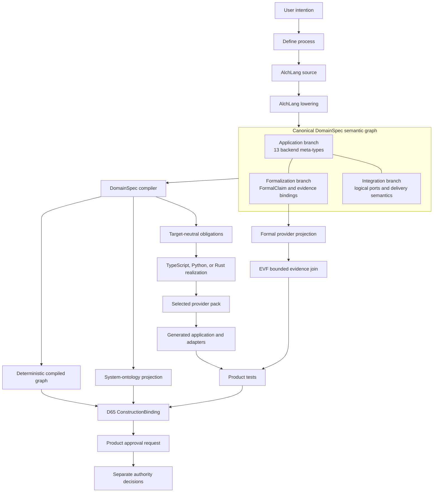

# From AlchLang to a Running Application

Status: **user-facing architecture and target-authoring guide**

This guide explains how AlchLang, DomainSpec, FormalClaim, integration
declarations, runtime/provider profiles, formal evidence, and the CAV2-D65
construction lifecycle fit together.

Some of the concise AlchLang forms in this guide are **target syntax**. They
describe the intended product contract; the current parser does not accept all
of them yet. The [implementation status](#current-and-target-behavior) section
identifies the current boundaries and points to the existing JSON contracts.

This guide has `authority_effect: none`. It does not admit a language profile,
approve a product candidate, select a production provider, or authorize
publication, release, or deployment.

## The complete idea

The product is not one large programming language. It is a sequence of bounded
languages and contracts with different owners:



The short version is:

> AlchLang authors. DomainSpec models and compiles. FormalClaim states. Rule
> applies. Provider packs realize. Runtime executes. EVF evaluates evidence.
> D65 governs the construction lifecycle.

## Five concerns that must remain separate

| Concern | User question | Owner |
| --- | --- | --- |
| Domain meaning | What concepts and behavior exist? | Domain project through AlchLang and DomainSpec source |
| Formal meaning | What exact proposition is being asserted? | FormalClaim and its definition owner |
| Integration intent | What must be stored, published, consumed, or called? | Integration branch of the semantic graph |
| Runtime realization | Which language, provider pack, and configuration slots realize that intent? | Runtime/provider profile |
| Evidence and authority | What was observed, and who may approve the next effect? | Providers, EVF, product-test owner, and D65 owners |

Keeping these concerns separate lets a team change PostgreSQL to another store
without changing what `Order` means, or evaluate a FormalClaim with Lean instead
of an SMT solver without creating another business truth.

## 1. Define the domain

The Define process begins when a user wants to start or materially reshape a
product capability. It obtains the language needed to write a coherent model:

- the domain and its boundary;
- important concepts and identities;
- operations and observable outcomes;
- business rules and formal claims;
- external systems and integration requirements;
- constraints, owners, and claim ceilings.

Define produces candidate meaning. It does not approve implementation or choose
an operational provider.

## 2. Author the domain in AlchLang

AlchLang is the human-facing authoring language. DomainSpec remains the owner of
the canonical typed graph and compilation semantics.

The following is **target AlchLang syntax**:

```alch
domain commerce "Commerce order management"

value-object Money:
  amount UInt64
  currency Currency

enum OrderStatus:
  draft
  submitted
  cancelled

entity Order:
  id OrderId
  status OrderStatus
  total Money

event OrderSubmitted:
  orderId -> Order.id
  total Money

operation SubmitOrder:
  input SubmitOrderRequest
  output OrderSummary
  produces OrderSubmitted

query FindOrder:
  input OrderId
  output optional<Order>
```

These declarations describe domain roles. They do not select a database,
message broker, HTTP library, process manager, or deployment target.

## 3. Bind behavior to FormalClaims

A FormalClaim is not executable application code. It is one exact,
provider-independent proposition bound to:

- accepted business meaning;
- an explicit definition closure;
- a formal signature;
- one canonical proposition;
- a formal-language profile;
- claim-owned assumptions;
- a claim ceiling; and
- an exact identity algorithm and digest.

A Rule gives that proposition an application role.

```alch
formal-claim OrderCanBeSubmittedClaim:
  profile fol-core/1-candidate

  sort Order
  predicate HasLine(Order)
  predicate HasNonNegativeTotal(Order)

  proposition forall order: Order:
    HasLine(order) and HasNonNegativeTotal(order)

  ceiling "Submission eligibility only; not persistence or delivery."

rule OrderCanBeSubmitted:
  meaning "An order requires a line and a non-negative total."
  claim OrderCanBeSubmittedClaim

OrderCanBeSubmitted --enforces--> SubmitOrder
```

The intended graph is:

```text
OrderCanBeSubmitted: Rule
  --condition-bound-to--> OrderCanBeSubmittedClaim: FormalClaim
  --enforces-----------> SubmitOrder: Operation
```

The ownership boundary is important:

| Concept | Responsibility |
| --- | --- |
| FormalClaim | Own the exact proposition and its semantic identity |
| Rule | Name the boolean application gate and connect it to behavior |
| Policy | Select declared behavior using declared Rules |
| State Machine | Reference declared Rules as transition guards |
| Executable projection | Realize a bounded subset of the claim for a selected target |
| Provider evidence | Record what one exact evaluator observed |

Policy cases, state-machine guards, and runtime checks must not introduce
independent formulas that compete with the FormalClaim.

## 4. Author integration intent as graph paths

Integration declarations say what the application needs while remaining
provider-neutral. They belong to a typed integration branch connected to the
application graph; they are not additional backend domain meta-types.

### Subscription

```alch
subscription StartBilling:
  topic OrderEvents
    -> message OrderSubmittedMessage
    -> map MessageToAuthorizePayment
    -> operation AuthorizePayment

  acknowledge after application-commit
  deduplicate by messageId
  failure -> dead-letter OrderEventsDeadLetter
```

This chain means:

```text
OrderEvents
  --delivers---------> OrderSubmittedMessage
  --transformed-by---> MessageToAuthorizePayment
  --invokes----------> AuthorizePayment
```

The compiler must check that:

- the topic accepts the selected message contract;
- the mapper accepts that message;
- the mapper output matches the Operation request;
- acknowledgement occurs at the declared boundary;
- queue, topic, stream, and dead-letter semantics remain distinct; and
- no provider is inferred from the declaration.

### Publication

```alch
publication PublishOrderSubmitted:
  event OrderSubmitted
    -> map OrderSubmittedToMessage
    -> message OrderSubmittedMessage
    -> topic OrderEvents
```

The Event remains a domain fact. The Message is a transport contract. The
mapper connects them without collapsing their identities.

### Inbound endpoint

```alch
inbound-endpoint SubmitOrderHttp:
  HTTP POST "/orders"
    -> request SubmitOrderRequest
    -> operation SubmitOrder
    -> response OrderSummary
```

An inbound endpoint invokes an Operation. It does not own the Operation's
business logic.

### Outbound API

```alch
outbound-call AuthorizePaymentCall:
  operation AuthorizePayment
    -> request PaymentAuthorizationRequest
    -> external-api PaymentGateway
    -> response PaymentAuthorization
```

The declaration identifies the logical external boundary. Timeout, retry,
authentication, and provider-specific failures remain explicit profile or
integration-policy concerns.

### Persistence

```alch
persistence Orders:
  stores Order
  serves FindOrder
  accepts-writes-from SubmitOrder
  transaction local
```

This states the required persistence capability. It does not say PostgreSQL,
table, index, client library, or connection string.

## 5. Select runtime and provider profiles

The runtime profile chooses how one provider-neutral graph will be realized.
It must be a separate top-level entry point so that domain meaning does not
change when the runtime changes.

```alch
runtime-profile CommerceProduction:
  target typescript
  runtime node 26

  providers:
    pack domainspec.reference-postgresql16-nats-http/v1

    Orders
      -> postgresql 16

    OrderEvents
      -> nats jetstream

    PaymentGateway
      -> outbound-http

    SubmitOrderHttp
      -> inbound-http

  configuration:
    database-url
      from environment "DATABASE_URL"

    broker-url
      from environment "NATS_URL"

    payment-base-url
      from environment "PAYMENT_BASE_URL"

    webhook-secret
      from secret "WEBHOOK_SECRET"

    bind-address
      from environment "INBOUND_BIND_ADDRESS"
```

### What the user selects

The user selects:

- the target language and runtime;
- a provider pack;
- the provider capability for each logical integration;
- symbolic configuration and secret slots; and
- any explicit compatibility constraints.

### What the provider pack owns

The provider pack owns language-specific implementation choices:

| Target | PostgreSQL | Messaging | HTTP |
| --- | --- | --- | --- |
| TypeScript | `pg` | `nats` | platform `fetch` and Node HTTP |
| Python | `psycopg` | `nats-py` | `httpx` and Starlette |
| Rust | `sqlx` | `async-nats` | `reqwest` and Axum |

Normal users should not repeat those package names and versions in every
application. Selecting a different provider pack is the explicit way to select
another dependency and adapter set.

### What remains outside source

Actual secret values, live endpoints, credentials, deployment approval, and
production activation remain environment/operator inputs. AlchLang records
references such as `WEBHOOK_SECRET`; it must not contain the secret value.

## 6. Select formal providers separately

Operational providers and formal providers are different product surfaces:

| Operational provider | Formal provider |
| --- | --- |
| PostgreSQL stores state | TDE executes bounded cases |
| NATS transports messages | SMT evaluates a solver projection |
| HTTP connects applications | Lean checks an exact theorem statement |

Formal providers are selected through a verification profile:

```alch
verification-profile CommerceVerification:
  evaluate OrderCanBeSubmittedClaim
    using tde bounded-cases

  evaluate OrderSubmissionInvariant
    using smt-sfol

  prove MoneyCannotBeNegativeClaim
    using lean-dtt
```

A verification profile creates evaluation contexts, projections, requests, and
evidence bindings. It does not modify FormalClaim identity, select the
application runtime, or authorize a product effect.

## 7. Use multiple entry points without creating multiple languages

The declarations may be colocated:

```alch
domain commerce ...
integration CommerceIntegrations ...
runtime-profile CommerceProduction ...
verification-profile CommerceVerification ...
```

or split for ownership and review:

```text
commerce/
├── domain.alch
├── integrations.alch
├── runtime.production.alch
└── verification.alch
```

File boundaries do not create new semantic authorities. Every entry point
lowers into a declared partition of one canonical DomainSpec graph.

## 8. Compile without turning DomainSpec into an application framework

The compiler joins four explicit inputs:

```text
domain source
+ integration source
+ realization selection
+ runtime/provider profile
```

It then produces:

```text
canonical source set
  -> validated application, formalization, and integration graph
  -> deterministic compiled graph
  -> system-ontology projection
  -> target-neutral realization obligations
  -> selected TypeScript, Python, or Rust realization
  -> generated domain code, ports, adapters, configuration schema, and bootstrap
  -> exact manifests and receipts
```

DomainSpec core owns the graph, obligations, deterministic selection, and
conformance boundary. Downstream runtime/provider packages own concrete
application assembly and execution.

This gives DomainSpec enough information to generate a coherent application
without giving it an unrestricted statement language, mutable variables,
arbitrary loops, dynamic imports, unrestricted I/O, or an open-ended standard
library.

## 9. Keep runtime stages observable and distinct

A successful operation that publishes a message crosses several observation
boundaries:

```text
application commit
  -> provider acceptance
  -> transport delivery
  -> consumer receipt
  -> consumer application commit
  -> acknowledgement
  -> business completion observation
```

None of these stages implies the next. For example:

- application commit is not provider acceptance;
- provider acceptance is not transport delivery;
- delivery is not consumer completion;
- acknowledgement is not business success; and
- a passing loopback test is not production behavior proof.

Receipts and runtime observations must state the exact boundary they observed.

## 10. Join formal evidence through EVF

The FormalClaim path remains separate from application execution:

```text
FormalClaim
  -> capability assessment
  -> preservation-backed projection
  -> neutral obligation or theorem request
  -> exact formal provider and runtime
  -> provider evidence
  -> EVF evidence join
  -> bounded conclusion
```

An EVF result can be `PASS_BOUNDED`, non-pass, unsupported, indeterminate,
stale, missing, failed, or blocked. A pass applies only to the exact claim,
projection, assumptions, provider, environment, inputs, and result semantics
named by the join.

Formal evidence does not become business authority, runtime conformance,
product approval, or production readiness.

## 11. Govern the construction through D65

CAV2-D65 surrounds the entire product-construction path:

```text
prototype definitions
  -> ontology scaffolds
  -> product-capability and business prototypes
  -> AlchLang and DomainSpec authored source
  -> deterministic compiled graph and system ontology
  -> implementation prototypes and tests
  -> one exact testable product candidate
  -> current product-test evidence
  -> product approval
  -> separate authority, admission, activation, publication, release,
     deployment, and cutover decisions
```

FormalClaim does not add another mandatory D65 stage. When a product uses a
FormalClaim:

1. its exact source identity belongs to the DomainSpec source set;
2. its Rule binding appears in the compiled graph;
3. its projections and provider evidence keep separate identities;
4. an EVF conclusion may satisfy only a product-test obligation that explicitly
   selects it; and
5. the frozen candidate's ConstructionBinding records the exact identities and
   current evidence.

A formally checked D65 proposition would not by itself establish axiom
grounding, Constitution adoption, operational-rule adoption, validator
activation, enforcement, satisfaction by a particular ConstructionBinding,
product approval, or authority.

## 12. Complete commerce example

This compact example shows how the entry points compose. Every block below is
**target syntax**.

```alch
domain commerce "Commerce order management"

value-object Money:
  amount UInt64
  currency Currency

entity Order:
  id OrderId
  status OrderStatus
  total Money

event OrderSubmitted:
  orderId -> Order.id
  total Money

formal-claim OrderCanBeSubmittedClaim:
  profile fol-core/1-candidate
  sort Order
  predicate HasLine(Order)
  predicate HasNonNegativeTotal(Order)
  proposition forall order: Order:
    HasLine(order) and HasNonNegativeTotal(order)
  ceiling "Submission eligibility only."

rule OrderCanBeSubmitted:
  claim OrderCanBeSubmittedClaim

operation SubmitOrder:
  input SubmitOrderRequest
  output OrderSummary
  produces OrderSubmitted

OrderCanBeSubmitted --enforces--> SubmitOrder

integration CommerceIntegrations:
  persistence Orders:
    stores Order
    transaction local

  message OrderSubmittedMessage:
    payload OrderSubmitted
    version 1

  topic OrderEvents:
    accepts OrderSubmittedMessage
    delivery at-least-once
    ordering by orderId
    dead-letter OrderEventsDeadLetter

  publication PublishOrderSubmitted:
    event OrderSubmitted
      -> map OrderSubmittedToMessage
      -> message OrderSubmittedMessage
      -> topic OrderEvents

  subscription StartBilling:
    topic OrderEvents
      -> message OrderSubmittedMessage
      -> map MessageToAuthorizePayment
      -> operation AuthorizePayment

    acknowledge after application-commit
    deduplicate by messageId

  inbound-endpoint SubmitOrderHttp:
    HTTP POST "/orders"
      -> request SubmitOrderRequest
      -> operation SubmitOrder
      -> response OrderSummary

runtime-profile CommerceProduction:
  target typescript
  runtime node 26

  providers:
    pack domainspec.reference-postgresql16-nats-http/v1
    Orders -> postgresql 16
    OrderEvents -> nats jetstream
    SubmitOrderHttp -> inbound-http

  configuration:
    database-url from environment "DATABASE_URL"
    broker-url from environment "NATS_URL"
    webhook-secret from secret "WEBHOOK_SECRET"

verification-profile CommerceVerification:
  evaluate OrderCanBeSubmittedClaim
    using tde bounded-cases
```

The example is declarative. Arrows connect typed nodes; they are not assignment,
control-flow, or arbitrary function-call operators.

## Current and target behavior

The current implementation has the underlying pieces at different lifecycle
states. The target syntax in this guide must not be presented as already
implemented.

| Surface | Current state | Target described here |
| --- | --- | --- |
| Backend graph | Thirteen compiled backend meta-types | Preserve the same application roles |
| AlchLang formal conditions | Legacy inline `sfol-v1` compatibility exists | Rules bind one FormalClaim; Policies and guards reference Rules |
| FormalClaim | v4 candidate definitions and ontology; current TDE intake still uses v2 | One reconciled current source contract and explicit compatibility adapter |
| Rule–FormalClaim join | Not in the active relationship catalog | Typed cross-partition `condition-bound-to` relationship |
| Integration authoring | Detailed validated JSON contracts | Concise graph-native AlchLang declarations lowering to those contracts |
| Provider selection | Separate language-specific JSON selections | Runtime-profile syntax selecting capabilities and a provider pack |
| Runtime | Reference and experimental runtime surfaces | Separately versioned downstream runtime product |
| D65 | Review-only, effect-free governance candidate | Exact ConstructionBinding for a frozen tested product candidate |

Current executable examples:

- [`impl/cli/examples/reconciled-commerce/source/project.json`](impl/cli/examples/reconciled-commerce/source/project.json)
- [`impl/cli/examples/reconciled-commerce/integrations/application.json`](impl/cli/examples/reconciled-commerce/integrations/application.json)
- [`impl/cli/examples/reconciled-commerce/providers/typescript.json`](impl/cli/examples/reconciled-commerce/providers/typescript.json)
- [`impl/cli/examples/reconciled-commerce/providers/python.json`](impl/cli/examples/reconciled-commerce/providers/python.json)
- [`impl/cli/examples/reconciled-commerce/providers/rust.json`](impl/cli/examples/reconciled-commerce/providers/rust.json)

Canonical or candidate semantic references:

- [`PRODUCT-THESIS.md`](PRODUCT-THESIS.md)
- [`ARCHITECTURE.md`](ARCHITECTURE.md)
- [`definitions/meta-types/meta-types.md`](definitions/meta-types/meta-types.md)
- [`definitions/relationships/relationships.md`](definitions/relationships/relationships.md)
- [`formalization/docs/WORKING-METHOD.md`](formalization/docs/WORKING-METHOD.md)
- [`formalization/docs/FORMALCLAIM-AND-PROFILES.md`](formalization/docs/FORMALCLAIM-AND-PROFILES.md)
- [`formalization/ontology/formalization.ontology.json`](formalization/ontology/formalization.ontology.json)
- [`development/whole-application-compilation/v1/CONTINUATION-DAG.md`](development/whole-application-compilation/v1/CONTINUATION-DAG.md)

Implementation discrepancies and remaining construction work are owned by the
linked formalization contracts, the whole-application continuation DAG, and the
AlchLang compiler plan. This guide explains their intended composition; it does
not resolve or promote them.

## Final boundary

The product remains coherent when every layer answers only its own question:

```text
AlchLang:       What does the user want to declare?
DomainSpec:     What typed semantic graph and obligations does that declaration mean?
FormalClaim:    What exact proposition is asserted?
Rule:           Where does that proposition gate application behavior?
Integration:    What logical external behavior is required?
Runtime profile: Which providers and target realize those requirements?
Provider pack:  Which libraries and adapters implement that selection?
EVF:            What bounded conclusion does exact evidence support?
D65:            Is the construction chain complete enough for its next owner decision?
```

No layer may silently answer the next layer's question.
