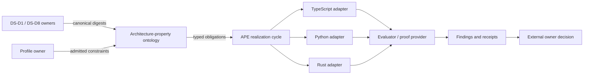
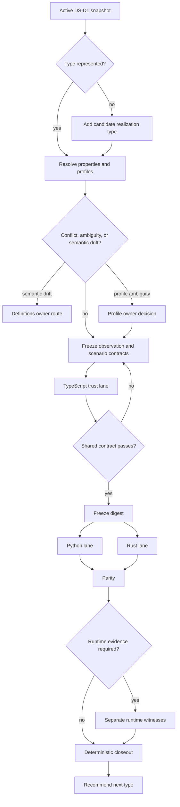

# Architecture Bundle: Ontology-Guided Architecture Enforcement

## Design intent

APE is the program umbrella. The architecture-property ontology states which
implementation elements, properties, relations, profiles, and observations are
understood. APE turns uncovered obligations into a per-meta-type delivery
cycle. Language adapters observe facts. A generic evaluator and BTE-compatible
proof provider evaluate them. External owners retain all admission and
promotion authority.

The smallest coherent design unit is one `MetaTypeRealizationProof`:

```text
active canonical meta-type digest
  + candidate realization type and portable property obligations
  + one selected language profile
  + real source observation and exact-cause negatives
  + deterministic findings and replayable evidence
```

Three language units recompose into one bounded type-completion receipt. The
ontology does not contain work-pack state.

## View 1 — Context



Trust boundaries:

- canonical sources define semantic identity and legal DomainSpec relations;
- the candidate ontology defines no canonical fact;
- profile owners decide implementation conventions;
- adapters only observe;
- evaluators and BTE only compare, execute, mutate, index, and replay;
- receipts never decide authority.

## View 2 — High-level structure

```text
canonical/
  CanonicalMetaTypeRef
ontology/
  ImplementationRealizationType
  ImplementationProperty
  AllowedArchitectureRelation
profiles/
  PortableProfile
  TypeScriptProfile
  PythonProfile
  RustProfile
observations/
  ObservationProjection
  UnsupportedObservation
proof/
  EvaluationScenario
  ConstraintFinding
  ReplayResult
program/
  MetaTypeRealizationCycle
  TypeCompletionReceipt
```

APE owns the `program/` planning surface. The ontology/profile package owns its
candidate model. Language packages own adapters. BTE owns proof mechanics.
Canonical and promotion owners remain external.

## View 3 — Low-level components

| Component | Inputs | Outputs | Must not own |
| --- | --- | --- | --- |
| `CanonicalCoverageProjector` | current DS-D1 registry | exact active-backend denominator and realization coverage | DS-D1 admission or positional IDs |
| `PropertyOntologyRegistry` | ontology and profiles | resolved types, properties, relations, applicability, owners | task state or canonical meaning |
| `ProfileResolver` | portable and language profiles | deterministic effective constraints or conflict | file-order precedence or exceptions |
| `ObligationPlanner` | uncovered ontology/profile obligations | ordered candidate SWUs and evidence burden | automatic Task Session selection |
| `ObservationProjection` | adapter and native evidence | observed, derived, owner-resolved, and unsupported facts | expected truth |
| `TypeScriptAdapter` | real TypeScript source and native tools | TypeScript observation projection | Python/Rust semantics |
| `PythonAdapter` | real Python source and native tools | Python observation projection | TypeScript/Rust semantics |
| `RustAdapter` | real Rust source and native tools | Rust observation projection | TypeScript/Python semantics |
| `ConstraintEvaluator` | profile plus observations | explainable findings | parsing, tool execution, profile admission |
| `ScenarioContract` | base/mutant handles and immutable expectations | exact causal input and case/result join model | task state or source mutation |
| `ProofEngineProvider` | frozen scenarios and observations | mutation, receipt, replay, exact-set result | semantic/property selection |
| `ParityEvaluator` | three lane receipts | exact obligation/applicability comparison | syntax equality or majority vote |
| `ProgressionSelector` | current coverage and evidence burdens | recommended next type packet | automatic lifecycle activation |

### Shared contracts

`ImplementationProperty` carries `property_id`, value domain, applicable
subjects, observation stage, owner route, and forbidden inference.

`ObservationProjection` carries language, artifact/tool/adapter/profile
digests, typed subjects, facts partitioned by provenance class, directed
relations with provenance, unsupported observations, raw evidence references,
diagnostics, and redaction posture.

`EnumRepresentationUnit` is a non-canonical implementation-evidence node. It
owns direct `{key, value}` member records or composes other units through
acyclic `architecture.composed_from` relations. Root and composite facts are
derived from exact leaf fact IDs; component order is normalized away while raw
source selectors remain reachable. A representation unit cannot acquire
DomainSpec Enum identity or authority.

`EvaluationScenario` carries stable scenario ID, operation, base and mutant
handles, immutable pre/post expectation handles, lineage, recomposition
partitions/scopes, case/result joins, expected diagnostic or delta, and
optional topology/output targets.

`ConstraintFinding` carries the subject, property or relation, expected and
observed values, originating profile, evidence reference, diagnostic, and
owner route.

## View 4 — Workflow process

1. Read current active-backend DS-D1 identities and reject the DS-D1.10
   tombstone and UI candidates from the denominator.
2. Select one active meta-type. The first cycle is Enum.
3. Bind the canonical definition and criterion digests without copying their
   authority into the ontology.
4. Add or repair the realization type, typed properties, allowed relations,
   non-collapse rules, applicability, and unsupported cases.
5. Resolve portable and language profiles. Stop on conflict or missing owner.
6. Freeze provenance, composition-graph, and causal scenario contracts.
7. Record the TypeScript representation decision, implement its exact runtime
   helper provider, and activate the profile only after binding the provider
   digest.
8. Prove TypeScript from real source and exact-cause negatives. Repair the
   shared contract only before the trust gate closes.
9. Freeze the shared observation contract.
10. Run Python and Rust independently against that digest.
11. Compare exact portable obligation IDs and applicability results.
12. Run a separate runtime plane only for behavioral or lifecycle obligations.
13. Reproduce deterministic findings/receipts and issue a bounded completion
    receipt.
14. Recompute realization coverage and evidence burden; recommend, but do not
    automatically select, the next type.

## View 5 — Decision and state flow



States are `unmodeled`, `ontology-modeled`, `profile-closed`,
`typescript-trusted`, `language-lanes-joined`, `complete-witnessed`, and
`blocked`. These are development evidence states, not authority states.

## View 6 — Dependency and interface

| Boundary | Provider | Consumer | Contract | Gate |
| --- | --- | --- | --- | --- |
| canonical meaning -> realization | DS-D1/DS-D8 owners | ontology/profile owner | exact IDs, selectors, versions, digests | no semantic reinterpretation |
| ontology -> APE planner | ontology/profile owner | ObligationPlanner | types, properties, relations, applicability, gaps | `authority_effect: none` |
| profile -> adapter | profile owner | language owner | exact constraints and unsupported set | owner decision current |
| source -> observation | language owner | evaluator | versioned `ObservationProjection` | total required observation accounting |
| scenario -> BTE | APE/profile design owner | proof-engine owner | scenario/lineage/recomposition/join schema | no fixture-invented semantics |
| findings -> parity | evaluator owner | parity owner | exact obligation IDs and raw evidence refs | no majority vote |
| completion -> progression | closeout verifier | APE planner | bounded receipt and remaining burden | recommendation only |
| evidence -> authority | APE | external owner | explicit request plus source evidence | separate human/owner decision |

Dependencies point inward toward semantic and observation contracts. The
ontology, evaluator, and BTE provider must not depend on a language adapter.
Language adapters may depend on shared schemas but never on each other.

## Migration and compatibility decisions

1. Preserve all earlier APE and BTE receipts and completed evidence.
2. Supersede only the older APE continuation ordering; do not relabel its
   completed work as ontology-guided proof.
3. Keep BTE L0B blocked until scenario lineage, recomposition,
   expectation-lineage, and result-join contracts are representable.
4. Reuse BTE L0A primitives only after their exact digests and claim ceilings
   are revalidated by the BTE owner.
5. Do not add a fourth umbrella package. APE composes the ontology, MTCI
   lifecycle grammar, BTE provider, and language lanes through interfaces.
6. Generate type coverage and canvas membership from canonical registries;
   hard-coded counts cannot be semantic acceptance.

## Risks and blind spots

- eight active backend meta-types lack realization types;
- Enum needs set equality, uniqueness, non-emptiness, and cardinality operators
  not present in the current evaluator;
- relation existence, forbidden relations, and graph algorithms are missing;
- profile conflict, conditional applicability, exceptions, and schema evolution
  are undefined;
- no native language adapter or pinned Python/Rust package home exists;
- BTE lacks three required causal representations;
- generated/source/native provenance is not yet complete in findings;
- static/runtime evidence can collapse for Workflow and State Machine;
- current ontology and MTCI/canvas artifacts are untracked and require exact
  Task Session baseline binding before mutation;
- three-language agreement can prove only the selected profiles, fixtures,
  tools, and obligations.

## Design decisions

| ID | Decision | Reason |
| --- | --- | --- |
| APE-D1 | APE is the umbrella; no new parallel package. | Existing packages already own the needed roles. |
| APE-D2 | The ontology models architecture properties, not task state. | Prevents planning mechanics from becoming architecture meaning. |
| APE-D3 | Existing active types use a realization cycle; MTCI new-type admission remains conditional. | Enum already has canonical DS-D1 authority. |
| APE-D4 | TypeScript is the trust-building lane; Python/Rust open after contract freeze. | The shared schema should be tested before parallel expansion. |
| APE-D5 | BTE is a proof provider and cannot select semantic obligations. | Prevents fixtures and evaluators from defining meaning. |
| APE-D6 | The next type is selected from evidence burden after Enum. | “Simple to hard” must be measured, not guessed. |
| APE-D7 | Profile-local conventions never become portable ontology truths. | Language idioms and project structure differ. |

## Claim ceiling

This Design proves architecture authoring and selection only. It does not prove
ontology completeness, adapter implementation, Enum conformance,
cross-language parity, BTE readiness, profile admission, release, deployment,
or production operation.
