# Execution Pack

This file choreographs the split Work Pack. Task and SWU definitions remain in
`work-pack/tasks/` and `work-pack/shared/SWU-MANIFEST.json`.

## Control fields

| Field | Value |
| --- | --- |
| complexity | high |
| outputMode | split |
| activeLayerWindow | L1 TypeScript representation-owner decision |
| selectedSWU | none |
| nearestCandidate | SWU-APE-ENUM-TS-001 |
| runtimeMutation | not authorized by Invoke |
| Python/Rust parallelism | planned only after TypeScript trust gate and fresh user confirmation |

## Choreography

```mermaid
flowchart LR
    O1[ONT-001 Enum realization] --> O2[ONT-002 properties/operators]
    O2 --> O3[ONT-003 profiles]
    O3 --> O4[ONT-004 provenance/conflicts]
    O4 --> O5[ONT-005 causal scenario]
    O5 --> O6[ONT-006 composition graph]
    O6 --> T1[TS-001 representation decision]
    T1 --> T1A[TS-001A runtime provider]
    T1A --> T1B[TS-001B profile activation]
    T1B --> T2[TS-002 adapter]
    T2 --> T3[TS-003 fixtures]
    T3 --> T4[TS-004 trust proof/freeze]
    T4 --> P[PY-001]
    T4 --> R[RS-001]
    P --> J[PARITY-001]
    R --> J
    J --> C[CLOSE-001]
    C --> S1[SCALE-001 coverage]
    S1 --> S2[SCALE-002 burden]
    S2 --> S3[SCALE-003 next packet]
    S3 --> S4[SCALE-004 CI aggregation]
```

## Wave gates

- W0 is complete: ONT-006 closes the graph/provenance gap discovered before
  TypeScript admission.
- W1 is sequential: decision, provider implementation, digest-bound profile
  activation, adapter, fixtures, and proof/freeze remain distinct boundaries.
- W2 is the only fan-out. Python and Rust require disjoint scopes, a validated
  dispatch, explicit human confirmation, and terminal join/close receipts.
- W3 and W4 are sequential recomposition/closeout waves.
- No wave begins from this document. Task Session selects one SWU at a time.

## Provider handoffs

- DS-D1/DS-D8: read-only exact source handles.
- Ontology/profile owner: candidate ontology and profiles.
- BTE owner: later adoption of the causal scenario contract; current BTE bytes
  are not in APE write scope.
- Language owners: real source/native projections after their entry gates.
- Closeout verifier: read-only deterministic recomposition.

## Terminal result

The maximum planned result is `Enum complete-witnessed` for the exact selected
profiles, tools, fixtures, obligations, and digests. No package step can emit
promotion, release, deployment, production, or universal-language claims.
