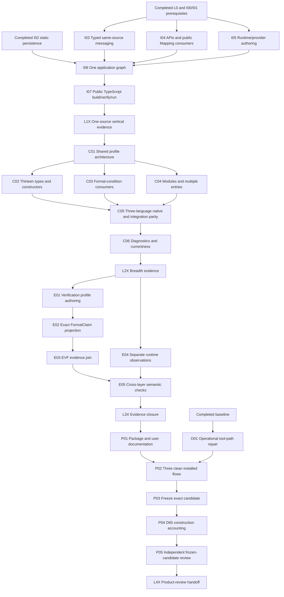

# What remains to implement

The existing DomainSpec backend is the reuse base. The unfinished product is
the coherent Alch authoring-to-runtime path over that backend, not another
generator or general-purpose programming language.

Eleven of 37 nodes have scoped completion evidence; 26 remain. Those are task
counts, not a percentage of implementation effort. I03 is partially implemented.
No completion status is promoted by this review.

## Current implementation findings

Paths beginning `Alch/` below are relative to
`/home/vrondelli/projects/cyberAlchemy-v2/language/capabilities/alchlang/plans/general-compiler-v1/implementation`.
Paths beginning `CLI/` are relative to this project's `impl/cli`.

| Area | Evidence in current code | What still prevents completion |
| --- | --- | --- |
| Formal/domain vertical, L0 | `Alch/src/application-source.ts`, `formal-claim-lowering.ts`, `application-rule-projection.ts`, `application-executable.ts`; historical `L0-COMPLETION.md` | Bounded implementation, not all formal consumers or formal-provider evidence. |
| Domain prerequisites, I00 | Entity identity projection, Event metadata, Query list/optional cardinality, Mapping v2/v3, Interface contracts and Operation effects; `I00-COMPLETION.md` | Full thirteen-type authoring breadth remains C02. A test adapter is not a generated workflow. |
| Integration grammar, I01 | `Alch/src/application-integration.ts`; seven fresh tests pass | Parsing arrows is not provider wiring or execution. |
| Persistence, I02 | `Alch/src/application-persistence.ts`; formation/executable path checks actual Query sources/cardinality and Operation write slots; four fresh tests pass | Physical/provider input is still an explicit internal companion. Runtime execution remains I05–I07. |
| Messaging, I03 | `Alch/src/application-messaging.ts`; four fresh tests pass. `CLI/src/system-integration/application-graph-v1.ts` exports the shared bounded runtime join | `lowerApplicationDomain` rejects every integration other than persistence. `prepareApplicationExecutable` accepts only persistence context. No same-source messaging join yet. |
| Backend join reuse | `CLI/test/system-integration/messaging-runtime-bindings.test.ts` compares the bounded helper with the whole graph, including source locations | Alch adapter test uses an existing backend project, not an Alch-authored messaging application. |
| APIs, I04 | Closed inbound/outbound syntax and existing backend contracts | The runtime graph's `runtimeMappingContract` accepts v2 only, while domain/public Mapping lowering supports v3. Public runtime consumers need closure before the API vertical. |
| Public product flow, I05–I07 | Existing backend selection/composition APIs and older CLI profiles | Current target flow still requires internal companions. A legacy `bound-application-v1` CLI branch is not completion of target `application-v1`. |
| Breadth/evidence/install | Existing backend implementations, tests and historical plans | No fresh evidence here closes unified authoring parity, EVF integration, all runtime stages or clean installed target flows. |

### Important fixture limitation

The static messaging fixture checks names and policies independently of payload
typing. It includes an Entity-shaped Mapping input even though the Event carries
an identity. Do not turn this fixture into proof of typed messaging closure.
Create a valid identity-based fixture, with every additional Mapping input
explicitly sourced. Never fabricate fields or resolve an identity implicitly.

### Fresh verification for this review

- Alch integration + persistence + messaging: **15 passed, zero skipped**.
- Backend application-binding + messaging-runtime-bindings: **8 passed, zero skipped**.
- Alch `npm run typecheck`: **passed**.
- DomainSpec CLI `npm run typecheck`: **passed**, including catalog, relationship,
  integration profile, reconciled/cross-generator materializers, atomic-publication
  currentness and packaged-schema checks.
- DAG validator: **passed**, 37 nodes and five layers; all remaining diagram
  nodes and dependencies are checked against the machine DAG.
- Full native three-language suites, broker/database execution, installed flows
  and formal-provider runs: **not run by this review**. Earlier receipts remain
  historical, not refreshed current evidence.

## Remaining dependency graph

This is a grouped view of `EXECUTION-DAG.json`, not a second scheduling authority.
L0 and I00/I01/I02 remain completed predecessors; every remaining node is shown.

## Next implementation sequence

### 1. Close I03 without rebuilding messaging semantics

1. Reuse the existing backend messaging runtime join and request validator.
2. Extend the formation context to carry messaging alongside persistence; require
   exactly one complete handler for every authored integration. No skip flag.
3. Carry source composition, compiled snapshot and trace through Rule/Query
   projection, executable preparation and compilation. Bind all emitted files.
4. Use a valid source fixture for Event → Mapping → Message and
   Message → Mapping → Operation. Assert payload extraction, Mapping result type,
   Operation parameter coverage, channel and acknowledgement policies together.
5. Reject stale inputs, missing/extra artifacts, wrong request types and illegal
   reference traversal. Prove deterministic same-source joins and unchanged inputs.

Exit: one typed source joins both messaging directions through the shared backend.
This closes static I03, not broker delivery, durability or consumer completion.

### 2. Close I04 and I05

These are dependency-ready alongside I03, but touch shared parser/context/adapter
surfaces. Parallel planning is safe; concurrent edits need explicit file ownership
and a serialized integration join. No additional agents are dispatched by this plan.

- **I04:** lower named inbound/outbound contracts and mappings; audit every consumer
  of public Mapping v3, including graph binding and code generation. Preserve
  Interface-owned public types. Prove exact request/response linkage and hostile
  missing/retargeted/type-incompatible cases. Do not replace public types with records.
- **I05:** author target/runtime/provider/environment selections separately from
  business meaning. Emit existing provider-selection contracts. Keep secrets as
  references, explicit provider choice, and no ARE-specific configuration.

Exit: each branch supplies validated, source-bound input to I06. If an existing
contract cannot represent an agreed behavior, identify that precise product
decision before changing semantics; do not use an implicit fallback.

### 3. I06 → I07 → L1X: the first complete product path

- Assemble domain, persistence, messaging, APIs and profile into the existing
  application graph; reject collisions, unresolved references and partial coverage.
- Inventory contract consumers before generation: public Mapping v3 and optional
  Query v2 must survive graph, generation, provider adapters and verification.
- Public CLI/API derives internal backend contracts from authored inputs. It may
  load explicit meaning/evidence inputs; users must not hand-write backend JSON
  merely to complete the application pipeline.
- Build, verify, compile and run one bounded loopback commerce scenario; include
  optional Query absence/one/multiple outcomes and a semantic mutant.
- Failed, stale or escaping inputs must leave the requested destination unchanged.
  All owned temporary outputs/services are cleaned up.

Exit: copyable source-to-running-TypeScript example without generated-code patches.
Only this exit warrants claiming the first coherent application vertical.

## Later layers and completion evidence

The five-layer structure is retained, including completed L0. Boundary heuristic:
stop each layer at the smallest demonstrated outcome that unlocks the next decision.

| Layer | After this layer, we know whether… | Minimum outcome and exit evidence | Main cost / deliberately deferred work |
| --- | --- | --- | --- |
| L0, bounded complete | Explicit formal meaning can lower without invention | One typed Rule/Operation vertical; retained historical receipt | No repeat of completed construction; not full breadth. |
| L1, current | One source becomes a coherent provider-backed application | I03–I07 joined TypeScript scenario and L1X receipt | Adapter/protocol joins; defer three-language breadth and production scale. |
| L2 | The same language works across promised types and targets | Shared parser, 13-type/constructor coverage, formal consumers, modules/entries, 39 native domain cells and 3 integration scenarios; C06/L2X | Native verification dominates cost; reuse backend implementations. Kotlin is not added by this review. |
| L3 | Evidence remains attached to exact authored meaning | Verification authoring, exact v4→v2 projection, typed EVF outcomes, distinct runtime stages, E05/L3X | Provider/oracle checks; no implied proof outside declared bounds. |
| L4 | A clean consumer can reproduce the product | Package allowlist, installed TS/Python/Rust flows, frozen candidate, D65 accounting, independent review, L4X | Installation/cleanup and exactness; no publication or deployment. |

Preserve earlier guarantees in every later layer: deterministic lowering, exact
identity/cardinality, explicit interpretations, unsupported-input rejection,
unchanged destination on failure, and no evidence-to-authority conversion.

## Test strategy and cost control

For a local edit, run the owning focused suite and affected predecessors. Run
combined regression/typechecks at branch closure and native/integration suites
at layer exits. Do not regenerate whole applications for a pure parser/hash change.
Every retained test must name an obligation: positive behavior, hostile mutation,
semantic oracle, non-collapse, orthogonality, determinism or currentness. Representation
checks alone cannot satisfy semantic obligations. E05 consolidates the matrix;
it does not postpone basic semantic tests until the end.

Reuse existing backend fixtures as regression inputs, but distinguish them from
Alch-authored and installed-consumer proofs. Track test resource ownership and
cleanup, not merely pass counts. No broad temporary-repository accumulation.

## Plan review and corrections

This is a separate self-review pass by the primary agent, not independent approval.

| Review question | Result / correction |
| --- | --- |
| Does the plan start at current code? | Yes: I03 shared helper exists, same-source join does not. Do not redo I00 or I02. |
| Can I03 pass too early? | Corrected: typed source/payload/request/trace closure is now required, not policy checks alone. |
| Is the API prerequisite hidden? | Corrected: I04 explicitly owns public v3 runtime-consumer compatibility. |
| Are previous obligations lost? | No node removed; 37 IDs, five layers and existing dependencies retained. |
| Is parallelism honest? | I03/I04/I05 are ready; shared edits need coordination. C02/C03/C04 and formal/runtime evidence branches can later proceed independently. |
| Is this a programming-language expansion? | No: closed typed arrows; Operations retain declared contracts; workflows own operation composition. No loops, imperative transactions or inline replacement propositions added. |
| Are profile responsibilities separate? | Runtime/provider selection, formal verification, domain meaning and authority remain distinct. |
| Does testing imply release readiness? | No: focused passes do not close L1, installed qualification or product approval. |
| Does operations work block construction? | O01 joins only at P02; it does not block I03–E05. |

## Construction and operational lanes

- Product frontier: I03 typed same-source messaging. I04 and I05 also runnable.
- Causal implementation gaps: messaging context/join missing; public Mapping runtime
  consumer compatibility missing; public target CLI/profile assembly unfinished.
- Operational support: O01 tool-path repair, owner implementation agent, affected
  stage P02 only. The historical container failure was not rerun in this review.
- Deferred operational residue: remote providers, production credentials,
  publication, release, deployment, HA/load/chaos work. None is authorized here.
- Skills: repository routing bounded this to planning; implementation-layering
  preserved the five decision-based layers rather than creating another backlog.
- Observer status: no separate observer or independent agent was run.

## Decisions and handoff

No new product decision is needed to start I03. This plan preserves the agreed
contracts. Stop for a decision only if implementation would change those meanings
or require new external-effect authority. Product approval is a later human
decision over the exact tested candidate, not a status field set by this plan.

Recommended next action: implement the I03 same-source join and its typed fixture,
then close I04/I05 and the first complete TypeScript path before widening scope.
