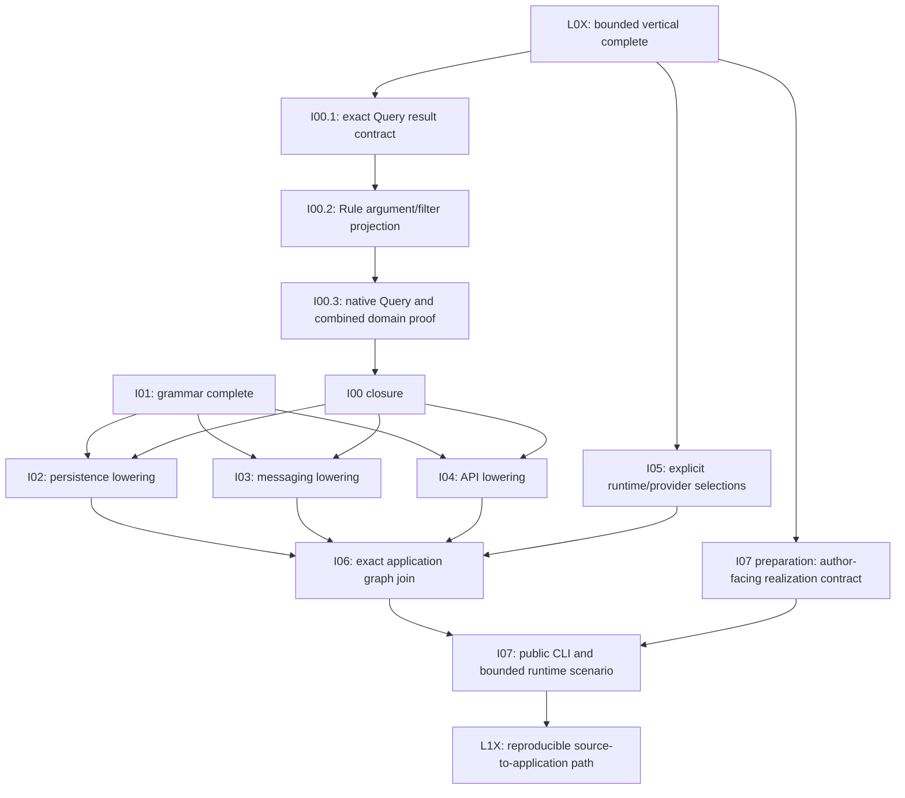

# Remaining implementation and reviewed execution plan

Date: 2026-09-17. Status: planning candidate. Authority effect: none.
Scope: the coherent AlchLang → DomainSpec authoring-to-runtime path, not a
reimplementation of the existing DomainSpec backend. Review: primary-agent
self-review, not independent review or product approval.

## Outcome

The bounded semantic vertical exists. The complete author-facing application
path does not. The current ledger has nine scoped-complete nodes, one partial
node (I00), and 27 pending nodes, including operational-support O01. These
counts are not a percentage of engineering effort or release readiness.

The next useful milestone is L1: one source-driven TypeScript commerce
application with explicit persistence, messaging, API and provider bindings.
I00 continuation and I05 are dependency-ready. No new product decision is
needed to inspect and implement the already representable contracts. A missing
semantic choice must be surfaced before implementation assigns it a default.

## Current implementation review

Alch paths below are relative to the sibling checkout's
`language/capabilities/alchlang/plans/general-compiler-v1/implementation/`.
DomainSpec paths are relative to this repository.

| Area | Current evidence | Remaining boundary |
| --- | --- | --- |
| FormalClaim and Rule | `src/formal-claim.ts`, `src/formal-claim-lowering.ts`, `src/application-rule-projection.ts`; exact formation and projection traces | Executable projection is bounded to ground Boolean/property and scalar interpretations. Functions, quantifiers and broader consumers are not completed. |
| Event, Mapping, Operation | `src/application-domain-lowering.ts`, `src/application-executable.ts`; native tests exercise constructors, explicit mapping inputs and transactional Event intents | Event field breadth is restricted; in-memory commit tests do not prove durable persistence or transport delivery. |
| Query | `src/application-source.ts`, `src/application-domain-lowering.ts`, `test/application-query.test.ts` retain Rule arguments, ontology paths and optional/list result identity | `src/application-rule-projection.ts` explicitly raises `APPLICATION_QUERY_PROJECTION_REQUIRED`. No native target Query execution exists on this path. |
| Backend Query | `impl/cli/src/typed-backend/contracts.ts` accepts `domainspec.typed-query/v1`; `impl/cli/src/generation/configured-query-source.ts` returns a readonly array | Optional results need an exact backend representation and all affected consumers accounted for; silently selecting the first row is not equivalent. |
| Integration arrows | `src/application-integration.ts` normalizes five distinct integration roles | Domain formation raises `APPLICATION_INTEGRATION_LOWERING_REQUIRED`; parsed arrows are not resolved application-graph bindings. |
| Executable input authoring | `prepareApplicationExecutable` consumes explicit interpretation and execution objects | Internal action selections still carry behavior not supplied by the `.alch` declarations alone. I07 must expose sufficient explicit authoring, not infer it from names. |
| Public CLI | `src/cli.ts` dispatches existing profile-specific flows, including `bound-application-v1` | Those flows do not establish the new `application-v1` one-source user path. |
| Complete breadth and evidence | Existing backend and earlier L0 receipts are reusable predecessors | C01–C06, E01–E05 and installed qualification remain separate obligations; earlier successful backend tests do not discharge them. |

This is a targeted frontier review, not a line-by-line audit of every backend
generator. The complete backend and all language/toolchain suites were not
rerun. Historical evidence stays historical; no frozen hashes were refreshed.

## Detailed next-work DAG

This is a task decomposition of existing I00/I05/I07 nodes, not a replacement
for `EXECUTION-DAG.json`. Completed L0X and I01 are prerequisites below. Solid
arrows are required ordering; no arrow means the work can be scheduled
independently, not that agents were dispatched.

Preparation under I07 is a planning contract only; executable I07 still waits
for I06 as specified by the canonical DAG. I02–I04 may research contracts now,
but completion still requires I00 and I01.

| Task | Implementation deliverable | Required evidence / stop condition |
| --- | --- | --- |
| I00.1 | Trace optional/list authoring to an explicit backend result contract; identify decoder, descriptor and language-generator consumers before changing the schema | Preserve existing list behavior. Specify zero/one/multiple-match behavior before coding. Recommended optional semantics: no match → absent, one → value, multiple → cardinality error; reconcile with existing contracts and ask if it changes an agreed product choice. No hidden limit-one. |
| I00.2 | Check exact Rule parameter names/types and substitute explicit Query bindings into the supported predicate contract | Missing/extra/mistyped arguments reject; exact ontology paths and source/claim/projection hashes retained; unsupported expressions fail instead of disappearing. No new Query-to-Rule relationship invented. |
| I00.3 | Generate and execute bounded FindOrder plus the combined Event/Mapping/Operation/Query source fixture through public APIs | Zero/one/multiple matches, nonmatching rows, malformed input, exact UInt64, deterministic output and stale projection rejection. No generated-code patches. Close I00 only after the combined proof. |
| I05 | Lower explicit target, runtime, provider and environment references into existing selection contracts | Missing/unsupported/conflicting selections reject; no ARE-specific dependency, ambient default or embedded secret. Existing backend capabilities are reused, not replaced. |
| I07 preparation | Identify how authors declare every required interpretation and action binding, including read keys, write mode/value, Event payload, result and failure behavior | Every internal field is derived from explicit author input or a documented semantics-preserving transformation. If required behavior has no agreed surface, present that exact choice. Do not add imperative operation bodies. |
| I02 | Resolve Entity/Query/Operation references and lower persistence declarations | Canonical stores/serves/write bindings, compatible identity and field types, explicit local transaction boundary. No database layout inferred from Entity identity alone. |
| I03 | Lower subscriptions/publications into current typed messaging contracts | Event versus Message, payload mapping, channel, acknowledgement, deduplication and dead-letter references retain distinct identities; reject incompatible payloads and noncanonical edges. |
| I04 | Lower inbound/outbound API declarations | Typed request/response mappings and Operation references resolve; route collisions and invalid external API bindings reject. No business behavior in endpoints. |
| I06 | Compose domain, integration and provider selections in the existing application graph | Exact cross-partition coverage, reproducibility, missing references and collisions. Replace the integration rejection guard only with complete lowering and trace coverage. |
| I07 / L1X | Public source loading, safe build and one bounded loopback scenario | No handwritten internal backend JSON; safe companion paths; stale/invalid input leaves destination unchanged; native compile and explicit runtime observations; owned temporary outputs cleaned. |

## Remaining layers, preserving the existing DAG

| Layer | Dependency chain | Exit question and evidence | Deferred beyond the layer |
| --- | --- | --- | --- |
| L1 | Detailed DAG above | Can one authored application compile and run coherently? Reproducible TypeScript scenario, exact bindings and safe public build. | Full language breadth and all-target parity. |
| L2 | L1X → C01 → {C02, C03, C04} → C05 → C06 → L2X | Does the shared model cover all promised constructs? Thirteen meta-types and field constructors, formal consumers, modules/entries, 39 native domain cells plus integration scenarios in TypeScript/Python/Rust. | Full formal-provider/evidence connection. |
| L3 | L2X → E01 → E02 → E03; L2X → E04; {E03, E04} → E05 → L3X | Are formal and runtime observations faithful to exact authored meaning? Verification profiles, v4-to-v2 preservation, EVF outcomes, separate runtime stages and semantic/non-collapse/orthogonality checks. | Clean installed product qualification. |
| L4 | L3X → P01; {P01, O01} → P02 → P03 → P04 → P05 → L4X | Can a clean consumer reproduce the product? Three installed paths, exact tested candidate, D65 accounting and independent read-only review. | Product approval, publication, release, deployment and production operation. |

Each layer preserves preceding semantics, exact identities, currentness and
failure behavior. The layer boundary is the smallest useful evidence join:
do not extend L1 into full language qualification before its application path
works. Main costs are backend-contract consumers at I00, cross-partition joins
at L1, native three-language evidence at L2, semantic evidence at L3 and clean
installation at L4. No unsupported elapsed-time estimate is assigned.

Operational support: O01 belongs to the implementation agent and affects P02
only. Re-diagnose tool visibility before repairing it; the old container failure
is historical. It does not block the current runnable I00/I05 construction.
Production credentials, remote provider operation and publication stay deferred.

## Plan review

Disposition: suitable planning candidate, with the refinements above. This is
a separate self-review pass over the plan, not an independent agent review.

| Review finding | Resolution |
| --- | --- |
| Query syntax could be counted as executable completion | I00 stays partial; close only after exact Rule projection, cardinality and native combined proof. |
| Optional cardinality is absent from the current backend contract | I00.1 explicitly owns the schema/consumer delta. The proposed multi-match error is not silently treated as an already approved behavior. |
| CLI wiring could conceal missing authored behavior | I07 preparation inventories required behavior now; I07 cannot derive missing semantics by guessing. |
| A new general-purpose language could creep into the bridge | Reuse bounded typed contracts and graph composition. Unsupported behavior rejects; no loops, arbitrary calls or imperative transaction body is introduced by this plan. |
| Existing generators could be rebuilt unnecessarily | Reuse current DomainSpec APIs; limit backend changes to evidenced representation or correctness gaps. |
| All-target domain tests could hide missing integration parity | C05 retains both the 39-cell denominator and three-target integration scenario. |
| Large test runs could dominate development | Focused obligation tests per change; native boundary checks for generated-code changes; complete layer joins once integrated; installed suite at P02. Always clean owned fixtures. |
| Unrelated operational work could block progress | O01 joins only P02; no operational gate added to I00/I05. |
| Passing checks could imply approval | P03 freezes exact current bytes, P04 accounts for construction, P05 reviews independently, L4X hands off. No approval or operational authority inferred. |

The canonical graph retains all 37 nodes and its dependencies. The detailed
L1 decomposition is acyclic and adds no reverse dependency on L2. Node counts
remain scoped ledger facts, not implementation-effort percentages.

## Fresh checks

- Alch focused selection: `application-query`, `application-integration`,
  `application-event`, `application-mapping`, `application-effects` and
  `application-executable`: **20/20 pass, zero skipped**. Includes public
  backend generation and native execution for the already implemented slices.
- Alch `npm run typecheck`: **pass**.
- Canonical `validate_dag.py`: **pass**, 37 nodes and five layers.
- Query/integration passing rejection tests establish the current fail-closed
  boundary; they do not prove the missing executable features.
- Full backend, installed-consumer and three-target integration suites were
  not rerun and are not claimed. No implementation source was edited.
