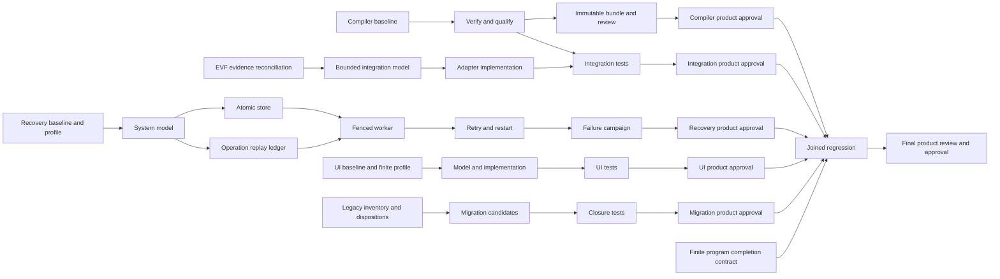
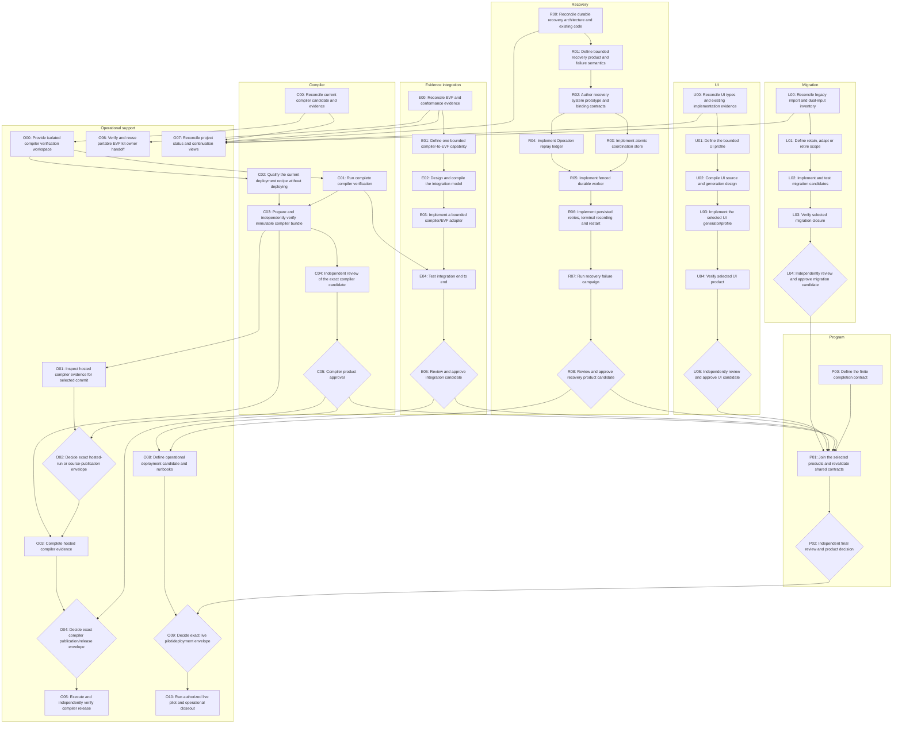

# DomainSpec v2 completion DAG

Status: **planning candidate**. This plan defines 46 tasks, 57 dependency edges and eight milestones. It does not execute implementation, approve a product, register an execution goal or authorize operational effects.

The proposed finish line is five finite products: the Stable 1.0 compiler, a bounded compiler-to-EVF integration, one durable recovery profile, one UI profile and the selected legacy migration. A joined regression and product decision closes the selected program. Publication and live operation have separate finish lines. P00 records this completion contract; each track defines its own finite profile before implementation.

## Read and use the plan

- [TASKS.md](TASKS.md): detailed owners, prerequisites and reasons, deliverables, completion criteria, validation and scope for every node.
- [plan.json](plan.json): machine-readable source of truth and complete dependency graph.
- [sources.json](sources.json): exact planning source snapshots; source records are not fresh product-test receipts.
- [validate.py](validate.py): structural, source-currentness and negative-case checks. Run `python3 -B projects/domainspec-v2/development/completion-dag/v1/validate.py --self-test` from the repository root.

## Current frontier and what to reuse

| Track | Existing basis | Remaining work proposed here |
|---|---|---|
| Compiler | Stable 1.0 compiler, release-candidate tooling and tests already exist | Select current source; run full checks and qualification; build and independently verify exact bundle; review and product decision |
| Evidence | EVF v3 has recorded test, review, product approval and bounded adoption evidence | Reconcile that evidence, then implement only the missing finite compiler/conformance integration |
| Recovery | Durable recovery architecture and in-process planning exist | Determine code delta; build atomic store, Operation ledger, fencing, retries and restart; test crashes and races |
| UI | Candidate UI profile/types and development work exist | Reconcile actual implementation; select finite framework/profile; resolve Adapter and State Indicator disposition; build missing scope and test |
| Migration | Legacy import manifest and consumer paths exist | Reconcile stale rows; retain, adapt or explicitly exclude requirements; verify selected consumers and parity |

These are source-based planning findings. Existing tests were not rerun to produce this plan. Every reconciliation node may reuse current evidence or remove duplicate implementation work after checking its exact scope. Historical Body War first-production tasks are not assumed to be Stable compiler requirements.

The portable EVF kit owner updated its build plan during this audit to record a completed local packaging candidate. O06 now verifies and reuses that handoff. Its archive and test receipts were not independently checked here. Distribution and additional platforms remain operational residue.

## Product dependency overview

This is an overview; the complete graph below includes every edge.

## Priority and first runnable work

Start with **P00 and C00**: bound the finish line and select the exact compiler candidate. E00, R00, U00 and L00 are also dependency-ready read-only reconciliation work. Named actors, exact selected source bytes and later mutation allowlists still need resolution; the plan does not assign people or launch parallel agents.

1. **Compiler closure first:** C00 → O00 → C01 and C02 → C03 → C04 → C05. Full verification and recipe qualification share a source/toolchain prerequisite and can be scheduled independently. Broader UI, recovery, migration or distribution work does not gate this milestone.
2. **Evidence integration:** E00 → E01 → E02 → E03 → E04 → E05. E04 also needs C01 for a compatible tested compiler baseline. Reuse EVF v3 instead of recreating it.
3. **Recovery:** R00 → R01 → R02 → R03 and R04 → R05 → R06 → R07 → R08. The store and Operation ledger can be developed independently after contracts are fixed; both are needed by the fenced worker.
4. **UI:** U00 → U01 → U02 → U03 → U04 → U05. A finite profile decision precedes implementation, and tests precede approval.
5. **Migration:** L00 → L01 → L02 → L03 → L04. Retirement proposals do not authorize deletion.
6. **Program join:** P01 consumes the five approved products and P00; P02 follows integrated regression and independent review. Shared contract changes reopen affected candidate epochs.

No duration-based critical path or delivery date is claimed. Estimate effort after baseline reconciliation reveals what can be reused. Independent DAG branches may still share files; use one owner per overlapping write scope or isolated checkouts.

## Construction sequence and evidence

For each materially revised capability, its profile-definition node records prototype definitions, agent-facing product/business ontology scaffolds and finite product meaning. The system-design node records DomainSpec, compiled-system and implementation prototypes; implementation produces one exact testable candidate; test nodes produce current evidence; a separate product decision follows. Compiler work reuses existing prototypes only after C00 checks their currentness. Migration must add or revise its scoped prototypes in L01/L02 when changing an implementation-bearing adapter.

A task closes against exact input/output manifests and observed checks, with independent review before product approval. A dependency cannot be discharged solely by a status field. Failures are `BLOCK`; causally unavailable checks are `not_evaluable`. Continue independent ready branches. Repair creates a successor task/candidate epoch instead of introducing a retry cycle into the accepted DAG. Changed shared contracts invalidate affected downstream evidence, including prior approval bindings.

The Python ontology runtime is not an admission gate during its suspension. Each task resolves only its selected ontology records, selectors and source bytes; unrelated ontology drift cannot block it.

## Operational support and causal blockers

| Nodes | Owner role | Affected stage | Relationship to construction |
|---|---|---|---|
| O00 | Repository/toolchain owner | Compiler product testing | Exact isolated source/toolchain prerequisite for C01 and C02; the only operational-to-product edges |
| O01–O03 | Repository/release owner | Hosted compiler evidence | Read existing evidence first; triggering remote work or publishing source needs O02's exact envelope after product approval |
| O04–O05 | Release owner | Compiler release | Separate release decision and execution after product approval and hosted evidence |
| O06 | Existing portable EVF kit owner | EVF distribution | Verify completed local candidate handoff; licensing, platforms and delivery are separate residue |
| O07 | Project maintenance owner | No product stage | Reconcile stale CRAFT, architecture/import and continuation views; cannot block prototypes |
| O08 | Deployment/operator and ORODI owners | Deployment preparation | Offline operational candidate and runbooks; identify exact ORODI prerequisites for selected scope |
| O09–O10 | Deployment/operator owner | Deployment and live operation | Separate authority decision and bounded execution after final product approval |

Exact current tool absence can block its dependent check. Unrelated packaging, bookkeeping, publication and deployment waits cannot block runnable product construction. An unavailable required live namespace stays a blocker for that live test; no isolation bypass is planned.

## Milestones

- **M-COMPILER** — Tested and approved Stable 1.0 compiler product; terminal: C05; lane: `product_construction`.
- **M-EVIDENCE** — Bounded compiler-to-EVF integration approved; terminal: E05; lane: `product_construction`.
- **M-RECOVERY** — Selected durable recovery product approved; terminal: R08; lane: `product_construction`.
- **M-UI** — Selected UI profile product approved; terminal: U05; lane: `product_construction`.
- **M-MIGRATION** — Selected legacy migration product approved; terminal: L04; lane: `product_construction`.
- **M-PROGRAM** — Joined selected products tested and approved; terminal: P02; lane: `product_construction`.
- **M-RELEASE** — Separately authorized compiler release verified; terminal: O05; lane: `operational_support`.
- **M-LIVE** — Separately authorized bounded live operation verified; terminal: O10; lane: `operational_support`.

## Complete DAG

Arrows mean “requires current evidence from.” Subgraphs are work tracks, not agent assignments. Human decision nodes are diamonds. O06 and O07 are intentionally separate operational terminals.

## Unresolved choices and exclusions

- Exact current compiler commit and hosted evidence to be selected at C00/O01.
- Provider/language and fixture scope for the first durable runtime at R01.
- Bounded obligation profile and independent consumer for compiler/EVF at E01.
- UI framework/profile and Adapter/State Indicator dispositions at U01.
- Actual current legacy consumer set and retirement scope at L00/L01.
- Named people/active tasks must be assigned to owner roles before dispatch; portable EVF kit retains its current owner.
- No execution-ready claim is made while exact per-node source selectors/file allowlists remain to be materialized.

- Historical Body War application-release program
- AlchLang integration/lowering
- Universal multi-language semantic parity
- All cloud/provider/framework variants
- Automatic ontology admission or promotion
- Rewriting frozen EVF candidates or historical decisions

A structural PASS validates this planning artifact only. It does not mean any milestone is complete.
