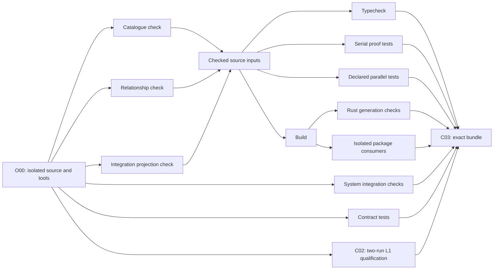

# P00 and C00 completion evidence

**Result: PASS for planning deliverables and source reconciliation.** No compiler product tests, product approval or operational effects were performed.

## P00 — finite completion contract

The [completion contract](completion-contract.json) fixes five bounded product outcomes and their evidence requirements:

| Track | Finish line | Scope-selection owner node |
|---|---|---|
| Compiler | Stable 1.0 source, generation, verification and bounded certification; 13 backend types and 39 language rows; exact tested bundle and product decision | C00 binds current source |
| Evidence | One tested compiler-to-EVF integration and independent consumer | E01 |
| Recovery | One provider/language profile with atomic storage, replay, fencing, retry and restart evidence | R01 |
| UI | One framework/user journey with explicit included/deferred types and interaction/accessibility evidence | U01 |
| Migration | Finite retained/adapted legacy consumer set, with tested parity and explicit exclusions | L00/L01 |

The program milestone joins the five approved candidates and checks shared contracts. Future profile choices are owned work, not implicit all-provider promises. Release and live operation remain separate milestones. AlchLang lowering, historical Body War release work and universal semantic/proof claims are excluded.

## C00 — selected compiler baseline

- Package: **@domainspec-v2/cli@1.0.0**.
- Exact source commit: `9832ee36c5332be825ff065fb8cff05b23b2fd81`.
- Supported package runtime: **Node 26.8.1 / npm 11.19.0, Linux x64**; acceptance uses the selected container. pnpm 10.34.5 resolves build dependencies.
- Frozen catalogue: **domainspec-meta-types-current-implemented@10**, 13 backend types and 39 realization rows.
- **184 tracked CLI files**, plus 22 enumerated supporting inputs, are pinned from their selected commit objects. **7 working files differed during inventory**; these active-writer changes are excluded from this epoch and preserved. The full [source inventory](sources.json) records paths, sizes, SHA-256 and Git blob identities.
- The package is dependency-free at runtime. Build tools come from the separate workspace importer and locked dependencies.

The [compiler baseline](compiler-baseline.json) records the reuse/rerun matrix. Existing implementation can be reused; historical PASS statements cannot discharge current verification. Hosted CI has not been queried; O01 owns that check. All C01/C02 product checks remain not run.

## Findings that change how we proceed

1. **CRAFT is stale:** it describes @2 while current runtime and CLI bind @10. O07 owns the documentation reconciliation; it does not block prototypes.
2. **Test scope is explicit:** 29 CLI test files exist, and the package scripts schedule 28 (2 proof, 23 parallel, 3 contract). `test/runtime-l3.test.ts` imports AlchLang SQLite adapters and remains separately recorded experimental residue for R00. Stable verification cannot claim that test passed.
3. **Use an isolated checkout:** the release builder rejects any repository dirt. The clean compiler source can be selected without touching unrelated shared work. O00 must provide a full checkout of the selected commit, since tests reference sibling fixtures.
4. **Verify the actual compiler executable:** the toolchain labels TypeScript 7.0.2 while the workspace also carries a TypeScript 6 alias. O00 must record the resolved `tsc` path/version instead of inferring it from the container name.

## Test-phase DAG

The exact commands, test membership, tools and prerequisites are in [test-phases.json](test-phases.json). Its 14 phases describe successors; they were not run here.

The existing aggregate uses shell short-circuiting. C01 must retain each result and continue independent checks when one fails; only actual dependent checks become `not_evaluable`. Serialize proof-heavy phases to avoid shared cache conflicts. PostgreSQL tests need Docker and psql; L1 qualification needs pinned adapters and read-only provider-registry access. Their availability has not yet been tested.

## Updated frontier

P00 and C00 have [task](P00/receipt.json) [receipts](C00/receipt.json); [progress.json](progress.json) references those exact files without rewriting the original planning snapshot or registering admitted execution state.

**Next compiler task: O00**, the isolated source/toolchain prerequisite for C01 and C02. **Independent product work ready: E00, R00, U00 and L00.** Release, packaging, bookkeeping and deployment remain separately owned operational residue. No product milestone is complete yet.

[CHECKS.json](CHECKS.json) records 10 passing artifact/source checks. These validate the two requested tasks, not the compiler product.
