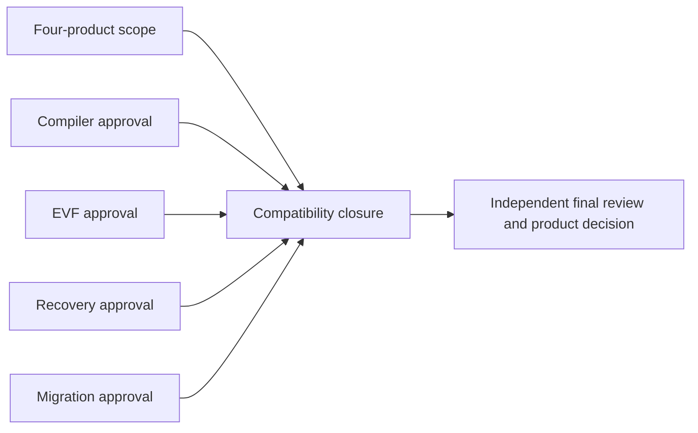

# DomainSpec v1.0.0 completion plan — revision 2

UI is outside v1.0.0. The user has replaced the earlier scheduling-only deferral with a release-scope exclusion. This is the current planning revision; v1 remains historical.

The four included products are the Stable 1.0 compiler, bounded compiler-to-EVF integration, recovery/ORODI local product, and selected legacy migration. U00–U05 and M-UI are removed. Future UI work has no selected release version.

The construction frontier is P01 closure review. The four exact product selections and existing compatibility preparation are linked in [plan.json](plan.json). UI is no longer a blocker. Reconcile that evidence against this revised contract and record a closure receipt before claiming P01 complete; P02 still requires independent review and the final product decision. No code or accepted candidate bytes changed, and removing a requirement is not a test result.

The previous compatibility report accurately describes the old five-product plan. Its UI blocker is superseded for this revision, while its test results and limitations remain unchanged. It does not prove a composed four-product runtime or new native provider execution.

Operational support remains separate: repository/release owners retain hosted evidence and publication; EVF owners retain provider/runtime portability; recovery owners retain legacy regression, pilot and cutover work; migration owners retain caller retirement. Exact affected stages and causal prerequisites are retained per node in [TASKS.md](TASKS.md) and the machine plan. None blocks the current scope reconciliation merely by being pending. Known failure and behavioral-gap evidence is not waived.

[Scope change](scope-change.json) records the user's instruction and old/new plan hashes. [Checks](checks.json) verify the DAG and preservation of selected historical inputs. These are planning checks, not product approval, admitted execution state or release authorization.
