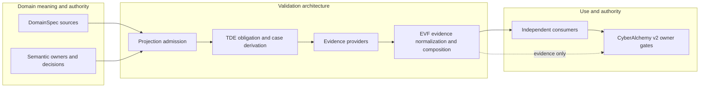
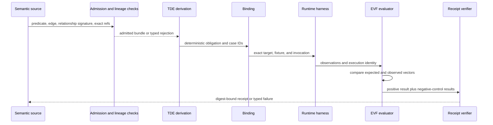

# Evolvable Validation Framework Architecture

## Document Contract

This document defines the stable architecture of the Evolvable Validation
Framework (EVF): its responsibilities, components, contracts, flows, trust
boundaries, failure model, and evolution rules.

It does not grant semantic admission, execution, promotion, release, deployment,
or production authority. DomainSpec sources and owner decisions remain
authoritative for meaning. Exact contracts and receipts remain authoritative for
their own bytes and results. The [Architecture and Progress Map](THREAD-MAP.md)
is the volatile status view; the [Validation Architecture Roadmap](../validation-architecture-roadmap/ROADMAP.md)
is the dependency and sequencing view.

Status terms used here are deliberate:

- **Current architecture** means a stable responsibility or boundary supported
  by the present design and implementation surfaces.
- **Candidate-local implementation** means executable repository-local code or
  evidence that has not thereby gained release or production authority.
- **Target architecture** means a required component or seam whose full
  end-to-end evidence does not yet exist.

## Executive Summary

EVF turns an exact DomainSpec claim into bounded, replayable evidence without
allowing the evidence to redefine the claim or assert more than it proves.

The architecture separates six responsibilities:

1. Domain owners define meaning.
2. Validation governance admits an exact executable projection.
3. the Test Derivation Engine (TDE) derives obligations and cases;
4. evidence providers execute one declared evaluation contract;
5. EVF normalizes and, where valid, composes provider evidence; and
6. independent consumers and authority owners decide what the evidence is useful
   for.

The governing invariant is:

```text
issued claim <= exact evidence <= admitted meaning
```

Every handoff carries stable identity, content digests, declared scope, typed
residue, and a claim ceiling. A missing, stale, contradictory, incomparable, or
unresolved input cannot be converted into a pass.

## Goals

EVF is designed to:

- preserve traceability from source meaning to a final receipt;
- derive deterministic, language-neutral obligations and cases;
- bind obligations to exact implementations, fixtures, tools, and runtimes;
- keep provider-native truth separate from normalized EVF meaning;
- preserve failures, unknowns, and omissions as typed residue;
- detect stale or tampered artifacts through exact references and replay;
- compose evidence only when scopes and semantic domains are comparable;
- support negative controls that prove a check can reject known-bad variants;
- expose a bounded claim ceiling on every evidence product; and
- let independently owned consumers use evidence without becoming EVF-owned
  proof.

## Non-Goals

EVF is not:

- the owner of DomainSpec semantics;
- a universal theorem prover or a replacement for runtime testing;
- a mechanism for inventing missing predicates or expected results;
- a majority-vote system for conflicting providers;
- an authority, admission, promotion, release, deployment, or retirement engine;
- evidence that a model matches production unless that exact correspondence is
  separately bound and observed; or
- permission to combine narrow passes into a broader claim without a typed,
  non-inflating composition contract.

## System Context



EVF is a private DomainSpec capability. Public Arcanum machinery may execute a
governed workflow, but it does not own private DomainSpec meaning or EVF product
claims.

## Architectural Principles

### 1. Meaning remains upstream

EVF consumes owner-authored semantic sources and admitted projections. Schema
validity alone never grants semantic authority. A missing predicate produces a
typed block; EVF does not synthesize one to make a run green.

### 2. Identity crosses every seam

Material inputs are referenced by path, SHA-256 digest, and byte size. Requests,
translations, runtime manifests, results, and receipts carry stable identifiers.
If identity or currentness changes, the earlier result remains evidence only for
the original bytes.

### 3. Derivation and execution are different responsibilities

TDE determines which obligation or case follows from admitted meaning. A
provider determines what happened when one exact evaluation was performed.
Neither may silently take over the other's responsibility.

### 4. Provider truth is preserved before normalization

Souffle, Alloy, SMT, TLA/TLC, language runtimes, and theorem providers retain
their native outcomes and execution facts. EVF maps those outcomes through an
explicit contract. `unknown`, timeout, blocked execution, and provider
disagreement remain unresolved evidence.

### 5. Evidence composition is non-inflating

Receipts may be joined only after proving that request, facts, universe,
property, mapping, and scope are comparable. A successful join states only the
intersection supported by its constituents. It cannot turn bounded checks into
unbounded correctness or provider agreement into semantic authority.

### 6. Failure is data

Blocked, stale, failed, indeterminate, and unresolved states are first-class
outcomes. Negative-control receipts, diagnostics, and residue are retained. A
missing constituent is never omitted from an aggregate result.

### 7. Evidence does not grant authority

EVF receipts use `authority_effect: none` or the equivalent invariant,
`release_admission: not-granted`, and an explicit claim ceiling. Promotion and
release remain separate owner decisions.

### 8. Consumer independence is real

An independent consumer receives exact EVF handles and produces its own receipt.
EVF cannot author, infer, or substitute the evidence required to prove that an
external application used the result correctly.

## Logical Component Model

| Component | Owns | Consumes | Produces | Must not do | Status |
| --- | --- | --- | --- | --- | --- |
| Semantic source authority | Domain meaning, relationship semantics, formal predicates | Domain and owner decisions | Versioned semantic sources and accepted contracts | Delegate meaning to a validator or provider | Current external boundary |
| Projection admission | Whether one source projection is exact and executable | Source identity, owner acceptance, profiles | Admitted projection or typed rejection | Treat structural validity as authority | Partly implemented; broader target |
| TDE derivation | Deterministic obligations, cases, and profile selection | Admitted projection and rule set | Neutral obligation/case set | Execute providers or redefine source meaning | Candidate-local and evolving |
| Binding layer | Exact correspondence between obligation, fixture, runtime, and source lineage | Obligation, fixture, runtime contract, exact refs | Runnable invocation or typed binding failure | Use ambient discovery or stale targets | Candidate-local |
| Provider adapter | One tool's request, execution, native result, and provider receipt | Formal request, translation, runtime manifest | Provider-native and normalized receipt | Broaden a result or hide unknowns | Bounded implementations and planned providers |
| Evidence normalizer | Common result vocabulary and claim ceiling | Valid provider receipt | Typed normalized evidence | Discard provider-native truth | Current bounded capability |
| Evidence composer | Exact comparability and non-inflating joins | Two or more independently valid receipts | Join receipt plus residue | Majority-vote or join incomparable domains | Current for one bounded graph property |
| Receipt and replay verifier | Integrity, currentness, acceptance vector, tamper detection | Exact refs, results, receipt | Verified receipt or typed failure | Validate against mutable ambient state | Candidate-local |
| Consumer gateway | Transfer of immutable EVF handles to another owner | Verified EVF handle set | Consumer request/receipt boundary | Author the consumer's proof | Target seam; owner-specific work exists |
| Promotion boundary | Admission, promotion, release, retirement | EVF and consumer evidence plus other owner evidence | Explicit owner decision | Infer authority from technical PASS | External CyberAlchemy v2 boundary |

## Core Contracts

| Contract | Required content | Architectural purpose | Current reference |
| --- | --- | --- | --- |
| `ExactRef` / `ExactArtifactRef` | path, digest, size, optional currentness | Binds evidence to immutable bytes | [`minted-project/types.ts`](../../impl/test-derivation-engine/src/minted-project/types.ts), [`sfol/smt/protocol.ts`](../../impl/test-derivation-engine/src/sfol/smt/protocol.ts) |
| Semantic source or admitted projection | source identity, owner/admission basis, predicate or typed meaning, claim ceiling | Keeps meaning upstream of execution | [`semantic-source/`](semantic-source/) and DomainSpec sources |
| Obligation and case set | stable IDs, source lineage, typed predicate, exact denominator | Makes deterministic consequences explicit | [`minted-project/derive.ts`](../../impl/test-derivation-engine/src/minted-project/derive.ts), [`sfol/cases/`](../../impl/test-derivation-engine/src/sfol/cases/) |
| Binding contract | obligation, fixture, runtime target, lineage refs, cardinality | Prevents ambient or ambiguous implementation selection | [`fixtures/`](fixtures/) and [`contracts/`](contracts/) |
| Provider request | semantic, obligation, theory, symbol, assumption, translation, runtime and policy refs | Freezes one executable evaluation envelope | [`FormalObligationRequest`](../../impl/test-derivation-engine/src/sfol/smt/protocol.ts) |
| Provider receipt | native execution tuple, native result, normalized result, evidence refs, residue, ceiling | Preserves provider truth and its exact interpretation | [`SmtProviderReceipt`](../../impl/test-derivation-engine/src/sfol/smt/protocol.ts) and L2 provider receipts |
| Join receipt | comparability preflight, constituent results, join status, residue, claim ceiling | Composes only exact comparable evidence | [`minted-project/l2/join.ts`](../../impl/test-derivation-engine/src/minted-project/l2/join.ts) |
| EVF proof receipt | exact refs, observations, acceptance vector, negative controls, admission and ceiling | Publishes replayable bounded evidence | [`evolvable-validation-receipt.ts`](../../impl/test-derivation-engine/src/minted-project/evolvable-validation-receipt.ts) |
| Independent consumer receipt | consumed handle identities, rebuild/usage evidence, consumer-owned verdict | Proves evidence crossed an ownership boundary unchanged | Consumer-owned; not emitted by EVF |

Contract compatibility is semantic, not merely structural. Matching JSON shapes
do not make two receipts comparable if their property, universe, assumptions,
runtime identity, or claim ceiling differs.

## Primary Flow: One Causal Proof

The smallest implemented proving ground is one `Rule --enforces--> Operation`
edge. It is intentionally narrow but crosses the complete internal EVF chain.



The positive receipt is issued only when the exact acceptance vector holds and
all required negative controls are killed. Its ceiling remains
candidate-local causal proof; it is not application-runtime or release proof.

## Provider Flow: Formal Or Graph Evidence

```text
formal obligation request
  -> validated meaning-preserving translation
  -> locked runtime and execution policy
  -> provider-native result
  -> normalized provider receipt
  -> optional exact-comparability join
  -> bounded EVF evidence handle
```

The request fixes the semantic source, obligation, assumptions, symbol table,
translation contract, runtime manifest, and execution policy. The provider
receipt retains timeout/failure state and native outcome. Synthetic protocol
fixtures cannot be presented as observed solver execution.

For the current bounded graph-property path, Souffle and Alloy evaluate the same
frozen facts. The join checks identical request, facts, universe, property,
mapping, and scope. Agreement yields only
`property-specific-consistency-over-shared-facts-only`. Disagreement or an
unresolved provider yields blocking residue and no consistency claim.

## Target End-to-End Flow

The system-level architecture is complete only when one exact claim crosses
every ownership boundary:

```text
one exact DomainSpec claim
  -> one admitted executable projection
  -> one deterministic TDE obligation/case set
  -> one selected provider execution receipt
  -> one EVF normalized or joined evidence handle
  -> one independently authored consumer receipt
  -> one separate owner decision, if requested
```

No current receipt proves this complete vertical. Local EVF proofs, provider
protocol validation, graph-property joins, planning readiness, and consumer
selection are evidence for individual seams, not substitutes for the missing
end-to-end result.

## Trust And Authority Boundaries

| Boundary | Trust gained | Trust not gained |
| --- | --- | --- |
| Domain source -> admission | Exact source identity and selected semantic basis | Runtime truth or release authority |
| Admission -> TDE | Permission to derive within one profile | Permission to add semantics or profiles |
| TDE -> provider | Stable obligation/case identity | Evidence that the obligation holds |
| Provider -> EVF | Exact native execution and bounded provider result | Generic correctness or semantic authority |
| Provider -> composer | Comparable evidence only after explicit preflight | Majority-vote truth or cross-domain equivalence |
| EVF -> consumer | Immutable bounded evidence handles | Proof that the consumer used them correctly |
| Evidence -> owner gate | Decision support at the declared ceiling | Automatic admission, promotion, release, or retirement |

Private DomainSpec meaning must not be copied into public Arcanum packages.
Arcanum may own reusable execution mechanics; CyberAlchemy v2 owns promotion
gates; neither boundary changes EVF's evidence result.

## Runtime And Physical View

The architecture is role-based rather than service-based. Its current physical
form is a private repository-local TypeScript harness and evidence package.

```text
projects/domainspec-v2/
  definitions/ and impl/spec/       Domain meaning and generated projections
  development/evolvable-validation-framework/
    semantic-source/                selected EVF-local semantic inputs
    contracts/                      JSON contracts and receipt schemas
    fixtures/                       positive, negative, and binding inputs
    providers/ and runtime/         bounded provider/runtime material
    evidence/                       persisted receipts and run evidence
    ARCHITECTURE.md                  stable architecture
    THREAD-MAP.md                   volatile progress projection
  impl/test-derivation-engine/src/
    minted-project/                 causal L0/L1 and graph-property L2 code
    sfol/                           typed logic, case derivation, evaluators, providers
```

Execution is local and explicit. Provider processes are invoked through bounded
adapters with declared working directories, resource ceilings, output limits,
and environment allowlists. The SMT request contract forbids network access,
but the local process runner does not create a network namespace: when isolation
is claimed, the orchestration environment must supply and identify a distinct
inherited namespace. There is no current EVF network service, database,
deployment topology, or production control plane.

Repository co-location does not collapse ownership: TDE, BTE compatibility,
EVF, providers, and consumers may share a package while retaining separate
contracts and decision owners.

## Failure Model

EVF fails closed at the earliest affected seam while retaining the full reason.

| Failure class | Examples | Required result |
| --- | --- | --- |
| Admission | unadmitted source, missing predicate, unsupported profile | blocked/rejected with typed diagnostic |
| Lineage/currentness | stale digest, changed graph, stale runtime target | stale/fail; no prior receipt reuse |
| Derivation | denominator mismatch, unstable obligation ID, omitted case | fail with exact discrepancy |
| Binding | missing, duplicate, ambiguous, or stale binding | fail before execution |
| Execution | missing export, timeout, process error, malformed output | failed/blocked receipt with native facts |
| Semantic evaluation | false predicate, indeterminate trace, unsupported operator | fail or indeterminate; never inferred pass |
| Composition | incomparable domains, provider disagreement, unresolved result | blocking residue; no join claim |
| Integrity | tampered receipt, changed acceptance vector, stale evidence ref | verification failure |
| Negative control | surviving semantic, structural, or stale-artifact mutant | positive receipt withheld |
| Consumer | missing or failed independent receipt | combined consumer claim blocked; core result unchanged |

Aggregates preserve every constituent failure. Cleanup, retries, or later passing
steps must not mask an earlier nonzero result. Environmental retries may retain
identity only when their contract says the graph and inputs are unchanged.

## Quality Attributes

### Traceability

Every result can be followed backward through stable IDs and exact references to
its source meaning, obligation, binding, execution, and provider evidence.

### Reproducibility

Canonical serialization, explicit runtime manifests, fixed execution policies,
and replay verifiers make equivalent inputs produce equivalent results or
equivalent typed residue.

### Evolvability

New predicates, languages, providers, and graph properties enter through
versioned contracts and admission profiles. Existing receipts retain their
original meaning and ceiling.

### Diagnostic integrity

Failures are phase-specific and machine-readable. Unknown or partial evidence
is visible instead of being flattened into a Boolean result.

### Provider independence

Neutral obligations and normalized receipts prevent a provider from becoming
the owner of DomainSpec meaning. Each provider must pass independently.

### Security and containment

Execution uses exact targets, bounded resources, environment allowlists, output
limits, and—for the current SMT contract—no network. These controls constrain a
run; they do not constitute a complete security or production-readiness claim.

### Reversibility

Evidence and compatibility changes precede retirement. BTE absorption retains a
forwarding facade and requires current rollback evidence before a separate
retirement decision.

## Evolution Models

EVF uses two layer vocabularies for different questions. They must not be
treated as one scale.

### EVF evidence-maturity layers

| Layer | Question |
| --- | --- |
| L0 | Can one claim produce a trustworthy causal receipt? |
| L0C | Can an independent consumer use the exact proof without drift? |
| L1 | Is the evidence method repeatable on another admitted slice? |
| L2 | Can one graph property be evaluated across providers without claim inflation? |
| L3 | Can EVF own broad backend evidence while preserving consumers and rollback? |

### Validation-roadmap layers

| Layer | Question |
| --- | --- |
| L0 | Can one exact claim cross the complete source-to-consumer vertical? |
| L1 | Is that complete vertical replayable and independently reproducible? |
| L2 | Can language and provider breadth expand without semantic drift? |
| L3 | Can EVF absorb broad BTE behavior reversibly? |
| L4 | Does current evidence support a separate promotion or retirement decision? |

The first model measures EVF's internal evidence capability. The second orders
the larger multi-owner validation system. A local EVF L2 result does not imply
validation-roadmap L2 or a complete roadmap L0 vertical.

## Current And Target Architecture

Candidate-local implementation evidence and governed Work Pack lifecycle state
are separate facts. A bounded capability may have live repository-local PASS
evidence while its governed task rows remain not started, blocked, unselected,
or unreconciled. Neither fact erases the other, and neither grants release
authority.

| Capability | Current evidence | Target or missing evidence |
| --- | --- | --- |
| Causal relationship proof | Candidate-local L0 positive receipt and negative controls | Broader admitted semantic profiles |
| Repeatability | Candidate-local L1 Financial Settlement slices | Independent complete-vertical replay |
| Graph evidence composition | One bounded reachability property across Souffle and Alloy | Separately contracted cycle, closure, and other properties |
| SMT integration | Request/receipt protocol and synthetic validation corpus | Admitted solver runtime, owner-authored binding, independent closure |
| TLA/TLC integration | Planned provider contracts and execution chain | Selected and executed provider plus EVF adapter |
| Language breadth | Existing TypeScript-centered and bounded multi-language work | Exact neutral-IR semantic parity across admitted profiles |
| Consumer integration | Explicit IOLM ownership boundary and selected route | Passing independently authored consumer receipt |
| EVF/BTE breadth | Exact 17-relationship planning frontier and compatibility design | Executed migration, parity, live-reference closure, rollback, separate retirement decision |
| Promotion/release | Explicitly outside EVF receipts | Current owner decision supported by release-specific evidence |

For exact live blockers and next transitions, use [THREAD-MAP.md](THREAD-MAP.md)
and the latest stream-local receipts. This table is an architectural capability
map, not an execution ledger.

## Architecture Decisions

| ID | Decision | Consequence |
| --- | --- | --- |
| EVF-AD-001 | Keep authored meaning separate from derived and observed evidence | Missing semantics block; validators cannot invent predicates |
| EVF-AD-002 | Bind every material handoff with exact references | Drift invalidates reuse but leaves historical receipts intelligible |
| EVF-AD-003 | Use typed provider adapters and preserve native outcomes | New providers can evolve without redefining neutral obligations |
| EVF-AD-004 | Compose evidence only after exact comparability checks | No majority vote and no cross-scope claim inflation |
| EVF-AD-005 | Treat residue and negative controls as required evidence | Partial success cannot masquerade as completeness |
| EVF-AD-006 | Keep consumer proof independently owned | EVF core success and real-application use remain separate claims |
| EVF-AD-007 | Keep authority effects outside evidence receipts | Technical PASS never performs promotion, release, or retirement |
| EVF-AD-008 | Preserve BTE compatibility until separate retirement authority | Migration remains reversible and consumers can be checked independently |

## Deferred Decisions

- the next graph property after bounded reachability;
- admission and runtime selection for the SMT provider;
- the TLA/TLC-to-EVF adapter contract;
- the exact first complete source-to-consumer vertical;
- complete language/profile parity and Lean correspondence boundaries;
- broad consumer evidence beyond the first independently owned receipt;
- BTE facade retirement; and
- packaging, deployment, release, and production operation.

Each deferred item requires its own exact contract and owner route. This
architecture document does not select one.

## Change Rules

Update this document when a stable responsibility, contract family, trust
boundary, or architectural decision changes. Update [THREAD-MAP.md](THREAD-MAP.md)
when only a work stream, blocker, receipt, or next action changes. Update the
[roadmap](../validation-architecture-roadmap/ROADMAP.md) when dependency order or
safe concurrency changes.

Any architecture update must:

1. distinguish current implementation from target architecture;
2. preserve private/public and semantic/authority boundaries;
3. link to exact source contracts rather than duplicating their schemas;
4. state the claim ceiling of cited evidence; and
5. avoid promoting plan, candidate, fixture, or receipt status into a runtime,
   release, deployment, or production claim.

## Navigation

- [EVF overview](README.md) — purpose, intuition, examples, and maturity summary.
- [Architecture and progress map](THREAD-MAP.md) — current streams, gates, and next edges.
- [Implementation layering](IMPLEMENTATION-LAYERING.md) — EVF L0–L3 decision boundaries.
- [Validation architecture roadmap](../validation-architecture-roadmap/ROADMAP.md) — system-wide sequencing and concurrency.
- [Original graph-composability design](DESIGN.md) — historical candidate design for the first evidence spine.
- [Visual architecture X-ray](x-ray/ARCHITECTURE-AND-DESIGN.html) — interactive explanation of the original candidate architecture.
- [EVF Work Pack](WORK-PACK.md) — bounded work and validation contracts.
- [DomainSpec v2](../../README.md) — private implementation and source-meaning boundary.
- [CyberAlchemy v2](../../../../cyberAlchemy-v2/README.md) — authority and promotion boundary.
- [Arcanum](../../../../arcanum/README.md) — public reusable execution machinery.
