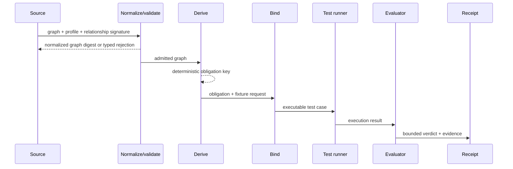
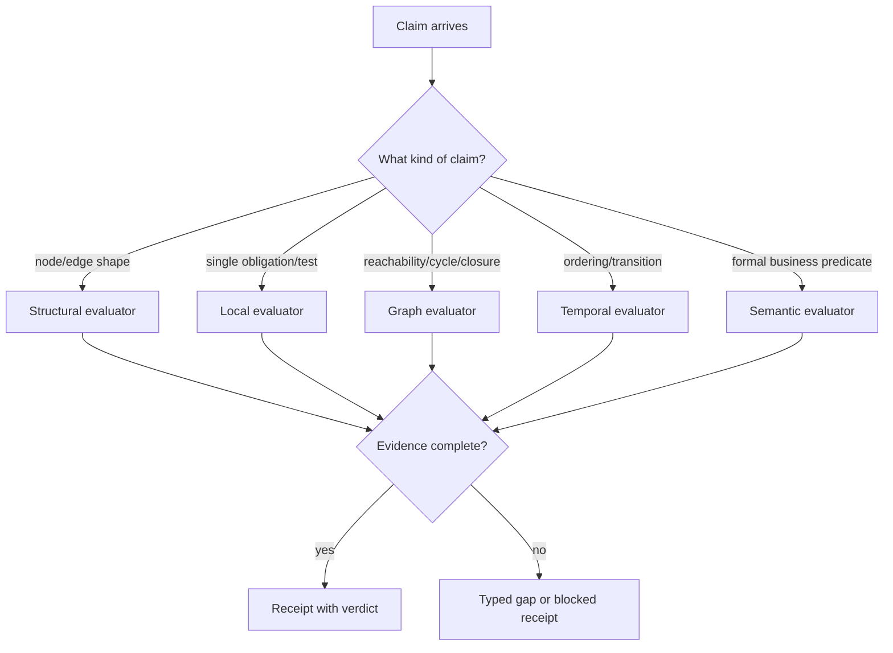

# Design: Graph Composability Evidence Spine

## Design Intent

Separate authored facts, derived claims, executable tests, and evidence so a
graph can be composed and re-tested without hiding a step inside a runner. The
design is deliberately profile-aware: the first profile is the key-and-door
`enforces` example, while later profiles can add node kinds and evaluator
families through admission contracts.

## 1. Context View

```mermaid
flowchart LR
  Source[Authored source graph and relationship registry]
  Normalizer[Normalizer and profile admission]
  Deriver[Obligation derivation]
  Binder[Binding and fixture adapter]
  Runner[Test harness]
  Evaluator[Local or graph evaluator]
  Receipt[Typed receipt]
  Inventory[Generated Inventory read model]
  Source --> Normalizer --> Deriver --> Binder --> Runner --> Evaluator --> Receipt
  Receipt --> Inventory
```



The source files and relationship registry are authoritative. Normalized graphs,
obligations, generated tests, evaluator outputs, receipts, and Inventory views
are derived artifacts.

## 2. High-Level Structure View

| Plane | Components | Responsibility | Must not do |
| --- | --- | --- | --- |
| Source plane | `NodeSource`, `EdgeSource`, `RelationshipSignature` | preserve authored intent and admissible links | infer runtime truth |
| Derivation plane | `Graph`, structural validator, obligation rules, test emitter | make deterministic consequences explicit | conceal missing formal predicates |
| Execution plane | `Binding`, harness adapter, `TestCase` runner | connect a logical claim to a runtime | rewrite source authority |
| Evidence plane | `Evaluator`, `Receipt`, Inventory projection | judge and preserve evidence | promote a receipt to release authority |

The v1 aspect adapter sits at the source/derivation boundary: operation rules,
calculations, and postconditions become candidate obligations; interface
requests and responses become binding/evaluator inputs. It does not turn the v1
aspect files into v2 authority.

## 3. Low-Level Components And Contracts

Candidate JSON-like shapes (field names are contract targets, not implementation
instructions):

```ts
type NodeSource = {
  node_id: string; kind: string; source_anchor: string; content_digest: string
}
type EdgeSource = {
  edge_id: string; signature: string; from: string; to: string;
  source_anchor: string; content_digest: string
}
type Graph = {
  graph_id: string; nodes: NodeSource[]; edges: EdgeSource[];
  source_digest: string; normalization_version: string
}
type Obligation = {
  obligation_id: string; rule_type: string; source_anchor: string;
  source_edge_id: string; canonical_params: object; rule_set_version: string
}
type TestCase = {
  test_id: string; obligation_id: string; fixture_ref: string;
  expected_predicate: object | null; status: "runnable" | "needs_formal"
}
type Binding = {
  binding_id: string; test_id: string; adapter: string;
  runtime_target: string; fixture_digest: string; graph_digest: string
}
type Evaluator = {
  evaluator_id: string; scope: "local" | "graph" | "temporal" | "semantic";
  input_contract: string; verdicts: string[]
}
type Receipt = {
  receipt_id: string; inputs: string[]; verdict: string;
  structural: object; execution: object | null; evaluator: object;
  residue: string[]; content_digests: string[]
}
```

`Graph` is a normalized container; it is not a replacement for the authored
node and edge records. `Evaluator` is intentionally an interface family, not a
promise that every formal engine already exists.

## 4. Workflow Process View



Every transition is a handoff boundary. A missing endpoint, unsupported
signature, stale digest, missing binding, or missing formal predicate yields a
typed residue rather than an invented pass.

## 5. Decision Flow View



The first proof uses structural and local evaluation only. Graph, temporal, and
semantic branches are explicit future extension points.

## 6. Dependency And Interface View

| Interface | Input authority | Output | Consumer | Boundary |
| --- | --- | --- | --- | --- |
| profile admission | supported-profile source | admitted node/edge kinds | normalizer | no automatic profile expansion |
| relationship admission | relationship registry | accepted/rejected edge | normalizer | endpoint signature remains authoritative |
| derivation `δ` | normalized graph + rule set | ordered obligations | test emitter | generator does not define `O_spec` |
| test emission | obligation + formal AST/fixture | test case or `needs_formal` | binding | no invented expected value |
| binding | test case + adapter registry | runnable invocation | harness | stale digest is a failure |
| evaluator | result + evaluator contract | verdict + evidence | receipt | verdict scope is explicit |
| receipt | all prior digests and residues | append-only evidence | reviewer/Inventory | not release authority |

## Two-Proof IOLM Consumer Boundary

Accepted [DEC-GCP-002](decisions/2026-07-20-iolm-proof-role.md) keeps two
independently closable proofs:

1. `SWU-GCP-001` proves the executable core from authored graph through
   obligation, TestCase, binding, evaluator, execution result, mutation, and
   receipt.
2. The private Interactive Ontology Learning Map consumes the exact successful
   core handles and independently proves unchanged IDs, relation direction,
   provenance, semantic bytes, view hashes, deterministic rebuild, and
   graph/hierarchy/table parity.

The IOLM adapter accepts exact handles; it does not author the formal predicate,
define `O_spec`, re-derive the core verdict, admit a profile, or change FPR,
release, production, or publication state. A missing or failed IOLM receipt
blocks only the combined “executable proof used by a real application” claim.
It cannot downgrade or upgrade the independently evaluated core receipt.

The same versioned consumer boundary is rerun later against the green BTE core
receipt. That breadth run is fresh evidence with its own run identity and cannot
be substituted by the narrow core receipt, a schema, or a fixture.

## v1 Aspect Adapter Boundary

`operations.md` is the preferred source pattern for formal obligations because
its rows already distinguish inputs, rules, calculations, postconditions, and
traceability. `interfaces.md` is the preferred source pattern for the binding
and evaluator boundary because it exposes request/response conditions. The
adapter must preserve those anchors while adding v2 graph and source digests.
State/event/query/mapping aspects remain optional extensions, not L0 inputs.

## Design Decisions

1. Keep graph composition separate from test execution so a structural receipt
   can exist even when no runtime adapter is available.
2. Use content digests at every handoff; this makes stale bindings and mutated
   source visible.
3. Make evaluator scope explicit instead of exposing one universal `check()`.
4. Treat `needs_formal`, `it.skip`, and `it.todo` as residue that blocks a
   completeness claim, while preserving the useful structural evidence.
5. Preserve the existing backend completeness package as the broad execution
   owner; this package supplies its composability contract and first proof.

## Risks And Deferred Decisions

- Closed TypeScript unions may prevent profile evolution until admission is
  generalized.
- Relationship signatures not mapped by the current checker need adapters or
  an explicit unsupported status.
- Cross-graph laws need a bounded query language and an independent oracle.
- Receipt schemas may need separate structural, execution, and semantic
  envelopes once formal evaluators are implemented.

No source code, canonical definitions, release state, or Inventory authority is
changed by this design artifact.
