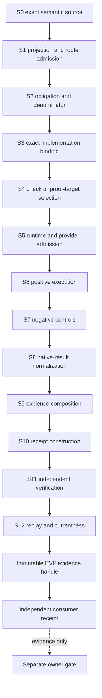

# EVF Production-Stability Plan

## Outcome

This plan takes EVF from bounded candidate-local evidence to an exact,
independently testable production-stability candidate. It does not call EVF
production-stable today. It does not adopt EVF, activate enforcement, mutate the
Auth Service, or grant release, deployment, or production authority.

The intended sequence is:

```text
stabilize EVF as a product
  -> obtain current product-test evidence
  -> obtain product approval
  -> make a separate bounded adoption/enforcement decision
  -> prove enforcement and rollback on a reference vertical
  -> only then begin a new Auth-specific D65 application epoch
```

The machine-readable dependency graph is
[`production-stability-dag.v1-candidate.json`](production-stability-dag.v1-candidate.json).

## Why This Plan Is Needed

The current EVF architecture already establishes the right trust boundaries:
meaning stays upstream, exact identity crosses every seam, provider-native truth
is preserved, evidence composition is non-inflating, failure is data, consumers
remain independent, and evidence grants no authority. Current repository-local
evidence proves bounded L0/L1 slices and one selected L2 reachability join.

That is not yet an enforceable production framework:

- the canonical receipt schema is fixed to `SWU-GCP-001`, two key-and-door
  observations, and sixteen exact mutants rather than a generic profile;
- there is no generic executable stage-DAG contract or aggregate campaign
  receipt;
- no current receipt crosses the complete source -> projection -> derivation ->
  provider -> EVF -> independent-consumer vertical;
- current runners can overwrite outputs and do not yet prove atomic,
  append-only, crash-safe finalization;
- current validation paths do not uniformly distinguish cause-specific mutant
  rejection from an unrelated nonzero process result;
- replay and currentness are not yet complete across every material input,
  provider result, join, and final receipt; and
- producer-side success is not yet closed by a structurally independent,
  read-only verifier for every stage and dependency edge.

The current Auth campaign is therefore a useful downstream prototype, not proof
that EVF itself is stable or enforceable.

## Product Definition: `EVF production-stable`

`EVF production-stable` is a bounded product-evidence state. It may be claimed
for one immutable candidate digest only when all of the following are current:

1. A versioned enforcement profile declares every EVF stage, selected provider
   route, exact denominator, mandatory artifacts, terminal-state rules, and
   claim ceiling.
2. Every declared stage terminates as `passed`, `failed`, `blocked`,
   `indeterminate`, or profile-authorized `not_applicable`; omission is invalid.
3. All material inputs and outputs use canonical serialization and exact path,
   SHA-256, and byte-size references. Currentness is checked per reference.
4. The run store is content-addressed, append-only, atomic at finalization, and
   crash-recoverable. An earlier PASS cannot survive as the apparent result of a
   later interrupted run.
5. Positive execution and negative controls are both real executions. A mutant
   is killed only by its declared cause-specific oracle, not by any arbitrary
   process failure.
6. Provider runtime identity, command, working directory, environment allowlist,
   resource limits, timeout, output limits, and network policy are exact and
   independently checked.
7. Provider-native outcomes remain reachable. Timeout, unknown, malformed,
   stale, unsupported, disagreement, and missing evidence cannot normalize to a
   pass.
8. Evidence joins prove exact semantic and scope comparability and expose only
   the intersection supported by their constituents.
9. A separate read-only verifier rehashes every reference, checks every DAG edge
   and denominator, recomputes the aggregate result, and cannot write producer
   artifacts.
10. Two clean-environment runs produce the same canonical evidence-payload
    digest. Run envelopes may have distinct identities and timestamps; those
    fields cannot hide payload drift.
11. A hostile conformance suite exercises missing, stale, duplicate, malformed,
    unknown, timeout, wrong-cause, surviving-mutant, crash, partial-write,
    incomparable-join, replay, and tamper cases at every affected stage.
12. Three reference profiles close successfully: one executable runtime/test
    route, one theorem/meta-type route, and one multi-provider joined route.
13. One exact claim crosses the complete source-to-independent-consumer vertical
    without identity loss, omitted residue, or claim inflation.
14. An independent product assessment confirms the candidate and current test
    evidence before a human product-approval decision.

This state does **not** mean adopted, activated, released, deployed, secure for
all workloads, or correct outside its declared profiles. Applying enforcement
to Auth additionally requires a separate adoption decision and Auth-specific
candidate/test/approval epoch.

## Enforced EVF Stage Architecture



Every selected profile instantiates the full stage list. Route-specific artifact
types vary, but stages are never silently skipped:

- the executable route uses a neutral TDE obligation/case set and an admitted
  runtime binding;
- the theorem route uses a capability assessment, `FormalClaimLeanBinding`,
  theorem request, exact theorem runtime, and theorem evidence; it does not
  pretend Lean is an ordinary generated test profile;
- the multi-provider route requires each provider to close independently before
  an exact-comparability join; and
- `not_applicable` is valid only when the profile names the stage, gives its
  reason code, and binds the rule authorizing that outcome.

The positive normalized theorem outcome remains `PASS_BOUNDED`, never an
unqualified proof of runtime conformance. A meta-type theorem proves only its
exact graph/source/projection correspondence. An Auth application will need an
Auth-specific generated theorem instance; the current foundation fixture cannot
be reused as Auth evidence.

## CAV2-D65 Construction Chain

The graph enforces this order:

```text
prototype definitions
  -> agent-facing ontology scaffold
  -> product, business, DomainSpec, compiled-system, and implementation prototypes
  -> one exact frozen EVF product candidate
  -> current product-test evidence
  -> product approval
  -> separate adoption/enforcement decision
  -> reference enforcement and rollback proof
  -> separate Auth D65 application epoch
```

Prototype and ontology stages are navigational and non-authoritative. A changed
acceptance-bound byte invalidates the product-test and approval epoch. Neither a
schema PASS nor a digest refresh manufactures approval or operational authority.

## Implementation Layers

### L0 — Generic Contract Proof

**Decision question:** After this layer, we know whether EVF can represent every
stage and terminal outcome generically without key-and-door constants.

- Minimum working unit: a generic enforcement-profile schema, exact-reference
  contract, stage receipt, aggregate receipt, and three route fixtures.
- Included: terminal algebra, denominator closure, route selection,
  `not_applicable` authorization, claim ceilings, and v1 compatibility decision.
- Deferred: execution, provider processes, persistent run storage, Auth.
- Visible outcome: a profile can be structurally compiled into a complete DAG
  whose missing or duplicate stage is rejected.
- Risk reduced: scenario-specific validation masquerading as a framework.
- Main cost: contract migration design and compatibility fixtures.
- Exit evidence: schema conformance, invalid-fixture corpus, DAG acyclicity, and
  round-trip canonicalization.
- Promotion decision: proceed only if no profile can omit a stage or widen a
  claim through shape alone.

### L1 — Deterministic Execution Kernel

**Decision question:** After this layer, we know whether the declared DAG can be
executed and finalized without stale PASS, partial-write, or ambient-input risk.

- Minimum working unit: content-addressed append-only run store, atomic finalizer,
  stage executor, runtime admission, and cause-specific negative controls.
- Included: crash recovery, exact environment/runtime binding, typed residue,
  positive and negative execution, and aggregate derivation.
- Deferred: broad provider coverage, external consumer use, Auth.
- Visible outcome: interrupted and hostile runs leave an explicit non-pass run
  record and cannot overwrite earlier evidence.
- Risk reduced: false success caused by stale files, unrelated command failure,
  or mutable ambient state.
- Main cost: kernel/runtime boundary, storage protocol, isolation, and fault
  injection.
- Exit evidence: deterministic integration tests and crash/partial-write corpus.
- Promotion decision: proceed only when the finalizer is monotonic and every
  negative control has a cause-specific oracle.

### L2 — Provider and Independent-Verification Closure

**Decision question:** After this layer, we know whether runtime, theorem, and
multi-provider routes preserve native truth and can be independently verified.

- Minimum working unit: one runtime/test adapter, the Lean meta-type theorem
  adapter, one two-provider join, and a separate read-only verifier.
- Included: runtime manifests, network-policy evidence, theorem bindings,
  comparability preflight, normalization, composition, full rehash/currentness.
- Deferred: production-scale throughput and Auth semantics.
- Visible outcome: three route profiles close through the same generic stage
  contract while retaining route-specific evidence.
- Risk reduced: provider result flattening, self-certification, and theorem/runtime
  category collapse.
- Main cost: clean provider environments and independent verifier implementation.
- Exit evidence: provider-native receipts, hostile mappings, tamper tests, and
  verifier/producer differential tests.
- Promotion decision: proceed only if producer PASS can be recomputed from
  immutable inputs by the independent verifier.

### L3 — Complete Vertical and Frozen Product Candidate

**Decision question:** After this layer, we know whether one exact claim can
cross every EVF ownership boundary and be frozen as one product candidate.

- Minimum working unit: one selected source -> admission -> derivation/provider
  -> EVF -> independently owned reference-consumer vertical.
- Included: all three reference profiles, hostile conformance suite, operational
  runbook candidate, observability, recovery, and candidate inventory.
- Deferred: product approval, adoption, Auth application, release/deployment.
- Visible outcome: one immutable candidate manifest and complete evidence graph.
- Risk reduced: local seam passes being mistaken for system-level completeness.
- Main cost: independent consumer coordination and clean-environment reproduction.
- Exit evidence: exact candidate digest, complete denominator, zero omitted stages,
  and two-run canonical evidence-payload equality.
- Promotion decision: freeze only after all acceptance-bound bytes are inventoried;
  any later byte change creates a new candidate.

### L4 — Product Approval and Bounded Enforcement Readiness

**Decision question:** After this layer, we know whether an approved EVF product
candidate is separately eligible to enforce one declared profile and roll back
without losing evidence.

- Minimum working unit: independent product assessment, human product approval,
  separate adoption/enforcement decision, and reference rollback rehearsal.
- Included: enforcement-point fail-closed behavior, degraded-mode policy,
  observability, retention, recovery, rollback, and authority separation.
- Deferred: Auth-specific profile, Auth approval, Auth cutover, public release,
  and deployment.
- Visible outcome: an exact EVF candidate may be selected for a separately
  authorized Auth application campaign.
- Risk reduced: technical evidence silently becoming operational authority.
- Main cost: owner review and operational rehearsal.
- Exit evidence: product decision bound to candidate digest, separate enforcement
  decision, successful rollback rehearsal, and retained immutable evidence.
- Promotion decision: open the Auth application frontier; do not activate Auth.

Every later layer retains these earlier guarantees: exact identity, full stage
denominator, typed non-pass states, native provider truth, non-inflating joins,
independent verification, append-only evidence, and authority effect `none` on
technical receipts.

## DAG Work Nodes

| Wave | Nodes | Product effect | Exit boundary |
| --- | --- | --- | --- |
| W0 definitions | `EVF-PS-00`–`EVF-PS-04` | freeze baseline, definitions, ontology scaffold, prototype contracts, and owner decisions | no implementation |
| W1 kernel | `EVF-PS-05`–`EVF-PS-09` | compile generic contracts; implement store, executor, runtime admission, and mutations | candidate-local implementation only |
| W2 evidence closure | `EVF-PS-10`–`EVF-PS-12` | theorem lane, non-inflating composition, and independent verifier | no product claim |
| W3 reference vertical | `EVF-PS-13`–`EVF-PS-15` | close reference profiles, hostile suite, and freeze exact candidate | product-test request eligible |
| W4 product test | `EVF-PS-16`–`EVF-PS-18` | current tests, independent assessment, and product approval | no operational authority |
| W5 authority/operations | `EVF-PS-19`–`EVF-PS-20` | separate bounded adoption decision and reference enforcement/rollback | Auth application eligible, not active |
| A0 Auth application | `AUTH-EVF-00`–`AUTH-EVF-05` | new Auth-specific D65 candidate, test, approval, and separate enforcement decision | downstream and deferred |

The first runnable product frontier after this plan is accepted is
`EVF-PS-00`/`EVF-PS-01`: freeze the audit baseline and author the generic
production-stability definitions. `EVF-PS-04` must resolve the implementation
decisions before code or existing contracts are changed.

## Decision Gates Before Implementation

These are real blockers for implementation, but they do not block creating this
plan.

### `EVF-DEC-001` — Receipt evolution

- Recommended: introduce generic `v2` stage/aggregate contracts while retaining
  the scenario-specific v1 receipt as a compatibility fixture and adapter target.
- Alternative: replace v1 in place, accepting higher evidence-history and
  consumer-breakage risk.
- Defer/stop: retain present candidate-local EVF and do not claim production
  stability.

### `EVF-DEC-002` — Production kernel boundary

- Option A: governed Rust kernel with compatibility adapters around current
  TypeScript/Python evidence producers.
- Option B: harden the current TypeScript core and expose a language-neutral CLI.
- Option C: specify the language-neutral protocol first and defer the kernel
  language until L0 contracts pass.
- Defer/stop: do not begin implementation.

The decision must account for deterministic serialization, atomic persistence,
process containment, portability, and independent-verifier separation. This plan
does not select a language on the owner's behalf.

### `EVF-DEC-003` — First complete vertical

- Recommended: migrate the narrow key-and-door slice to generic v2 and pair it
  with a separately owned minimal reference consumer.
- Alternative: use the meta-type theorem route as the first vertical.
- Alternative: use the existing Souffle/Alloy reachability join.
- Defer/stop: preserve seam-local evidence without claiming system completeness.

Whichever route is selected, all three reference profiles remain required before
the product candidate is frozen.

## Operational Support Lane

Operational tasks do not replace product work or silently become global
blockers. Each task names the stages it can actually affect.

| ID | Affected stages | Causal blocking basis | Owner | Required evidence |
| --- | --- | --- | --- | --- |
| `EVF-OPS-01` | plan registration | CyberAlchemy Goals validation is currently blocked | goals/governance owner | a current admitted registration receipt; this does not alter plan bytes |
| `EVF-OPS-02` | S5–S7, S12 | the present sandbox cannot run the full `tsx` subprocess test because IPC socket creation returns `EPERM` | execution-environment owner | clean-environment test receipt with exact environment identity |
| `EVF-OPS-03` | S5–S9 | Alloy, Souffle, SMT, and Lean runtimes need portable manifests rather than user-cache or ambient paths | provider/runtime owners | version, executable digest, dependency lock, command, limits, and currentness |
| `EVF-OPS-04` | S5–S7 | a no-network policy is not proof of isolation unless the host supplies and identifies the boundary | host-runner owner | independently inspectable namespace/sandbox evidence or typed `blocked` |
| `EVF-OPS-05` | S10–S12 | append-only retention, capacity, corruption recovery, and run indexing are not yet production contracts | EVF operations owner | retention/recovery rehearsal and immutable run inventory |
| `EVF-OPS-06` | S6–S12 | stage metrics must not contain Auth credentials or private semantic payloads | observability/privacy owners | field allowlist, redaction tests, and private-boundary review |

## Product Test Matrix

| Test family | Must prove | Required non-pass examples |
| --- | --- | --- |
| contract/DAG | complete acyclic stage denominator and legal route selection | missing, duplicate, cyclic, unauthorized N/A |
| identity/currentness | every material byte is exact and current | stale digest, size drift, path substitution, post-run mutation |
| derivation/binding | stable IDs, complete denominator, unique exact binding | hidden skip, orphan, duplicate, ambiguous target |
| execution | exact admitted runtime produced the native result | timeout, spawn error, malformed output, unisolated network claim |
| negative control | each declared mutant is executed and killed for its stated reason | surviving mutant, wrong-cause process failure, unexecuted mutant |
| normalization/join | native truth is retained and joins do not inflate | unknown-to-pass mapping, disagreement, incomparable scope |
| persistence | finalization is atomic and monotonic | crash before/after stage write, partial receipt, stale PASS reuse |
| independent verification | producer output is fully recomputable read-only | tamper, missing ref, altered denominator, forged aggregate PASS |
| replay | canonical evidence payload is deterministic across clean runs | ambient path, order, locale, time, or cache dependence |
| consumer boundary | exact handles cross unchanged and consumer authors its receipt | EVF-authored consumer proof, handle substitution, missing receipt |
| theorem/meta-type | theorem binds exact graph/source/projection and preserves its ceiling | fixture reuse for another domain, stale theorem, runtime claim inflation |

Preacceptance is collect-all and non-effectful: dependent checks whose inputs are
blocked are recorded as `not_evaluable` with their causal blocker. Effectful
execution later stops at the first real effectful failure; it does not implicitly
execute successors.

## Auth Application Boundary

Auth remains downstream until `EVF-PS-20` closes. The subsequent Auth campaign
must start a new exact D65 epoch:

1. freeze one Auth semantic, DomainSpec, theorem, implementation, test, provider,
   and campaign input set;
2. author an Auth EVF profile with every S0–S12 stage and an exact denominator;
3. replace token-presence derivation and set-membership lineage with exact typed
   derivation and ordered lineage proofs;
4. execute provider and scope mutants rather than checking only source text;
5. bind the trusted-boundary implementation and every scope-detector input into
   the immutable candidate;
6. generate an Auth-specific meta-type theorem instance and bind it to the exact
   Rust projection; the foundation fixture is not admissible Auth evidence;
7. write observations and receipts to a new content-addressed run, never overwrite
   a prior PASS;
8. independently verify and replay the complete Auth run; and
9. seek Auth product approval and any enforcement/cutover decision separately.

The existing `auth-service-evf-campaign/v1-candidate` remains historical
prototype evidence. It is not the production EVF profile and is not mutated by
this plan.

## Completion and Claim Ceiling

The plan is complete when its Markdown and JSON DAG agree structurally. The EVF
work is complete only when `EVF-PS-20` has current evidence. The Auth application
work is separate and begins at `AUTH-EVF-00`.

Current claim:

> A D65-ordered, machine-readable production-stability plan exists for EVF. It
> identifies the exact enforcement stages, product layers, decision gates,
> operational dependencies, test evidence, approval boundary, and deferred Auth
> application. No implementation, product approval, adoption, enforcement,
> release, deployment, or production claim is granted.

## Source Anchors

- [`README.md`](README.md) — EVF purpose, maturity, and claim ceiling.
- [`ARCHITECTURE.md`](ARCHITECTURE.md) — responsibilities, stage seams, failure
  model, current/target state, and complete-vertical requirement.
- [`IMPLEMENTATION-LAYERING.md`](IMPLEMENTATION-LAYERING.md) — current bounded
  graph-evidence layers; retained as historical capability evidence.
- [`WORK-PACK.md`](WORK-PACK.md) — current slice evidence, gaps, and owner
  boundaries; it is not reused as this plan's execution mechanism.
- [`contracts/evolvable-validation-receipt.v1.schema.json`](contracts/evolvable-validation-receipt.v1.schema.json)
  — scenario-specific v1 receipt that motivates generic contract evolution.
- [`../../formalization/docs/TDE-EVF-INTEGRATION.md`](../../formalization/docs/TDE-EVF-INTEGRATION.md)
  — executable, solver, and theorem route ownership and join semantics.
- [`../../../auth-foundation/development/auth-service-d65-r2-plan/evf-campaign-v1/campaign.json`](../../../auth-foundation/development/auth-service-d65-r2-plan/evf-campaign-v1/campaign.json)
  — downstream Auth prototype boundary only.
