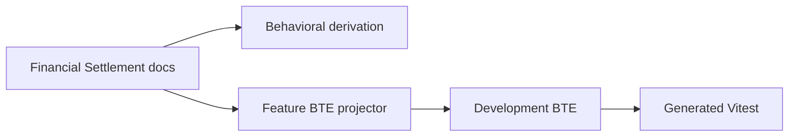
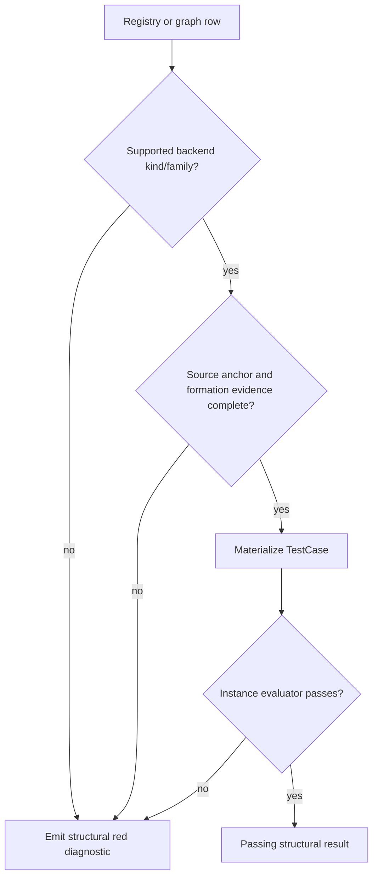

# Architecture: Financial Settlement Executable Test Generation

## Design Intent

Add a narrow bridge between the real Financial Settlement documents and the
development BTE. Preserve the complete-profile fixture, keep behavioral
derivation independent, and make invalid feature structure visible through
generated executable tests instead of fail-fast loss or fabricated passes.

## 1. Context View



The two lanes share source documents but own different claims. Behavioral
derivation remains responsible for its 79 obligations and oracle gaps.
Structural BTE generation owns registered node and edge conformance only.

## 2. High-Level Structure View

```text
feature documents
  -> registry and feature-graph reader
  -> formation-evidence adapters
  -> DevelopmentProject { coverage_mode: declared-subset }
  -> collecting structural validator
  -> six exact catalogues
  -> TestCase / ExecutionResult
  -> Vitest emitter + coverage report
```

Complete-profile mode remains the default, so the existing all-backend fixture
and its 89 obligations do not weaken.

## 3. Low-Level Components View

| Component | Responsibility | Input | Output |
| --- | --- | --- | --- |
| `feature-projector.ts` | Read the `Concepts` or `Concept Registry` table, Feature Concept Graph, links, and formation evidence. | Feature directory | Project plus projection diagnostics |
| `development-engine.ts` | Admit complete-profile or exact declared-subset membership; expose reusable node and edge validators. | `DevelopmentProject` | Graph/build or stable diagnostics |
| `proof-engine.ts` | Materialize exact catalogue members and evaluate full node/edge instance conformance. | Project/build/diagnostics | Structural TestCases and results |
| `emit/development-tests.ts` | Render one executable Vitest case per structural TestCase and a machine report. | TestCases/results/source handle | Byte-stable `.derived.test.ts` and report |
| `development-feature-pipeline.ts` | Compose projection, generation, emission, replay, and CLI summary. | Feature path | Generated file/report and exit result |

### Projection Rules

1. Registry rows define root node membership and canonical kind; aspect-parser
   helper nodes do not silently become root BTE nodes.
2. Feature Concept Graph rows define edge membership.
3. Registry links and graph evidence cells must resolve within the feature
   directory.
4. Formation body fields require explicit source evidence. Missing evidence
   emits a stable projection/formation diagnostic.
5. `Evidence` and `Source Evidence` are accepted as explicit dialect aliases;
   other header guessing is rejected.
6. Node and edge IDs are stable functions of feature ID, registry ID or graph
   row, and source anchor.
7. The projector never changes the source to make a test pass.

## 4. Workflow Process View

```text
read source snapshot
  -> parse registry and graph
  -> resolve each linked aspect anchor
  -> project every registered node and graph edge
  -> collect projection diagnostics
  -> derive exact six-catalogue membership
  -> materialize all structural TestCases
  -> evaluate each node/edge independently
  -> emit runnable Vitest and coverage report
  -> run generated suite
  -> replay bytes and membership
```

Projection or conformance failure is attached to the affected test. Build/core
aggregation becomes green only when all required structural cases pass.

## 5. Decision Flow View



Decisions:

- Feature completeness means exact declared membership, not full-profile
  breadth.
- Generation completes even when a source test is red.
- Structural and behavioral coverage counts are reported separately.
- The current `maps -> SettlementResult` incompatibility is not auto-repaired.

## 6. Dependency And Interface View

| Provider | Consumer | Contract | Failure |
| --- | --- | --- | --- |
| Financial Settlement `SPEC.md` | projector | registry IDs, kinds, graph rows, evidence anchors | stable projection diagnostic |
| Aspect docs | formation adapters | kind-specific evidence | missing/invalid formation diagnostic |
| Projector | development engine | `DevelopmentProject` with explicit coverage mode | profile/subset diagnostic |
| Development engine | proof engine | graph plus reusable instance validators | per-test structural failure |
| Proof engine | emitter | exact TestCases and results | missing/extra/duplicate member failure |
| Emitter | Vitest | relative source handle and deterministic cases | compilation or runtime failure |

## Risks

| Risk | Guard |
| --- | --- |
| Registry and aspect parser disagree on a concept's kind. | Registry kind owns root membership; disagreement becomes a diagnostic with both anchors. |
| Fail-fast compilation prevents complete test emission. | Add a collecting validation path and reserve throwing compile for green aggregation. |
| Type semantics are used as invented formation evidence. | Require a source anchor for every projected body field. |
| Structural success is reported as behavioral completeness. | Separate reports and retain the 67 behavioral gaps unchanged. |
| Subset mode weakens the full-profile fixture. | Default to complete-profile and retain exact 13/16 regression tests. |
