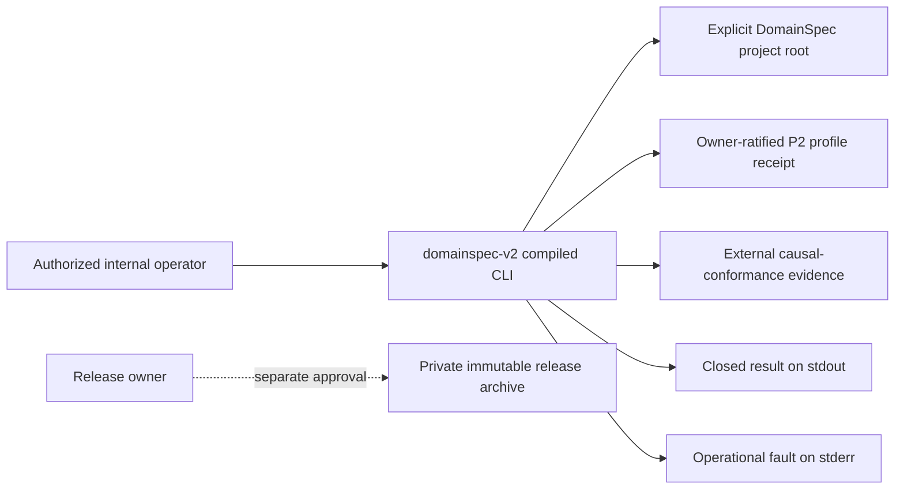

# Design: Stable Foundation CLI

## Design intent

Create a narrow read-only product boundary around reusable current parser and
minted-project mechanics while replacing their fallback resolution, open output,
source-run packaging, and self-attesting evidence assumptions. Every result is
bound to exact external owner inputs and remains non-authoritative.

## View 1 — context



The operator supplies an explicit project root. The CLI reads canonical/profile
and causal-evidence bindings but cannot admit them. The supported runtime has no
network, telemetry, or product-file write effect.

## View 2 — high-level structure

```text
bin/domainspec-v2
  -> InvocationDecoder
  -> RuntimeAndLimitPreflight
  -> ProjectRootResolver
  -> ProfileBindingResolver
  -> StructuralEvaluator
  -> LintPaginator | ReceiptProjector
  -> AtomicResultWriter
```

`@domainspec-v2/cli` is a new workspace package under `impl/cli/`. The existing
`@domainspec-v2/impl` root owns development dependencies and the one authoritative
npm lock. The CLI package imports only explicitly curated pure structural modules;
it never exposes the current development CLI or factory command surface.

## View 3 — low-level components

| Component | Responsibility | Input | Output/failure |
| --- | --- | --- | --- |
| InvocationDecoder | closed command/flag grammar | argv | typed invocation or exit 1 |
| RuntimePreflight | exact Node/platform and resource limits | runtime + root metadata | admitted context or 21/23 |
| ProjectRootResolver | contain and order declared node/edge sources | explicit root | digest-bound source manifest or 22 |
| ProfileBindingResolver | resolve owner-ratified P2 identity and 13/16 denominator | profile receipt + registries | bound profile view or 20 |
| StructuralEvaluator | apply schema, formation, relationship, and causal-receipt checks | manifest/profile/evidence | normalized findings |
| LintPaginator | stable sort, whole-report digest, page slice, token | findings + page request | DiagnosticReport page |
| ReceiptProjector | compact exact structural summary | evaluation result | StructuralReceipt |
| AtomicResultWriter | buffer, closed-decode, size-check, single write | declared result | one stdout JSON or exit 23/24 |
| FaultWriter | pointer-only operational fault | typed fault | one stderr JSON |
| AcceptanceBindingValidator | invalidate stale candidate evidence | candidate manifest + owner receipt | pass/fail receipt |

## View 4 — workflow process

1. Decode argv without reading a default path.
2. Verify Node `v24.19.0`, Linux x64, and supported command.
3. Resolve and contain the explicit project root; census sizes before full read.
4. Load exact owner-ratified profile/registry bindings and reject stale or missing input.
5. Resolve all feature-local nodes/same-feature edges and project cross-feature edges.
6. Evaluate structural/formation/relationship rules and externally supplied causal evidence.
7. Normalize stable codes and relative pointers; never retain excerpts.
8. Materialize the complete declared JSON in memory or a private bounded temp file,
   validate it against its own closed schema, then perform one result-channel write.
9. Return the stable exit class. Cleanup candidate-local temporary bytes.

No step installs dependencies, contacts a network, writes the project, promotes a
profile, or modifies release/authority state.

## View 5 — decision and state flow

```text
START
  -> USAGE_REJECTED (1)
  -> RUNTIME_REJECTED (21)
  -> PATH_REJECTED (22)
  -> RESOURCE_REJECTED (23)
  -> PROFILE_REJECTED (20)
  -> EVALUATED
       -> ACCEPTED (0)
       -> STRUCTURAL_REJECTED (4)
  -> INTERNAL_REJECTED (24)
```

Terminal states emit at most one closed document on the declared channel. A
serialization, size, or write failure before stdout commit emits no partial result.
Receipt history and release history are immutable; patch, rollback, withdrawal,
quarantine, and supersession add records rather than changing past states.

## View 6 — dependency and interface

| Interface | Direction | Version/binding | Owner boundary |
| --- | --- | --- | --- |
| canonical meta-types/relationships | inbound read | exact content digests | definitions owners |
| P2 supported-profile receipt | inbound read | profile ID/version + 13/16 membership + owner receipt digest | profile owner |
| C2 expected/executed evidence | inbound read | independent expected catalogue and executed receipt identities | conformance/validation owners |
| project source manifest | internal | ordered relative paths, sizes, per-file and aggregate digests | project source owners; CLI derives only |
| StructuralReceipt v1 | outbound stdout | closed schema + decoder + producer/runtime/profile/source digests | CLI contract owner; authority none |
| DiagnosticReport v1 | outbound stdout | closed schema, stable ordering/pagination/token/report digest | CLI contract owner |
| OperationalFault v1 | outbound stderr | stable code, pointer, no protected content | CLI contract/security owner |
| release candidate manifest | inbound to acceptance validator | source/dependency/artifact/runtime hashes | build/release owners |

## Authority and trust extension

- Canonical definitions, profile admission, causal expected catalogue,
  implementation-conformance acceptance, CLI artifact, evidence verification,
  and release approval have distinct accountable owners.
- The CLI accepts only digest-bound owner receipts and rejects self-issued or
  stale inputs.
- `authority_effect: none` is mandatory in structural results.
- Bypass tests replace each owner receipt, digest, profile membership, and
  candidate artifact independently and require failure.

## Security and abuse extension

- Treat every path, JSON member, token, diagnostic field, dependency script, and
  environment value as untrusted.
- Resolve real paths under the explicit root; reject symlink/path escape,
  duplicate identity, decompression/size expansion, unknown members, and token reuse.
- Use a minimal environment allowlist for build/tests and no inherited environment
  in supported runtime results.
- Network calls and telemetry are forbidden and tested with process-level denial.
- Secret canaries must never reach stdout, stderr, archives, snapshots, or caches.

## Persistence, failure, and compensation extension

The supported CLI owns no database, queue, or durable runtime mutation. Its only
durable product artifacts are separately staged release bytes, acceptance receipts,
and diagnostic bundles owned by release/evidence workflows. A failed CLI invocation
does not compensate by rewriting project or historical bytes. Recovery is retry with
unchanged inputs or a new versioned candidate after correction.

## Integration and versioning extension

- Receipt and diagnostic schemas version independently and reject unknown major
  versions/unknown members unless that exact member is declared by the version.
- N-1 read support is decoder-only and time bounded; old inputs do not become
  writable current inputs.
- Page tokens bind schema, source, profile, CLI version, whole-report digest,
  page size, and next index; mismatched/replayed tokens fail.
- Current and historical modes resolve immutable preimages; mutable path lookup
  cannot silently substitute for a recorded digest.

## Migration and rollout extension

1. Add `impl/cli` as `@domainspec-v2/cli`; keep the impl workspace identity.
2. Curate pure resolver/evaluator modules behind new closed interfaces; do not
   rename or expose the development CLI.
3. Move the supported build path to npm 11.17.0 and one root lock; remove nested
   pnpm authority only in its own accepted migration SWU.
4. Produce compiled JS and a content-addressed private staging manifest.
5. Rebuild from two arbitrary clean roots before any candidate tag.
6. Run independent operator/support/rollback evidence; release remains a separate gate.

## Data lifecycle extension

| Data | Classification | Retention | Deletion/supersession |
| --- | --- | --- | --- |
| project inputs | internal-confidential; read only | caller-owned | CLI retains none |
| ordinary diagnostics | pointer-only internal | 90 days | expiry after reference check |
| release bytes and acceptance receipts | private content-addressed | permanent | never overwritten; may be withdrawn/superseded |
| incident evidence | redacted internal | permanent after approval | unredacted secret material quarantined/revoked |
| caches/temp | no authority | immediate cleanup when safe | must not break referenced receipts |

## Quality extension

Required quality scenarios include deterministic output across clean roots,
50,000-record/512-MiB/4-MiB/64-MiB boundaries, two-minute/4-GiB targets,
early over-bound rejection, killed negative mutants, no-write proof, dependency
script denial, and independent green/red operation. These are design requirements,
not current evidence.

## Significant behavior scenario

Stimulus: an operator runs `domainspec-v2 lint /tmp/project-a` where the project
contains all 13/16 admitted kinds/signatures and one wrong-root cross-feature edge.

Expected ordered response: preflight admits sizes; resolver rejects the edge scope;
the evaluator emits a stable relative pointer; paginator produces one closed report;
stdout contains exactly that report; stderr is empty; exit is 4; no file under the
project changes. Repeating from `/tmp/project-b` with byte-identical inputs yields
the same normalized report and whole-report digest.

Acceptance owner: independent CLI verifier. This scenario can falsify path topology,
profile binding, diagnostics, determinism, channel behavior, and no-write posture.

## Planned witness boundary

`PLANNED-WITNESS-CONTRACTS.md` defines fixtures and validators selected by this
design. They are unexecuted Design contracts and begin Plan at
`plan-evidence-pending`.

## Claim ceiling

This design can reach `design-validator-pass`. It cannot prove that code,
schemas, packages, builds, benchmarks, security controls, operators, release
records, or production behavior exist or pass.

