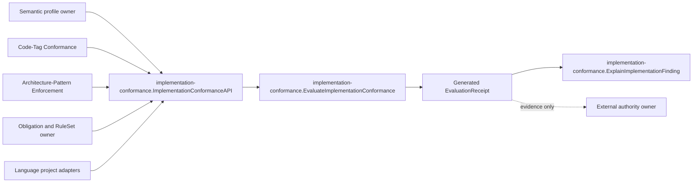
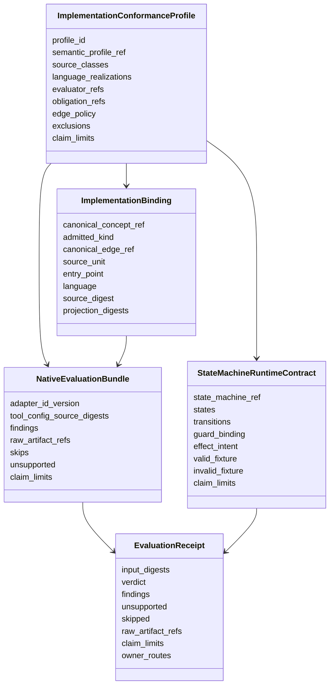
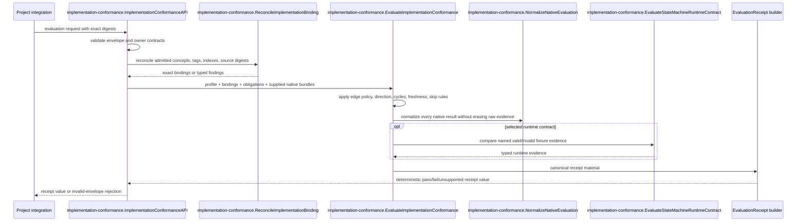
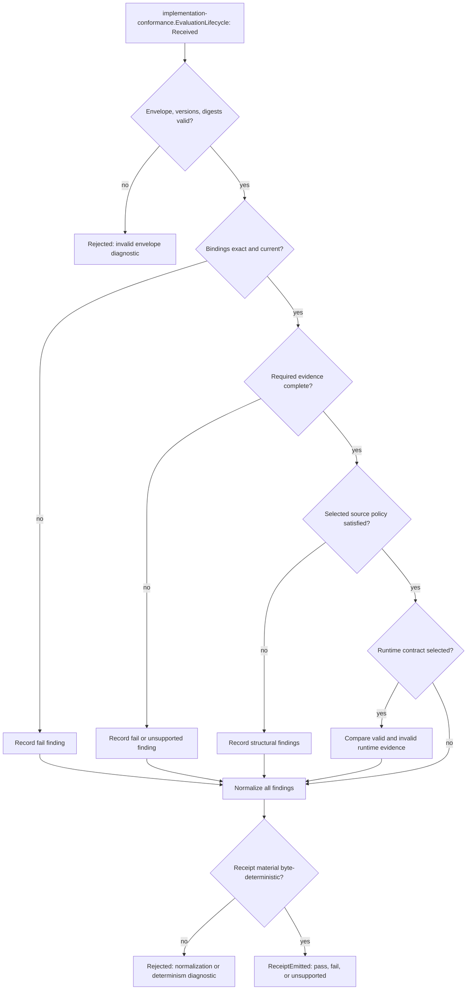
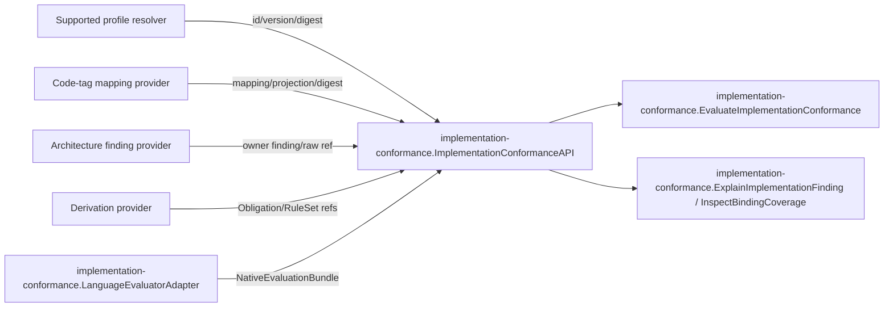

# Architecture Bundle: DomainSpec Implementation Conformance

## Design Intent

Build one profile-bound, deterministic composition layer between admitted
DomainSpec intent and language-native implementation evidence. Keep canonical
identity, native execution, evidence normalization, authority decisions, and
adoption as separate owners so no linter, generated index, or receipt can become
semantic authority by convenience.

## Inputs And Evidence Ceiling

- [SPEC](SPEC.md) and its [aspect documents](SPEC.md#aspect-docs)
- [source contracts](SOURCE-CONTRACTS.md)
- [closed Design scope](DESIGN-SCOPE-MANIFEST.json), input digest
  `4886731988f307c261b3331c17924302fccaa5a066782a8f861c4a19229f2ee4`
- [selection result](DESIGN-SELECTION-RESULT.json), result digest
  `d3fb7e558f4280f93df2eddf1c3798934729e90c299b5f06d6fcb20d8a9b7c72`
- evidence state: `design-validator-pass`

This is Design evidence. Product fixtures, parsers, adapters, benchmarks,
receipts, and runtime behavior are unexecuted.

## View 1 — Context

### Trust Boundaries

| Boundary | Input trust | Package action | Prohibited inference |
| --- | --- | --- | --- |
| semantic profile | id/version/digest from admitted owner | resolve and compare | registry membership equals admission |
| code-tag mapping | owner projection plus source digest | reconcile exact cardinality | generated index owns identity |
| architecture findings | provider id/version/digest plus raw reference | preserve and normalize | package owns the architecture law |
| native evidence | adapter/tool/config/source digests and raw references | total mapping to result algebra | native pass proves DomainSpec semantics |
| generated receipt | deterministic value and claim limits | expose evidence and owner route | receipt authorizes exception, promotion, or release |

## View 2 — High-Level Structure

```mermaid
graph TD
    subgraph L3[External adoption and authority]
      Owner[Profile, exception, promotion, release owners]
    end

    subgraph L2[Project integration]
      API[implementation-conformance.ImplementationConformanceAPI]
      Coverage[implementation-conformance.InspectBindingCoverage]
      Explain[implementation-conformance.ExplainImplementationFinding]
    end

    subgraph L1[Language realizations]
      Adapter[implementation-conformance.LanguageEvaluatorAdapter]
      TS[TypeScript realization]
      PY[Python realization]
      RS[Rust realization]
    end

    subgraph L0[Pure contract and normalization kernel]
      Author[implementation-conformance.AuthorImplementationConformanceProfile]
      Reconcile[implementation-conformance.ReconcileImplementationBinding]
      Normalize[implementation-conformance.NormalizeNativeEvaluation]
      Evaluate[implementation-conformance.EvaluateImplementationConformance]
      Runtime[implementation-conformance.EvaluateStateMachineRuntimeContract]
      Exact[implementation-conformance.ExactBindingRule]
      Direct[implementation-conformance.DirectRuleUseRule]
      NonAuthority[implementation-conformance.EvidenceNonAuthorityRule]
      Lifecycle[implementation-conformance.EvaluationLifecycle]
    end

    Owner --> API
    API --> Adapter
    Adapter --> TS
    Adapter --> PY
    Adapter --> RS
    API --> Author
    API --> Reconcile
    API --> Evaluate
    API --> Coverage
    API --> Explain
    Reconcile --> Exact
    Evaluate --> Direct
    Evaluate --> NonAuthority
    Evaluate --> Normalize
    Evaluate --> Runtime
    Evaluate --> Lifecycle
```

L0 has no filesystem, network, process, store, clock, or scheduler capability.
L1 contracts may be implemented by project-owned tool runners. L2 assembles
already-owned inputs. L3 is outside the package.

## View 3 — Low-Level Components And Types

### Contract graph

These records are package-local contracts. The Concept Registry operations and
rules own behavior:

| Component responsibility | Registry concept(s) | Constraint |
| --- | --- | --- |
| profile closure | `implementation-conformance.AuthorImplementationConformanceProfile` | references existing semantic admission; creates no registry |
| binding reconciliation | `implementation-conformance.ReconcileImplementationBinding`, `implementation-conformance.ExactBindingRule` | exactly one owner-projected binding and callable entry point |
| source-edge evaluation | `implementation-conformance.DirectRuleUseRule` | profile selects edge policy; inward direction always retained |
| native normalization | `implementation-conformance.NormalizeNativeEvaluation` | total mapping; raw result retained |
| conformance decision | `implementation-conformance.EvaluateImplementationConformance` | deterministic evidence result only |
| runtime fixture comparison | `implementation-conformance.EvaluateStateMachineRuntimeContract` | valid/invalid transition evidence; no runtime ownership |
| non-authority guard | `implementation-conformance.EvidenceNonAuthorityRule` | no package operation changes owner state |

### Language realization matrix

| Evidence class | TypeScript | Python | Rust | Shared result |
| --- | --- | --- | --- | --- |
| style/source convention | formatter, ESLint, typescript-eslint extension | formatter/Ruff evidence; bounded CPython `ast` reader | rustfmt/Clippy; bounded macro-free `mod`/`use` reader | native result plus profile-local convention id |
| topology | dependency-cruiser with exact config/project binding | Import Linter contracts | Cargo packages plus bounded explicit intra-crate reader | direct/indirect/reversed/cycle/unresolved/orphan/unsupported |
| static type/exhaustiveness | `tsc`, `never` | mypy, `assert_never` | rustc exhaustive `match` | native diagnostic retained |
| runtime | project TypeScript harness | project Python harness | project Rust harness | named valid/invalid result and effect intent |
| initially unsupported | unresolved aliases/references/conditional exports/decorators/generated barrels | namespace packages/import hooks/`__getattr__`/monkey patch/runtime modules | `cfg`/`#[path]`/macros/generated modules/ambiguous re-exports/dynamic loading | blocking `unsupported` when required |

Ruff is not a DomainSpec plugin host; mypy is not a topology owner; Cargo
metadata is not an intra-crate source graph.

## View 4 — Workflow Process

### `EvaluateImplementationConformance`

### Operation obligations

| Operation | Preconditions | Ordered behavior | Postcondition |
| --- | --- | --- | --- |
| `implementation-conformance.AuthorImplementationConformanceProfile` | semantic profile resolves; all evaluator contracts complete | bind profile digest, source classes, realizations, edge policy, exclusions, obligations, claim limits | closed candidate profile; no admission |
| `implementation-conformance.ReconcileImplementationBinding` | owner mapping and projection supplied | resolve admission, check exact cardinality, callable, digests, sidecar agreement, orphan/unbound coverage | exact binding or typed failure |
| `implementation-conformance.EvaluateImplementationConformance` | valid envelope and complete required evidence | bind inputs, evaluate structural obligations, normalize native evidence, compare optional runtime fixture, construct receipt | deterministic evidence value |
| `implementation-conformance.EvaluateStateMachineRuntimeContract` | admitted State Machine and named application fixture | compare state, guard, transition, next state, effect intent, valid/invalid outcomes | bounded runtime evidence; no delivery claim |

Native tool execution occurs before this sequence in the project adapter; it is
not a hidden step of the shared evaluator.

## View 5 — Decision And State Flow

This Design clarification distinguishes invalid request rejection from a valid
evaluation whose conformance verdict is `fail` or `unsupported`. The current
Define State view does not make that distinction explicit; `DES-R12` records
the required upstream patch before normal implementation planning.

### Terminality, replay, and supersession

- Evaluation is pure and has no durable internal lifecycle.
- A replay with identical canonical inputs must produce byte-identical receipt
  material.
- A changed source, profile, owner projection, tool, config, adapter, generator,
  or obligation digest is a new evaluation identity, not a retry of the old one.
- A newer receipt may supersede evidence operationally, but cannot revoke or
  replace canonical authority.
- `Rejected` and `ReceiptEmitted` are terminal for one request. No package
  transition reaches accepted, promoted, released, deployed, or production-ready.

## View 6 — Dependency And Interface

| Interface | Versioning key | Compatibility rule | Recovery |
| --- | --- | --- | --- |
| semantic profile resolver | profile schema/version/digest | exact supported version only | stale/unknown blocks before evaluation |
| code-tag mapping provider | tag schema/extractor/source digest | no lossy mapping; duplicated projections agree | disagreement is a typed failure; no package write-back |
| architecture finding provider | finding schema/provider/config/source digest | preserve owner id, code, endpoints, evidence ref | unknown required finding class is `unsupported` |
| derivation provider | Obligation/RuleSet version and digest | reuse existing keys and semantics | incompatible widening routes to derivation owner |
| `LanguageEvaluatorAdapter` | adapter/language/tool/config/source digests | total native-result mapping and explicit unsupported set | crash/skip/incomplete bundle fails required evidence |
| `ImplementationConformanceAPI` | package contract version/profile digest | additive fields only when old readers can reject or ignore explicitly | incompatible contract blocks; no implicit coercion |
| `EvaluationReceipt` | receipt schema and all input digests | content-addressed; raw evidence remains reachable | stale receipt is evidence residue, never current authority |

## Significant Behavior Scenario

**Scenario:** a Rule implementation file is renamed after the code-tag projection
was generated.

| Element | Contract |
| --- | --- |
| stimulus | project integration requests `implementation-conformance.EvaluateImplementationConformance` with a current source digest and stale generated mapping digest |
| preconditions | semantic Rule is admitted; implementation profile and adapter versions resolve; code-tag owner projection names the old source unit |
| ordered response | validate envelope → `implementation-conformance.ReconcileImplementationBinding` compares mapping/index/source → emit `DSV2-GENERATED-STALE` or `DSV2-BINDING-UNRESOLVED` → normalize raw evidence → construct failing receipt material |
| forbidden behavior | infer identity from the new filename, rewrite the tag, accept the stale index, continue as pass, or promote the receipt |
| recovery | code-tag owner updates/reconciles its projection; a new digest-bound request is evaluated |
| observable evidence | binding inputs, source/index digests, stable finding, raw mapping reference, claim limit, and owner route |
| acceptance owner | product validator may establish deterministic failure behavior; code-tag owner resolves mapping; separate authority owner decides admission |

This scenario falsifies the design if the package owns identity, ignores stale
projections, loses raw evidence, or lets a receipt move authority.

## Concern-To-View Trace

| Concern | Signals | Disposition | Accountable owner | Contributing owners | Artifact owner | Validator owner | View / extension |
| --- | --- | --- | --- | --- | --- | --- | --- |
| `concern:authority` | `authored:authority`; `signal:normative-rule:evidence-non-authority`; `signal:normative-rule:exact-binding` | required | `domainspec-authority-owner` | profile owner, package owner | package owner | `invoke-design-selection-validator` | authority/trust |
| `concern:security` | `authored:security` | N/A | `security-risk-owner` | package owner | package owner | validator | none; no trust/resource surface |
| `concern:state-event` | `authored:state-event`; `signal:normative-rule:state-runtime-contract` | required | workflow owner | State Machine definition owner, application runtime owner | package owner | validator | state/event |
| `concern:persistence` | `authored:persistence` | N/A | `persistence-owner` | package owner | package owner | validator | none; pure returned value |
| `concern:failure` | `authored:failure` | required | workflow owner | language adapter owner, future exception owner | package owner | validator | failure/compensation |
| `concern:reliability` | `authored:reliability` | required | service owner | language adapter owner, design validation owner | package owner | validator | quality |
| `concern:integration` | authored plus three interfaces and two compatibility signals | required | interface owner | profile, tag, pattern, and adapter owners | package owner | validator | integration/versioning |
| `concern:migration` | authored plus stored-tag compatibility signal | required | migration owner | tag and adoption owners | package owner | validator | migration/rollout |
| `concern:rollout` | `authored:rollout` | recommended | release owner | adoption and profile owners | package owner | validator | not selected; revisit after owner closure |
| `concern:privacy-data` | `authored:privacy-data` | required | data owner | adapter and project privacy owners | package owner | validator | data lifecycle |
| `concern:performance` | authored plus developer-loop claim | recommended | service owner | adapter and benchmark owners | package owner | validator | not selected independently; quality records dimensions only |
| `concern:ux` | `authored:ux` | N/A | UX plan owner | package owner | package owner | validator | none; no human-facing surface |
| `concern:validation` | authored plus acceptance, effect, direct-use, and unsupported signals | required | design owner | adapter and validation owners | package owner | validator | validation contracts |

Exact ownership and evidence selectors are preserved in
`DESIGN-SELECTION-RESULT.json`.

## Selected Extension — Authority And Trust

| Decision | Authority owner | Package enforcement | Bypass control |
| --- | --- | --- | --- |
| semantic-profile admission | supported-profile/compiler owner | exact id/version/digest resolution | registry membership alone is rejected |
| implementation-symbol identity | code-tag owner after reformulation | reconcile mapping/index/source | no binding writer; filename never establishes identity |
| architecture-law meaning | Architecture-Pattern Enforcement owner | consume provider finding | retain provider/version/config/evidence refs |
| native-tool guarantee | native tool and project adapter | normalize total result | raw diagnostic and tool/config digests retained |
| exception acceptance | no general owner selected | none | suppression remains finding; no accepted-with-exception verdict |
| promotion/release | external authority/release owner | none | receipt schema has no authority-changing operation |

CAV2 contributes the narrowest-owner and evidence/projection non-collapse
discipline. It does not make this package a CAV2 authority kind or supply a
canonical architecture-pattern ontology.

## Selected Extension — State And Event

- `implementation-conformance.EvaluationLifecycle` owns only request processing.
- `implementation-conformance.EvaluateStateMachineRuntimeContract` compares
  application-supplied evidence for one canonical State Machine.
- Formation, static exhaustiveness, source graph, guard execution, transition
  behavior, effect intent, effect delivery, and durable state are distinct
  evidence classes.
- Invalid transitions, missing transitions, non-exhaustive native code, and
  skipped runtime evidence retain different diagnostic codes.
- No event queue, replay log, workflow runtime, persistence model, or effect
  dispatcher is selected.

## Selected Extension — Failure And Compensation

| Failure class | Result | Retry/repair owner | Compensation |
| --- | --- | --- | --- |
| malformed/stale envelope | reject request | caller refreshes exact inputs | none; no effect occurred |
| unresolved/duplicate/orphan/stale binding | failing receipt finding | mapping/profile owner repairs source of truth | none |
| native adapter crash or required evidence skip | fail | project adapter/runner owner | none |
| indeterminate admitted construct | blocking `unsupported` | profile narrows or adapter gains authoritative support | none |
| normalization disagreement | reject/fail closed | package owner repairs mapping contract | none |
| non-deterministic receipt material | reject | package validator owner | none |
| invalid runtime transition accepted | failing receipt finding | application runtime owner | effect compensation outside initial contract |

No package effect is external or irreversible, so compensation means routing
the underlying application evidence—not executing rollback.

## Selected Extension — Integration And Versioning

- Every provider declares id, version, input/output schema, configuration/source
  digests, unsupported behavior, and claim limits.
- The package accepts only explicitly supported versions; it does not guess or
  down-convert a newer provider result.
- Additive evolution requires an old reader to reject or explicitly ignore new
  optional fields without changing verdict meaning.
- Finding codes and result algebra are stable package contracts; native messages
  are not normalized into pretend cross-tool textual equivalence.
- An unknown required evidence class blocks; an unknown optional class remains
  typed residue.

## Selected Extension — Migration And Rollout

Migration is selected because stored/current code-tag projections and
folder-derived assumptions must reconcile with explicit binding. Design gates
are:

1. code-tag reformulation owner closes the intended canonical mapping shape;
2. old projection rows are classified as exact, stale, duplicate, unresolved,
   orphan, or unsupported against the new binding view;
3. duplicated sidecar module/symbol fields are derived or fail-closed reconciled;
4. old and new receipts bind their schema and input digests;
5. rollback means restoring the previous owner-approved mapping/profile bytes,
   never treating old evidence as current authority.

Rollout is only recommended. No waves, deployment targets, dates, mutation
tasks, or release modes are authored in Design.

## Selected Extension — Data Lifecycle

| Data class | Purpose | Package handling | External owner decision |
| --- | --- | --- | --- |
| canonical ids and profile refs | bind semantic scope | exact value/digest in receipt material | publication sensitivity |
| source paths/symbols/digests | reconcile implementation identity | use exact values; support opaque references | path redaction and disclosure |
| native diagnostics | preserve proof and debugging context | retain raw reference plus normalized code | storage location, access, retention |
| source fragments/tool logs | optional raw evidence | never require embedding in receipt | collection minimization and deletion |
| runtime fixture inputs/results | compare named behavior | bind only selected fields and raw reference | domain-data classification |

The package owns no data sink. A caller that persists or publishes receipts must
supply retention, access, redaction, and deletion policy before doing so.

## Selected Extension — Quality

Required quality claims:

- exact input and binding cardinality;
- deterministic normalization and receipt material;
- total visible classification of unsupported/skipped evidence;
- raw-diagnostic reachability;
- cache invalidation on every profile, registry, tag, source, evaluator config,
  generator, and tool-version digest change.

Performance remains a recommendation. Later measurement must bind corpus,
hardware, tool versions, warm/cold protocol, sample count, cache policy, latency,
memory, and CI cost before selecting thresholds. No performance number is
claimed here.

## Selected Extension — Validation Contracts

The planned product fixtures and validators are specified in
`PLANNED-WITNESS-CONTRACTS.md`. Required negative coverage includes empty scope,
unresolved/duplicate/orphan/stale binding, public-index bypass, cycles and
direction, dynamic/unsupported source, suppression, skipped evidence,
non-exhaustive state handling, invalid transition behavior, deterministic
receipt material, raw-diagnostic reachability, and authority non-collapse.

Those are Design contracts. None is executed Plan or implementation evidence.

## Architecture Pattern Provenance

| Pattern discipline | Source owner | Use here | Claim limit |
| --- | --- | --- | --- |
| narrowest owner | CAV2 authority model | route admission, mapping, exception, data, and release decisions outward | no CAV2 authority transfer |
| generated/evidence non-collapse | DomainSpec and CAV2 authority models | prevent indexes/receipts from authorizing | evidence only |
| pure kernel plus adapters | parser experiment precedent | isolate deterministic contracts from source/tool effects | precedent, not promoted universal pattern |
| architecture-law provider | Architecture-Pattern Enforcement | consume owner findings rather than duplicate validation | adjacent candidate owner remains |
| fail-closed unsupported/residue | accepted research and existing governance precedent | avoid heuristic success | product evidence unexecuted |
| public index and inward direction | v1 pattern library | retain inward direction; expose conflict for Rule edge policy | private precedent; not silently inherited |

## Design Claim Ceiling

This bundle establishes an authored architecture with a passing deterministic
Design selection. It does not establish product correctness, runnable fixtures,
language parity, tool fit, performance, semantic-profile admission, code-tag
migration completion, exception acceptance, promotion, deployment, release, or
production readiness.
