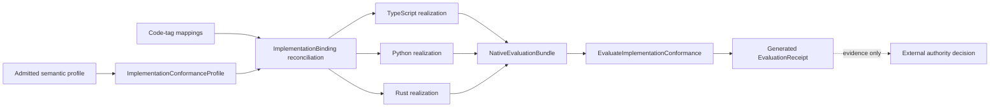

# DomainSpec Implementation Conformance Package

## What This Module Owns

This package defines how an admitted DomainSpec concept is bound to an
implementation unit, checked through a bounded language realization, reconciled
with native evidence, and represented in a generated evaluation receipt. It owns
implementation-facing contracts and deterministic normalization; it does not own
DomainSpec meaning, semantic-profile admission, source execution, CI scheduling,
exception acceptance, authority promotion, release, or production correctness.

## Module Map



## Capabilities

| Capability | What | Key aspects |
| --- | --- | --- |
| Profile authoring | Close one implementation profile against an existing semantic-profile digest and declared claim limits. | source classes, language realizations, evaluators, exclusions, obligations |
| Binding reconciliation | Resolve each admitted concept to exactly one source unit and entry point and reconcile tags with generated projections. | exact cardinality, source digest, kind-specific callable constraints |
| Structural evaluation | Evaluate source shape and dependency topology without treating style as semantic proof. | direct Rule-leaf use, direction, cycles, orphan/unresolved/unsupported diagnostics |
| Native evidence normalization | Consume—not replace—language-native style, type, exhaustiveness, topology, and runtime results. | raw diagnostic preservation, `pass|fail|unsupported`, version binding |
| Runtime-contract evidence | Bind a canonical State Machine to an application-owned valid/invalid transition fixture. | guard, state, transition, effect intent, invariants; no runtime ownership |
| Receipt generation | Emit content-addressed evidence with findings, skips, unsupported cases, digests, and raw references. | evidence only; no acceptance or promotion |

## Portable Invariants

1. Every admitted canonical `Rule` in scope has exactly one admitted
   `ImplementationBinding` and one callable entry point.
2. Every bound Operation/Query that the Rule enforces depends directly on the
   Rule leaf in the source graph unless the selected profile explicitly chooses
   the conflicting public-index precedent.
3. Rule implementations do not depend on their use cases, adapters, or outward
   layers.
4. Unresolved, duplicate, orphan, cyclic, reversed, stale, skipped, and
   unsupported cases remain distinct typed results.
5. Native compiler/type-system guarantees are attached as evidence and are not
   reimplemented as DomainSpec checks.
6. Generated receipts and indexes are projections; they never authorize.

## Profile-Local Conventions

The selected implementation profile may require one Rule per file, one exported
callable, arrow functions, filename casing, or a folder convention. Those
choices are language-local ergonomics. They cannot prove semantic identity,
binding, composability, or cross-language conformance.

The initial source classifications are:

```text
domain/rules/
application/use-cases/
adapters/
generated/
tests/
```

The binding owns identity. A rename matters only when it breaks or stales the
binding and its digest.

## Capabilities And Concepts

| Aspect | Concept | Summary |
| --- | --- | --- |
| Operation | [AuthorImplementationConformanceProfile](OPERATIONS.md#authorimplementationconformanceprofile) | close profile configuration without creating admission authority |
| Operation | [ReconcileImplementationBinding](OPERATIONS.md#reconcileimplementationbinding) | prove exact mapping cardinality and digest agreement |
| Operation | [EvaluateImplementationConformance](OPERATIONS.md#evaluateimplementationconformance) | apply bounded obligations to normalized native evidence |
| Operation | [EvaluateStateMachineRuntimeContract](OPERATIONS.md#evaluatestatemachineruntimecontract) | compare named valid/invalid runtime outcomes |
| Query | [ExplainImplementationFinding](QUERIES.md#explainimplementationfinding) | return evidence and owner route for one finding |
| Query | [InspectBindingCoverage](QUERIES.md#inspectbindingcoverage) | expose admitted, bound, orphan, and unsupported coverage |
| Interface | [ImplementationConformanceAPI](INTERFACES.md#internal-implementationconformanceapi) | pure package contract |
| Interface | [LanguageEvaluatorAdapter](INTERFACES.md#internal-languageevaluatoradapter) | language-owned evidence adapter |
| Calculation | `NormalizeNativeEvaluation` | normalize native result without erasing raw diagnostics |
| Rule | `ExactBindingRule` | one admitted concept resolves to one admitted binding |
| Rule | `DirectRuleUseRule` | use case depends on its Rule leaf under the selected profile |
| Rule | `EvidenceNonAuthorityRule` | receipts and projections never authorize or promote |
| State Machine | [EvaluationLifecycle](STATES.md#evaluationlifecycle) | processing lifecycle only; no owner/release state |

## Package-Local Contract Records

These names are package contracts, not new DS-D1 kinds, DS-D2 relationships, or
CAV2 authority kinds.

| Contract | Posture |
| --- | --- |
| `ImplementationConformanceProfile` | proposed authored configuration extending or accompanying the existing supported-profile owner |
| `ImplementationBinding` | proposed exact concept/source/entry-point binding |
| existing `Obligation` | reused authority-owned derivation request |
| `StateMachineRuntimeContract` | proposed application-owned executable fixture contract |
| `ExceptionRecord` | deferred reference shape; no acceptance owner selected |
| `EvaluationReceipt` | proposed generated evidence; never authority |
| `NativeEvaluationBundle` | adapter output carrying native results and raw-artifact references |

## Concept Registry

| Concept | ID | Type |
| --- | --- | --- |
| AuthorImplementationConformanceProfile | implementation-conformance.AuthorImplementationConformanceProfile | Operation |
| ReconcileImplementationBinding | implementation-conformance.ReconcileImplementationBinding | Operation |
| EvaluateImplementationConformance | implementation-conformance.EvaluateImplementationConformance | Operation |
| EvaluateStateMachineRuntimeContract | implementation-conformance.EvaluateStateMachineRuntimeContract | Operation |
| ExplainImplementationFinding | implementation-conformance.ExplainImplementationFinding | Query |
| InspectBindingCoverage | implementation-conformance.InspectBindingCoverage | Query |
| ImplementationConformanceAPI | implementation-conformance.ImplementationConformanceAPI | Interface |
| LanguageEvaluatorAdapter | implementation-conformance.LanguageEvaluatorAdapter | Interface |
| NormalizeNativeEvaluation | implementation-conformance.NormalizeNativeEvaluation | Calculation |
| ExactBindingRule | implementation-conformance.ExactBindingRule | Rule |
| DirectRuleUseRule | implementation-conformance.DirectRuleUseRule | Rule |
| EvidenceNonAuthorityRule | implementation-conformance.EvidenceNonAuthorityRule | Rule |
| EvaluationLifecycle | implementation-conformance.EvaluationLifecycle | State Machine |

## Feature Concept Graph

| From | Edge | To | Evidence |
| --- | --- | --- | --- |
| implementation-conformance.ExactBindingRule | enforces | implementation-conformance.EvaluateImplementationConformance | [portable invariants](#portable-invariants) |
| implementation-conformance.DirectRuleUseRule | enforces | implementation-conformance.EvaluateImplementationConformance | [portable invariants](#portable-invariants) |
| implementation-conformance.EvidenceNonAuthorityRule | enforces | implementation-conformance.EvaluateImplementationConformance | [authority boundary](#what-this-module-owns) |
| implementation-conformance.NormalizeNativeEvaluation | calculates | implementation-conformance.EvaluateImplementationConformance | [normalization mapping](MAPPINGS.md#nativediagnostictoevaluationfinding) |
| implementation-conformance.ImplementationConformanceAPI | exposes | implementation-conformance.EvaluateImplementationConformance | [internal API](INTERFACES.md#internal-implementationconformanceapi) |
| implementation-conformance.ImplementationConformanceAPI | exposes | implementation-conformance.ExplainImplementationFinding | [internal API](INTERFACES.md#internal-implementationconformanceapi) |

## Cross-Feature Dependencies

| Owner/package | This package consumes | Must not duplicate |
| --- | --- | --- |
| supported-profile registry/compiler | semantic admission and bound digests | semantic-profile registry or compiler |
| Code-Tag Conformance | canonical source annotation and migration status | second symbol-mapping registry |
| Architecture-Pattern Enforcement | admitted layering/edge laws and pattern evidence | architecture-pattern authority |
| language parser experiment | pure-kernel/adapter precedent and parser result discipline | general parser framework |
| test-derivation engine | existing `Obligation`, `RuleSet`, and transition derivation | second derivation engine |
| native language tools | style, type, exhaustiveness, source graph, and runtime evidence | compiler/type-system guarantees |
| DomainSpec/CAV2 authority routes | owner decisions and promotion gates | authority or release decisions |

## Aspect Docs

- [Operations](OPERATIONS.md)
- [Queries](QUERIES.md)
- [Interfaces](INTERFACES.md)
- [States](STATES.md)
- [Mappings](MAPPINGS.md)
- [Glossary](GLOSSARY.md)
- [Define decisions](DEFINE-DECISIONS.md)
- [Define gaps](DEFINE-GAPS.md)

## Non-Goals And Claim Ceiling

- No code, package manifest, linter, parser, test fixture, or benchmark exists
  from this authoring run.
- No canonical definition, semantic profile, relationship, code-tag contract,
  obligation IR, authority kind, or release state is changed.
- No TypeScript/Python/Rust parity, runtime correctness, project fit,
  performance, promotion, deployment, release, or production claim is made.

