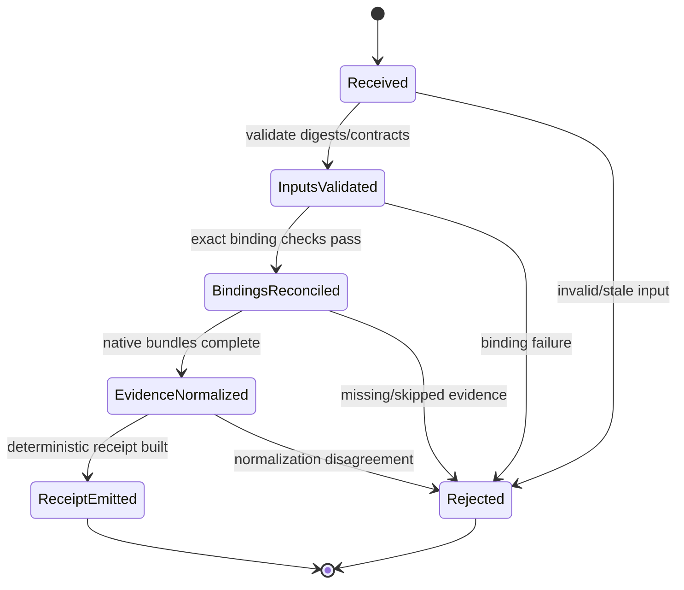

# State Machines: DomainSpec Implementation Conformance

## EvaluationLifecycle

This state machine describes package evaluation processing. It is not a release,
promotion, exception, or production lifecycle.



### Transition Table

| From | Event | To | Guard | Effect |
| --- | --- | --- | --- | --- |
| Received | inputs-valid | InputsValidated | all contracts and digests current | none |
| Received | inputs-invalid | Rejected | any required input stale/missing | typed finding |
| InputsValidated | bindings-exact | BindingsReconciled | all in-scope bindings reconcile | none |
| InputsValidated | binding-failed | Rejected | unresolved/duplicate/orphan/disagreement | typed finding |
| BindingsReconciled | evidence-complete | EvidenceNormalized | native bundles complete or explicitly unsupported | normalized findings |
| BindingsReconciled | evidence-skipped | Rejected | required evidence absent/skipped | typed finding |
| EvidenceNormalized | receipt-deterministic | ReceiptEmitted | repeat construction is byte-identical | generated receipt |
| EvidenceNormalized | receipt-disagrees | Rejected | non-deterministic or stale result | typed finding |

### Invariants

| ID | Invariant |
| --- | --- |
| EL-I1 | Rejected evaluation emits no passing receipt. |
| EL-I2 | `unsupported` is visible and blocks profile admission. |
| EL-I3 | Raw native diagnostics remain reachable from every normalized finding. |
| EL-I4 | Receipt emission does not change semantic, implementation, or release authority. |
| EL-I5 | Evaluation states never include accepted, promoted, released, deployed, or production-ready. |

## StateMachineRuntimeContract Boundary

The initial fixture references one canonical State Machine and proves only:

```text
approve({state:draft, eligible:true})
  => approved + OrderApproved effect intent

approve({state:approved, eligible:true})
  => DSV2-TRANSITION-NOT-ALLOWED
```

Compiler exhaustiveness, source topology, guard result, transition result, and
effect intent remain separate evidence classes. Effect delivery and durable
runtime behavior are not proven.

