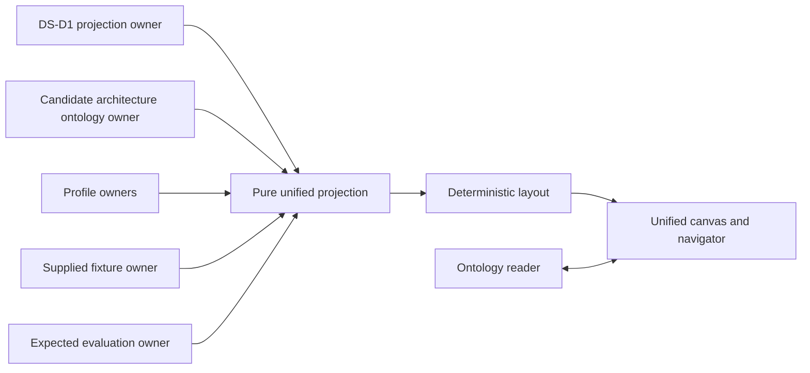
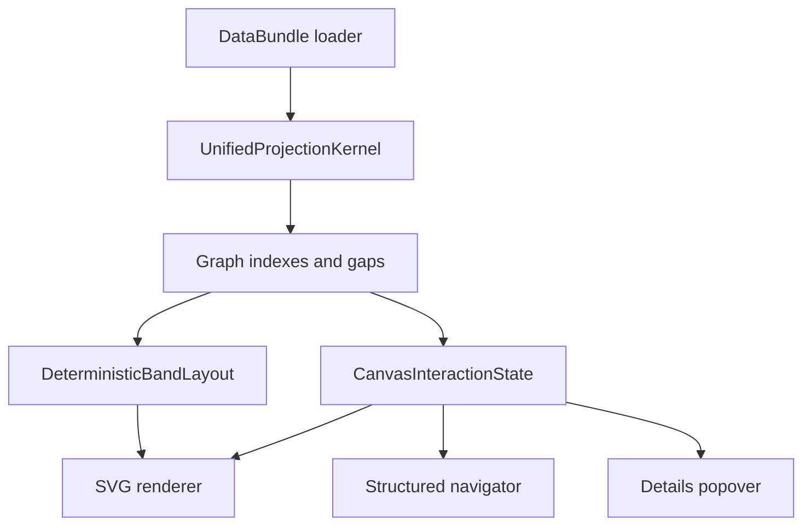

# Architecture: Unified Ontology Canvas

## Architecture Intent

Replace five lens-specific graph reconstructions with one deterministic typed
presentation graph whose nodes all occupy one coordinate system. Preserve every
source distinction while making the complete available path from DomainSpec
meaning to conformance explanation navigable.

## Source Contracts And Evidence Ceiling

- Define owner: [SPEC.md](SPEC.md)
- Closed scope: [DESIGN-SCOPE-MANIFEST.json](DESIGN-SCOPE-MANIFEST.json), input
  digest `50fd5e8078d7ca994ac5618bd7b3319a95e6a639fa0ca3c5d4b64184564230af`
- Denominator: [DESIGN-DENOMINATOR-RECEIPT.json](DESIGN-DENOMINATOR-RECEIPT.json)
- Selection: [DESIGN-SELECTION-RESULT.json](DESIGN-SELECTION-RESULT.json),
  `design-validator-pass`
- Current implementation: read-only
  `../ontology-experiment/architecture-ontology-view.html`
- Data bundle: read-only ontology, meta-type projection, four profiles, supplied
  TypeScript facts, and expected TypeScript evaluation.

This is Design evidence. It does not prove implementation, browser acceptance,
accessibility, performance, adapter execution, ontology admission, or release.

## View 1: Context



The feature reads owner-held static JSON and performs presentation-only
derivation. It has no source-code adapter, writer, store, queue, network service,
authority API, or promotion path.

## View 2: High-Level Structure



| Part | Owns | Must not own |
| --- | --- | --- |
| Data bundle loader | same-origin static JSON loading and exact load failures | partial-success completeness claims |
| Projection kernel | normalized nodes, edges, gaps, stable IDs, prototype verification status | source mutation, semantic inference, or browser-side checksum authority |
| Graph indexes | by-ID, by-family, incident-edge, profile, and trace indexes | new graph truth |
| Band layout | coordinates, bounds, ports, corridors, semantic zoom metadata | ontology hierarchy |
| Interaction state | selection, focus, filters, transform, popup state | graph identity or evidence status |
| SVG renderer | visual nodes/edges/bands and hit targets | content authority or hidden state mutation |
| Navigator/inspector | equivalent structured access and raw source explanation | stronger claims than source records |

## View 3: Low-Level Components

### Unified graph contract

```text
UnifiedCanvasGraph {
  graph_id
  verification_status
  nodes: UnifiedNode[]
  edges: UnifiedEdge[]
  gaps: PresentationGap[]
  indexes
}

UnifiedNode {
  id                  // namespaced stable presentation id
  family              // meta-type | architecture-type | profile | constraint |
                      // property | fact-element | fact-relation | finding
  band                // meaning | realization | expectation | observation | explanation
  source_id
  source_ref
  label
  plain_language
  statuses            // maturity, coverage, candidate status, fixture/evaluation posture
  fixture_projection_id
  fixture_profile_id
  evaluation_profile_id
  constraint_origin_profile_id
  authority_effect
  raw
}

UnifiedEdge {
  id
  kind
  from
  to
  derivation          // exact source selector and rule id
  source_kind         // source-native | presentation-bridge
  semantic_posture    // never promoted by rendering
  visual_class
}
```

### Node and constraint representation

Constraints are first-class presentation nodes, not unlabeled profile-to-property
edges. A constraint carries the exact expected value/operator and its origin
profile. Property definitions remain separate nodes carrying portable meaning.
This avoids implying that a TypeScript expectation such as `arrow-function` is
the meaning of `callable.form` or the meaning of Rule.

```text
profile -> constraint -> property
                  `-> applies-to -> architecture type
finding -> exact constraint
finding -> exact subject
finding -> property
```

### Stable identity and collisions

Stable IDs follow [MAPPINGS.md](MAPPINGS.md). Projection rejects duplicate IDs,
missing endpoints, reciprocal candidate-alignment disagreement, and a finding
whose subject/constraint/property cannot be resolved. It records explicit gaps
for unsupported or profiled-unmapped meta-types. It never repairs a gap through
name similarity.

### Five deterministic bands

| X order | Band | Content and Y ordering |
| ---: | --- | --- |
| 1 | Meaning | maturity/category clusters, then canonical DS-D1 order including the Saga tombstone |
| 2 | Realization | inheritance depth, then canonical reference, then concept ID |
| 3 | Expectation | base profile, TypeScript, Python, Rust; within each profile constraints sorted by applies-to and ID; properties use a stable sub-lane |
| 4 | Observation | supplied TypeScript elements and relations ordered by source path/ID |
| 5 | Explanation | findings ordered by subject, constraint, property, severity |

Every graph member exists in the canvas projection at once. The default overview
keeps all members present and highlights a complete Rule story while dimming,
not deleting, unrelated neighborhoods. Semantic zoom may suppress labels or show
cluster summaries, but identity and search/navigation remain available.

### Edge ports and routing

- intra-band edges use top/bottom ports and local lanes;
- cross-band edges use left/right ports and reserved corridors;
- parallel edges receive deterministic offsets;
- labels are focus-only below the readable zoom threshold;
- paths must not cross node interiors;
- semantic `guards` and structural `depends_on` use distinct line patterns,
  names, and accessible text, not color alone.

## View 4: Workflow Process

### Load and render

```mermaid
sequenceDiagram
  participant Browser
  participant Loader
  participant Projection
  participant Layout
  participant View

  Browser->>Loader: load exact static JSON bundle
  alt any source missing or invalid
    Loader-->>Browser: blocked-load with exact path
  else complete bundle
    Loader->>Projection: immutable bundle
    Projection->>Projection: normalize IDs, edges, gaps, indexes
    alt invalid explicit contract
      Projection-->>Browser: blocked-projection; render no false complete graph
    else valid graph
      Projection->>Layout: unified graph
      Layout->>View: stable positions, ports, bounds
      View-->>Browser: overview + default Rule trace emphasis
    end
  end
```

### Focus and filters

1. User selects a node from canvas or navigator.
2. `FindCanvasTrace` resolves only explicit incident paths.
3. Matching nodes/edges are emphasized; unrelated items remain present and dim.
4. Details opens with exact statuses, provenance, raw contract, and claim ceiling.
5. Clearing focus restores the prior transform and full overview.
6. Family/maturity/profile filters alter visibility metadata over the same
   `graph_id`; they do not rerun source normalization.

### Profile and fixture compatibility

All four profiles and their constraints belong to the unified graph. Profile
selection changes emphasis/visibility only and never changes `graph_id`. The
only supplied observation and finding bundle is TypeScript. Observation nodes
store `fixture_projection_id` and an exact language-projection-to-profile-derived
`fixture_profile_id`; finding nodes store the evaluation's exact
`evaluation_profile_id` separately from `constraint_origin_profile_id`. Selecting
Python or Rust must display “no supplied observation/evaluation for this
profile” and must never activate or reinterpret the TypeScript findings.

## View 5: Decision Flow

```text
load complete bundle?
  no -> block with exact missing source
  yes -> normalize all families

all explicit IDs/endpoints/reciprocal alignments valid?
  no -> block projection; preserve diagnostics
  yes -> compute deterministic bands and routes

user selects profile?
  TypeScript -> emphasize its expectations plus supplied facts/findings
  Python/Rust -> emphasize expectations; retain labeled TypeScript fixture dimmed

user selects node?
  trace exists -> emphasize available path
  bridge missing -> stop at gap and explain owner/review trigger

viewport too dense?
  keep all identities in graph; reduce labels/cluster visuals and offer navigator
```

## View 6: Dependency Interface View

| Dependency | Direction | Contract | Failure posture |
| --- | --- | --- | --- |
| current JSON files | inbound | exact relative path and current schema | block load; never partial-complete |
| projection kernel | internal pure | `DataBundle -> UnifiedCanvasGraph` | typed diagnostics; no DOM mutation |
| layout engine | internal pure | `Graph -> LayoutResult` | overlap/port validation fails fixture |
| interaction reducer | internal pure | `(state, action) -> state` preserving graph ID | reject illegal transition |
| SVG renderer | internal effect | render exact layout/state | no data inference or graph mutation |
| structured navigator | internal human interface | same IDs/relationships as graph | equivalence test required |
| existing validator | external read-only | ontology/profile/evaluation consistency | remains upstream evidence, not replaced |

No external layout package is selected for L0-L2. The architecture should keep a
future `LayoutProvider` seam only if the deterministic layout later proves
insufficient; do not create an abstraction without that evidence.

## Significant Behavior Scenario

| Stimulus | Preconditions | Ordered response | Failure/recovery | Observable evidence | Acceptance owner |
| --- | --- | --- | --- | --- | --- |
| Reader selects `DS-D1.7 Rule` | complete current bundle and unified graph | highlight candidate alignment -> `RuleImplementation` -> applicable constraints/properties -> supplied Rule facts -> exact findings; show missing hops explicitly | malformed bridge blocks projection; absent mapping stops trace with owner route | deterministic graph fixture, path fixture, DOM selectors, browser screenshots/keyboard receipt | unified-canvas validation owner |

## Planned Witness Contracts

| Witness | Polarity | Planned assertion | Phase |
| --- | --- | --- | --- |
| UOC-PROJECTION-POSITIVE | positive | stable IDs/counts, zero dangling endpoints, all source families present | L0 |
| UOC-BRIDGE-NAME-NEGATIVE | negative | matching labels without explicit refs create no bridge | L0 |
| UOC-ALIGNMENT-RECIPROCAL-NEGATIVE | negative | mismatched reciprocal alignment blocks | L0 |
| UOC-LAYOUT-POSITIVE | positive | byte-stable positions and zero node-interior edge crossings on canonical fixture | L0/L1 |
| UOC-PROFILE-PROVENANCE | positive | TypeScript facts/findings never connect to Python/Rust constraints | L1 |
| UOC-KEYBOARD-JOURNEY | positive | navigator reaches every object and focus returns from popovers | L2 |
| UOC-DENSITY-MEASUREMENT | neutral | collect node/edge/render/navigation measurements without a readiness claim | L2 |

Planned witnesses are not executed evidence.

## Concern-To-View Trace

| Concern | Disposition | Output | Views |
| --- | --- | --- | --- |
| UX | required | `UX-PLAN.md` | context, process, decision, dependency |
| validation | required | planned witnesses and Work Pack validators | all six |
| performance/density | recommended | measurement only | low-level, process, risks |

## Dependency And Interface Rules

| Rule ID | Rule | Enforcement |
| --- | --- | --- |
| ARC-R01 | No source JSON is mutated by the canvas. | write-scope and browser request audit |
| ARC-R02 | Projection is pure and renderer-independent. | dependency-free fixture harness |
| ARC-R03 | Visibility never changes the explicit prototype graph ID. | reducer fixture |
| ARC-R04 | All cross-band bridges carry exact derivation metadata. | projection validator |
| ARC-R05 | Constraint expected values remain profile-owned. | constraint node/provenance fixture |
| ARC-R06 | Supplied facts/findings retain explicit fixture/evaluation profile IDs distinct from constraint origin. | negative cross-profile and base-constraint fixtures |
| ARC-R07 | Canvas and navigator expose the same graph objects. | equivalence check |
| ARC-R08 | Meaning/status is never color-only. | DOM/CSS/accessibility inspection |

## Decision Log

| ID | Status | Decision | Rejected/deferred alternative | Revisit trigger |
| --- | --- | --- | --- | --- |
| DES-D01 | accepted | normalize one graph before rendering | sixth builder concatenating five lens outputs | never within this feature |
| DES-D02 | accepted | explicit constraint nodes | profile-to-property edge that hides expected value/provenance | source model removes constraint identity |
| DES-D03 | accepted | include all four profiles in graph; selection is emphasis | rebuild graph per selected profile | source bundle becomes unbounded |
| DES-D04 | accepted | pin facts/findings to TypeScript fixture | recompute or reinterpret without evaluator | a real profile-bound evaluator is supplied |
| DES-D05 | accepted | deterministic five-band layout and routed ports | force layout; ELK/Dagre at L0 | layout witness fails representative scale |
| DES-D05A | accepted for local prototype | use fixed version IDs, structural replay, and `prototype-unverified`; compute no browser checksums | retain Node-only SHA-256 in browser imports; fake digest placeholders | a small Node server or cache/replay integrity becomes an admitted requirement |
| DES-D06 | accepted | all identities present; default Rule trace highlighted with unrelated nodes dimmed | hide unsupported/unmapped items for readability | user explicitly chooses a different default after testing |
| DES-D07 | accepted | structured navigator is an equivalent representation | SVG-only accessibility | never |
| DES-D08 | deferred | minimap | include before navigation evidence | L2 density test shows value |

## Risks

| Risk | Impact | Mitigation |
| --- | --- | --- |
| 60+ nodes become unreadable at fit-all | one canvas technically exists but is unusable | semantic zoom, deterministic groups, default trace emphasis, navigator, measurement |
| visual edge implies semantic equivalence | authority overclaim | `candidate-aligns-to` wording, exact derivation, claim cues |
| selected profile appears to own fixed findings | false evidence | TypeScript provenance pin and no-evaluation message for other profiles |
| excessive SVG tab stops | keyboard trap | roving canvas focus plus structured navigator |
| focus lost on rerender/popover close | inaccessible recovery | reducer-held focus origin and restoration fixture |
| edge labels collide | comprehension loss | focus-only labels, corridors, offsets, navigator relation text |
| copy drifts from ontology data | inconsistent explanation | keep current copy ownership explicit; route migration separately |

## Downstream Planning Notes

- First unit: pure unified projection and fail-closed fixtures, with no rendering
  or JSON mutation.
- Layout and edge routing are separate atomic behaviors.
- Static rendering precedes focus/filter interaction.
- Accessibility navigator and focus semantics are independently accepted before
  any `role="application"` claim.
- Browser recomposition is a closure SWU after unit evidence exists.

## Gate Result

- Status: pass for Design authoring.
- Evidence state: `design-validator-pass`.
- Mutation authority: none; Plan and Task Session remain separate.
