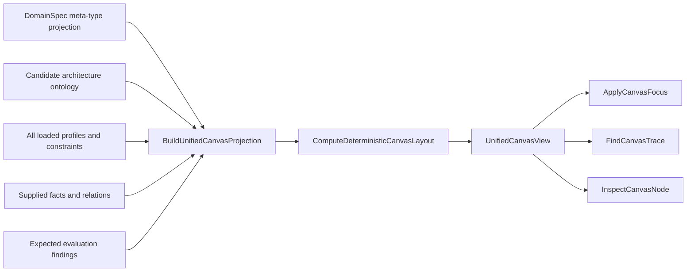

# DomainSpec Unified Ontology Canvas

## What This Module Owns

This feature defines a deterministic presentation projection that places the
five existing ontology lenses on one persistent pan-and-zoom canvas:

```text
Meaning -> Realization -> Expectation -> Observation -> Explanation
```

It owns graph assembly, presentation-only bridge edges, stable canvas identity,
deterministic layout bands, visibility/focus state, path tracing, and the
human-facing inspection contract. It does not own or rewrite the DomainSpec
meta-type registry, the candidate architecture ontology, language profiles,
supplied facts, findings, evaluation, admission, promotion, or release.

## Why One Canvas

The current HTML builds five different graphs from one data bundle and replaces
the graph whenever the user switches lens. That makes the most important idea
hard to see: a semantic type can be aligned to an architecture realization,
constrained by the loaded profiles, instantiated by a supplied observation, and
explained by a finding. The unified canvas keeps those relations spatially and
interactionally continuous.

## Module Map



## Capabilities

| Capability | Responsibility | Evidence ceiling |
| --- | --- | --- |
| Unified projection | Assemble all source node families and typed bridge edges into one immutable graph. | Proves deterministic presentation assembly only. |
| Deterministic layout | Assign each visible node to a stable semantic band, order, and coordinate. | Does not prove ontology hierarchy or semantic correctness. |
| Visibility and focus | Hide, dim, isolate, or restore parts of the same graph without changing graph identity. | Hidden nodes remain present in the source projection. |
| Trace navigation | Highlight a complete available path across semantic, realization, expectation, observation, and explanation layers. | Missing bridges stay visibly absent; no inference fills them. |
| Inspection and search | Expose plain-language meaning, exact IDs, evidence posture, and owner boundaries. | UI copy cannot strengthen the source claim. |

## Portable Invariants

1. Exactly one `UnifiedCanvasGraph` is assembled for the complete loaded data
   bundle, including all profiles; profile selection never changes `graph_id`.
2. A filter changes visibility or emphasis, never the graph's semantic identity.
3. Every node uses a namespaced stable ID and retains its source family and raw
   source reference.
4. Every cross-band edge is derived from an explicit source field or a declared
   presentation-only rule; label similarity never creates a bridge.
5. The five bands retain the order Meaning, Realization, Expectation,
   Observation, Explanation.
6. Selecting a node may highlight only real incident paths; absent mapping,
   constraint, fact, or finding links remain absent.
7. Meta-type maturity, implementation coverage, candidate status, and evaluation
   verdict remain separate visible axes.
8. Supplied facts remain supplied example data; the canvas never implies that a
   source-code adapter executed.
9. `authority_effect: none` and source claim limits remain visible and unchanged.
10. A keyboard/list alternative exposes the same node identities and trace
    relationships as the spatial canvas.

## Selected Layout Strategy

Use a deterministic five-band layered layout in the first implementation.
Stable positions and ordered edge corridors preserve the user's mental map and
make fixtures reproducible. A force-directed layout is rejected because it is
nondeterministic and obscures the pipeline. ELK/Dagre is deferred because an
external dependency is unnecessary for the bounded experiment and would not
solve the semantic grouping problem by itself.

## Local Prototype Evidence Boundary

The current local browser prototype uses explicit version identities
`unified-canvas:prototype` and `unified-layout:prototype`. It does not compute
source, graph, node-layout, or layout checksums in the browser. Determinism is
tested through repeated structural deep equality, stable IDs, coordinates, and
routes. The browser receipt declares
`verification_status: "prototype-unverified"` and carries no generated digest
fields.

This is a prototype-only exception to evidence identity, not to semantic or
structural correctness. A later small Node server may own content hashing,
cache identity, or replay receipts. Adding those checks later requires a new
contract and cannot retroactively strengthen prototype evidence.

## Concept Registry

| Concept | ID | Type |
| --- | --- | --- |
| BuildUnifiedCanvasProjection | unified-canvas.BuildUnifiedCanvasProjection | Calculation |
| ComputeDeterministicCanvasLayout | unified-canvas.ComputeDeterministicCanvasLayout | Calculation |
| UnifiedCanvasLayout | unified-canvas.UnifiedCanvasLayout | Value Object |
| ApplyCanvasFocus | unified-canvas.ApplyCanvasFocus | Query |
| FindCanvasTrace | unified-canvas.FindCanvasTrace | Query |
| InspectCanvasNode | unified-canvas.InspectCanvasNode | Query |
| UnifiedCanvasView | unified-canvas.UnifiedCanvasView | Interface |
| OneGraphRule | unified-canvas.OneGraphRule | Rule |
| ExplicitBridgeRule | unified-canvas.ExplicitBridgeRule | Rule |
| EvidenceBoundaryRule | unified-canvas.EvidenceBoundaryRule | Rule |
| CanvasInteractionLifecycle | unified-canvas.CanvasInteractionLifecycle | State Machine |

## Feature Concept Graph

| From | Edge | To |
| --- | --- | --- |
| unified-canvas.OneGraphRule | enforces | unified-canvas.BuildUnifiedCanvasProjection |
| unified-canvas.ExplicitBridgeRule | enforces | unified-canvas.BuildUnifiedCanvasProjection |
| unified-canvas.EvidenceBoundaryRule | enforces | unified-canvas.InspectCanvasNode |
| unified-canvas.ComputeDeterministicCanvasLayout | calculates | unified-canvas.UnifiedCanvasLayout |
| unified-canvas.UnifiedCanvasView | exposes | unified-canvas.ApplyCanvasFocus |
| unified-canvas.UnifiedCanvasView | exposes | unified-canvas.FindCanvasTrace |
| unified-canvas.UnifiedCanvasView | exposes | unified-canvas.InspectCanvasNode |

## Aspect Documents

- [Calculations and queries](QUERIES.md)
- [Interface](INTERFACES.md)
- [Interaction states](STATES.md)
- [Mappings](MAPPINGS.md)
- [Events](EVENTS.md)
- [Glossary](GLOSSARY.md)

## Included Scope

- one unified immutable presentation graph for the currently loaded bundle;
- five deterministic semantic bands and explicit bridge-edge kinds;
- all-loaded-profile resolution using current inheritance rules; selection
  changes emphasis only;
- visibility/focus filters, trace highlighting, search, inspection, and fit;
- accessible keyboard/list operation and responsive focus behavior;
- dependency-free local HTML behavior and deterministic structural validation
  fixtures without browser-generated checksums.

## Excluded Scope

- changing any ontology/profile/fact/finding JSON contract in the initial slice;
- implementing a TypeScript, Python, or Rust source adapter;
- inferring missing semantic mappings from names or folder layout;
- force-directed or externally hosted layout engines;
- persistence, collaboration, editing, ontology authoring, remote data, CI,
  deployment, release, or production readiness;
- browser-side cryptographic hashing, checksum-backed replay integrity, cache
  identity, or the deferred Node server;
- promoting candidate alignment or architecture-property vocabulary.

## Non-Goals And Claim Ceiling

The initial Invoke run authored Define, Design, and Plan artifacts only. This
direct-user Refresh authorizes only `SWU-UOC-004P`, the local no-checksum static
prototype slice. It does not authorize later SWUs, the deferred Node server,
promotion, publication, release, deployment, or production claims. The earlier
Design validator still proves only its original denominator and output
selection; 004P must supply fresh structural and browser evidence for its
changed bytes.
