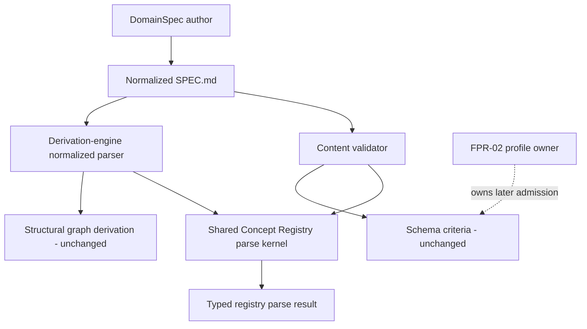
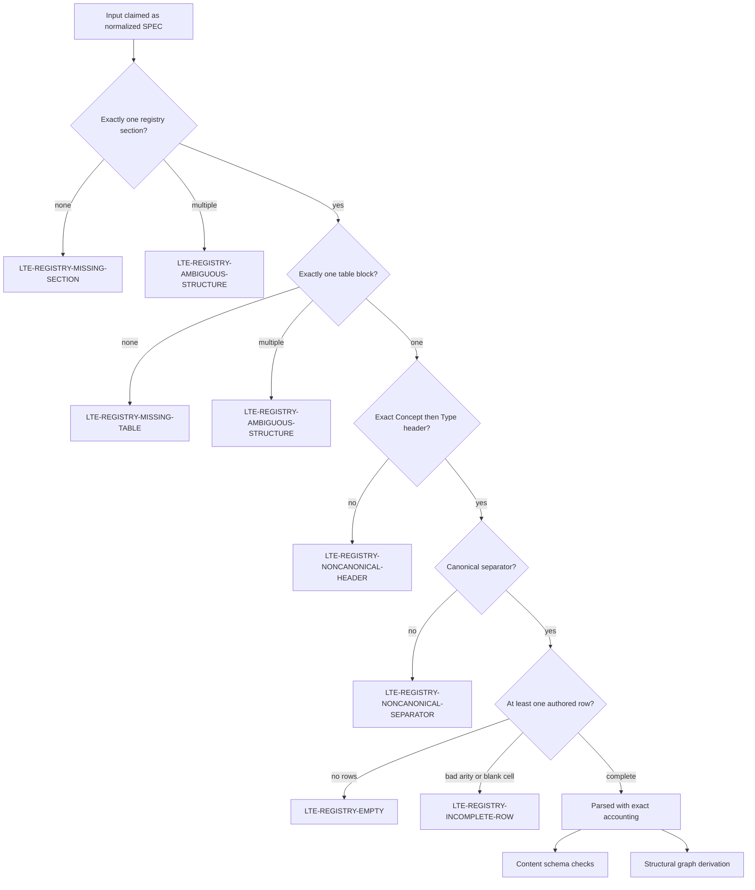

# Architecture Bundle: Language Type-Enforcement Parser Experiment

## Design Intent

Witness the smallest missing structural subjudgment in the accepted DomainSpec
language assurance chain: the same authored Concept Registry must not be
silently skipped by one consumer and rejected by another. Extract one shared,
side-effect-free registry parse kernel that returns typed accounting and stable
diagnostics, then make the content validator and normalized SPEC parser consume
that result while preserving their downstream responsibilities.

The experiment-local subjudgment is:

```text
RegistryParsedCompletely(spec)
```

It means that the one in-scope Concept Registry was either parsed with complete
row accounting or rejected with one exact structural diagnostic. It is a
necessary input to, not proof of, whole-spec `ParsedCompletely`.

This design is an experiment, not a DomainSpec language definition or authority
promotion.

## Approved Inputs And Delivery Boundary

- Approved source contract:
  `../research/2026-07-16-language-type-enforcement-proof/findings.md`.
- Local method vocabulary:
  `../../definitions/DEFINITIONS.md#domainspec-v2-d14-concept-registry`.
- Current consumers:
  `../../impl/tools/validate-content.ts` and
  `../../impl/test-derivation-engine/src/grammar/index.ts`.
- Delivery boundary: Concept Registry **shape parsing and accounting only**.
- Explicitly excluded: supported-profile decisions, schema admission, endpoint
  admissibility, translation preservation, Lean generation/proof, implementation
  conformance, runtime behavior, and semantic correctness.

## Experiment Contract

### Hypothesis

One shared Concept Registry parse kernel can make both current consumers accept
the same canonical positive and reject the same one-field structural negatives
with the same diagnostic code, while leaving positive-path behavior, output
carriers, exit conventions, downstream node criteria, graph derivation, and
unrelated diagnostics intact. The intended new fail-closed rejections and
additive stable code prefixes are the two explicit behavior deltas.

### Falsifier

The hypothesis is killed if any of these occurs:

1. a missing or malformed registry remains a green skip in either consumer;
2. the two consumers reject the same mutation for different primary causes;
3. a canonical current feature pack changes its parsed declarations or
   downstream validation result; or
4. the shared kernel must decide whether a meta-type is admitted by a profile.

### Expected Evidence

- one canonical positive registry;
- eight consumer-surface exact-cause negatives: missing section, duplicate
  section, no table, multiple table blocks, non-canonical header,
  non-canonical separator, empty registry, and incomplete row; duplicate
  section and multiple tables intentionally share the
  `LTE-REGISTRY-AMBIGUOUS-STRUCTURE` code but exercise distinct branches;
- a parity matrix binding each mutation to one stable code;
- unchanged positive results for the current sample, financial-settlement, and
  agent-execution-orchestrator packs; and
- a Task Session receipt naming code changes, commands, results, and residue.

## Required View Set

### 1. Context View



The shared kernel owns no profile, schema, graph-edge, or semantic decision. It
only accounts for the claimed registry structure.

### 2. High-Level Structure View

```text
authored Markdown lines
  -> registry parse kernel
       -> parsed declarations
       -> exact diagnostics
       -> accounting counts
  -> content-validator adapter
       -> existing schema criterion checks
  -> normalized-parser adapter
       -> existing graph nodes and violations
```

The adapters preserve each consumer's output carrier, exit convention, and
load-bearing diagnostic detail. A stable code prefix and the intended new
fail-closed rejections are the only allowed observable deltas. The kernel
supplies one structural fact instead of letting two parsers infer it
independently.

### 3. Low-Level Components View

| Component | Responsibility | Inputs | Outputs | Must not own |
| --- | --- | --- | --- | --- |
| `test-derivation-engine/src/grammar/concept-registry-parser.ts` | Locate and parse one canonical Concept Registry; account for every authored row. Exported as `@domainspec/test-derivation-engine/concept-registry`. | Markdown lines, source label. | `RegistryParseResult`. | schema/profile admission, concept tables, graph edges, semantics |
| `RegistryParseResult` | Discriminated result with declarations, diagnostics, and counts. | kernel state | parsed or rejected result | filesystem writes, process exit |
| content-validator adapter | Convert kernel diagnostics into current `Violation`/exit behavior; pass declarations to existing schema checks. | parse result, loaded schemas | existing content-validator report | normalized graph derivation |
| normalized-parser adapter | Convert the same declarations into `SpecConcept` nodes and diagnostics into existing violation text. | parse result, parse context | existing graph and violations | content criteria |
| parity test matrix | Run identical fixtures through both consumers and compare primary diagnostic codes. | canonical + one-field mutations | green/red evidence table | broad full-suite success as a substitute for exact cause |

Candidate local data contract:

```ts
type RegistryDiagnosticCode =
  | "LTE-REGISTRY-MISSING-SECTION"
  | "LTE-REGISTRY-MISSING-TABLE"
  | "LTE-REGISTRY-NONCANONICAL-HEADER"
  | "LTE-REGISTRY-NONCANONICAL-SEPARATOR"
  | "LTE-REGISTRY-AMBIGUOUS-STRUCTURE"
  | "LTE-REGISTRY-EMPTY"
  | "LTE-REGISTRY-INCOMPLETE-ROW";

type RegistryDeclaration = {
  concept: string;
  metaType: string;
  line: number;
};

type RegistryParseResult = {
  status: "parsed" | "rejected";
  declarations: RegistryDeclaration[];
  primaryDiagnostic: {
    code: RegistryDiagnosticCode;
    line: number | null;
    subject: string;
    detail: string;
  } | null;
  accounting: {
    authoredRows: number;
    parsedRows: number;
    rejectedRows: number;
  };
};
```

The exact exported names may change during implementation, but the discriminated
status, single primary diagnostic, codes, subject, and accounting fields are
acceptance-critical. `parsed` requires `primaryDiagnostic: null`; `rejected`
requires exactly one primary diagnostic and no declarations.

### 4. Workflow Process View

For each input claimed as normalized `SPEC.md`, apply this frozen grammar:

1. require exactly one level-two heading whose trimmed text is the
   case-sensitive string `Concept Registry`;
2. identify a candidate pipe-table block before separator validation: it begins
   with a pipe-prefixed, header-like row; the following row remains optional
   until the separator rule runs; require exactly one such contiguous block in
   the section; zero candidates is missing-table and more than one is
   ambiguous-structure;
3. require exactly two header cells in this order and case:
   `Concept | Type`; extra, reordered, or differently cased columns are
   non-canonical-header;
4. require the immediately following row to contain exactly two separator cells,
   each matching `:?-{3,}:?`; an absent or malformed separator is
   non-canonical-separator;
5. treat every subsequent contiguous pipe row that is not a separator as an
   authored data row; require exactly two trimmed, non-empty cells;
6. reject a row with a missing, blank, or extra cell as incomplete-row instead
   of skipping it;
7. reject a header-only registry as empty;
8. return declarations and the invariant
   `authoredRows = parsedRows + rejectedRows`;
9. if rejected, each consumer emits `[<kernel-code>] <compatible detail>` and
   stops downstream work for that file;
10. if parsed, content validation continues into schema criteria and normalized
    parsing continues into structural graph derivation; and
11. the parity test invokes both consumer surfaces and compares their emitted
    codes, not two direct calls to the kernel or unrelated downstream failures.

Trailing prose after the contiguous data rows is ignored. A later pipe-table
block before the next level-two heading makes the section ambiguous. Multiple
faults are not accumulated: the first failed discriminator in the precedence
below is the sole primary diagnostic. This keeps L0 deterministic without
claiming general Markdown recovery.

### 5. Decision Flow View



Unknown or formation-deferred meta-types do not branch here. They are parsed
declarations and remain for the later profile/schema-admission judgment.

Primary-cause precedence is the diagram's order: section cardinality, table
cardinality, header, separator, row-set, then row completeness. Each isolated
mutation fixture must bind to exactly one code. Multi-fault fixtures may be used
only to assert this precedence; they do not expand the required evidence set.

### 6. Dependency / Interface View

| Boundary | Owner | Input contract | Experiment output | Compatibility rule |
| --- | --- | --- | --- | --- |
| Markdown -> kernel | derivation-engine grammar package owner | normalized `SPEC.md` section and table | typed parse result through the package subpath export | the source leaf imports no consumer, schema/profile, graph, filesystem, or process-exit logic |
| kernel -> content validator | content-validator owner | declarations or exact diagnostic | existing `Violation`/exit surface with additive `[LTE-*]` prefix | current positive node criteria and exact key prose remain unchanged; rejected stops file work |
| kernel -> normalized parser | derivation-engine grammar owner | same declarations/diagnostic | existing `SpecConcept` nodes and violation strings with additive `[LTE-*]` prefix | existing normalized positives remain green; rejected stops normalized downstream work |
| parsed meta-type -> admission | FPR-02/profile owner | parsed `metaType` value | out of scope | no admission decision in L0 |
| Invoke -> Task Session | Invoke / Task Session | approved work-pack and selected SWU | bounded execution receipt | Invoke performs no source mutation |

## Design Decisions

| ID | Decision | Reason | Rejected alternative |
| --- | --- | --- | --- |
| LTE-D1 | Extract a shared registry-shape kernel. | Existing consumers disagree because they parse independently. | Directly importing the whole derivation grammar into the content validator couples unrelated graph/rule responsibilities. |
| LTE-D2 | Keep the kernel pure and result-returning. | Both consumers need the same fact but different downstream outputs. | A kernel that calls `process.exit` cannot be reused or unit-tested precisely. |
| LTE-D3 | Use stable codes plus compatible prose. | Codes support parity; adapters can preserve existing diagnostics. | Comparing prose alone is brittle; broad exit-code checks are non-discriminating. |
| LTE-D4 | Stop at structural registry parsing. | This is the smallest missing judgment and has no owner decision blocker. | Unknown-type/profile enforcement would trespass on blocked FPR-02 decisions. |
| LTE-D5 | Preserve consumer-specific downstream logic. | The experiment tests one bridge, not a unified parser rewrite. | Merging content validation and graph derivation would overbuild L0 and confound the result. |
| LTE-D6 | Host the pure leaf in the existing derivation-engine package and expose one package subpath. | The package is already the reusable normalized-grammar owner and builds the file under its current `rootDir`; a leaf export lets the root validator consume it without a new package. | A new workspace package adds scaffolding before reuse pressure exists; a relative cross-package source import is not a supported interface. |
| LTE-D7 | Expose codes as deterministic diagnostic prefixes. | Both current consumer surfaces already emit strings, so a code-bearing prefix is testable end to end without redesigning their public result types. | A new durable diagnostic manifest is a later owner decision; direct kernel-only parity is tautological. |

## Behavior-Delta Matrix

| Surface | Baseline | Allowed delta | Forbidden delta |
| --- | --- | --- | --- |
| three current normalized packs | accepted with current declarations/counts and downstream results | none except implementation-internal parser source | declaration/count/result drift |
| missing or malformed registry cases currently skipped | may pass or lack an exact cause | reject fail-closed with the bound `[LTE-*]` code | rejection caused only by schema, graph, or profile work |
| existing normalized-parser registry negatives | reject with current subject/detail | additive `[LTE-*]` prefix and deterministic primary classification | loss or material rewrite of current subject/detail |
| consumer process/API carriers | content validator reports violations and strict mode exits nonzero; engine returns violation strings and CLI exits nonzero | intended new malformed-registry rejection | changed success exit, report carrier, or unrelated diagnostic behavior |
| admission behavior | content adapter currently checks only available schemas; engine preserves authored meta-type text | none | new or changed FPR-02 schema/profile admission decision |

The positive baseline records exact declaration sets, content `conceptsChecked`,
engine node counts, and downstream pass/fail before mutation. The parity matrix
uses one green sibling fixture per one-field mutation so an unrelated failure
cannot satisfy the negative. Adapter mapping is total over every kernel code.

## Risks And Guardrails

| Risk | Failure signal | Guardrail |
| --- | --- | --- |
| Parser extraction changes current positive declarations. | pack counts or derived obligations change | snapshot exact declarations/counts before and after; require equality |
| A generic table parser silently accepts malformed rows. | `authoredRows != parsedRows + rejectedRows` | accounting invariant in unit and consumer tests |
| Content and engine adapters map the same code differently. | parity matrix mismatch | spawn both consumer surfaces over the same temporary pack; compare stable code first and preserved prose second |
| Source-only package export works under `tsx` but not the engine build. | root typecheck or engine build fails | validate the package subpath, root typecheck, engine typecheck/build, and both focused suites |
| L0 absorbs profile admission. | kernel imports schemas/profile state or rejects `Fixture` as a type | dependency ban and FPR-02 boundary test |
| Concurrent FPR work changes the same parser files. | dirty-overlap preflight before Task Session | execution blocks and refreshes context; Invoke plan does not merge concurrent edits |

## Glossary Consistency

Result: `pass`. See [GLOSSARY-CONSISTENCY.md](GLOSSARY-CONSISTENCY.md).
New names are experiment-local implementation terms; none is a canonical
DomainSpec definition or promotion candidate.

## Dispatch Technique Trace

| Technique | Applied to | Validation expectation |
| --- | --- | --- |
| `sequence` | findings -> bounded context -> architecture -> plan | every artifact names its prior handle |
| `artifact_contract_bridge` | shared parse result -> two consumer adapters | both adapters validate the same result contract without claiming language promotion |
| `concrete_path_evidence` | source contracts and test surfaces | every load-bearing claim names an existing path/selector |
| `owner_boundary_check` | parser shape vs FPR-02/profile and definitions owners | no profile, schema, or definition decision appears in the kernel |
| `residue_ledger` | deferred judgments and FPR overlap | every deferral has an owner and next route |
| `handle_handoff` | Invoke design -> plan -> Task Session | downstream work consumes artifact paths, not copied private context |

No full dispatch JSON is required: this is one bounded repository-local feature
plan with a straightforward Invoke-to-Task-Session handoff, no planned
parallel subagent strategy, no protected-context transfer, and no promotion
route.

## Design-Unit Distill Status

Independent Proposer and Balancer reviews initially returned `FLAG`. Their
bounded repairs are incorporated above: the subjudgment claim, frozen grammar
and precedence, code-bearing output bridge, behavior-delta matrix, neutral leaf
dependency contract, navigation, and frame-expiry trigger. Both independent
reconciliation passes returned `PASS`; plan authoring may proceed.

## Navigation And Frame Expiry

Start here:

1. [CONTEXT.md](CONTEXT.md)
2. [ARCHITECTURE.md](ARCHITECTURE.md)
3. [GLOSSARY-CONSISTENCY.md](GLOSSARY-CONSISTENCY.md)
4. [DESIGN-TRANSPORT.md](DESIGN-TRANSPORT.md)

Rerun Distill and refresh this design if registry syntax changes, a third
consumer appears, FPR work alters either parser surface, parity requires
schema/profile knowledge, or the normalized input ceases to be one Markdown
table.

## Planning Handoff

If design-unit Distill passes, plan only the smallest coherent unit:

> shared Concept Registry shape kernel + exact-cause cross-consumer parity,
> with profile/schema admission explicitly deferred.
