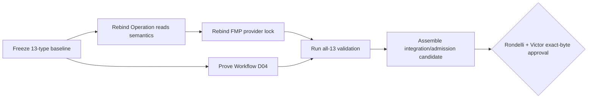

# Meta-Type Closure Epoch E1

## What This Module Owns

This epoch owns the bounded preservation, dependency rebinding, current validation, and integration-candidate assembly needed to close the existing 13 DomainSpec v2 meta-type implementations. It does not reimplement the meta types, admit architecture profiles, or promote ontology/registry authority.

## Module Map

## Capabilities

| Capability | What | Key aspects | Detail |
| --- | --- | --- | --- |
| PreserveBaseline | Prove the current implementation denominator before mutation | inventory, hashes, predecessor identity | [domain.md](domain.md) |
| RebindOperationDependencies | Align Operation evidence with two current dependencies | `reads` semantic lock; FMP provider contract | [operations.md](operations.md) |
| ProveWorkflowClosure | Test D04 against the existing ordered Workflow representation | step count versus distinct Operation degree | [workflows.md](workflows.md) |
| ValidateAllMetaTypes | Re-run language, admission, parity, relation, and factory checks | fail-closed validation matrix | [queries.md](queries.md) |
| AssembleAdmissionCandidate | Freeze exact postimages and owner requests | candidate manifest, claim ceiling, approvals | [interfaces.md](interfaces.md) |

## Exact Meta-Type Denominator

| ID | Meta type | Predecessor | Epoch treatment |
| --- | --- | --- | --- |
| DS-D1.1 | Entity | WP-RMT-001 | preserve and revalidate |
| DS-D1.2 | Value Object | WP-RMT-001 | preserve and revalidate |
| DS-D1.3 | Enum | WP-RMT-001 | preserve existing TypeScript/Python/Rust candidate; revalidate |
| DS-D1.4 | Operation | WP-RMT-002 prototype + WP-RMT-002R | repair two dependency bindings; revalidate |
| DS-D1.5 | Query | WP-RMT-001 | preserve and revalidate |
| DS-D1.6 | Rule | WP-RMT-002 prototype + WP-RMT-002R | preserve and revalidate |
| DS-D1.7 | Calculation | WP-RMT-001 | preserve and revalidate |
| DS-D1.8 | Policy | WP-RMT-001 | preserve and revalidate |
| DS-D1.9 | Interface | WP-RMT-002 prototype + WP-RMT-002R | preserve and revalidate |
| DS-D1.11 | Mapping | WP-RMT-002 prototype + WP-RMT-002R | preserve and revalidate |
| DS-D1.12 | Event | WP-RMT-002 prototype + WP-RMT-002R | preserve and revalidate |
| DS-D1.13 | State Machine | WP-RMT-002 prototype + WP-RMT-002R | preserve and revalidate |
| DS-D1.14 | Workflow | WP-RMT-002 prototype + WP-RMT-002R | prove D04; mutate only if proof exposes a gap |

## Core Invariants

1. The 13-type denominator is closed and unique.
2. Existing implementation bytes are the baseline; absence of fresh evidence does not authorize replacement.
3. Enum is included through WP-RMT-001 evidence, not recreated.
4. The original WP-RMT-002 70-unit route remains `superseded-without-execution`; it is never reconstructed.
5. Operation `reads` is sourced from BMC-REL-001 RQ1. Rebinding must not reopen that semantic choice.
6. FMP provider rebinding may alter only the named request/replay/test lock surfaces.
7. Workflow D04 is proof-first; a representation delta is permitted only if the planned negative and positive witnesses prove the current bytes insufficient.
8. APE Operation/Workflow profiles stay separate from meta-type core semantics and admission.
9. Green implementation evidence does not itself grant ontology, registry, profile, promotion, release, or production authority.

## Concept Registry

| Concept | ID | Type |
| --- | --- | --- |
| Meta-Type Closure Epoch | mtc.ClosureEpochE1 | Workflow |
| Freeze Baseline | mtc.FreezeBaseline | Operation |
| Rebind Operation Semantic Dependency | mtc.RebindOperationReads | Operation |
| Rebind Operation Provider Dependency | mtc.RebindOperationProviderLock | Operation |
| Validate Workflow D04 | mtc.ValidateWorkflowD04 | Operation |
| Validate All 13 | mtc.ValidateAllThirteen | Operation |
| Current Baseline | mtc.CurrentMetaTypeBaseline | State Machine |
| Integration Candidate | mtc.IntegrationAdmissionCandidate | Entity |
| Exact Acceptance | mtc.ExactCandidateAcceptance | Policy |
| Candidate Status | mtc.CandidateStatus | Enum |
| Baseline Query | mtc.GetBaselineStatus | Query |
| Candidate Handoff | mtc.AdmissionCandidateHandoff | Interface |
| Candidate Manifest Mapping | mtc.CandidateManifestProjection | Mapping |
| Candidate Frozen | mtc.CandidateFrozen | Event |

## Feature Concept Graph

| From | Edge | To | Evidence |
| --- | --- | --- | --- |
| mtc.ExactCandidateAcceptance | enforces | mtc.AdmissionCandidateHandoff | [interfaces.md](interfaces.md) |
| mtc.RebindOperationReads | reads | mtc.CurrentMetaTypeBaseline | [operations.md](operations.md) |
| mtc.RebindOperationProviderLock | reads | mtc.CurrentMetaTypeBaseline | [operations.md](operations.md) |
| mtc.ValidateAllThirteen | produces | mtc.CandidateFrozen | [events.md](events.md) |
| mtc.CandidateManifestProjection | maps | mtc.IntegrationAdmissionCandidate | [mappings.md](mappings.md) |
| mtc.ClosureEpochE1 | orchestrates | mtc.ValidateAllThirteen | [workflows.md](workflows.md) |

## Cross-Feature Dependencies

| Capability | Depends on | Via | Why |
| --- | --- | --- | --- |
| RebindOperationDependencies | BMC-REL-001 | owner decision RQ1 | exact `reads` meaning |
| RebindOperationDependencies | FMP SWU-FMP2-002 candidate | provider-contract digest | current factory contract identity |
| ProveWorkflowClosure | BMC-REL-001 | owner decision D04 | exact degree/step-count distinction |
| AssembleAdmissionCandidate | Rondelli and Victor | exact-byte owner responses | protected admission boundary |

## Supersession Statement

`WP-MTC-001/E1/2026-08-24` consumes WP-RMT-001 terminal evidence, WP-RMT-002 prototype evidence, and WP-RMT-002R reconciliation evidence. It supersedes only the original WP-RMT-002 execution route as an active route. It does not erase or supersede predecessor implementation evidence, and it does not supersede either APE profile Work Pack.

## Success Condition

One exact candidate package proves: 13/13 denominator coverage; preserved implementation inventory; both Operation dependencies rebound; Workflow D04 closed by evidence; current TypeScript/Python/Rust, admission, parity, relation, and factory validation green; exact changed-byte inventory; and separate pending or accepted Rondelli/Victor responses. Admission remains false until the protected owner edge completes.
