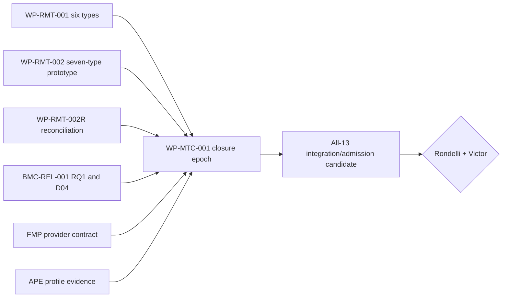
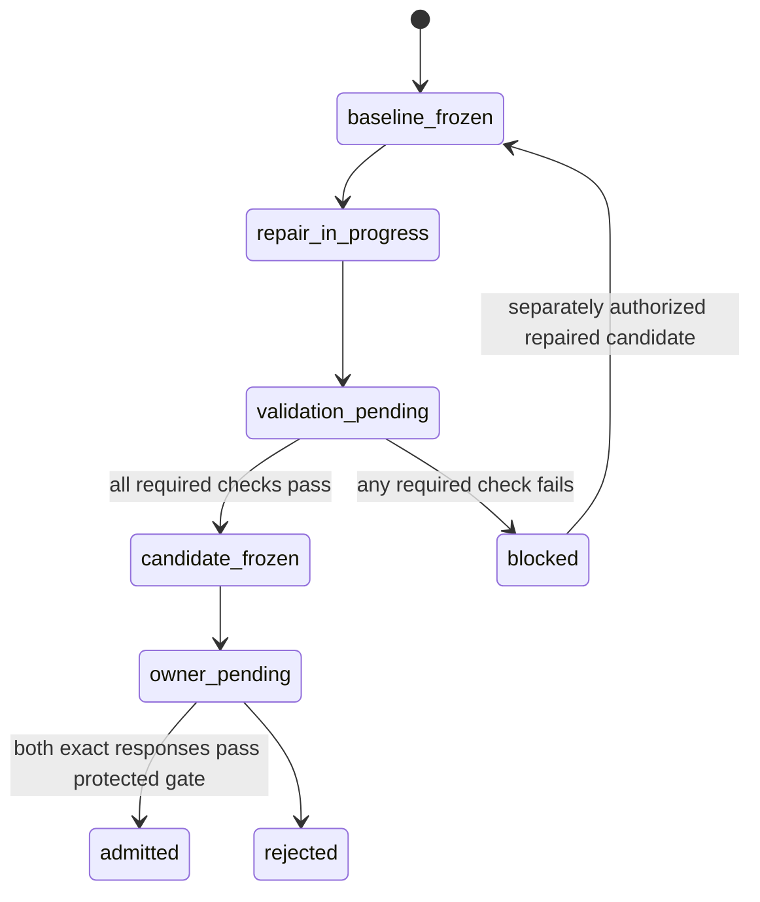

# Architecture — Meta-Type Closure Epoch E1

## Design Intent

Close the current 13-type implementation boundary by preserving existing bytes, repairing only proven dependency drift, proving Workflow D04, and freezing one exact local candidate for distinct owner review. The architecture treats predecessor implementation, profile evidence, semantic decisions, validation evidence, and admission authority as separate planes.

## View 1: Context

The closure epoch consumes evidence but grants no authority. Only the downstream protected owner edge may authorize a separately applied admission candidate.

## View 2: Capability

- `mtc.FreezeBaseline` reads predecessor evidence and produces an exact preservation inventory.
- `mtc.RebindOperationReads` aligns RMT Operation evidence to the already-decided `reads` contract.
- `mtc.RebindOperationProviderLock` aligns the factory request/replay to the current FMP provider contract.
- `mtc.ValidateWorkflowD04` proves step count and distinct Operation degree are not conflated.
- `mtc.ValidateAllThirteen` executes the fail-closed staged matrix.
- `mtc.CandidateManifestProjection` maps all accepted evidence into `mtc.IntegrationAdmissionCandidate`.

## View 3: Concept/Type

The `SPEC.md` Concept Registry supplies every node. The 13 DS-D1 meta types are the denominator being closed; they are not redefined as new registry concepts. Candidate status uses the bounded `mtc.CandidateStatus` Enum, including `baseline-frozen`, `repair-in-progress`, `validation-pending`, `candidate-frozen`, `owner-pending`, `admitted`, `rejected`, and `blocked`.

Typed relationships:

- `mtc.ClosureEpochE1 orchestrates mtc.ValidateAllThirteen`.
- `mtc.RebindOperationReads reads mtc.CurrentMetaTypeBaseline`.
- `mtc.ValidateAllThirteen produces mtc.CandidateFrozen`.
- `mtc.ExactCandidateAcceptance enforces mtc.AdmissionCandidateHandoff`.

## View 4: Operation/Flow

1. Freeze every existing source and target before mutation.
2. Rebind the Operation semantic seam: current schema/card plus BMC RQ1 into admission inventory/validator and relation proof.
3. Rebind the Operation provider seam: exactly three request roles and two regenerated replay/test constant surfaces.
4. Prove Workflow D04 without mutation; if it fails, stop with a bounded representation-gap candidate rather than silently widening scope.
5. Run each per-type and full-factory command with preserved exit status.
6. Freeze changed bytes, preserved bytes, results, and claim ceiling into one candidate manifest.
7. Produce separate digest-bound Rondelli and Victor requests.

## View 5: State

A failure never advances state. A new changed byte invalidates the frozen candidate and restarts at `baseline_frozen`.

## View 6: Dependency/Interface

| Boundary | Input | Consumer | Version/drift rule |
| --- | --- | --- | --- |
| predecessor | WP-RMT-001, WP-RMT-002 prototype, WP-RMT-002R exact refs | baseline freezer | any hash drift requires reclassification |
| semantic | BMC RQ1/D04 and current schemas | Operation/Workflow validators | decision ID and source digest required |
| factory | current `FactoryNodeProviderV1` bytes | Operation request/replay | all 109 refs and derived identities must close |
| profile evidence | APE verification receipts | candidate manifest | evidence class remains `profile-candidate-local` |
| owner | candidate manifest and exact requests | Rondelli and Victor | two separate matching responses; no aggregate substitution |

## Extension: Authority/Trust

Rondelli is the primary owner; Victor Boscaro is a distinct second approver. The candidate builder and validators may report facts but cannot self-issue either response. Admission, registration, ontology promotion, profile admission, release, deployment, and production remain forbidden effects.

## Extension: State/Event

Workflow D04 is modeled as a state/structure invariant: ordered declared steps remain countable independently from the set of distinct Operation concepts referenced by those steps. Repeated Operation binding is a positive witness; conflating degree and count is a negative witness.

## Extension: Failure/Compensation

Every changed accepted-bound byte supersedes the candidate and requires full refreeze. Compensation is local rollback to frozen baselines for the declared repair targets. The work never deletes predecessor evidence or mutates public/external systems.

## Extension: Integration/Versioning

The candidate binds three independent version planes: predecessor evidence identities, semantic decision/schema identities, and factory provider/request/replay identities. No plane may use “latest”. APE profile receipts are referenced with their original claim ceilings.

## Extension: Validation Contracts

The 13 planned witnesses in `PLANNED-WITNESSES.json` cover denominator omission, route resurrection, stale Operation semantics, stale provider bindings, Workflow D04 conflation, evidence-class inflation, exit masking, and incomplete owner gates. They are Design contracts only and remain unimplemented/unexecuted.

## Significant Behavior Scenario

Stimulus: a worker attempts to freeze a candidate after updating the three provider-contract request roles but leaves one replay constant stale. Preconditions: baseline inventory exists and the `reads` seam is green. Ordered response: the 109-ref validator passes, the replay constant validator fails with `MTC_OPERATION_PROVIDER_BINDING_STALE`, the full sequence stops, no candidate manifest or owner request is issued, and the repair is returned to `baseline-frozen`. Acceptance owner: validation owner for the evidence; Rondelli and Victor remain untouched because no candidate exists.

## Decision Log

1. Use `WP-MTC-001` because the denominator is all 13, not “remaining” types.
2. Reuse Enum from WP-RMT-001.
3. Supersede only the original WP-RMT-002 active execution route.
4. Treat BMC RQ1 as decided semantics and perform a binding rebase, not a Decision Gate.
5. Keep the FMP repair to its exact three-file contract.
6. Make Workflow D04 proof-first.
7. Keep APE profiles separate and preserve their retained findings.
8. Require one staged full matrix before candidate freeze.
9. Require separate exact Rondelli and Victor responses.
10. Stop before canonical apply/admission; that is a later protected route.
