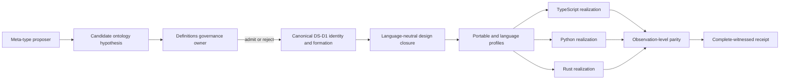
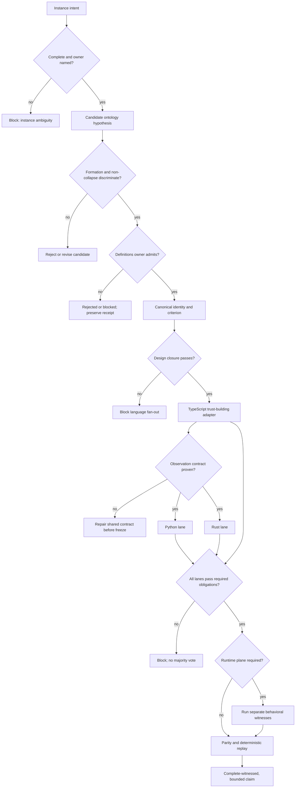

# Architecture: Meta-Type Complete Implementation

## Design intent

Turn one explicit meta-type proposal into a traceable chain of semantic authority and independent implementation evidence. The architecture is ontology-aware: adapters observe source properties and the evaluator compares them to an admitted ontology/profile contract. It does not let a graph node, implementation, or generated receipt mint ontology authority.

## View 1 — context



The user supplies semantics; definitions-governance owns admission; implementation owners supply observations; a generic evaluator compares evidence. The final receipt cannot promote, release, or deploy.

## View 2 — high-level structure

```text
intent/
  MetaTypeInstanceIntent
candidate-ontology/
  CandidateOntologyPacket
authority/
  OntologyAdmissionReceipt
design/
  MetaTypeDesignClosure
  ImplementationObligation[]
  ImplementationProfile
realizations/
  typescript/ -> ObservationProjection
  python/     -> ObservationProjection
  rust/       -> ObservationProjection
evaluation/
  normalized language receipts
  parity receipt
closeout/
  claim ceiling + residue + owner routes
```

Canonical mutation targets are not owned by this development folder. When approved, definitions-governance mutates the DS-D1 registry/card and formation assets. The implementation-conformance ontology is a reciprocal, non-authoritative realization and evaluation model.

## View 3 — low-level components

| Component | Owns | Inputs | Outputs | Must not own |
| --- | --- | --- | --- | --- |
| `MetaTypeInstanceIntentValidator` | completeness and stable proposal identity | authored instance intent | pass/block diagnostics | candidate semantics |
| `CandidateOntologyPacketBuilder` | candidate card, criterion, fixtures, relationship delta, non-collapse dossier | valid intent and current ontology | content-addressed candidate packet | canonical admission |
| `OntologyAdmissionAdapter` | transport to/from definitions-governance | candidate packet | admitted/rejected receipt | self-approval |
| `DesignClosureValidator` | language-neutral completeness and obligation applicability | admitted ontology digest and authored design | closed/block receipt | language syntax policy |
| `ArchitectureRealizationProjector` | reciprocal DS-D1 to realization mapping | admitted identity and design | `authority_effect: none` projection | canonical identity |
| `ObservationProjection` | common fact, provenance, unsupported, and diagnostic carrier | language adapter output | normalized input | owner decisions |
| `TypeScriptAdapter` | TS AST/module/native-tool facts | real `.ts` fixture/project | observation projection | Python/Rust semantics |
| `PythonAdapter` | CPython AST/import/native-tool facts | real `.py` fixture/project | observation projection | TS/Rust semantics |
| `RustAdapter` | Cargo/module/rustc facts | real `.rs` fixture/project | observation projection | TS/Python semantics |
| `ConstraintEvaluator` | property/relation comparison | profile + observation | deterministic findings | admission or exceptions |
| `ParityEvaluator` | obligation-level recomposition | three lane receipts + one design digest | parity receipt | syntax equality or majority vote |

### Shared data contracts

`ImplementationObligation` contains `id`, `semantic_property`, `applicability`, `positive_witness`, `negative_witness`, `required_evidence_classes`, and `claim_limit`.

`ObservationProjection` contains `language`, `artifact_digest`, `toolchain_digest`, `adapter_digest`, `profile_digest`, `observed_facts`, `unsupported_observations`, `native_evidence_refs`, and `diagnostics`.

An unsupported observation is typed as `unsupported-blocking` when a required property cannot be established. Absence of a fact never means pass.

## View 4 — workflow

1. Validate `INSTANCE-INTENT.md`; block if any semantic field or accountable owner is absent.
2. Snapshot current DS-D1 identity/category/tombstone space, formation schemas, and active relationship signatures.
3. Author a candidate ontology hypothesis with `authority_effect: none`.
4. Produce a separating formation/non-collapse dossier and relationship analysis.
5. Route the packet through definitions-governance. Stop on reject, ambiguity, or missing human decision.
6. After admission, update the canonical registry/card, criterion schema/card, fixtures, and canonical validators through the owning route.
7. Add the reciprocal architecture realization and recompute graph/canvas invariants; do not use hard-coded counts as semantic acceptance.
8. Close the language-neutral design: behavior, interfaces, state/effects, failures, obligations, applicability, and profile bindings.
9. Freeze the shared observation schema and unsupported algebra.
10. Implement and validate TypeScript first. The shared observation contract may be repaired only before its trust gate closes.
11. After the TypeScript contract gate, run Python and Rust independently against the frozen observation contract.
12. Run semantic-property parity, negative mutants, runtime witnesses when required, deterministic replay, and read-only closeout.

Every mutating SWU ends with Invoke Refresh, Task Session closeout, Continuation Router, and evidence synchronization before its successor becomes eligible.

## View 5 — decision and state flow



A design may mark an obligation not applicable only with owner rationale and evidence. It may never convert unknown, missing, dynamic, macro-generated, decorator-mediated, feature-gated, or unresolved behavior into not applicable automatically.

## View 6 — dependency and interface

| Boundary | Provider owner | Consumer | Contract | Gate |
| --- | --- | --- | --- | --- |
| instance intent -> candidate packet | proposer / package session | definitions-governance | complete semantic proposal, digest bound | intent completeness |
| candidate packet -> canonical DS-D1 | definitions-governance | design closure | admission receipt and canonical digests | G1 |
| canonical DS-D1 -> architecture realization | definitions owner | ontology/profile owner | reciprocal mapping, `authority_effect: none` | G1 receipt |
| design -> language lanes | design/profile owner | adapter owners | obligation matrix + frozen observation schema | G2 |
| native source -> observation | language owner | generic evaluator | adapter-specific facts with native provenance | G3 per lane |
| three receipts -> parity | parity owner | closeout | same design/profile digest and total obligation accounting | G4 |

Dependencies point inward toward stable semantic contracts. Language adapters may depend on the shared observation schema; the schema and evaluator must not depend on a language adapter. The public Arcanum tree is forbidden scope.

## Language realization profiles

Portable obligations describe semantics and evidence classes. Language profiles may add native conventions without pretending they are universal ontology properties.

- TypeScript: AST plus module resolution and native type checking; profile-local arrow-function or direct-leaf rules are allowed only if explicitly admitted.
- Python: CPython AST plus explicit import resolution and native corroboration; decorators, dynamic imports, and namespace packages return typed unsupported results when unresolved.
- Rust: Cargo metadata, bounded `mod`/`use` resolution, and rustc/Clippy corroboration; macros, generated code, features, and conditional compilation return typed unsupported results when unresolved.

No Python or Rust adapter/test command currently exists. Their package homes, pinned tools, and commands are Design/Plan outputs, not assumed repository facts.

## Runtime evidence plane

A structural source witness proves representation and binding, not runtime correctness. If the admitted meta-type is behavioral or lifecycle-bearing, its design must declare runtime obligations and fixtures separately. For a stateful concept, representation, exhaustiveness, guards, valid/invalid transitions, durable state, intent publication, and effect delivery are separate claims.

## Blind spots absorbed

- candidate and canonical ontology views can drift;
- the current ontology projection is hand-maintained;
- profile conflict resolution and schema evolution need owner contracts;
- conditional properties, relation cardinality, and graph algorithms need explicit evaluator support;
- observed, derived, and owner-resolved facts need distinct provenance;
- exception authority and unsupported algebra cannot be implicit;
- current canvas checks contain hard-coded graph counts that a legitimate new type changes;
- existing parsers have positional/tombstone assumptions that may fail on a new registry shape;
- performance, caching, and incremental extraction remain measured residue, not presumed qualities;
- a candidate cannot author the evidence that clears its own promotion gate.

## Design decisions

| ID | Decision | Reason |
| --- | --- | --- |
| MTCI-D1 | Parameterize the lifecycle rather than invent the next type. | The user selected the route, not the meta-type semantics. |
| MTCI-D2 | Permit a candidate ontology hypothesis first, but require definitions-governance for canonical admission. | Preserves ontology-first exploration without authority inflation. |
| MTCI-D3 | Close design after admission and before language code. | Prevents implementations from defining semantics accidentally. |
| MTCI-D4 | Establish the observation contract through TypeScript before opening Python and Rust. | No real language adapters exist; the first lane is a trust-building contract test. |
| MTCI-D5 | Compare semantic obligations, not code shape. | Language idioms differ while ontology properties remain stable. |
| MTCI-D6 | Treat unsupported required constructs as blocking. | Missing evidence is not conformance. |
| MTCI-D7 | Use a separate runtime plane when behavior or lifecycle is claimed. | Static structure cannot prove temporal or effect semantics. |

## Glossary consistency

Result: pass. Package-local terms are namespaced in [GLOSSARY.md](GLOSSARY.md); canonical terms are referenced, not redefined.

## Claim ceiling

This Design is authored architecture. It is not an admitted meta-type, language adapter, live three-language proof, release, or deployment.

