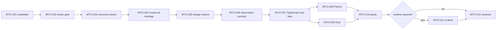

# Wave Graph

MTCI-008 and MTCI-009 are the only planned parallel wave. Execution requires a validated dispatch, exact user confirmation, registration, native spawn/join/close, and all-lane receipts. Until then, the route remains planned.

