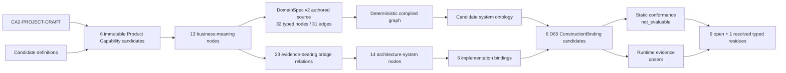

# ORODI Ontology Architecture

## Verdict

ORODI is modeled as one isolated, private `business-system-bridge` ontology candidate owned by `CA2-PRODUCT-CRAFT` and coordinated by the existing `CA2-PROJECT-CRAFT`. It connects six immutable Product Capability candidates to DomainSpec v2 typed intent, a deterministic compiled graph, an implementation architecture, exact code/test bytes, and explicit evidence gaps. It does not alter the canonical DomainSpec product ontology, adopt a Product Capability, admit a business ontology or DomainSpec profile, accept an implementation, or authorize runtime effects.

## Construction chain

The arrows are traceability and dependency, not authority propagation. A later stage cannot make a missing predecessor true.

## Layer contracts

| Layer | Artifact | Current state | What it establishes | What it does not establish |
|---|---|---|---|---|
| Source ledger | `sources.json` | 29 exact selectors | Current bytes and provenance | Semantic acceptance |
| Product identity | `cyberAlchemy-v2/product/craft/capabilities/orodi/` | 6 immutable candidates | Stable CAV2-D67 identities and exact record digests | Craft Product owner adoption |
| Product decomposition | `capabilities.json` | 6 ontology-local aliases | Bounded capability scopes and realization links | Product Capability adoption |
| Business meaning | `nodes.json` business branch | 13 candidates | Operational meanings and invariants | Canonical ontology admission |
| Architecture model | `nodes.json` system branch | 14 mixed states | Component responsibilities and maturity | DomainSpec typed intent or code conformance |
| Business-system bridge | `relations.json` | 23 bridge + 11 dependency relations | Evidence on both sides of each meaning-to-system link | Equivalence, acceptance, or runtime truth |
| DomainSpec source | `domainspec/project.json`, `feature.json`, `nodes/` | candidate profile | Typed entities, rules, operations, events | Release-profile admission |
| Compiled intent | `domainspec/generated/graph.json` | byte-deterministic | Compiler-resolved node and edge graph | Implementation conformance |
| System ontology | `domainspec/generated/system-ontology.json` | candidate | Exact, non-effectful projection of compiled intent | Canonical system-ontology admission |
| Capability trace | `domainspec/capability-projection.json` | candidate | Every capability mapped to exact business, architecture, graph, edge, and binding IDs | Capability acceptance |
| Implementation binding | `implementation-bindings.json` | implemented/partial/planned/deferred evidence | Exact targets and explicit maturity | Owner acceptance, conformance, or runtime evidence |
| D65 record | `construction-bindings.json` | 6 unregistered candidates | Full chain references and stage states | ConstructionBinding registration |
| Evidence boundary | `evidence/` | static not_evaluable, runtime absent | Negative evidence is explicit and typed | A PASS or deployment claim |
| Residue | `residue.json` | 9 open, 1 resolved | Named blockers, owner routes, and Project-resolution evidence | Automatic continuation |

## Two meanings of “system”

The package deliberately contains two related but non-interchangeable system views:

1. The **architecture-system branch** names modules such as the runtime decoder, projector, canary gateway, telemetry pipeline, and rollback controller.
2. The **generated system ontology** is the deterministic DomainSpec graph projection of operational entities, rules, operations, events, and relations.

`domainspec/capability-projection.json` joins these views through each capability. They must not be collapsed: an architecture component can be planned while its governing typed intent is already deterministic, and neither fact proves code conformance.

## Capability topology

| Capability | Architecture state | DomainSpec trace | Implementation boundary |
|---|---|---|---|
| Offline evidence replay | candidate-local implementation | candidate-complete | Existing local contracts and historical focused validation only |
| Denied runtime projection | partial | candidate-partial-implementation | SWU-BWCR-001 bytes exist; projector remains SWU-BWCR-002 |
| Canary evaluation | planned | candidate-planned | SWU-BWCR-003 through 006 |
| Rollback verification | planned | candidate-planned | SWU-BWCR-007 and 008 |
| Run-ready lab | planned | candidate-planned | SWU-BWCR-009 and 010 |
| Local commissioning | deferred and separately gated | deferred-separately-gated | No implementation or effect authorization |

## Invariants

- Evidence states remain distinct: `not_run`, `passed`, `failed`, `not_evaluable`, and `absent` cannot be promoted by aggregation.
- Every evaluation binds exact contract, profile, subject, observation, and freshness identities.
- A profile may specialize thresholds but cannot redefine Product Capability meaning.
- Simulation cannot prove deployment or runtime truth.
- Missing required data fails closed.
- Observers cannot actuate the system they observe.
- Telemetry must conserve requests, errors, and outcomes across the evaluation window.
- Successful rollback requires zero references to the candidate image.
- Evaluation has `authority_effect: none`; commissioning remains a separate owner-bound effect.

## Integration sequence

Canonical integration must follow the construction invariant, in order:

1. The existing Craft Project is selected and six immutable Product Capability candidates are bound; the Craft Product owner must adopt, reject, or revise their exact manifest digest.
2. The named business-ontology owner must review and admit, reject, or revise its exact candidate digest.
3. Review/admit the DomainSpec development profile or rematerialize under an admitted profile.
4. Rebuild twice and bind the exact compiled graph and system-ontology digest.
5. Review each capability projection and register its ConstructionBinding through the Craft Project only after predecessor admissions and conformance close.
6. Implement remaining SWUs without changing predecessor meaning silently.
7. Perform independent static conformance against exact implementation targets.
8. Separately authorize commissioning, collect runtime evidence, and evaluate teardown and rollback.
9. Project into the canonical product ontology only after the target owner accepts the immutable candidate.

Any changed acceptance-bound byte creates a new candidate epoch; digest refresh alone cannot preserve an earlier decision.
