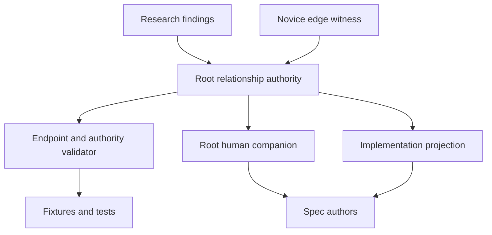

# Architecture Bundle: R3/L2 Relationship Hardening

> **2026-07-11 supersession:** The accepted Saga collapse cancels every Saga-law
> hardening route in this document. Saga-specific design text below is retained
> as historical planning evidence only; `WORK-PACK.md` owns the active route.


## Design Intent

Address the first-class category and relationship research findings without reopening R3 root authority.
The design hardens the active relationship surface by making identity, ownership consequences, overloaded
belonging semantics, Saga obligations, projection rules, and deferred residue explicit enough for one
implementation pass.

## Inputs

- [l2-first-class-categories-cross-domain/findings.md](../r3-research/l2-first-class-categories-cross-domain/findings.md)
- [first-class-category-boundary/findings.md](../../research/2026-07-02-first-class-category-boundary/findings.md)
- [HANDOFF-novice-test-edge-findings.md](../reformulate-batch1/HANDOFF-novice-test-edge-findings.md)
- [relationships.yml](../../definitions/relationships/relationships.yml)
- [relationships.md](../../definitions/relationships/relationships.md)
- [RELATIONSHIPS.md](../../impl/spec/RELATIONSHIPS.md)
- [relationship-signatures.ts](../../impl/tools/lib/relationship-signatures.ts)
- [validate-relationships.test.ts](../../impl/tools/tests/validate-relationships.test.ts)
- [r3-closeout-plan/WORK-PACK.md](../r3-closeout-plan/WORK-PACK.md)

## Source Contracts

| Contract | Design Use | Boundary |
| --- | --- | --- |
| Root `definitions/relationships/` owns relationship authority | All hardening fields land in root machine and human authority | Implementation docs stay projection only |
| `impl/spec/RELATIONSHIPS.md` is a projection | It mirrors the human view and author guidance | It must not become authority |
| Validators read root `relationships.yml` | Validation hardening is allowed in `impl/tools/` | Validator behavior must follow root, not invent new law |
| "typed composable graph fragment" wording | Preserves current category-theory boundary | Full category law remains deferred |
| R3 closeout plan | This package composes with it as a focused R3H work-pack | It does not replace APE/corpus/attestation closeout |

## Decisions

| ID | Decision | Reason |
| --- | --- | --- |
| R3H-D1 | Keep root placement settled. | Both research passes agree authority belongs in `definitions/relationships/`; implementation has necessary views only. |
| R3H-D2 | Add explicit per-signature machine identity with `signature_key`. | Current duplicate `id: orchestrates` is sound only while every tool keys by full typed signature. A stable key prevents id-only collapse. |
| R3H-D3 | Keep `id` as the author-facing verb, not the unique row id. | Human notation like `Saga --[orchestrates]--> Operation[]` stays intuitive. |
| R3H-D4 | Harden `owns` with `authority_effects`. | "Lifecycle, custody, or write responsibility" must produce observable consequences, not just prose. |
| R3H-D5 | Keep `belongs-to`, but govern it as a polysemy-controlled relation with `semantic_kinds`. | This preserves the intuitive verb while separating membership, classification, and home assignment. |
| R3H-D6 | Do not require per-instance `belonging_kind` in the flat graph yet. | Current graph rows are `From | Edge | To`; adding row metadata is a larger authoring-surface change. If examples prove one law cannot cover the senses, split later. |
| R3H-D7 | Harden Saga orchestration with structural obligation metadata. | Saga is first-class only if participant, compensation, failure residue, temporal safety, and owner-boundary duties remain distinct from Workflow. |
| R3H-D8 | Keep `depends-on`, Operation-returned Value Object, Event payload/publisher composite, and full category laws deferred. | Each lacks a finite current reject/allow witness beyond existing root signatures. |

## Required View Set

### 1. Context View



The context is a root-authority hardening pass. The implementation layer only consumes or renders the
authority needed for authors and validators.

### 2. High-Level Structure View

| Layer | Responsibility | Output |
| --- | --- | --- |
| Authority source | Root machine signatures and generated/deferred policy | `relationships.yml` with explicit identity and law fields |
| Human authority companion | Plain-language meaning, authoring guidance, examples, non-examples | `relationships.md` |
| Projection | Implementation-facing read view | `impl/spec/RELATIONSHIPS.md` |
| Validation | Parse root authority, validate endpoint triples, validate hardening metadata | `impl/tools/lib/relationship-signatures.ts`, tests |
| Evidence | Positive/negative fixtures, command receipts, closeout note | fixture specs, test output, final R3H receipt |

### 3. Low-Level Components View

| Component | Change Shape | Acceptance Signal |
| --- | --- | --- |
| `signature_key` | New stable unique key on active signatures, for example `workflow-orchestrates-operation` and `saga-orchestrates-operation` | Loader rejects duplicate or missing keys after migration |
| `id` | Remains the authored edge verb | Existing graph rows still use `orchestrates`, `owns`, `belongs-to` |
| `authority_effects` | Required for `owns`; optional for future authority-bearing relations | At least one allowed effect is present |
| `semantic_kinds` | Required for `belongs-to`; values: `membership`, `classification`, `home_assignment` | Examples and non-examples cover each declared kind |
| `saga_obligations` | Required for Saga `orchestrates` signature | Participant, compensation, failure residue, temporal safety, and owner boundary fields exist |
| Deferred residue entries | Each deferred candidate names witness criteria | No deferred candidate is accidentally accepted as active |

### 4. Workflow Process View

1. Add machine identity and loader checks first.
2. Add root law fields for `owns`, `belongs-to`, and Saga.
3. Update human root companion and implementation projection from root decisions.
4. Add structural validation tests and fixtures.
5. Run relationship, content, docs, and tool tests.
6. Record which research findings are closed, which remain deferred, and why.

### 5. Decision Flow View

```text
Candidate relation
  -> has typed endpoints?
  -> has stable contrast?
  -> changes validation, projection, derivation, composition, or owner route?
  -> has examples and non-examples?
  -> has finite machine law?
      yes: root authority
      no but witnessed: candidate/residue
      no witness: deferred or rejected
```

For current R3H:

- `owns`: active, harden.
- `belongs-to`: active, harden with semantic kinds.
- Saga `orchestrates`: active, harden with identity and obligations.
- `depends-on`: deferred.
- Operation returns Value Object: deferred as operation signature/property.
- Event payload/publisher composite: deferred.
- Full category laws: future candidate only after finite validator obligations exist.

### 6. Dependency/Interface View

| Interface | Producer | Consumer | Contract |
| --- | --- | --- | --- |
| `relationships.yml` | Root definitions | validators, docs, projections | JSON-compatible YAML; active signatures have unique `signature_key` |
| `relationships.md` | Root definitions | authors, reviewers | human companion mirrors active/generated/deferred status |
| `RELATIONSHIPS.md` | implementation projection | spec authors | projection states root authority and does not add law |
| validator library | implementation tools | `validate:rels`, tests | endpoint plus metadata validation follows root |
| fixtures | implementation tests | tool tests and command receipts | valid and invalid examples discriminate the new laws |

## Glossary Consistency

Glossary review is captured in [GLOSSARY-CONSISTENCY.md](GLOSSARY-CONSISTENCY.md). No upstream glossary
promotion is performed by this design.

## Risks And Guardrails

| Risk | Guardrail |
| --- | --- |
| `signature_key` becomes a second authored edge label | Keep authored graph rows on `id`; key is machine identity only. |
| `belongs-to` remains too broad | Require semantic kinds now; split into narrower verbs only if validation evidence proves one law is not enough. |
| Saga law becomes prose-only | Add structural fields and tests for presence before claiming hardening complete. |
| Full category theory leaks into R3 authority | Keep wording to "typed composable graph fragment"; category laws stay deferred. |
| Broader R3 closeout work is conflated with R3H | R3H only closes the relationship research findings; APE/corpus/attestation stay in R3C. |

## Dispatch Technique Trace

| Technique ID | Applied To | Validation Expectation | Status |
| --- | --- | --- | --- |
| sequence | research findings -> design decisions -> plan artifacts | Later artifacts cite concrete source paths and do not reopen settled authority placement. | pass |
| concrete_path_evidence | source contracts and write scopes | Claims point to repository paths, not vague prior discussion. | pass |
| owner_boundary_check | root authority vs implementation projection | Design does not move authority into `impl/`. | pass |
| artifact_contract_bridge | design fields to validator/projection artifacts | Each proposed field has a consumer or explicit documentation role. | pass |
| residue_ledger | deferred candidates and category laws | Deferred items stay named with owner routes. | pass |

## Distill Design-Unit Check

| Check | Result | Rationale |
| --- | --- | --- |
| Coherent unit | pass | The unit is "R3/L2 relationship hardening", not all R3 closeout. |
| Split pressure | pass | The plan splits identity, entity semantics, Saga laws, projection/validation, and verification. |
| Recomposition | pass | The unit recomposes into the root relationship authority and broader R3 closeout plan. |
| Hidden blocker | pass | No acceptance-critical decision remains open because `belongs-to` is kept with semantic kinds. |

## Implementation-Layering Seed

Plan mode should start at L0 with signature identity because every later hardening check depends on a
non-collapsing machine identity for active signatures.
