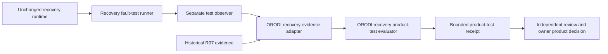

# Recovery evidence binding to ORODI

Status: source-bound design candidate. Route: CA2-ROUTE-PLAN. Authority effect: none.

The selected design keeps the tested recovery engine and makes ORODI the owner of its operational-evidence integration. ORODI supplies shared reference/evidence vocabulary and a new bounded product-test profile. A small adapter connects the recovery test observer to that profile. This is a design, not an implemented or admitted binding.

## What is reused

R03–R06 continue to own durable dispatch, claim/lease fencing, attempt identity, Operation replay, retry policy, progress and terminal state. These are executable Workflow recovery semantics. ORODI's Body War recovery ledger instead names Compose resources, effect epochs and cleanup; it cannot substitute for the generic engine.

ORODI already owns BoundReference, EvidenceState, EvaluationBinding, observations, typed control receipts, profile validation, offline replay and evidence eligibility. Future evidence integration should live there. The separate R07 campaign/receipt orchestration overlaps with these responsibilities, but its recovery assertions and fault injectors are useful domain-specific test assets. Preserve those assertions and raw evidence; migrate new runs through an ORODI adapter rather than copy the whole campaign evaluator into another subsystem.

The present ORODI validator is not a drop-in evaluator for R07. It requires exactly C01–C16 and includes deployment-oriented obligations. EvaluationBinding also requires stable_artifact, topology and operational policies; there is no proven stable recovery-runtime baseline to populate those by invention. The offline tool-profile replay registry is closed to seven existing families. A recovery product-test family is not currently registered. A Python recovery enum or a collection of passing unittest messages cannot bypass these contracts.

## Proposed composition

There is no return edge from the evaluator to the runtime's databases, retry scheduler or deployment mechanisms. The evaluator reports evidence; it does not cause a recovery action. Observation failures are recorded separately and cannot change committed recovery truth.

The product under test is the recovery runtime. A separate observer can therefore produce bounded product-test evidence about it. Normal execution logs of a business Workflow retain their workflow-plane classification. The adapter must not change that classification merely to satisfy ORODI's product-plane gate. `independently_observed` is a property of the producer relationship and evidence, not a synonym for running the same tests twice or obtaining a code review.

## Contract strategy

Add a versioned `recovery-product-test` profile under the ORODI implementation owner. Reuse existing BoundReference and EvidenceState directly. In the implementation prototype, extract shared binding facets within ORODI only where their semantics and validation are identical; preserve the existing EvaluationBinding JSON shape and C01–C16 behavior. The new recovery binding has explicit runtime, schema, fixture, observer, adapter, evaluator, test-contract and policy references. It does not pretend to be a valid deployment EvaluationBinding.

The new profile uses the existing R01-F01 through R01-F30 assertion identities. It does not relabel them C01–C16 or invent canonical control numbers. A profile-specific receipt contains assertion evidence references and the original qualified outcome. ORODI's existing operational-evaluation bundle and tool replay contracts remain unchanged until an additive successor is separately implemented and tested. No universal validator switch or workflow-plane exception is proposed.

`binding-design.json` describes the intended fields and behavior; it is not a schema instance, registered profile, generated implementation or executable contract. `scenario-mapping.json` retains the complete original matrix and maps each obligation to its evidence class and historical selector.

## Adapter responsibilities

1. Accept explicit byte inputs, never discover files or open production databases: the selected profile, product-test manifest, source/runtime manifests, scenario contract, raw results, observer descriptor, attribute policy and evaluation context.
2. Validate closed shapes, duplicate keys/identities, exact digests and supported versions before interpreting evidence. Compute an invalidation digest from the named dependency digests and policy; source drift produces stale/invalid evidence, never a refreshed approval.
3. Retain raw result selectors and original outcome labels. Do not turn stored `PASS` into a newly observed runtime fact. Historical import records provenance and reports what cannot be reconstructed.
4. For fresh runs, consume separate read-only observer snapshots and explicit barrier/process observations. The observer binds the artifact under test and actual test environment. It must not reuse compiler runtime metadata as proof of the child process environment without checking it.
5. Preserve the distinction between formation-only checks, runtime observations, simulation/fault conditions, and externally effected deployment. Process death in a temporary local fixture is not a deployed rollback observation.
6. Evaluate all declared obligations and both required repetitions. Reject duplicates; retain missing and timed-out cases; do not short-circuit collection or omit a denominator item.
7. Emit a deterministic, non-effectful receipt. No Operation invocation, database write, retry, outbox acknowledgement, cleanup, network access or deployment is available from the adapter/evaluator.

## State and time rules

ORODI states remain passed, failed, missing, invalid, inconclusive, stale and not-run. Failed assertions map to failed. Missing required evidence maps to missing. Invalid schema/digest/identity maps to invalid; changed previously bound dependency bytes map to stale. An unexecuted required test maps to not-run. An unknown outcome or insufficient observation maps to inconclusive with the original classification and cause retained. Historical `not_evaluable` is not mapped by name alone: its causal reason determines missing, invalid, stale, not-run or inconclusive.

An unknown runtime outcome can be the correct expected result of a fault scenario. In that case the scenario assertion may pass while its recorded runtime outcome remains unknown. The evaluator must compare expected and observed behavior, never require every injected runtime action to succeed.

The binding's explicit evaluation time/expiry are evaluation-policy fields. They are distinct from host monotonic lease time and boot identity. R07 lacks per-observation wall-clock timestamps for some evidence. The adapter must retain that absence, not fill it with the evaluation time. A historical importer therefore cannot establish fresh observation age. Fresh observer instrumentation is a separate construction task.

No telemetry accounting numbers are invented. Database event counts are not OTel exported/queued/dropped counts. Unavailable telemetry is explicitly absent and cannot satisfy a telemetry obligation. The selected product-test profile must only require measurements its observer can actually collect.

The reviewed lease guarantee remains authorization plus an immediate pre-COMMIT check. It is not a physical COMMIT-completion deadline. This qualification must survive normalization and receipt rendering.

## Acceptance and migration

The current R07 candidate and R08 independent review remain valid evidence for their original scope. The user's reuse request places the product decision on hold while the proposed integration is constructed. No old packet is edited and no product approval is inferred. The integrated adapter/profile/observer and unchanged runtime form a new composite candidate with new tests, review and product decision.

The first successor is offline only. It can import historical R07 evidence with explicit limits, then run a newly instrumented campaign against the exact same runtime. Existing ORODI golden and hostile cases must still pass without a relaxed control denominator or evidence-plane gate. The product-test extension must be independently tested before any claim that ORODI integration works.

Rollback of this construction is selection of the preserved original runtime and historical evidence, not deletion of data or an operational rollback. Existing canary cleanup remains under its exact ORODI owner and authorization envelope.

## Construction DAG and limits

`plan.json` contains separate product-construction and operational-support lanes. B00 (this design) is complete; B01 contract/ontology-scaffold prototypes and B02 observer/fixture design are dependency-ready. B03 implements the additive ORODI profile/evaluator, B04 implements the adapter/observer, B05 tests the composite, B06 independently reviews it and B07 requests the exact product decision. These are planning candidates, not admitted Goals execution state or blanket mutation authority.

ORODI definition promotion, business-ontology/profile admission, publication, commissioning and deployment retain their existing owners. They do not block bounded local prototype construction. A selected dependency's actual byte drift does block its dependent integration check. No ambient ontology runtime gate is used, and no target ontology records are claimed as admitted dependencies by this design.
