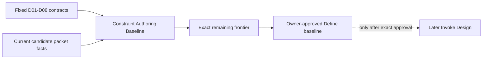

# BMC-REL-001 Relationship Constraint Completion

## What This Module Owns

This candidate owns only the Define-stage contract for authoring the remaining `BMC-REL-001` relationship constraints. It binds fixed source decisions, partitions unresolved policy domains, states evidence and approval obligations, and prepares a recomposable input for a later Invoke Design run.

It does not own canonical relationships, definitions, registries, the candidate packet, packet acceptance, product implementation, runtime enforcement, promotion, publication, release, deployment, or production state.

## Module Map

## Capabilities

| Capability | What | Key aspects | Boundary |
| --- | --- | --- | --- |
| CompileFixedDecisions | Preserve D01-D08 as immutable inputs | evidence bindings, claim ceilings, selected facets | no reopening or reinterpretation |
| DefineConstraintFrontier | Expose the remaining domains as separate authoring obligations | nonnumeric, typed per-fact representation, runtime, numeric, packet acceptance, later enforcement | no policy selection |
| BindDefineApproval | Close the candidate artifact set under SHA-256 | exact artifact paths, digests, approval question | approval is not inferred from authoring authorization |

## Fixed Source Contracts

| Decision | Fixed contract | Preserved ceiling |
| --- | --- | --- |
| D01 | `BMC-REL-D01-B2-ORTHOGONAL-STRICT-PROFILES` | architecture only; no unresolved bound, representation, or runtime guarantee |
| D02 | `BMC-REL-D02-A-EXPLICIT-DIRECTIONAL-CLOSURE` | positive minima require matching closure evidence; open views do not silently pass |
| RQ1 | retain `Query`; canonical relation is `reads` for `Query|Operation -> Entity`; exclude `Calculation` | semantic correction only, not numeric authority |
| D03 | `BMC-REL-D03-B-PER-ENDPOINT-TYPE` | per-canonical-endpoint-type aggregation for `exposes`, `applies`, `maps`, and `reads`; no bounds or roles inferred |
| D04 | `BMC-REL-D04-C-SEPARATE-CONCEPT-DEGREE-AND-STEP-ARITY` | distinct Operation concept degree and Operation-bound declared step count remain separate from runtime execution count |
| D05 | `BMC-REL-D05-C-SEPARATE-CONCEPT-DEGREE-AND-ROLE-COUNT` | distinct endpoint concept degree and declared Mapping-role count; role identity and representation remain unresolved |
| D06 | `BMC-REL-D06-C-ONE-OWNER-PER-OWNERSHIP-DIMENSION` with applied typed packet projection | conditional uniqueness within exact D29 registry dimensions; no existence condition, instance storage, or other facet resolution |
| D07 | `BMC-REL-D07-C-ONE-DIRECT-MEMBERSHIP-PER-GOVERNED-KIND` with applied typed packet projection | conditional uniqueness within exact D30 registry kinds; no existence condition, instance storage, or other facet resolution |
| D08 | `BMC-REL-D08-B-RETAIN-CANONICAL-ENDPOINT-PROVENANCE-ONLY` | no added cross-row constraint; `produces` and `emits` retain their canonical endpoint meanings |

These contracts are inputs, not topics for this candidate to reopen, reinterpret, weaken, or extend.

## Current Packet Invariants

The Define baseline must preserve all of the following simultaneously:

- exactly `31` packet rows;
- every row-level `proposed_decision.status` remains `unresolved`;
- exactly `30` `numeric_bounds_evidence` records remain `unresolved`;
- exactly six ordinary facet objects remain `owner-selected`: four D03 `multi_endpoint_semantics` objects plus D04 and D05 `occurrence_semantics` objects;
- the `owns` row retains its separately scoped D06 `ownership_topology` object;
- the `belongs-to` row retains its separately scoped D07 `membership_topology` object;
- packet status remains `candidate-pending-owner-decision`;
- owner disposition remains `pending`;
- `authority_effect` remains `none`.

## Remaining Constraint-Authoring Frontier

1. Nonnumeric pass: duplicates, ordered occurrence representation, inverse views, self-edge/cycle topology, hostile fixtures, and partial-view behavior.
2. Per-fact ownership-dimension and membership-kind representation plus executable fixtures.
3. Runtime-cardinality semantics.
4. Numeric bounds, separately from all other axes.
5. Packet-wide owner acceptance.
6. Implementation and enforcement later, under separately authorized lifecycle work.

No policy in this remaining frontier is selected by this package.

## Domain Concepts

| Concept | Type | Key constraints |
| --- | --- | --- |
| FixedDecisionCorpus | Evidence binding | D01-D08 are immutable inputs for this Define candidate |
| ConstraintAxis | Candidate type | axes remain orthogonal and require explicit evidence |
| DeclaredOccurrence | Candidate distinction | design-time step or role occurrences remain distinct from canonical concept degree and runtime multiplicity |
| TypedFactQualifier | Candidate requirement | a future representation must bind one admitted D29 dimension or D30 kind without inventing storage here |
| ApprovalClosure | Governance boundary | exact digest-bound owner approval is required before Design |

## Candidate Concept Registry

These IDs are local navigation labels for this candidate only. They are not canonical registry entries and are not promoted by this package.

| Concept | Candidate ID | Type |
| --- | --- | --- |
| Constraint Completion Define | `bmc-rel-001.ConstraintCompletionDefine` | Capability |
| Fixed Decision Corpus | `bmc-rel-001.FixedDecisionCorpus` | Evidence |
| Remaining Constraint Frontier | `bmc-rel-001.RemainingConstraintFrontier` | Ledger |
| Define Approval Closure | `bmc-rel-001.DefineApprovalClosure` | Approval boundary |

## Feature Concept Graph

This Define package authors no new canonical DomainSpec relationship fact. Source examples in `DEFINE-COMPLEXITY-EXAMPLES.md` are explicitly hypothetical and have decision effect `none`.

## Aspect Coverage

| Aspect | Location | Coverage |
| --- | --- | --- |
| Intent and approval semantics | `DEFINE-INTENT.md` | complete for Define |
| Evidence context | `DEFINE-CONTEXT.md` | closed and hash-bound |
| Policy gaps | `DEFINE-GAPS.md` | exact remaining frontier |
| Explanatory examples | `DEFINE-COMPLEXITY-EXAMPLES.md` | low, medium, complex; non-decisional |
| Validation | `DEFINE-VALIDATION.json` and sidecar validator | candidate authoring only |
| Implementation layering | `DEFINE-GAPS.md` | explicitly deferred to later Design/Plan; no seed emitted |

## Acceptance Contract

Define is authored when the required artifacts validate, selected sources and handoff bytes retain their bound hashes, the approval manifest closes, and the claim ceiling remains intact. Design remains blocked until the owner explicitly approves the exact manifest-bound candidate.

## Claim Ceiling

This package may prove `artifact_authored.status = pass` for this Define candidate. It cannot prove or set `registry_released = true`, `mutation_runtime_ready = true`, canonical authority, packet-wide acceptance, implementation, enforcement, promotion, publication, release, deployment, or production readiness.
