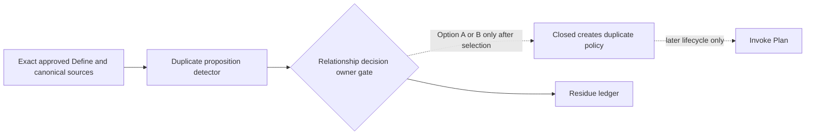
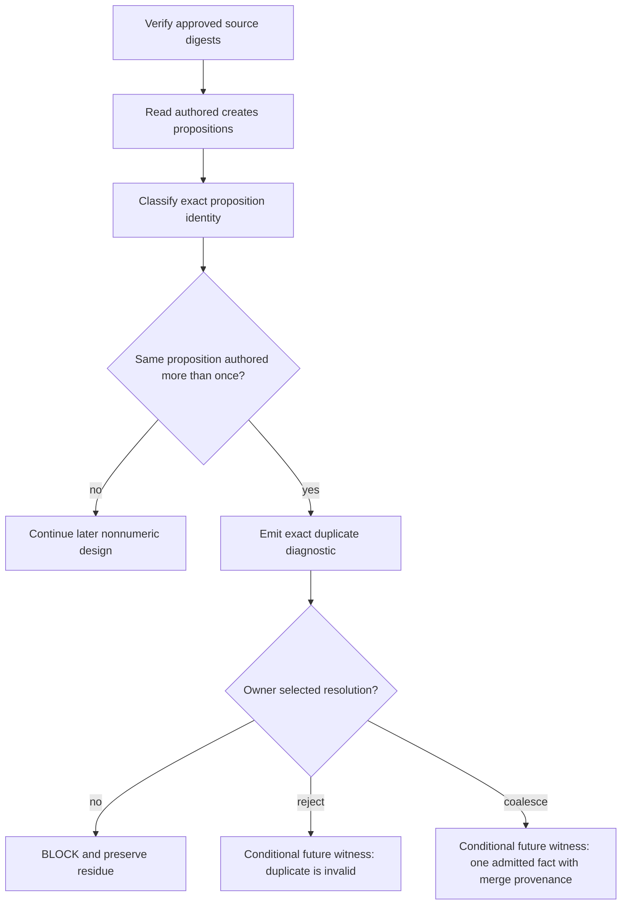

# Architecture Bundle: BMC-REL-001 Constraint Completion

## Current Phase

N01 is resolved by exact owner selection A: reject an exact duplicate authored
canonical `creates` proposition only. N02 is resolved by exact owner selection A:
`ordered_step_ids` is the sole authored exact-once total order over declared Workflow
step IDs; `steps` array position is non-semantic and authored `after` is not
co-authoritative. N03 is resolved by exact owner selection A: reject an exact
duplicate authored canonical `Workflow --[orchestrates]--> Operation` proposition
only. N04 is resolved by exact owner selection A: reject direct `owns_d(e,e)`
self-edges for every admitted D29 dimension. N05 is resolved by exact owner selection
A: one future same-dimension longer-cycle behavior rule governs every current and
later admitted D29 dimension unless fresh authority changes it. N06 is resolved by
exact owner selection A: reject every same-dimension directed `owns` cycle over two
or more distinct Entities. N07 is resolved by exact owner selection A: do not reject
a directed canonical `owns` path solely because its combined path closes when it
uses at least two admitted D29 dimensions. N08 is resolved by exact owner selection
A: reject an exact duplicate authored
canonical `owns` proposition, preserve source handles, and require source repair.
N09 is resolved by exact owner selection A: generated non-authoritative `owned-by`
preserves the exact D29 dimension from each canonical `owns` fact.
N10 is resolved by exact owner selection A: compute that projection from current
canonical facts when requested without independently retained state. N11 is resolved
by exact owner selection A: incomplete relevant closure produces
`not-evaluated-incomplete-closure` while observed prohibited cycles remain invalid.
N12 is resolved by exact owner selection A: complete boundary identity, eligible
Entity population and placement, and complete outgoing canonical `owns` adjacency
suffice for the N06 whole-boundary cycle-freedom predicate.
N13 is resolved by exact owner selection B: future same-dimension `owns` path
consequences are governed independently per admitted D29 dimension, with a later
owner decision and fresh registry-digest review for each current or later-added
dimension. The N13 six-view architecture and historical preselection gate are in
`continuations/N13-OWNS-PATH-CONSEQUENCE-GOVERNANCE/ARCHITECTURE-BUNDLE.md`.

The exact sequencing input `lifecycle` is immutably recorded. N14 is resolved by
exact owner selection A: lifecycle responsibility consequences remain on authored
direct lifecycle `owns` facts, and no upstream lifecycle responsibility or
reachability consequence is derived. The historical six-view architecture and
preselection gate remain in
`continuations/N14-OWNS-LIFECYCLE-PATH-CONSEQUENCE-BEHAVIOR/ARCHITECTURE-BUNDLE.md`.
The exact next sequencing input `custody` is immutably recorded and N15 A keeps
custody consequences direct-only. N16 A does the same for write-responsibility. N17 A
keeps distinct-endpoint mixed-dimension consequences on direct facts, and N18 A
derives no self-reachability from admitted mixed-dimension closed paths. Those exact
receipts close the finite nonnumeric `owns` topology/path pass without transferring
authority to another relation. N19 A selects uniform direct-self-edge governance,
N20 A rejects direct `belongs-to_k(e,e)` facts, N21 A selects uniform governance
for same-kind longer-cycle behavior, N22 A rejects that exact same-kind
longer-cycle predicate uniformly, and N23 A allows a topology-admitted mixed-kind
closed path only as independent exact kind-bearing direct facts. N24 A rejects an
exact repeated authored `belongs-to` proposition under the five-part proposition
identity and preserves source handles for repair. N25 A reports
`not-evaluated-incomplete-closure` when no prohibited same-kind
topology is visible but relevant closure is absent, while observed N20/N22 violations
remain invalid. N26 A selects complete outgoing exact-kind adjacency over the
complete eligible Entity population and placement as sufficient for that proof;
incoming adjacency is not required. N27 B now governs future same-kind path-
consequence behavior independently per exact active D30 kind, without selecting
behavior. Its historical six-view architecture and immutable gate evidence are in
`continuations/N27-BELONGS-TO-PATH-CONSEQUENCE-POLICY-GOVERNANCE/ARCHITECTURE-BUNDLE.md`.
The exact sequencing input `classification` is immutably recorded. N28 A now keeps
classification consequences on authored direct facts and derives no classification
reachability. Because D30 currently has exactly two active kinds, home-assignment is
the sole current unresolved kind by set difference, not registry order. N29 asks
whether an acyclic exact-`home-assignment` path has only direct consequences or also
a non-authoritative derived home-assignment reachability consequence.
Recommendation is A, direct-only, because D30 withholds transitivity; N29 remains
unselected. Its current six-view architecture is in
`continuations/N29-BELONGS-TO-HOME-ASSIGNMENT-PATH-CONSEQUENCE-BEHAVIOR/ARCHITECTURE-BUNDLE.md`.
The N01 material below is retained
as its immutable preselection snapshot and is superseded only for lifecycle status.

## Historical N01 Preselection Design Intent

Convert the exact approved Define baseline into a closed, reviewable Design
contract without preselecting unresolved relationship policy. The smallest
coherent current unit detects an exactly duplicated authored canonical
`creates` proposition, separates that condition from legitimate declared
occurrence reuse, and stops at the owner choice between rejection and
coalescence.

## Inputs

- approved Define `SPEC.md`, `GLOSSARY.md`, context, gaps, result, approval
  manifest, and approval receipt;
- fixed D01-D08 decision record;
- current candidate packet and `creates` row;
- canonical relationship signatures, D27/D29/D30, and the exact D29/D30
  registries;
- closed scope: `DESIGN-SCOPE-MANIFEST.json`, input digest
  `67011038c7d34cf1f19fdaaa3e358870d9fe024dc1e14f28fae1e99f5035d9b5`;
- selection result: `DESIGN-SELECTION-RESULT.json`, result digest
  `d5bc249a53e1dbed8f445989b7e233d582c8440f02928350d5df5b73d8df5bf2`.

## Required View Set

### 1. Context View



The system of interest is the Design-time constraint-authoring boundary. It
does not observe runtime event emission, execute an aggregate, or change the
canonical relationship registry.

### 2. High-Level Structure View

| Component | Responsibility | Input | Output | Owner boundary |
| --- | --- | --- | --- | --- |
| ExactSourceBoundary | reject changed or out-of-denominator source bytes | 14 SHA-bound sources | current source handles | Design evidence owner |
| DuplicatePropositionDetector | identify repeated authorship of one exact `creates` proposition | authored relationship facts | stable duplicate diagnostic or no duplicate | future validator owner |
| AxisSeparator | keep canonical edge duplicates distinct from declared step/role occurrences and runtime multiplicity | D04/D05/D27 contracts | classified constraint axis | architecture owner |
| DuplicateResolutionPolicy | map one duplicate diagnostic to reject or coalesce | owner-selected policy | determinate resolution | relationship decision owner |
| PlannedWitnessContract | describe later positive and hostile evidence without executing it | selected policy and exact sources | Plan-start witness contract | Plan owner |
| ResidueLedger | preserve every later nonnumeric and cardinality decision | unselected frontier | named owner routes | relationship decision lifecycle |

`DuplicateResolutionPolicy` is an interface with no implementation or default
until the owner chooses. That missing selection is the current blocker.

### 3. Low-Level Components View

#### Candidate duplicate predicate

Within the active `creates` authority boundary, two authored records are an
exact duplicate candidate only when they assert the same canonical proposition:

```text
same verb = creates
and same canonical Operation concept id
and same canonical Entity concept id
and same admitted feature/authority context
```

This predicate is Design-local and does not introduce a packet field or
canonical representation. Distinct endpoints are not exact duplicates; they
remain subject to the already-authoritative D27 partial-injection bounds.

#### Detector result

```text
NoDuplicate
| ExactDuplicateDetected {
    proposition_handle,
    authored_occurrence_handles[2..n],
    source_evidence_handles
  }
```

The detector must preserve source evidence so both viable policies remain
auditable. It must not silently choose between them.

#### Axis separation

- two different Workflow `step_id` declarations may reuse one Operation
  binding under D04 and are not duplicate canonical `creates` facts;
- a generated `creation_targets` projection is not an authored second fact;
- runtime retries or multiple entity instances are outside concept-level
  duplicate detection;
- ownership dimensions and membership kinds do not participate in `creates`.

### 4. Workflow Process View



Only the path through `BLOCK` is active in this package. The two selected paths
are conditional Design projections, not implemented behavior.

### 5. Decision Flow View

Decision ID: `BMC-REL-NONNUMERIC-01-CREATES-DUPLICATE-AUTHORSHIP`.

Question: when the exact same canonical `Operation --[creates]--> Entity`
proposition is authored more than once, should admission reject the duplicated
authorship or coalesce the exact duplicates into one admitted fact while
retaining provenance?

The canonical prefilter admits two authority-hazard actions only behind
`relationship-decision-owner:owner-decision`, plus reversible `defer` and
`stop`; it selects none and does not satisfy either action gate.
Recommendation: reject duplicate authorship because D27 says one canonical
proposition is authored once, and early rejection exposes drift instead of
normalizing it away. Coalescence remains viable when multiple independent
source fragments are a confirmed authoring reality, but selection would create
a further conditional Design obligation to close deterministic merge
provenance before admission.

### 6. Dependency Interface View

| Interface | Producer | Consumer | Contract | State |
| --- | --- | --- | --- | --- |
| Define approval handle | Define owner gate | Invoke Design | exact manifest and artifact-set digests | satisfied |
| Source denominator | Design author | scope extractor | 14 exact in-root selectors, no unknowns | pass |
| Denominator receipt | scope extractor | selection validator | independent detector, all signals bound | pass |
| Selection result | selection validator | architecture bundle | required validation contracts; fixed point | pass |
| Duplicate diagnostic | future detector | relationship decision policy | exact proposition plus occurrence provenance | planned, unexecuted |
| Owner decision | user / relationship decision owner | later Design continuation | one stable option ID | blocked pending selection |
| Planned witnesses | Design | later Plan | no executed evidence claim | conditional and unexecuted |

No interface grants canonical authority, packet acceptance, implementation
admission, promotion, publication, or runtime readiness.

## Significant Behavior Scenario

Stimulus: one source set contains the same `CreateOrder --[creates]--> Order`
concept proposition twice.

Preconditions: exact approved sources are current; both declarations resolve to
the same canonical verb, Operation concept, Entity concept, and admitted
same-feature boundary.

Ordered response:

1. validate source hashes;
2. classify both records as the same proposition;
3. emit one exact duplicate diagnostic with both source handles;
4. stop because no resolution policy is selected;
5. retain all later frontier items unchanged.

Failure/recovery: changed inputs block as stale; an unresolved owner choice
blocks continuation without editing the packet. Recovery is one exact owner
selection followed by a fresh Design continuation that binds the chosen option.

Observable evidence: manifest, denominator receipt, fixed-point selection
result, option-admissibility receipt, and the still-unselected decision log.
Acceptance owner: relationship decision owner (`user`).

## Concern-To-View Trace

| Concern ID | Primary class | Source signal IDs | Disposition | Accountable owner | Contributing owners | Artifact owner | Validator owner | View or extension | Evidence selectors |
| --- | --- | --- | --- | --- | --- | --- | --- | --- | --- |
| `concern:validation` | validation | authored duplicate concern; approved baseline; halt rule | required | relationship-decision-owner | definitions-owner, architecture-owner | plan-work-pack-owner | invoke-design-selection-validator | all six views plus planned validation contracts | Define frontier, packet creates row, D27 |

## Planned Witness Contracts

### Fixture spec

| Fixture ID | Claim ID | Polarity | Target | Input or violation | Expected result | Execution owner | Execution phase |
| --- | --- | --- | --- | --- | --- | --- | --- |
| `planned:creates-duplicate-detected` | duplicate authorship | positive detection | duplicate detector | exact same proposition twice | stable duplicate diagnostic before policy | future Plan owner | Plan or validation |
| `planned:creates-distinct-edge-not-duplicate` | no false positive | hostile | duplicate detector | one endpoint differs | not an exact duplicate; D27 bounds remain separate | future Plan owner | Plan or validation |
| `planned:declared-occurrence-not-edge-duplicate` | axis separation | hostile | axis separator | two step IDs reuse one binding | declared occurrences remain distinct | future Plan owner | Plan or validation |

### Validator contract

| Contract ID | Claim ID | Target contract | Accepted digest/binding | Verdicts | Stale rule | Self-issue rule | Validator owner |
| --- | --- | --- | --- | --- | --- | --- | --- |
| `planned:creates-duplicate-policy-validator` | selected resolution | packet creates duplicate facet plus owner receipt | future exact selection digest | pass and fail | reject | reject | future independent validator owner |

These rows are planned contracts, not executed Plan evidence. Their final
expected resolution cannot be fixed until the owner selects Option A or B.

## Triggered Architecture Extensions

Selection requires `validation-contracts`. No optional architecture extension
is selected because the exact source denominator has no store, queue, external
effect, deployment, compatibility, human-rendered surface, or data-sink signal.

## Design Rules

- preserve all six baseline views;
- reference only Define candidate IDs and existing canonical source terms;
- treat the duplicate predicate as a Design-local detector contract, not a new
  canonical field;
- keep generated projections, declared occurrences, and runtime multiplicity
  outside authored canonical duplicate semantics;
- never describe planned witnesses as executed evidence;
- stop at the first unresolved consequential owner choice.

## Output

This historical N01 snapshot is `authored-complete` and had a passing Design
selection validator. Its owner gate is now closed by the separate immutable
selection receipt. Normal Plan handoff remains forbidden because the current N26
subject Design is blocked at its owner decision.

## Closed N25 And Current N26 Frontier Projection

N25 A is closed narrowly: absence of a visible N20/N22 prohibited same-kind topology
does not become a whole-boundary pass while relevant closure evidence is absent. The
verdict is `not-evaluated-incomplete-closure`; observed prohibited topology remains
immediately invalid. This does not select the exact proof shape.

The current six-view bundle is
`continuations/N26-BELONGS-TO-SAME-KIND-CYCLE-CLOSURE-PROOF-SHAPE/ARCHITECTURE-BUNDLE.md`.
It compares complete boundary identity, exact D30 kind, eligible Entity population
and placement, and complete exact-kind outgoing adjacency against the stronger form
that also requires complete incoming adjacency. It recommends A as minimally
sufficient for directed-cycle detection and stops unselected. Closure metadata,
feature-scope inference, minima, mandatory membership, topology reopening,
reachability, representation, runtime/numeric policy, canonical or packet mutation,
Plan, implementation, promotion, and publication remain outside the gate.
