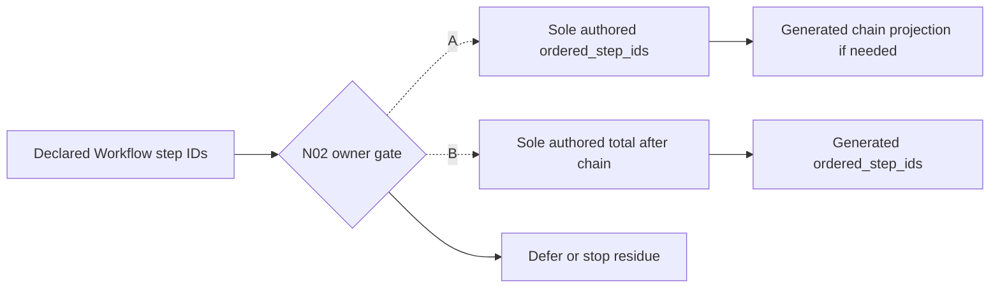
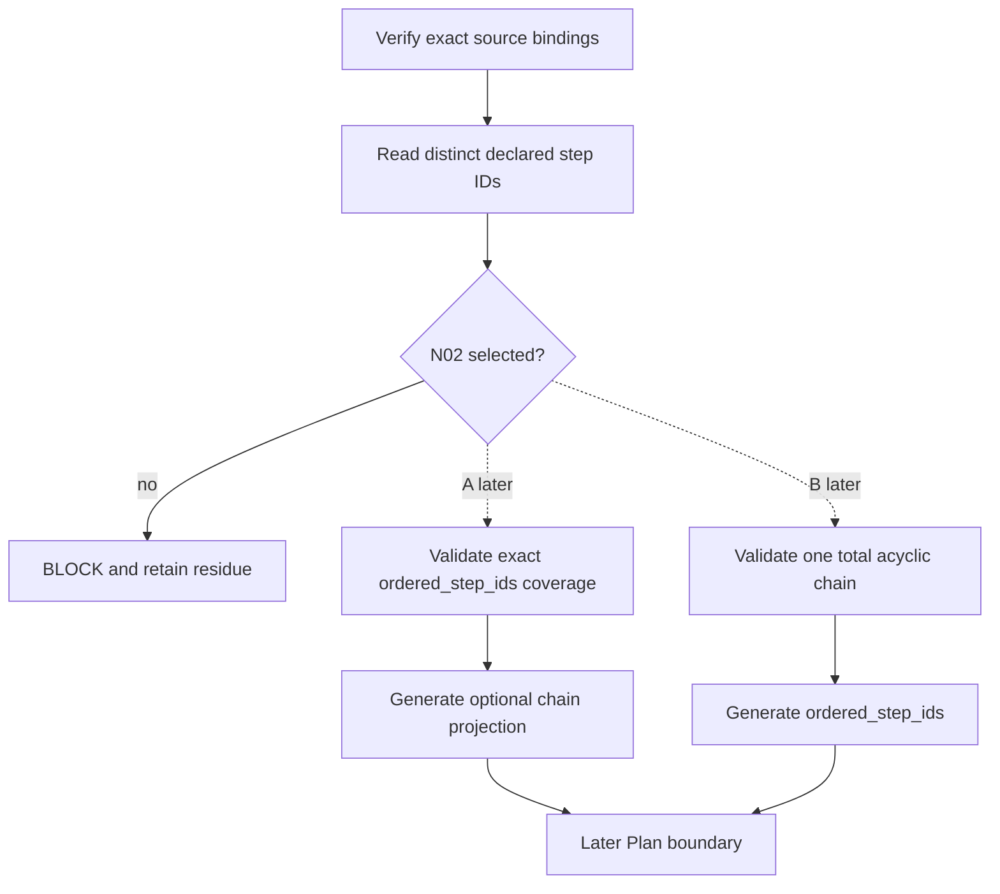

# Architecture Bundle: N02 Orchestrates Order Authorship

## Design Intent

Preserve the exact N01 `creates` duplicate-rejection choice, then design only the
smallest boundary needed to choose one canonical authoring form for a total order
over declared Workflow step IDs. No N02 option is selected.

## 1. Context View



The system boundary is Design-time authoring of one total declared-occurrence order.
It excludes runtime event sourcing, execution scheduling, compensation order, and a
general dependency DAG.

## 2. High-Level Structure View

| Component | Responsibility | Input | Output | Owner boundary |
|---|---|---|---|---|
| ExactSourceBoundary | reject stale denominator bytes | 14 SHA-bound files | current handles | Design evidence owner |
| DeclaredOccurrenceSet | preserve distinct step IDs independently of reused Operation concepts | Workflow declaration | exact step-ID set | definitions owner |
| TotalOrderAuthor | expose exactly one conditional authored form | step-ID set plus N02 selection | list or chain | relationship decision owner |
| OrderValidator | validate exact membership and the selected form's invariants | authored form | stable diagnostics | future validator owner |
| ProjectionGenerator | derive the non-authored alternate view | valid canonical form | generated projection | future Plan owner |
| ResidueLedger | retain broad DAG, runtime, topology, duplicates, and later axes | excluded questions | named gaps | lifecycle owner |

`TotalOrderAuthor` has no active branch until N02 is selected.

## 3. Low-Level Components View

Shared invariant:

```text
declared_step_ids = distinct occurrence identifiers
authored_order covers declared_step_ids exactly once
steps array position is non-semantic
exactly one order representation is authored
```

Conditional A contract:

```text
ordered_step_ids is authored
set(ordered_step_ids) = declared_step_ids
len(ordered_step_ids) = len(declared_step_ids)
```

Conditional B contract:

```text
after links are authored
exactly one root has no predecessor
every other step has exactly one predecessor
every non-last step has at most one successor
the chain is acyclic and covers every declared step
ordered_step_ids is generated from the unique path
```

Branches, joins, multiple roots, disconnected nodes, cycles, and dual authorship are
invalid under B. They are not alternate meanings silently bundled into it.

## 4. Workflow Process View



Only the `BLOCK` path is active. Dashed branches are conditional Design projections.

## 5. Decision Flow View

Decision: `BMC-REL-NONNUMERIC-02-ORCHESTRATES-ORDER-AUTHORSHIP`.

Question: which single authored representation owns one total order over declared
Workflow step IDs?

- **A:** sole-authored `ordered_step_ids`; smallest validation and generation
  surface; recommended because it matches D04's proposed direction without treating
  that proposal as prior consent.
- **B:** sole-authored total acyclic predecessor chain; local link authorship, but
  incurs graph validation, generation, and stricter merge/reorder constraints; no
  branches or joins.
- **C:** defer and keep Design blocked.
- **D:** stop the route.

Array-position order, dual-authored list plus chain, and general `after` DAG are
prefiltered as inadmissible. A/B are authority choices behind
`relationship-decision-owner:owner-decision`. Selection: `null`.

## 6. Dependency Interface View

| Interface | Producer | Consumer | Contract | State |
|---|---|---|---|---|
| N01 owner selection | user | N02 Design | exact A; creates-only scope | satisfied |
| N02 source denominator | Design author | extractor | 14 exact files, no unknowns | pass |
| N02 denominator receipt | extractor | selector | independent, complete, bound | pass |
| N02 selection result | selector | architecture | unchanged pass-one/pass-two digest | pass |
| N02 prefilter receipt | canonical prefilter | user gate | A/B/C/D presented; X/Y/Z rejected | pass |
| N02 owner selection | user | later Design continuation | one exact presented ID | blocked |
| Planned witnesses | Design | later Plan | design-planned only | unexecuted |

## Significant Scenario

A Workflow declares `validate`, `charge`, and `confirm`. Validation first preserves
all three occurrence IDs even if two bind the same Operation concept. Because N02 is
unselected, no list or chain is treated as canonical and the continuation blocks.
After a future exact A selection, the list would be checked for exact-once coverage;
after B, the chain would additionally be checked for one root, acyclicity, one path,
and no branch/join. Neither conditional path is active here.

## Concern Trace And Planned Evidence

The required `validation` concern binds the N01 scope rule, N02 halt rule, approved
Define baseline, and exact owner selection. Planned fixtures cover A's list, B's
bounded chain, dual-authorship rejection, and occurrence/concept separation. Their
evidence state is `design-planned`; no fixture has executed.

## Output Boundary

All six views are authored. Extractor and selector pass at a fixed point. The subject
Design remains incomplete because N02 has no owner selection. No Plan handoff,
canonical mutation, packet acceptance, implementation, promotion, publication, or
runtime-readiness claim is admitted. `authority_effect: none`.
