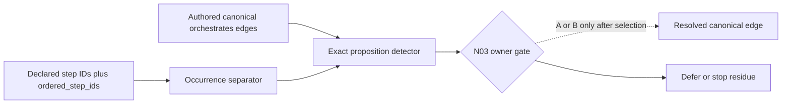
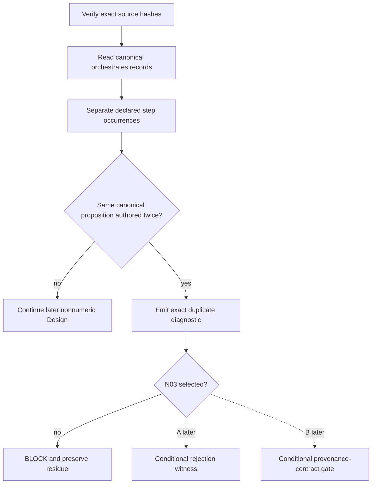

# Architecture Bundle: N03 Orchestrates Duplicate Authorship

## Design Intent

Preserve N01 creates-only rejection and N02 sole-authored exact-once step order,
then isolate duplicate authored canonical `orchestrates` edges from valid repeated
declared step bindings. No N03 option is selected.

## 1. Context View



The boundary is Design-time canonical edge authorship. It excludes runtime calls,
step execution, storage, packet mutation, and duplicate policies for other verbs.

## 2. High-Level Structure View

| Component | Responsibility | Input | Output | Owner boundary |
|---|---|---|---|---|
| ExactSourceBoundary | reject stale denominator bytes | 14 SHA-bound sources | current handles | Design evidence owner |
| OccurrenceSeparator | preserve step IDs independently of Operation concept adjacency | N02 order and D04 distinction | occurrence/edge classification | architecture owner |
| DuplicatePropositionDetector | detect repeated exact Workflow-to-Operation authorship | canonical edge records | stable diagnostic | future validator owner |
| DuplicateResolutionPolicy | conditionally reject or provenance-coalesce | owner-selected N03 action | one determinate resolution | relationship decision owner |
| PlannedWitnessContract | describe positive and hostile checks | bounded predicate/options | Design-planned fixtures | future Plan owner |
| ResidueLedger | preserve other rows and axes | excluded frontier | named later routes | lifecycle owner |

`DuplicateResolutionPolicy` has no active action branch until N03 is selected.

## 3. Low-Level Components View

Exact duplicate identity within one admitted authority context:

```text
same canonical verb = orchestrates
same canonical Workflow concept ID
same canonical Operation concept ID
same admitted feature/authority context
```

Not part of identity:

```text
step_id
position in ordered_step_ids
runtime execution/retry identity
generated or stored representation
```

Detector result:

```text
NoDuplicate
| ExactDuplicateDetected {
    proposition_handle,
    authored_record_handles[2..n],
    source_evidence_handles
  }
```

Option A would reject the diagnostic. Option B would remain blocked until a separate
deterministic merge-provenance contract can reduce it to one admitted proposition
without losing authored-source evidence.

## 4. Workflow Process View



Only the block path is active. Conditional branches are Design projections, not
implemented behavior.

## 5. Decision Flow View

Decision: `BMC-REL-NONNUMERIC-03-ORCHESTRATES-DUPLICATE-AUTHORSHIP`.

- **A:** reject exact duplicate authored canonical `orchestrates` propositions;
  exposes drift early and requires source repair. Recommended because D04 says the
  canonical concept edge is authored once.
- **B:** coalesce exact duplicates into one admitted edge only under a separately
  closed deterministic merge-provenance contract; supports fragment convergence but
  adds provenance and diagnostic obligations.
- **C:** defer and keep Design blocked.
- **D:** stop the route.

Per-step canonical edge authorship and silent provenance-free deduplication are
inadmissible. A/B remain authority choices behind
`relationship-decision-owner:owner-decision`. Selection: `null`.

## 6. Dependency Interface View

| Interface | Producer | Consumer | Contract | State |
|---|---|---|---|---|
| N02 owner selection | user | N03 Design | exact A; order-only scope | satisfied |
| N03 denominator | Design author | extractor | 14 exact sources, no unknowns | pass |
| Denominator receipt | extractor | selector | complete, independent, bound | pass |
| Selection result | selector | architecture | unchanged pass-one/pass-two digest | pass |
| N03 prefilter | canonical prefilter | user gate | only A/B/C/D presented | pass |
| N03 owner selection | user | later Design continuation | one exact presented option | blocked |
| Planned witnesses | Design | later Plan | design-planned only | unexecuted |

## Significant Scenario

One Workflow uses one Operation in two distinct declared steps. Both step IDs occur
exactly once in `ordered_step_ids`, while the same canonical Workflow-to-Operation
edge is authored twice. The separator keeps both steps, the detector emits one exact
duplicate diagnostic, and Design stops because N03 is unselected. Neither rejection
nor coalescence is active.

## Concern Trace And Planned Evidence

The required validation concern binds N01's creates-only boundary, N02 order
authorship, the packet's unresolved duplicate facet, D04, and D27. Planned witnesses
cover exact duplicate detection, step-reuse separation, distinct Operation edges,
and missing coalescence provenance. All remain `design-planned`.

## Output Boundary

All six views are authored to the owner gate. No Plan handoff, packet acceptance,
canonical mutation, implementation, promotion, publication, or runtime-readiness
claim is admitted. `authority_effect: none`.
