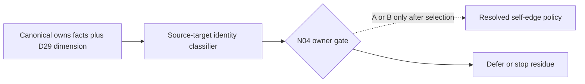
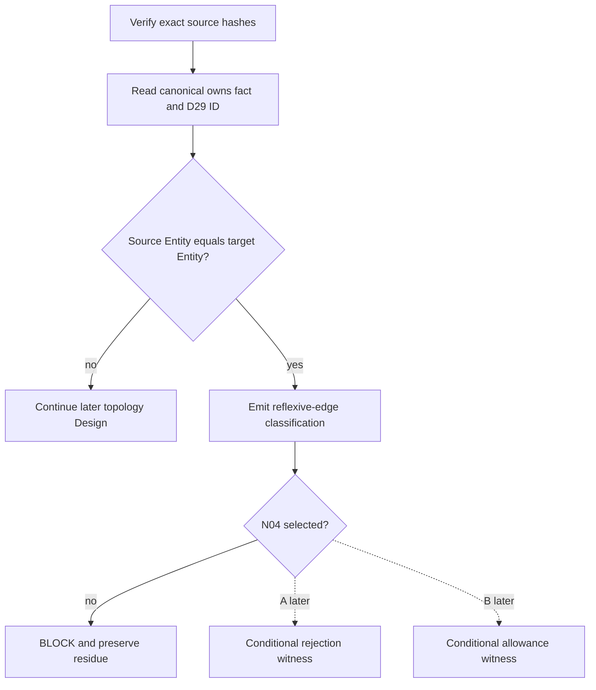

# Architecture Bundle: N04 Owns Self-Edge Policy

## Design Intent

Preserve N03 exact duplicate-`orchestrates` rejection and current signature-bound
inverse authority, then isolate whether one dimension-bearing canonical `owns` fact
may be reflexive. No N04 option is selected.

## 1. Context View



The boundary is Design-time canonical `owns` reflexivity. It excludes cycles over
distinct Entities, transitivity, existence, storage, runtime and packet mutation.

## 2. High-Level Structure View

| Component | Responsibility | Input | Output | Owner boundary |
|---|---|---|---|---|
| ExactSourceBoundary | reject stale denominator bytes | 14 SHA-bound sources | current handles | Design evidence owner |
| CanonicalInversePreserver | retain `owned-by` as generated navigation | DS-D8 inverse authority | no new semantic choice | definitions owner |
| SelfEdgeClassifier | compare canonical source/target Entity IDs within one dimension | owns fact plus admitted D29 ID | reflexive/non-reflexive classification | architecture owner |
| SelfEdgePolicy | conditionally reject or allow reflexive fact | owner-selected N04 action | determinate self-edge result | relationship decision owner |
| PlannedWitnessContract | describe positive and hostile checks | predicate/options | Design-planned fixtures | future Plan owner |
| ResidueLedger | preserve cycles and all excluded axes | excluded frontier | named later routes | lifecycle owner |

`SelfEdgePolicy` has no active action branch until N04 is selected.

## 3. Low-Level Components View

Reflexive identity within one admitted ownership dimension:

```text
same canonical verb = owns
same source Entity concept ID = target Entity concept ID
one exact active D29 ownership dimension ID
```

Not part of N04:

```text
paths through two or more distinct Entities
transitive closure
whether an owns fact must exist
where a dimension is represented or stored
generated owned-by navigation
runtime writers, calls, or cardinality
```

Classifier result:

```text
NonReflexiveOwns
| ReflexiveOwnsDetected {
    proposition_handle,
    ownership_dimension_id,
    source_evidence_handle
  }
```

Option A would reject only the reflexive fact. Option B would allow but not require
it; D06 uniqueness inside the dimension remains unchanged.

## 4. Workflow Process View



Only the block path is active. Conditional branches are Design projections, not
implemented behavior.

## 5. Decision Flow View

Decision: `BMC-REL-NONNUMERIC-04-OWNS-SELF-EDGE-POLICY`.

- **A:** reject an `owns` fact whose source and target are the same Entity in one
  admitted D29 dimension. Recommended because it preserves distinct responsibility
  roles and avoids a reflexive fact satisfying uniqueness vacuously.
- **B:** allow such a self-edge without requiring one; useful only when the same
  concept intentionally occupies owner and target roles, but adds reflexive topology.
- **C:** defer and keep Design blocked.
- **D:** stop the route.

Bundled longer cycles, mandatory self-ownership, and token-derived topology are
inadmissible. A/B remain authority choices behind
`relationship-decision-owner:owner-decision`. Selection: `null`.

## 6. Dependency Interface View

| Interface | Producer | Consumer | Contract | State |
|---|---|---|---|---|
| N03 owner selection | user | N04 Design | exact A; orchestrates-duplicate-only scope | satisfied |
| Canonical inverse authority | DS-D8 | N04 Design | `owns` generates `owned-by`; no authored inverse | satisfied |
| N04 denominator | Design author | extractor | 14 exact sources, no unknowns | pass |
| Denominator receipt | extractor | selector | complete, independent, bound | pass |
| Selection result | selector | architecture | unchanged pass-one/pass-two digest | pass |
| N04 prefilter | canonical prefilter | user gate | only A/B/C/D presented | pass; unselected |
| N04 owner selection | user | later Design continuation | one exact presented option | blocked |
| Planned witnesses | Design | later Plan | design-planned only | unexecuted |

## Significant Scenario

One Entity is both source and target of an `owns` fact classified under `lifecycle`.
The classifier emits a reflexive-edge result and Design stops because N04 is
unselected. It neither rejects nor admits the fact, and it says nothing about longer
cycles or whether ownership must exist.

## Concern Trace And Planned Evidence

The required validation concern binds N03's narrow effect, D06/D29 optional
dimension-scoped uniqueness, the owns packet self-relations facet, and canonical
inverse authority. Planned witnesses cover reflexive classification, distinct
source/target non-matches, longer-cycle separation, and optional ownership. All
remain `design-planned`.

## Output Boundary

All six views are authored to the owner gate. No Plan handoff, packet acceptance,
canonical mutation, implementation, promotion, publication, or runtime-readiness
claim is admitted. `authority_effect: none`.
