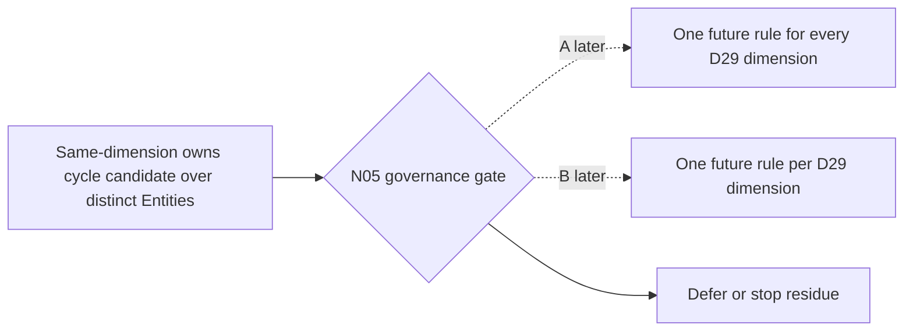
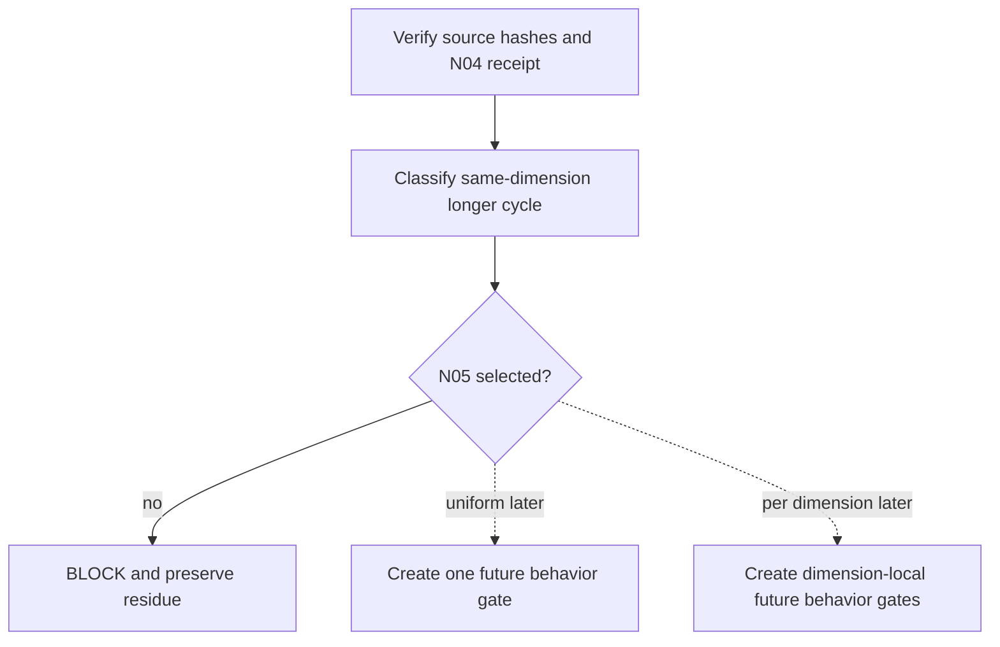

# Architecture Bundle: N05 Owns Cycle Policy Governance

## Design Intent

Preserve N04 rejection of every direct dimension-bearing owns self-edge, then isolate
whether future longer-cycle behavior is governed uniformly across all admitted D29
dimensions or independently per dimension. No actual cycle behavior or N05 option is selected.

## 1. Context View



The boundary is Design-time partitioning of future cycle-policy authority. It excludes
cycle acceptance/rejection, mixed-dimension paths, transitivity, closure, existence,
representation, runtime behavior, and packet mutation.

## 2. High-Level Structure View

| Component | Responsibility | Input | Output | Owner boundary |
|---|---|---|---|---|
| ExactSourceBoundary | reject stale denominator bytes | 14 SHA-bound sources | current handles | Design evidence owner |
| N04BoundaryPreserver | reject direct owns_d(e,e) only | exact N04 A receipt | self-edge excluded from N05 | relationship decision owner |
| SameDimensionCycleClassifier | identify closed directed paths over 2+ distinct Entities whose edges share one dimension | canonical owns facts plus D29 IDs | dimension-tagged cycle candidate | architecture owner |
| GovernancePartition | conditionally select one shared policy surface or one per dimension | owner-selected N05 action | future gate partition | relationship decision owner |
| ResidueLedger | preserve behavior and excluded axes | unselected frontier | named later routes | lifecycle owner |

`GovernancePartition` has no active action branch until N05 is selected.

## 3. Low-Level Components View

N05 candidate identity:

```text
directed closed path length >= 2
every vertex is a distinct-position canonical Entity concept
every edge is canonical owns
every edge carries the same exact admitted D29 dimension ID d
no edge is a direct self-edge
```

Option A would create one later behavior gate whose outcome applies identically to
every admitted dimension. Option B would require one later behavior gate for each
admitted dimension and reopen coverage when the registry changes. Neither option
accepts or rejects any cycle.

Not part of N05: mixed-dimension closed paths, transitive inference, closure semantics,
mandatory ownership, dimension representation/storage, generated `owned-by`, numeric
or runtime policy, other relationships, or implementation.

## 4. Workflow Process View



Only the block path is active. Conditional branches are Design projections, not
cycle-policy behavior or implementation.

## 5. Decision Flow View

Decision: `BMC-REL-NONNUMERIC-05-OWNS-CYCLE-POLICY-GOVERNANCE`.

- **A:** use one future same-dimension longer-cycle rule uniformly for every admitted
  D29 dimension. Simpler and consistent, but couples pairwise non-overlapping axes.
- **B:** govern future same-dimension longer-cycle behavior independently per admitted
  D29 dimension. Recommended because D29 separates the semantic axes and no source
  proves topology coupling; costs additional owner gates and validator branches.
- **C:** defer and keep Design blocked.
- **D:** stop this route.

Direct behavior choices, mixed-dimension topology, and token-derived uniformity are
inadmissible at this gate. A/B remain authority choices behind
`relationship-decision-owner:owner-decision`. Selection: `null`.

## 6. Dependency Interface View

| Interface | Producer | Consumer | Contract | State |
|---|---|---|---|---|
| N04 owner selection | user | N05 Design | exact A; direct self-edge rejection only | satisfied |
| D29 axes | definitions owner | N05 classifier | three exact active, pairwise non-overlapping semantic axes | satisfied |
| N05 denominator | Design author | extractor | 14 exact sources, no unknowns | pass |
| Denominator receipt | extractor | selector | complete, independent, bound | pass |
| Selection result | selector | architecture | unchanged pass-one/pass-two digest | pass |
| N05 prefilter | canonical prefilter | user gate | only A/B/C/D presented | pass; unselected |
| N05 owner selection | user | later Design continuation | one exact presented option | blocked |
| Planned witnesses | Design | later Plan | design-planned only | unexecuted |

## Significant Scenario

Lifecycle and custody each contain a separate two-Entity cycle candidate. Design can
classify both, but stops because it cannot infer whether one future rule governs both
or each dimension receives an independent rule. It does not accept or reject either cycle.

## Concern Trace And Planned Evidence

The validation concern binds N04's narrow effect, D06/D29 axis independence, the owns
packet unresolved topology facet, and the exact registry. Planned witnesses cover a
same-dimension cycle, cross-dimension policy separation, N04 self-edge exclusion, and
mixed-dimension residue. All remain `design-planned`.

## Output Boundary

All six views are authored to the owner gate. No Plan handoff, cycle behavior, packet
acceptance, canonical mutation, implementation, promotion, publication, or runtime-
readiness claim is admitted. `authority_effect: none`.
