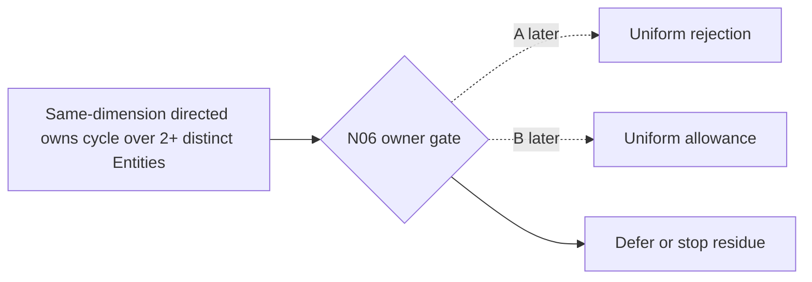
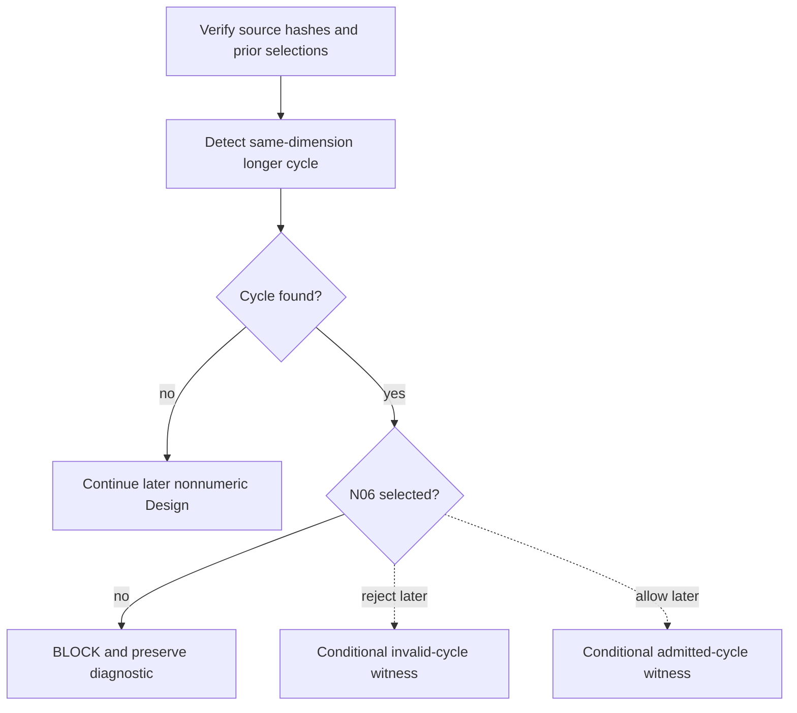

# Architecture Bundle: N06 Uniform Owns Longer-Cycle Behavior

## Design Intent

Preserve N04 self-edge rejection and N05 uniform policy governance, then isolate
whether every same-dimension canonical `owns` cycle over two or more distinct
Entities is rejected or allowed. No N06 option is selected.

## 1. Context View



The boundary excludes direct self-edges, mixed-dimension paths, transitivity, closure,
mandatory ownership, exception vocabularies, representation, runtime, and packet mutation.

## 2. High-Level Structure View

| Component | Responsibility | Input | Output | Owner boundary |
|---|---|---|---|---|
| ExactSourceBoundary | reject stale denominator bytes | 14 SHA-bound sources | current handles | Design evidence owner |
| PriorSelectionPreserver | retain N04 self-edge rejection and N05 uniform scope | exact owner receipts | closed adjacent rules | relationship decision owner |
| SameDimensionCycleDetector | identify directed closed paths over 2+ distinct Entities under one dimension | canonical owns facts plus D29 IDs | stable cycle diagnostic or no cycle | architecture owner |
| UniformCyclePolicy | conditionally reject or allow every detected cycle | owner-selected N06 action | determinate behavior | relationship decision owner |
| ResidueLedger | preserve excluded axes | unresolved frontier | later owner routes | lifecycle owner |

`UniformCyclePolicy` has no active action branch until N06 is selected.

## 3. Low-Level Components View

```text
LongerSameDimensionOwnsCycle(d, vertices, edges) iff
  edges form a directed closed path
  and path length >= 2
  and at least two distinct canonical Entity concept IDs participate
  and every edge is canonical owns under the same admitted D29 dimension d
  and no edge is a direct self-edge
```

Option A would make every such candidate invalid across every current and later
admitted dimension. Option B would allow, but not require, every such candidate under
the same uniform scope. D06 one-owner-per-target-per-dimension remains unchanged.

No conditional exception action is supported: the denominator admits no governed
root, role, class, feature, or dimension exception vocabulary.

## 4. Workflow Process View



Only the block path is active. Conditional branches are Design projections, not
implemented validation behavior.

## 5. Decision Flow View

Decision: `BMC-REL-NONNUMERIC-06-OWNS-UNIFORM-LONGER-CYCLE-BEHAVIOR`.

- **A:** reject every same-dimension directed `owns` cycle over two or more distinct
  Entities, uniformly across all current and later admitted D29 dimensions.
  Recommended because it preserves directional accountability and exposes circular
  responsibility as a diagnostic, but rejects domains that intentionally model
  mutual or cyclic ownership.
- **B:** allow such cycles uniformly without requiring them. Preserves mutual/cyclic
  domain models and D06 uniqueness, but permits circular responsibility structures.
- **C:** defer and keep Design blocked.
- **D:** stop this route.

Conditional exceptions, mixed-dimension paths, token-derived behavior, and self-edge
reopening are inadmissible. A/B remain authority choices behind
`relationship-decision-owner:owner-decision`. Selection: `null`.

## 6. Dependency Interface View

| Interface | Producer | Consumer | Contract | State |
|---|---|---|---|---|
| N04 owner selection | user | N06 | direct self-edges rejected | satisfied |
| N05 owner selection | user | N06 | one uniform future rule across D29 dimensions | satisfied |
| N06 denominator | Design author | extractor | 14 exact sources, no unknowns | pass; manifest input digest `2f43e05736c562dbe127fc21c5be9bf2712f4a63691ef8d16c6db3efaf6b47bc` |
| Denominator receipt | extractor | selector | complete, independent, bound | pass; receipt digest `d8b5d8aa4097f3a9186be548e6418fec904451b8c43a8e5337e2db5fdcd02949` |
| Selection result | selector | architecture | unchanged pass-one/pass-two digest | pass; both `ce027eb350f2a38b1bfe1459758f53aa51279e47b5f44953dc6c4f09688fae17` |
| N06 prefilter | canonical prefilter | user gate | only A/B/C/D presented | pass; request digest `10f7c3d48fb54447fb9c1f6abfcc4ec9e8836c4c1bf5b465f1ca3084798ca810` |
| N06 owner selection | user | later Design continuation | one exact presented option | blocked |
| Planned witnesses | Design | later Plan | design-planned only | unexecuted |

## Significant Scenario

Three distinct Entities form one lifecycle `owns` cycle. The detector emits a stable
cycle diagnostic, but Design stops because no reject/allow behavior is selected. The
same unresolved rule would govern custody, write-responsibility, and later D29 IDs.

## Concern Trace And Planned Evidence

The validation concern binds N04, N05, D06/D29, and the unresolved owns packet facet.
Planned witnesses cover a minimal cycle, an acyclic chain, N04 self-edge preservation,
and mixed-dimension residue. All remain `design-planned`.

## Output Boundary

All six views are authored to the owner gate. No cycle behavior, Plan handoff, packet
acceptance, canonical mutation, implementation, promotion, publication, or runtime-
readiness claim is admitted. `authority_effect: none`.
