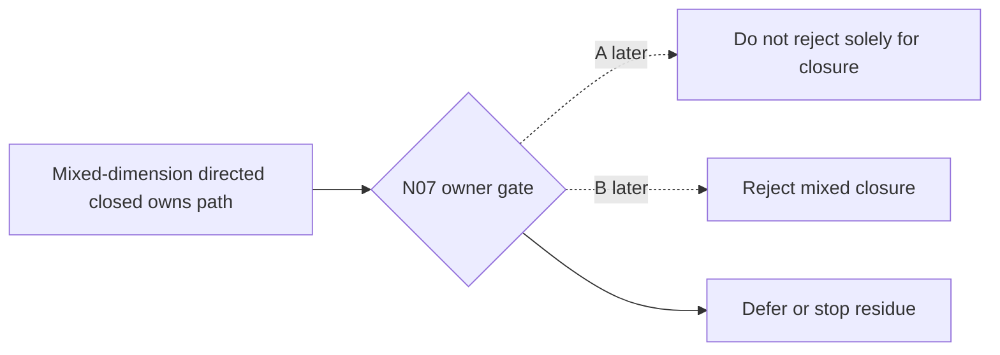
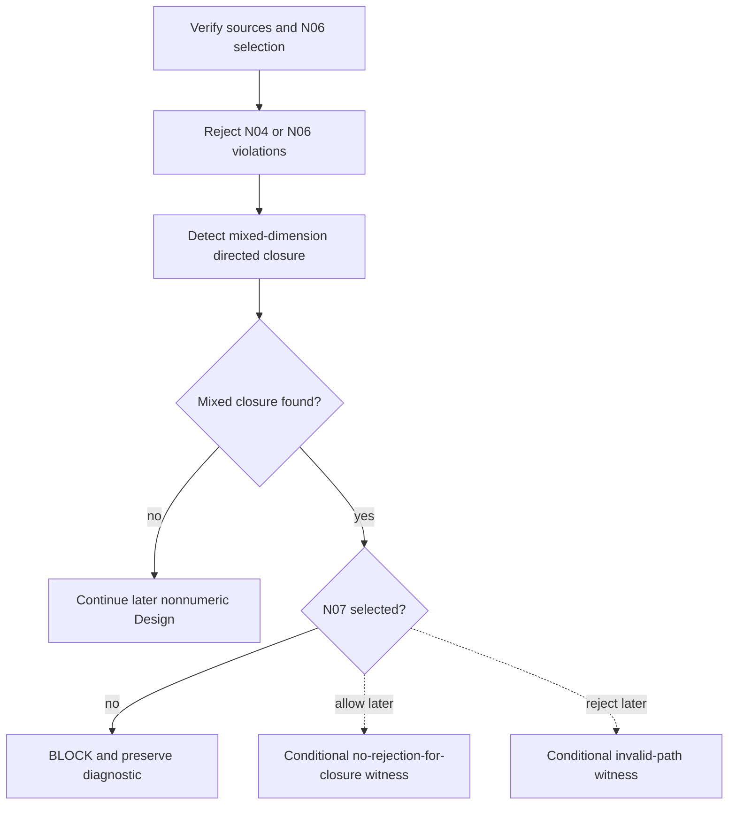

# Architecture Bundle: N07 Mixed-Dimension Owns Closed-Path Behavior

## Design Intent

Preserve N04 self-edge rejection and N06 uniform same-dimension-cycle rejection,
then isolate whether cross-axis closure alone invalidates a directed canonical
`owns` path using at least two admitted dimensions. No N07 option is selected.

## 1. Context View



The boundary excludes self-edges, same-dimension cycles, transitivity, closure-derived
edges, mandatory ownership, exceptions, representation, runtime, and packet mutation.

## 2. High-Level Structure View

| Component | Responsibility | Input | Output | Owner boundary |
|---|---|---|---|---|
| ExactSourceBoundary | reject stale denominator bytes | 14 SHA-bound sources | current handles | Design evidence owner |
| PriorSelectionPreserver | retain N04 and N06 rejection predicates | exact owner receipts | closed adjacent rules | relationship decision owner |
| MixedDimensionClosedPathDetector | detect directed closure using 2+ dimensions with no embedded selected violation | canonical owns facts plus D29 IDs | stable diagnostic or no match | architecture owner |
| MixedClosurePolicy | conditionally allow or reject solely for cross-axis closure | owner-selected N07 action | determinate behavior | relationship decision owner |
| ResidueLedger | preserve excluded axes | unresolved frontier | later owner routes | lifecycle owner |

`MixedClosurePolicy` has no active action branch until N07 is selected.

## 3. Low-Level Components View

```text
MixedDimensionOwnsClosedPath(vertices, edges) iff
  edges form a directed closed path
  and path length >= 2
  and at least two distinct canonical Entity concept IDs participate
  and at least two distinct admitted D29 dimensions label the edges
  and no edge is a direct self-edge
  and no same-dimension directed cycle is embedded in the candidate
```

Option A would prevent rejection solely because the combined cross-axis path closes;
each fact remains subject to all other policies. Option B would make every such
combined closure invalid. Neither option derives an edge or requires ownership.

No per-combination exception action is supported: the denominator admits no governed
dimension-sequence or dimension-pair composition vocabulary.

## 4. Workflow Process View



Only the block path is active. Conditional branches are Design projections, not
implemented validation behavior.

## 5. Decision Flow View

Decision: `BMC-REL-NONNUMERIC-07-OWNS-MIXED-DIMENSION-CLOSED-PATH-BEHAVIOR`.

- **A:** do not reject a mixed-dimension directed closed path merely because the
  combined cross-axis path closes. Recommended because D29 makes the dimensions
  pairwise non-overlapping; cost is that the aggregate graph may visually appear
  circular even though no one responsibility axis is circular.
- **B:** reject every mixed-dimension directed closed path. Produces a globally
  acyclic combined ownership graph, but couples distinct responsibility axes and
  can reject facts whose individual dimension projections are acyclic.
- **C:** defer and keep Design blocked.
- **D:** stop this route.

Per-combination exceptions, same-dimension reopening, token-derived behavior, and
transitive-edge inference are inadmissible. A/B remain authority choices behind
`relationship-decision-owner:owner-decision`. Selection: `null`.

## 6. Dependency Interface View

| Interface | Producer | Consumer | Contract | State |
|---|---|---|---|---|
| N06 owner selection | user | N07 | uniform rejection of same-dimension longer cycles | satisfied |
| D29 registry | Definitions Governance | N07 | exact pairwise non-overlapping dimensions | satisfied |
| N07 denominator | Design author | extractor | 14 exact sources, no unknowns | pass; manifest input digest `73eff0d7cbe7e3c4008caa5c1cb3137ede758c339efe098da801074d972c0af6` |
| Denominator receipt | extractor | selector | complete, independent, bound | pass; receipt digest `b709ba52a09066e1adb4b0b75f5cee8b89354a02beecaf46aad758f96c873d50` |
| Selection result | selector | architecture | unchanged pass-one/pass-two digest | pass; both `c15e931fcfc7e55f2934ec2bb73dc5e4fb6aacccefa67b37974e94fa82a564b6` |
| N07 prefilter | canonical prefilter | user gate | only A/B/C/D presented | pass; request digest `24653db6f1f91d167d9fffb74caadfa6dc4bb6e48a029b9e024745131dd2209a` |
| N07 owner selection | user | later Design continuation | one exact presented option | blocked |
| Planned witnesses | Design | later Plan | design-planned only | unexecuted |

## Significant Scenario

Two distinct Entities own different responsibilities for each other, forming a
two-edge closed path only when lifecycle and custody are combined. The detector emits
a stable mixed-dimension diagnostic, but Design stops because no behavior is selected.

## Concern Trace And Planned Evidence

The validation concern binds exact N06 A, D29 non-overlap, and the unresolved `owns`
facets. Planned witnesses cover minimal and longer mixed paths, same-dimension-cycle
preservation, and a non-closing cross-axis chain. All remain `design-planned`.

## Output Boundary

All six views are authored to the owner gate. No mixed-path behavior, Plan handoff,
packet acceptance, canonical mutation, implementation, promotion, publication, or
runtime-readiness claim is admitted. `authority_effect: none`.
