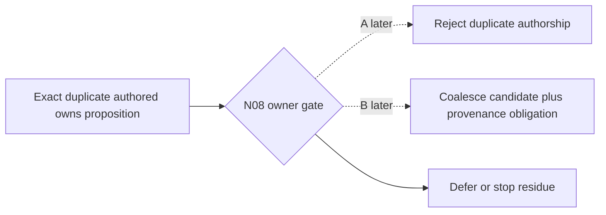
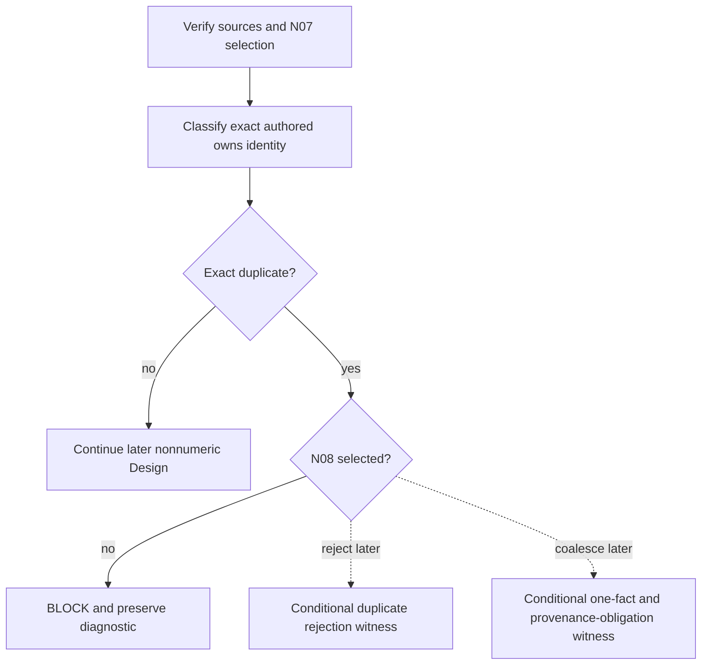

# Architecture Bundle: N08 Owns Duplicate Authorship

## Design Intent

Preserve N04 through N07 topology outcomes, then isolate behavior when the exact
same canonical `owns` proposition is authored more than once. No N08 option is
selected.

## 1. Context View



The boundary excludes facts in different dimensions, D06 competing owners,
topology, transitivity, inverse authorship, per-fact representation, runtime,
numeric policy, and packet mutation.

## 2. High-Level Structure View

| Component | Responsibility | Input | Output | Owner boundary |
|---|---|---|---|---|
| ExactSourceBoundary | reject stale denominator bytes | 14 SHA-bound sources | current handles | Design evidence owner |
| PriorSelectionPreserver | retain N04-N07 topology policies | exact owner receipts | closed adjacent rules | relationship decision owner |
| ExactOwnsFactClassifier | compare authored proposition identity | verb, owner, target, dimension, context | exact duplicate or distinct | architecture owner |
| DuplicateAuthorshipPolicy | conditionally reject or coalesce | owner-selected N08 action | determinate behavior | relationship decision owner |
| ProvenanceObligationLedger | retain B's conditional downstream cost | source handles | later Design obligation | later architecture owner |
| ResidueLedger | preserve excluded axes | unresolved frontier | later owner routes | lifecycle owner |

`DuplicateAuthorshipPolicy` has no active action branch until N08 is selected.

## 3. Low-Level Components View

```text
ExactDuplicateOwns(a, b) iff
  a.verb == b.verb == canonical owns
  and a.owner_entity_concept_id == b.owner_entity_concept_id
  and a.target_entity_concept_id == b.target_entity_concept_id
  and a.dimension_id == b.dimension_id
  and a.authority_or_feature_context == b.authority_or_feature_context
```

A different dimension produces a distinct fact. A different owner produces a
different proposition and can trigger the already-decided D06 uniqueness rule.
Generated `owned-by` projections and runtime repeats are outside authored canonical
fact identity.

Option A would reject the repeated authorship while preserving source handles for
repair. Option B would form one candidate fact; retention of every contributing
source handle is a conditional downstream design obligation, not current authority.

## 4. Workflow Process View



Only the block path is active. Conditional branches are Design projections, not
implemented validation behavior.

## 5. Decision Flow View

Decision: `BMC-REL-NONNUMERIC-08-OWNS-DUPLICATE-AUTHORSHIP`.

- **A:** reject the exact duplicate authored proposition and require source repair.
  Recommended because it matches the relation-local N01/N03 posture, keeps conflicting
  sources visible, and avoids silently introducing provenance representation.
- **B:** coalesce exact duplicates into one candidate fact, with provenance retention
  carried as a conditional downstream obligation. This tolerates repeat authorship
  but adds a later source-attribution design burden.
- **C:** defer and keep Design blocked.
- **D:** stop this route.

Global duplicate policy, cross-dimension merging, D06 conflict coalescing, and inverse
authorship are inadmissible. A/B remain authority choices behind
`relationship-decision-owner:owner-decision`. Selection: `null`.

## 6. Dependency Interface View

| Interface | Producer | Consumer | Contract | State |
|---|---|---|---|---|
| N07 owner selection | user | N08 | mixed-dimension closure alone is not rejected | satisfied; SHA `50f2058afcfeb315101a8328f370e99c1f91aa881479b71529b7bae512301580` |
| D29 registry | Definitions Governance | N08 | exact admitted dimension identity | satisfied |
| N08 denominator | Design author | extractor | 14 exact sources, no unknowns | pass; manifest input digest `3328e18ae307de4bd12ac8b571f82d3104c825c7f359406f81e489ac415d6284` |
| Denominator receipt | extractor | selector | complete, independent, bound | pass; receipt digest `24911277bdd08b28ede0140483d5724554f19e86d28ef40d746cba5fb5f7d7ed` |
| Selection result | selector | architecture | unchanged pass-one/pass-two digest | pass; both `33b503efa842fd1afd6b4e6dcec339237097ae638dbba08bd4d3333f8bd6a829` |
| N08 prefilter | canonical prefilter | user gate | only A/B/C/D presented | pass; request digest `df05eff24ba0dbaccd4066a2f31f4d190e4b0c6118e803f160142e9ef44e5c18` |
| N08 owner selection | user | later Design continuation | one exact presented option | blocked |
| Planned witnesses | Design | later Plan | design-planned only | unexecuted |

## Significant Scenario

Two feature fragments author the same lifecycle ownership proposition. The classifier
emits one exact-duplicate diagnostic while leaving a custody fact with the same
endpoints distinct and a different-owner lifecycle fact to D06. Design stops because
neither rejection nor coalescing has owner authority.

## Concern Trace And Planned Evidence

The validation concern binds exact N07 A, D29 fact identity, and the packet's explicit
unresolved duplicate facet. Planned witnesses cover a minimal exact duplicate, a
different-dimension non-duplicate, and a competing-owner D06 conflict. All remain
`design-planned`.

## Output Boundary

All six views are authored to the owner gate. No duplicate behavior, provenance
representation, Plan handoff, packet acceptance, canonical mutation, implementation,
promotion, publication, or runtime-readiness claim is admitted.
`authority_effect: none`.
