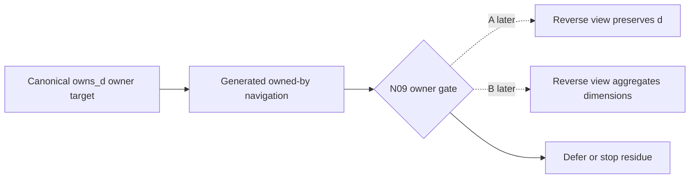
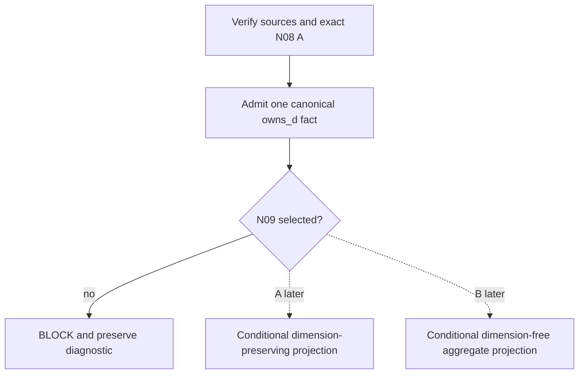

# Architecture Bundle: N09 Owns Inverse Dimension Preservation

## Design Intent

Preserve N04 through N08 exactly, retain `owns` as the sole authored authority and
`owned-by` as generated navigation, then isolate whether that generated reverse
view preserves each D29 dimension or aggregates dimensions. No N09 option is selected.

## 1. Context View



The boundary excludes authored `owned-by`, storage or materialization, new inverse
verbs, dropped canonical dimensions, topology reopening, transitivity, closure,
mandatory ownership, runtime/numeric policy, and canonical mutation.

## 2. High-Level Structure View

| Component | Responsibility | Input | Output | Owner boundary |
|---|---|---|---|---|
| ExactSourceBoundary | reject stale denominator bytes | 14 SHA-bound sources | current handles | Design evidence owner |
| PriorSelectionPreserver | retain N04-N08 outcomes | exact owner receipts | closed adjacent rules | relationship decision owner |
| CanonicalOwnsFact | retain dimension-bearing authored authority | owner, target, dimension, context | one admitted owns fact | definitions owner |
| GeneratedInverseProjector | conditionally preserve or aggregate dimension | canonical fact plus N09 choice | reverse navigation | relationship decision owner |
| ResidueLedger | preserve excluded axes | unresolved frontier | later owner routes | lifecycle owner |

`GeneratedInverseProjector` has no active A or B branch until N09 is selected.

## 3. Low-Level Components View

```text
canonical: owns_d(owner, target, authority_or_feature_context)

Option A projection:
  owned-by_d(target, owner, authority_or_feature_context)

Option B projection:
  owned-by(target, owner) if any admitted d has owns_d(owner, target, context)
```

Both actions keep `owned-by` generated and non-authoritative. A preserves exact
dimension identity in reverse navigation. B aggregates matching endpoint pairs and
therefore cannot answer which dimension produced the navigation without consulting
canonical `owns` facts. Neither action chooses storage, syntax, or computation timing.

## 4. Workflow Process View



Only the block path is active. Conditional branches are Design projections, not
implemented or canonically accepted behavior.

## 5. Decision Flow View

Decision: `BMC-REL-NONNUMERIC-09-OWNS-INVERSE-DIMENSION-PRESERVATION`.

- **A:** preserve the exact admitted D29 dimension in generated `owned-by`.
  Recommended because D29 fact identity and D06 uniqueness are dimension-specific,
  so reverse navigation retains the same distinction without consulting the source.
- **B:** expose dimension-free generated `owned-by` endpoint navigation. This keeps
  canonical facts intact but deliberately aggregates multiple dimensions and makes
  dimension-specific reverse questions consult canonical `owns`.
- **C:** defer and keep Design blocked.
- **D:** stop this route.

Authored `owned-by`, materialization selection, new inverse verbs, and removal of
canonical dimensions are inadmissible. A/B remain authority choices behind
`relationship-decision-owner:owner-decision`. Selection: `null`.

## 6. Dependency Interface View

| Interface | Producer | Consumer | Contract | State |
|---|---|---|---|---|
| N08 owner selection | user | N09 | exact duplicate authored owns is rejected | satisfied; SHA `6cbb90f152e0800832514084799657669ff100286b7f433b84be7d79ac2b0e78` |
| D29 ownership dimensions | Definitions Governance | N09 | admitted dimensions remain distinct | satisfied |
| Generated owned-by rule | DS-D8 / relationships registry | N09 | reverse navigation is generated, not authored | satisfied |
| N09 denominator | Design author | extractor | 14 exact sources, no unknowns | pass; manifest input digest `b67b39ac73862a4ac8486d4181182d306a65b59bad12f291a7ca9e712a9ee6ec` |
| Denominator receipt | extractor | selector | complete, independent, bound | pass; receipt digest `b889d96f62001c44f75c14e85c35cd6bebbd9d35338fb8761923b9fd147feda9` |
| Selection result | selector | architecture | unchanged pass-one/pass-two digest | pass; both `f86116d0c304dce941effb8d252ae12edb8e213c61738bba0fd017911b06aac2` |
| N09 prefilter | canonical prefilter | user gate | only A/B/C/D presented | pass; request digest `1e2a1d5f57e74d1c72e4140ac064aec9c792966c5bc2177594fb702eb4e08861` |
| N09 owner selection | user | later Design continuation | one exact presented option | blocked |
| Planned witnesses | Design | later Plan | design-planned only | unexecuted |

## Significant Scenario

One Entity owns another in both lifecycle and custody dimensions. A generated reverse
lookup may either return two distinguishable dimension-bearing navigation facts (A)
or one aggregated endpoint pair (B). Design stops because neither semantic view has
owner authority.

## Concern Trace And Planned Evidence

The validation concern binds exact N08 A, D29 dimension identity, generated-only
`owned-by`, and the packet's unresolved inverse semantics. Planned witnesses cover
one dimension, two dimensions over one endpoint pair, and multi-owner/multi-context
facts. All remain `design-planned`.

## Output Boundary

All six views are authored to the owner gate. No N09 action, inverse representation,
materialization, Plan handoff, packet acceptance, canonical mutation, implementation,
promotion, publication, or runtime-readiness claim is admitted.
`authority_effect: none`.
