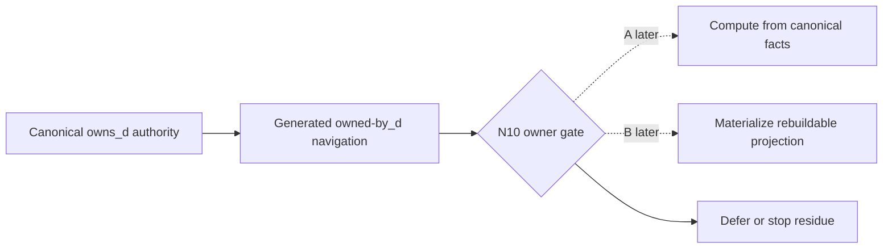
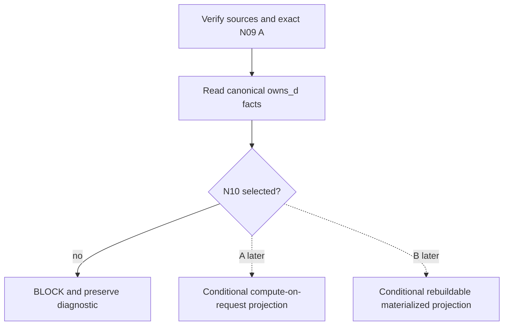

# Architecture Bundle: N10 Owned-By Materialization Policy

## Design Intent

Preserve N04 through N09 exactly, including dimension-preserving generated-only
`owned-by`, then isolate whether that projection is computed from canonical `owns`
when requested or may exist as rebuildable materialized derived state. No N10 option
is selected.

## 1. Context View



The boundary excludes authored or dual-written `owned-by`, storage technology,
schema, serialization, cache, synchronization timing, API, topology, partial-view,
runtime/numeric policy, and canonical mutation.

## 2. High-Level Structure View

| Component | Responsibility | Input | Output | Owner boundary |
|---|---|---|---|---|
| ExactSourceBoundary | reject stale denominator bytes | 14 SHA-bound sources | current handles | Design evidence owner |
| PriorSelectionPreserver | retain N04-N09 outcomes | exact owner receipts | closed adjacent rules | relationship decision owner |
| CanonicalOwnsAuthority | retain sole authored dimension-bearing facts | canonical owns set | authoritative graph | definitions owner |
| GeneratedInverseProjector | conditionally compute or materialize | canonical set plus N10 choice | reverse navigation | relationship decision owner |
| ProjectionProvenance | conditionally bind B state to canonical facts and rebuild | source handles | later obligation | later architecture owner |
| ResidueLedger | preserve excluded axes | unresolved frontier | later owner routes | lifecycle owner |

`GeneratedInverseProjector` has no active A or B branch until N10 is selected.

## 3. Low-Level Components View

```text
canonical authority:
  owns_d(owner, target, context)

N09-fixed navigation result:
  owned-by_d(target, owner, context)

Option A policy:
  reverse_result := project(current canonical owns set)

Option B policy:
  materialized_reverse := rebuild(current canonical owns set)
  every row retains source provenance
  stale or drifted state is invalid, never authority
```

Option B's provenance, deterministic regeneration, and drift handling are conditional
downstream obligations, not an authorized storage representation or implementation.

## 4. Workflow Process View



Only the block path is active. Conditional branches are Design projections, not
implemented storage or runtime behavior.

## 5. Decision Flow View

Decision: `BMC-REL-NONNUMERIC-10-OWNED-BY-MATERIALIZATION-POLICY`.

- **A:** compute dimension-preserving `owned-by` from current canonical `owns` facts
  when navigation is requested. Recommended because it preserves one authority and
  introduces no projection-drift state.
- **B:** permit a rebuildable materialized projection. This can support a durable read
  model but creates conditional provenance, deterministic regeneration, and drift
  repair obligations while remaining non-authoritative.
- **C:** defer and keep Design blocked.
- **D:** stop this route.

Authored/dual-written projection state, materialization without provenance, and
selection of a storage stack are inadmissible. A/B remain authority choices behind
`relationship-decision-owner:owner-decision`. Selection: `null`.

## 6. Dependency Interface View

| Interface | Producer | Consumer | Contract | State |
|---|---|---|---|---|
| N09 owner selection | user | N10 | generated owned-by preserves exact D29 dimension | satisfied; SHA `5328ba862a55df36a3927ffb972e0659a1eb114c9351091e12636c751a76eae1` |
| D22/D25 projection vocabulary | Definitions Governance | N10 | views and generated artifacts remain subordinate | satisfied |
| D27 single authority | Definitions Governance | N10 | generated equivalents retain canonical provenance | satisfied |
| N10 denominator | Design author | extractor | 14 exact sources, no unknowns | pass; manifest input digest `b5cbce041224169f4a29c5f6b2f36c9096e9e07a09635c06c702fce30cbb5b63` |
| Denominator receipt | extractor | selector | complete, independent, bound | pass; receipt digest `748b092a48766bca324f797f6c9cf7754ef7aa87d34c7eb7efb3bfa16e918728` |
| Selection result | selector | architecture | unchanged pass-one/pass-two digest | pass; both `d3750655ce2757f713b5a8dce44d81f64702e02aeb24038c629b01d327cfde33` |
| N10 prefilter | canonical prefilter | user gate | only A/B/C/D presented | pass; request digest `41fd4b0e04ed7cc0b8d1ca3bd0e8c0bef1b1daaafb09f1a7b667f4f2aadd2bc9` |
| N10 owner selection | user | later Design continuation | one exact presented option | blocked |
| Planned witnesses | Design | later Plan | design-planned only | unexecuted |

## Significant Scenario

A lifecycle owner changes. A computes the next reverse result directly from current
canonical facts. B requires any previously materialized reverse result to be rebuilt
or rejected as stale, while canonical `owns` remains authoritative. Design stops
because neither materialization policy has owner authority.

## Concern Trace And Planned Evidence

The validation concern binds exact N09 A, D22/D25 projection forms, D27 provenance,
and the packet's unresolved representation facet. Planned witnesses cover on-demand
projection, rebuild after source change, and rejection of independent projection
writes. All remain `design-planned`.

## Output Boundary

All six views are authored to the owner gate. No N10 action, store, schema,
serialization, API, Plan handoff, packet acceptance, canonical mutation,
implementation, promotion, publication, or runtime-readiness claim is admitted.
`authority_effect: none`.
