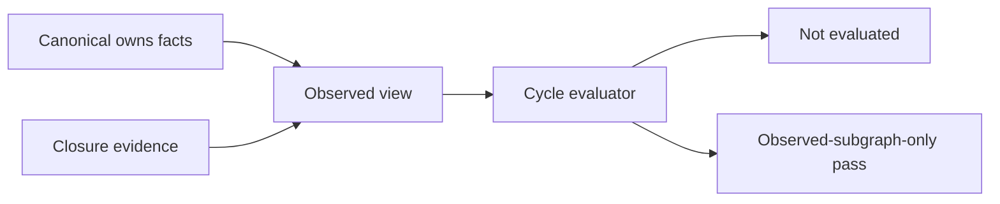
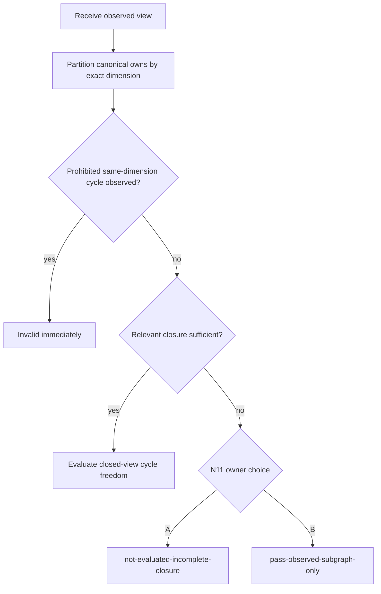

# N11 Six-View Architecture Bundle

Decision: `BMC-REL-NONNUMERIC-11-OWNS-CYCLE-PARTIAL-VIEW-VERDICT`
Selection: `null`
Authority: `authority_effect: none`

## 1. Context View

An evaluator sees a fragment of the canonical `owns` graph. It can reject a
prohibited cycle that is present in that fragment, but absence of a visible cycle
does not prove whole-boundary cycle-freedom when relevant closure evidence is absent.

The boundary excludes the exact closure proof shape, positive minima, transitivity,
mandatory ownership, representation, runtime/numeric policy, and canonical mutation.

## 2. High-Level Structure View

The input contract separates facts, dimension IDs, boundary identity, and closure
evidence. The verdict contract separates observed invalidity, no-evaluation, and a
strictly local observed subgraph pass. No action can emit a global acyclicity claim
without relevant closure evidence, and every observed prohibited cycle remains invalid.

## 3. Low-Level Components View

1. `CanonicalOwnsFactReader` reads only canonical dimension-bearing facts.
2. `ObservedSubgraph` preserves the admitted dimension for every visible fact.
3. `ClosureEvidenceReader` reports evidence without inferring it from tokens.
4. `SameDimensionCycleDetector` detects explicit N06-prohibited cycles.
5. `PartialViewVerdictPolicy` applies the future N11 owner selection.
6. `ClaimCeilingGuard` prevents a local or non-verdict from becoming global conformance.

These are design responsibilities, not authorized implementation components.

## 4. Workflow Process View

## 5. Decision Flow View

- A maximizes proof discipline by withholding a positive verdict.
- B supports local feedback but introduces a carefully scoped positive verdict.
- C keeps the unresolved facet visible and blocks dependent progress.
- D ends this route without selecting semantics.

Recommendation: A, because the same evidence state cannot prove that an omitted fact
would not complete a prohibited cycle, and it aligns with D02's established
incomplete-closure posture without pretending D02 already selected this facet.

## 6. Dependency Interface View

| Dependency | Input | Output | Boundary |
|---|---|---|---|
| D02 | explicit closure evidence model | precedent for incomplete evidence | does not itself select N11 |
| N06 | same-dimension longer-cycle rejection | prohibited topology predicate | does not select partial-view verdict |
| N07 | mixed-dimension closed paths allowed | excluded path class | not reopened |
| N10 | computed generated owned-by | prior selected inverse policy | no N11 selection inferred |
| N11 gate | A/B/defer/stop | one owner choice later | currently unselected |

Claim ceiling: this bundle proves only that N11 is the smallest evidence-backed
consequential blocker developed here. It does not accept or mutate the packet,
authorize implementation, or make the owner choice.
