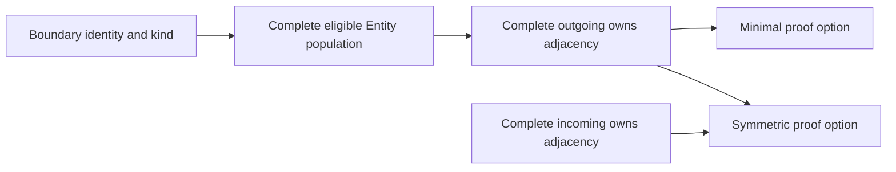
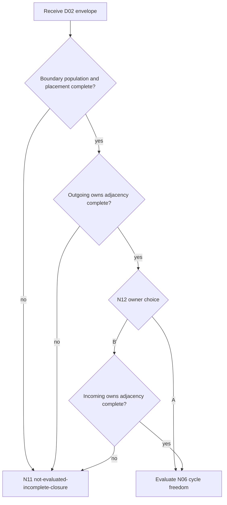

# N12 Six-View Architecture Bundle

Decision: `BMC-REL-NONNUMERIC-12-OWNS-CYCLE-CLOSURE-PROOF-SHAPE`
Selection: `null`
Authority: `authority_effect: none`

## 1. Context View

N11 says when to withhold a cycle-freedom verdict. N12 defines the evidence threshold
that would let the evaluator leave that state for the N06 same-dimension predicate.

Both actions include placement scope and exclude closure storage, inference from
compatibility tokens, per-dimension closure metadata, and project-only evaluation.

## 2. High-Level Structure View

The proof input separates boundary identity, population completeness, placement
scope, outgoing adjacency, and incoming adjacency. The topology evaluator consumes
only an owner-selected sufficient subset. N11 remains the fallback whenever a
required member of that subset is absent.

## 3. Low-Level Components View

1. `BoundaryEvidence` names boundary identity and kind.
2. `EntityPopulationEvidence` proves the eligible Entity population is complete.
3. `PlacementScopeEvidence` proves relevant cross-feature placement is covered.
4. `OutgoingOwnsClosure` proves canonical outgoing adjacency for every eligible Entity.
5. `IncomingOwnsClosure` supplies the additional symmetric proof axis for Option B.
6. `CycleProofGate` applies the future N12 selection before the N06 evaluator.

These are proof responsibilities, not authorized implementation components or fields.

## 4. Workflow Process View

## 5. Decision Flow View

- A uses the minimal directional proof proposed for a directed cycle predicate.
- B requires symmetric adjacency evidence, simplifying proof uniformity at greater evidence cost.
- C keeps “relevant closure” unresolved and dependent Design blocked.
- D ends this route without selecting a proof threshold.

Recommendation: A. Complete outgoing adjacency for every member of a complete
eligible Entity population covers every edge that could participate in a directed
cycle; incoming completeness would duplicate evidence for this predicate.

## 6. Dependency Interface View

| Dependency | Input | Output | Boundary |
|---|---|---|---|
| D02 | independent directional closure axes | permitted proof vocabulary | does not select N12 subset |
| N06 | prohibited same-dimension longer cycles | predicate to prove | topology unchanged |
| N07 | mixed-dimension closed paths allowed | excluded path class | not reopened |
| N11 | incomplete relevant closure verdict | fallback result | exact A preserved |
| N12 gate | A/B/defer/stop | one owner choice later | currently unselected |

Claim ceiling: this bundle defines only the next proof-shape gate. It does not
define closure representation, accept or mutate the packet, authorize implementation,
or make the owner choice.
