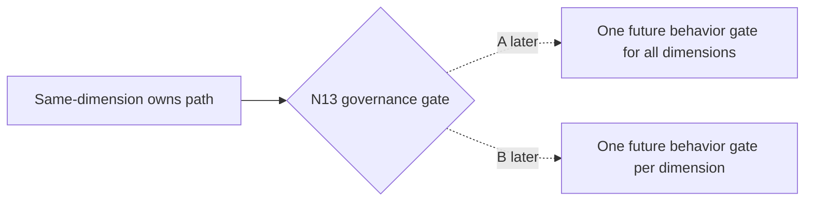
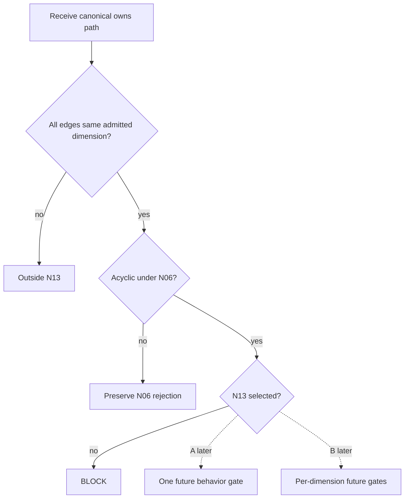

# N13 Six-View Architecture Bundle

Decision: `BMC-REL-NONNUMERIC-13-OWNS-PATH-CONSEQUENCE-GOVERNANCE`
Selection: `null`
Authority: `authority_effect: none`

## 1. Context View

N13 concerns an acyclic path of two or more canonical `owns` edges that all carry
one admitted D29 dimension. It asks how later path behavior is governed, not what
that behavior is.

## 2. High-Level Structure View

The path classifier preserves canonical direct facts, exact dimension identity, N06
acyclicity, and N07 mixed-dimension separation. A governance partition then selects
only the scope of future behavior authority. No transitive result exists yet.

## 3. Low-Level Components View

1. `DirectOwnsPath` recognizes path length at least two over distinct-position Entities.
2. `DimensionGuard` requires every edge to carry the same exact active D29 ID.
3. `PriorTopologyGuard` preserves N04 self-edge and N06 same-dimension cycle rejection.
4. `GovernancePartition` conditionally creates one later gate or dimension-local gates.
5. `ResidueLedger` retains behavior, mixed-dimension, provenance, and representation.

These are design responsibilities, not authorized fields or implementation components.

## 4. Workflow Process View

## 5. Decision Flow View

- A uses one future path-consequence rule for every current and later admitted D29 dimension. It is simpler and consistent, but couples independent semantic axes.
- B governs future behavior independently per admitted dimension. It preserves D29 separation, but adds owner gates and registry-evolution work.
- C defers and keeps dependent Design blocked.
- D stops without selecting a governance partition.

Recommendation: B. D29 makes the dimensions pairwise non-overlapping, and no exact
source generalizes N05 cycle uniformity to transitivity or path consequences.

## 6. Dependency Interface View

| Dependency | Input | Output | Boundary |
|---|---|---|---|
| N12 | exact A cycle-proof threshold | preserved closure evidence | no path behavior inferred |
| D29 | exact active dimension IDs | path dimension guard | no transitivity or coupling inferred |
| D23 | finite path-consequence vocabulary | identifies consequential axis | no general closure |
| N13 gate | A/B/defer/stop | one owner choice later | currently unselected |

Claim ceiling: this bundle defines only the next governance-shape gate. It does not
select path behavior, create derived or canonical edges, accept or mutate the packet,
authorize implementation, or make the owner choice.
