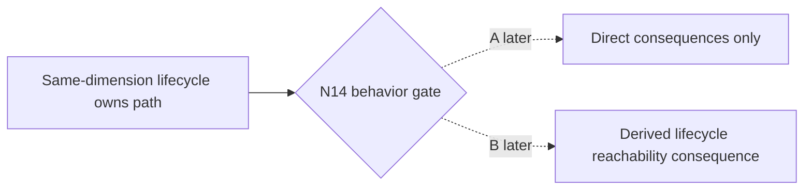
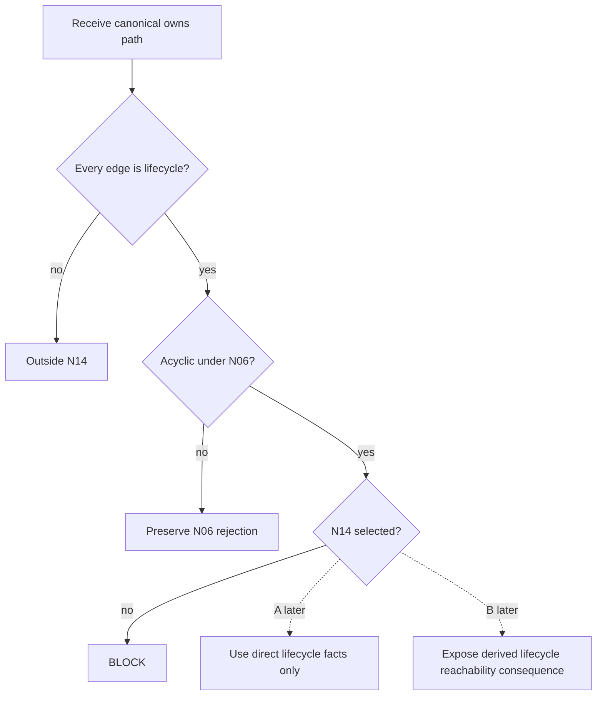

# N14 Six-View Architecture Bundle

Decision: `BMC-REL-NONNUMERIC-14-OWNS-LIFECYCLE-PATH-CONSEQUENCE-BEHAVIOR`
Selection: `null`
Authority: `authority_effect: none`

## 1. Context View

N14 concerns an acyclic path of two or more canonical `owns` facts that all carry
the exact admitted `lifecycle` dimension. It asks whether lifecycle responsibility
has only direct consequences or also a non-authoritative path-reachability
consequence.

## 2. High-Level Structure View

The classifier preserves the canonical direct facts, exact lifecycle dimension,
N04 self-edge rejection, N06 same-dimension cycle rejection, and N07 mixed-dimension
separation. The consequence policy then either stops at direct facts or exposes
derived reachability as a non-authoritative semantic result. Neither route creates a
canonical edge.

The `custody`, `write-responsibility`, and mixed-dimension paths remain outside this
lifecycle-only gate.

## 3. Low-Level Components View

1. `LifecyclePathClassifier` recognizes a path of length at least two with every
   edge carrying exact dimension `lifecycle`.
2. `PriorTopologyGuard` preserves N04, N06, N07, and N08 outcomes.
3. `DirectFactBoundary` keeps canonical authorship on the direct `owns` facts.
4. `LifecycleConsequencePolicy` conditionally returns direct-only consequence or
   non-authoritative derived reachability.
5. `ResidueLedger` retains other dimensions, evidence completeness, naming,
   provenance, representation, and runtime behavior.

These are Design responsibilities, not authorized schema fields or implementation
components.

## 4. Workflow Process View

## 5. Decision Flow View

- A keeps lifecycle responsibility consequences on explicitly authored direct facts.
  It preserves D29's direct semantics and minimizes new validation obligations, but
  does not expose an upstream-to-downstream lifecycle responsibility result.
- B derives a non-authoritative lifecycle responsibility reachability consequence
  over an acyclic same-dimension path. It gives D23's relationship-chain axis a
  lifecycle-specific effect, but creates a new semantic layer whose completeness,
  naming, provenance, and representation remain later decisions.
- C defers and keeps lifecycle path behavior unresolved.
- D stops without selecting lifecycle path behavior.

Recommendation: A. D29 repeatedly describes direct responsibility and explicitly
withholds transitivity and closure; A therefore preserves the strongest exact
current evidence. D23 keeps B admissible as a deliberate owner-selected path
consequence, but does not make it the default.

## 6. Dependency Interface View

| Dependency | Input | Output | Boundary |
|---|---|---|---|
| N13 B | per-dimension governance | lifecycle-local gate | no behavior inferred |
| lifecycle clarification | exact active dimension ID | first target fixed | no N14 option selected |
| D29 | direct lifecycle responsibility | direct semantic baseline | no inferred transitivity or closure |
| D23 | finite relationship-chain consequence vocabulary | makes B consequential and admissible | no category law or general closure |
| N04-N12 | topology, duplicates, inverse, and evidence boundaries | preserved constraints | no reopening |
| N14 gate | A/B/defer/stop | one owner choice later | currently unselected |

Claim ceiling: this bundle defines only the lifecycle-specific path-consequence
gate. It does not select an option, create canonical edges, decide derived-result
representation or evidence completeness, accept or mutate the packet, authorize
implementation, promote, publish, or make the owner choice.
