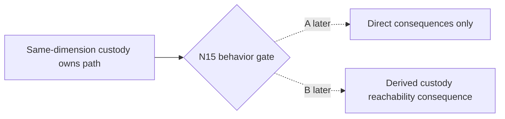
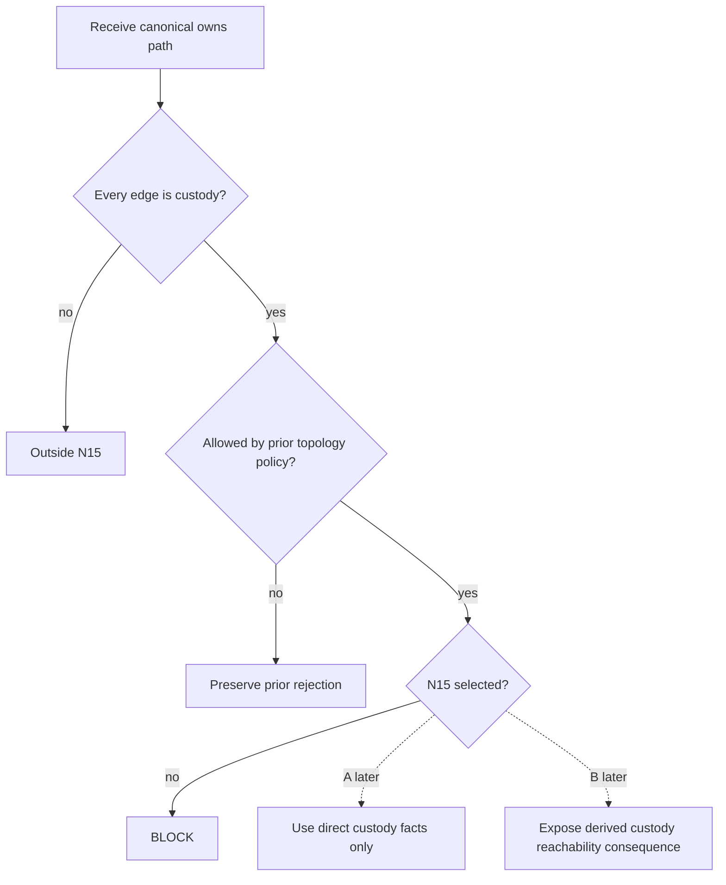

# N15 Six-View Architecture Bundle

Decision: `BMC-REL-NONNUMERIC-15-OWNS-CUSTODY-PATH-CONSEQUENCE-BEHAVIOR`
Selection: `null`
Authority: `authority_effect: none`

## 1. Context View

N15 concerns an acyclic path of two or more canonical `owns` facts that all carry
the exact admitted `custody` dimension. It asks whether custody responsibility has
only direct consequences or also a non-authoritative path-reachability consequence.

## 2. High-Level Structure View

The classifier preserves the canonical direct facts, exact custody dimension, all
N04-N13 constraints, and N14 direct-only lifecycle behavior. The consequence policy
then either stops at direct custody facts or exposes derived reachability as a
non-authoritative semantic result. Neither route creates a canonical edge.

Lifecycle, `write-responsibility`, and mixed-dimension paths remain outside this
custody-only gate.

## 3. Low-Level Components View

1. `CustodyPathClassifier` recognizes a path of length at least two with every edge
   carrying exact dimension `custody`.
2. `PriorDecisionGuard` preserves N04-N14 outcomes, including direct-only lifecycle.
3. `DirectFactBoundary` keeps canonical authorship on the direct `owns` facts.
4. `CustodyConsequencePolicy` conditionally returns direct-only consequence or
   non-authoritative derived reachability.
5. `ResidueLedger` retains write-responsibility, mixed paths, naming, provenance,
   representation, evidence completeness, and runtime behavior.

These are Design responsibilities, not authorized schema fields or implementation
components.

## 4. Workflow Process View

## 5. Decision Flow View

- A keeps custody responsibility consequences on explicitly authored direct facts.
  It preserves D29's direct semantics and minimizes new validation obligations, but
  exposes no upstream-to-downstream custody result.
- B derives a non-authoritative custody responsibility reachability consequence over
  an acyclic same-dimension path. It gives D23's relationship-chain axis a
  custody-specific effect, but creates a new semantic layer whose naming,
  provenance, completeness, and representation remain later decisions.
- C defers and keeps custody path behavior unresolved.
- D stops without selecting custody path behavior.

Recommendation: A. D29 describes direct custody responsibility and explicitly
withholds transitivity and closure; A therefore preserves the strongest exact
current evidence. D23 keeps B admissible as a deliberate owner-selected path
consequence, but does not make it the default.

## 6. Dependency Interface View

| Dependency | Input | Output | Boundary |
|---|---|---|---|
| N13 B | per-dimension governance | custody-local gate | no behavior inferred |
| N14 A | direct-only lifecycle consequence | preserved prior behavior | not copied into custody |
| custody clarification | exact active dimension ID | next target fixed | no N15 option selected |
| D29 | direct custody responsibility | direct semantic baseline | no inferred transitivity or closure |
| D23 | finite relationship-chain consequence vocabulary | makes B consequential and admissible | no category law or general closure |
| N15 gate | A/B/defer/stop | one owner choice later | currently unselected |

Claim ceiling: this bundle defines only the custody-specific path-consequence gate.
It does not select an option, reopen lifecycle, choose write-responsibility behavior,
create canonical edges, decide result naming/provenance/representation or evidence
completeness, accept or mutate the packet, authorize implementation, promote,
publish, or make the owner choice.
