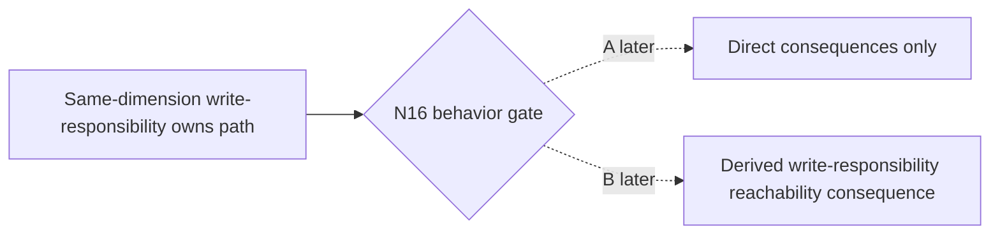
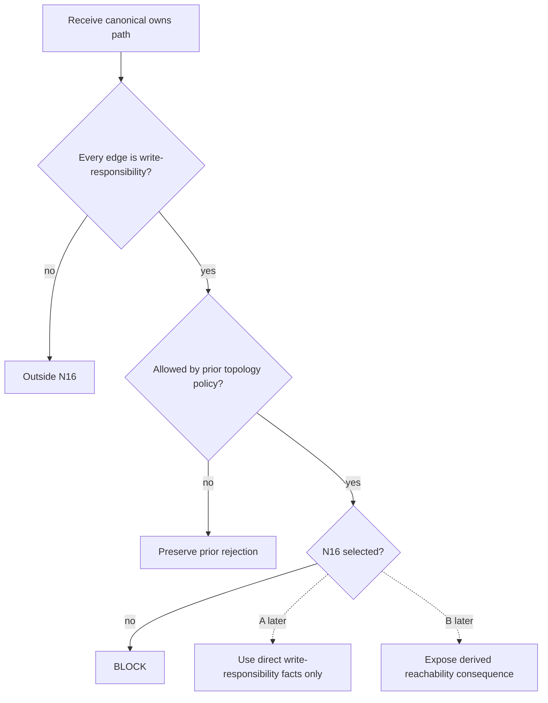

# N16 Six-View Architecture Bundle

Decision: `BMC-REL-NONNUMERIC-16-OWNS-WRITE-RESPONSIBILITY-PATH-CONSEQUENCE-BEHAVIOR`
Selection: `null`
Authority: `authority_effect: none`

## 1. Context View

N16 concerns an acyclic path of two or more canonical `owns` facts that all carry
the exact admitted `write-responsibility` dimension. It asks whether responsibility
for business-state change has only direct consequences or also a non-authoritative
path-reachability consequence.

## 2. High-Level Structure View

The classifier preserves the canonical direct facts, exact write-responsibility
dimension, all N04-N13 constraints, N14 direct-only lifecycle behavior, and N15
direct-only custody behavior. The consequence policy either stops at direct facts or
exposes derived reachability as a non-authoritative semantic result. Neither route
creates a canonical edge or turns a runtime writer into an owner.

Lifecycle, custody, mixed-dimension paths, Operations, permissions, calls, and
runtime writers remain outside this gate.

## 3. Low-Level Components View

1. `WriteResponsibilityPathClassifier` recognizes a path of length at least two with
   every edge carrying exact dimension `write-responsibility`.
2. `PriorDecisionGuard` preserves N04-N15 outcomes, including direct-only lifecycle
   and custody.
3. `DirectFactBoundary` keeps canonical authorship on the direct `owns` facts.
4. `RuntimeActorExclusion` prevents writers, Operations, permissions, or calls from
   becoming canonical ownership inputs merely because they perform or permit writes.
5. `WriteResponsibilityConsequencePolicy` conditionally returns direct-only
   consequence or non-authoritative derived reachability.
6. `ResidueLedger` retains mixed paths, naming, provenance, representation,
   evidence completeness, and runtime behavior.

These are Design responsibilities, not authorized schema fields or implementation
components.

## 4. Workflow Process View

## 5. Decision Flow View

- A keeps write-responsibility consequences on explicitly authored direct facts. It
  preserves D29's direct semantics and minimizes new validation obligations, but
  exposes no upstream-to-downstream responsibility result.
- B derives a non-authoritative write-responsibility reachability consequence over
  an acyclic same-dimension path. It gives D23's relationship-chain axis a
  dimension-specific effect, but creates a new semantic layer whose naming,
  provenance, completeness, and representation remain later decisions.
- C defers and keeps write-responsibility path behavior unresolved.
- D stops without selecting write-responsibility path behavior.

Recommendation: A. D29 describes direct write-responsibility and explicitly
withholds transitivity and closure; A therefore preserves the strongest exact
current evidence. D23 keeps B admissible as a deliberate owner-selected path
consequence, but does not make it the default.

## 6. Dependency Interface View

| Dependency | Input | Output | Boundary |
|---|---|---|---|
| N13 B | per-dimension governance | write-responsibility-local gate | no behavior inferred |
| N14 A | direct-only lifecycle consequence | preserved prior behavior | not copied |
| N15 A | direct-only custody consequence | sole current unselected dimension exposed | answer not copied |
| D29 registry | exact current active set | write-responsibility derived by set difference | serialization order gives no precedence |
| D29 definition | direct write-responsibility semantics and runtime-actor exclusion | direct semantic baseline | no inferred transitivity or closure |
| D23 | finite relationship-chain consequence vocabulary | makes B consequential and admissible | no category law or general closure |
| N16 gate | A/B/defer/stop | one owner choice later | currently unselected |

Claim ceiling: this bundle defines only the write-responsibility-specific
path-consequence gate. It does not select an option, reopen lifecycle or custody,
promote runtime actors into ownership, create canonical edges, decide result naming,
provenance, representation, or evidence completeness, accept or mutate the packet,
authorize implementation, promote, publish, or make the owner choice.
