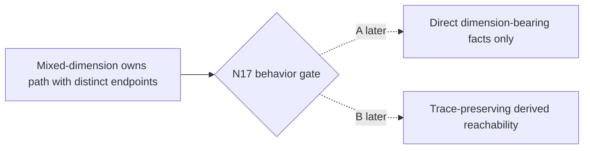
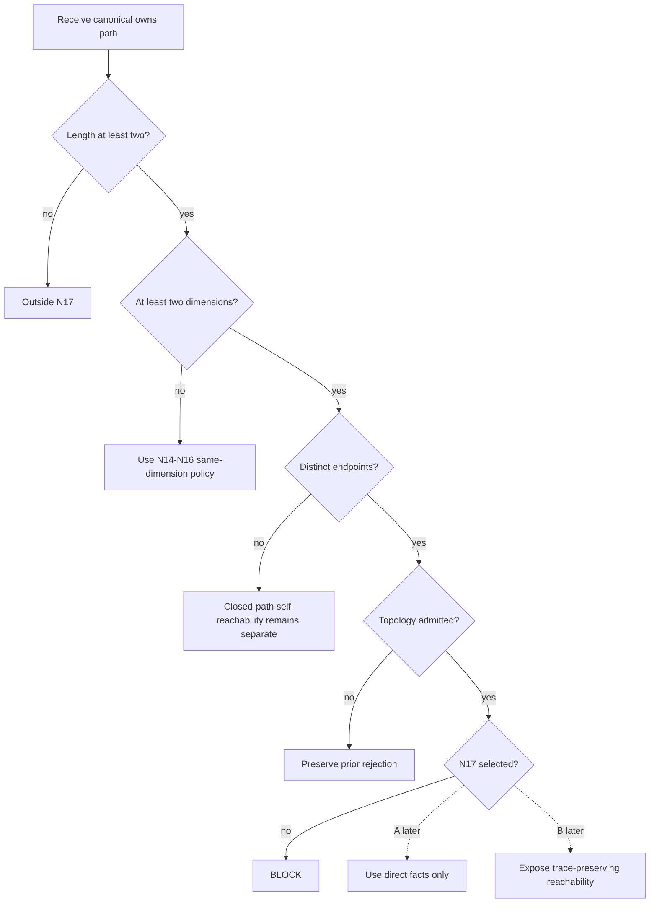

# N17 Six-View Architecture Bundle

Decision: `BMC-REL-NONNUMERIC-17-OWNS-MIXED-DIMENSION-PATH-CONSEQUENCE-BEHAVIOR`
Selection: `null`
Authority: `authority_effect: none`

## 1. Context View

N17 concerns a topology-admitted directed path of two or more canonical `owns`
facts using at least two exact admitted D29 dimensions, with distinct endpoints. It
asks whether the path has only direct per-edge consequences or also a
non-authoritative reachability result that preserves its dimension trace.

## 2. High-Level Structure View

The classifier preserves all canonical direct facts, their exact per-edge D29
dimensions, N07's mixed-topology allowance, and N14-N16 direct-only same-dimension
policies. A exposes no mixed-path consequence. B exposes a non-authoritative result
that retains the ordered sequence of dimensions used by the path; it does not claim
one dimension-free responsibility or create a canonical edge.

Closed paths whose endpoints coincide, same-dimension paths, dimension registry
evolution, and all representation/proof/runtime questions remain outside the gate.

## 3. Low-Level Components View

1. `MixedDimensionPathClassifier` recognizes a directed path of length at least two,
   at least two exact D29 dimensions, and distinct endpoints.
2. `TopologyGuard` preserves N04-N07 topology decisions without converting N07
   closure allowance into derived self-reachability.
3. `SameDimensionGuard` preserves direct-only N14-N16 behavior.
4. `DirectFactBoundary` keeps canonical authorship on exact dimension-bearing
   direct `owns` facts.
5. `DimensionTraceGuard` prevents a B result from collapsing distinct axes into a
   dimension-free responsibility claim.
6. `MixedPathConsequencePolicy` conditionally returns no derived result or a
   non-authoritative trace-preserving reachability result.
7. `ResidueLedger` retains closed-path self-reachability, naming, provenance,
   representation, completeness, and runtime behavior.

These are Design responsibilities, not authorized schema fields or implementation
components.

## 4. Workflow Process View

## 5. Decision Flow View

- A keeps mixed-dimension path consequences on explicitly authored direct facts. It
  preserves D29's direct semantics and adds no derived semantic layer, but provides
  no endpoint-to-endpoint mixed-path result.
- B derives non-authoritative reachability between distinct endpoints and retains
  the ordered per-edge dimension trace. It gives D23's relationship-chain axis a
  mixed-path effect without collapsing dimensions, but creates later naming,
  provenance, completeness, coalescence, and representation questions.
- C defers and keeps mixed-path consequence behavior unresolved.
- D stops without selecting mixed-path consequence behavior.

Recommendation: A. D29 defines direct, pairwise distinct responsibility axes and
withholds transitivity and closure. D23 keeps B admissible as a deliberate typed
path consequence, but neither D23 nor N07 makes it the default.

## 6. Dependency Interface View

| Dependency | Input | Output | Boundary |
|---|---|---|---|
| N07 A | mixed-dimension closure not rejected solely for closure | mixed topology can reach N17 classifier | no transitivity or derived self-reachability inferred |
| N13 B | independent same-dimension governance | same-dimension scope known | no mixed-path behavior inferred |
| N14-N16 A | all current same-dimension consequences direct-only | preserved prior behavior | answers not generalized |
| D29 | exact pairwise distinct dimension IDs and direct semantics | dimension trace must remain non-collapsed | no registry precedence or representation |
| D23 | finite relationship-chain consequence vocabulary | makes B consequential and admissible | no full category law or automatic transitivity |
| N17 gate | A/B/defer/stop | one owner choice later | currently unselected |

Claim ceiling: this bundle defines only the distinct-endpoint mixed-dimension
path-consequence gate. It does not select an option, derive self-reachability from a
closed mixed path, reopen same-dimension decisions, conflate dimensions, create
canonical edges, decide naming, provenance, representation, or completeness, accept
or mutate the packet, authorize implementation, promote, publish, or make the owner
choice.
