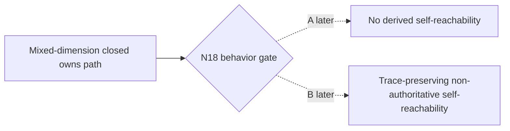
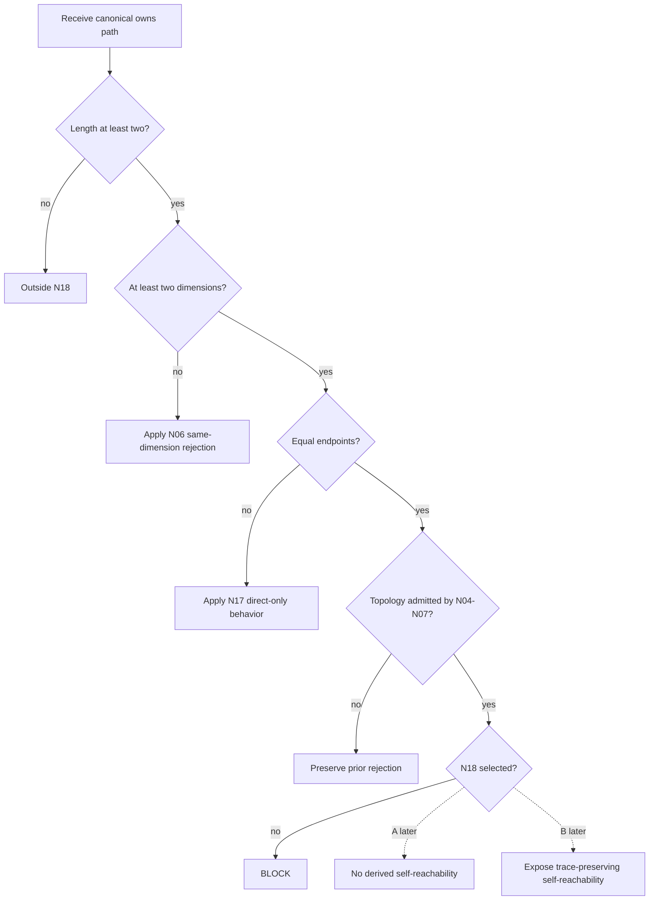

# N18 Six-View Architecture Bundle

Decision: `BMC-REL-NONNUMERIC-18-OWNS-MIXED-DIMENSION-CLOSED-PATH-SELF-REACHABILITY-BEHAVIOR`
Selection: `null`
Authority: `authority_effect: none`

## 1. Context View

N18 concerns a topology-admitted directed closed path of two or more canonical
`owns` facts using at least two exact admitted D29 dimensions. It asks whether the
path has no derived self-reachability consequence or a non-authoritative result that
preserves its ordered per-edge dimension trace.

## 2. High-Level Structure View

The classifier preserves every canonical direct fact, its exact D29 dimension,
N04's direct-self-edge rejection, N06's same-dimension cycle rejection, N07's
mixed-topology allowance, and N17's distinct-endpoint direct-only behavior. A adds
no closed-path semantic result. B exposes only a non-authoritative self-reachability
result retaining the ordered sequence of dimensions in the closed walk; it does not
claim a dimension-free responsibility or create `owns_d(e,e)`.

Trace coalescence, rotation equivalence, naming, provenance, materialization,
representation, completeness, and storage remain outside this behavior gate.

## 3. Low-Level Components View

1. `MixedClosedPathClassifier` recognizes a directed path of length at least two,
   at least two exact D29 dimensions, and equal endpoints.
2. `TopologyGuard` applies N04, N06, and N07 before N18 classification.
3. `DistinctEndpointGuard` routes unequal endpoints to the fixed N17 A behavior.
4. `DirectSelfEdgeGuard` prevents a B result from becoming a direct or canonical
   self-ownership fact.
5. `DimensionTraceGuard` preserves the ordered per-edge dimension trace and prevents
   dimension-free responsibility.
6. `ClosedPathSelfReachabilityPolicy` conditionally returns no derived result or a
   non-authoritative trace-preserving self-reachability result.
7. `ResidueLedger` retains naming, provenance, materialization, representation,
   completeness, storage, runtime, and numeric behavior.

These are Design responsibilities, not authorized schema fields or implementation
components.

## 4. Workflow Process View

## 5. Decision Flow View

- A derives no self-reachability from an admitted mixed-dimension closed path. It
  preserves D29's direct semantics and adds no semantic layer, but provides no
  explicit way to observe the closed walk as a self-reachability consequence.
- B derives a non-authoritative self-reachability result and retains the ordered
  per-edge dimension trace. It gives D23's finite-chain consequence a closed-path
  effect without reopening N04, but creates later questions about trace equality,
  naming, provenance, completeness, materialization, and representation.
- C defers and keeps mixed closed-path self-reachability unresolved.
- D stops without selecting a closed-path self-reachability policy.

Recommendation: A. D29 defines direct, pairwise distinct responsibility axes and
withholds transitivity and closure. D23 keeps B admissible as a deliberate path
consequence, but neither D23 nor N07 makes derived self-reachability the default.

## 6. Dependency Interface View

| Dependency | Input | Output | Boundary |
|---|---|---|---|
| N04 A | direct `owns_d(e,e)` rejected | direct self-edge guard | B cannot create canonical self-ownership |
| N06 A | same-dimension longer cycles rejected | only topology-admitted mixed paths proceed | no same-dimension reopening |
| N07 A | mixed-dimension closed topology allowed | a closed mixed path can reach N18 | no transitivity or derived semantics inferred |
| N17 A | distinct-endpoint mixed consequences direct-only | endpoint partition fixed | answer not carried into equal endpoints |
| D29 | exact pairwise dimensions and direct semantics | trace must remain non-collapsed | no dimension-free responsibility or representation |
| D23 | finite relationship-chain consequence vocabulary | keeps B consequential and admissible | no automatic closure or category law |
| N18 gate | A/B/defer/stop | one owner choice later | currently unselected |

Claim ceiling: this bundle defines only the mixed-dimension closed-path
self-reachability gate. It does not select an option, create direct or canonical
self-ownership, reopen N04/N06/N07/N17, conflate dimensions, decide trace equality,
naming, provenance, materialization, representation, completeness, or storage,
accept or mutate the packet, authorize implementation, promote, publish, or make the
owner choice.
