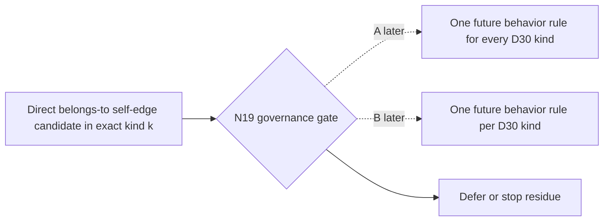
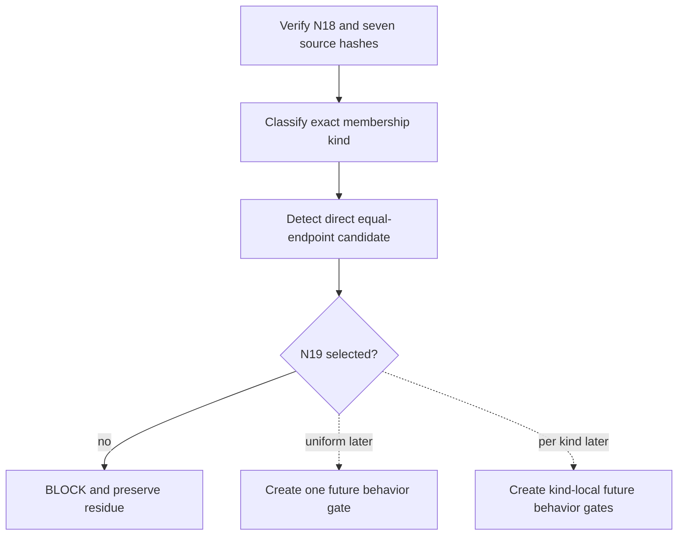

# Architecture Bundle: N19 Belongs-To Self-Edge Policy Governance

## Design Intent

Preserve N18 A and the completed nonnumeric `owns` pass, then move to the next fixed
relationship subject, D07 `belongs-to`. N19 decides only whether future direct
self-membership behavior is governed uniformly across every admitted D30 membership
kind or independently per kind. No reject/allow behavior or N19 option is selected.

## 1. Context View



The boundary is Design-time partitioning of future self-edge authority. It excludes
actual reject/allow behavior, paths over two or more Entities, transitivity, closure,
duplicates, existence, representation, runtime behavior, numeric policy, and packet mutation.

## 2. High-Level Structure View

| Component | Responsibility | Input | Output | Owner boundary |
|---|---|---|---|---|
| ExactSourceBoundary | reject stale denominator bytes | seven SHA-bound sources | current handles | Design evidence owner |
| N18BoundaryPreserver | close owns path semantics without carryover | exact N18 A receipt | next-relation boundary | relationship decision owner |
| MembershipKindClassifier | require one exact active D30 kind | canonical `belongs-to` candidate plus registry | kind-bearing self-edge candidate | definitions owner |
| GovernancePartition | conditionally select one shared policy surface or one per kind | future owner-selected N19 action | later behavior-gate partition | relationship decision owner |
| ResidueLedger | preserve behavior and excluded axes | unselected frontier | named later routes | lifecycle owner |

`GovernancePartition` has no active action branch until N19 is selected.

## 3. Low-Level Components View

N19 candidate identity:

```text
one canonical direct belongs-to fact
source Entity concept ID = target Entity concept ID = e
exact admitted D30 membership kind k
no inference from owns or compatibility token many_to_one
```

Option A would create one later behavior gate whose outcome applies identically to
every current and later admitted membership kind unless fresh authority changes it.
Option B would require later kind-local behavior decisions and registry-digest review.
Neither option rejects, allows, or requires any self-edge.

Not part of N19: two-node or longer cycles, transitivity, closure, duplicate authorship,
mandatory membership, kind representation/storage, inverse authorship, numeric or
runtime policy, other relationships, packet acceptance, or implementation.

## 4. Workflow Process View



Only the block path is active. Conditional branches are Design projections, not
self-edge policy or implementation.

## 5. Decision Flow View

Decision: `BMC-REL-NONNUMERIC-19-BELONGS-TO-SELF-EDGE-POLICY-GOVERNANCE`.

- **A:** use one future direct self-edge rule uniformly for every current and later
  admitted D30 membership kind. This is simpler and consistent, but couples meanings
  that D30 deliberately keeps non-overlapping.
- **B:** govern future direct self-edge behavior independently per admitted membership
  kind. Recommended because D30 separates meanings and no source proves policy
  coupling; it costs additional owner gates and registry-evolution review.
- **C:** defer and keep Design blocked.
- **D:** stop this route.

Direct reject/allow behavior, token-derived uniformity, longer cycles, and other
facets are inadmissible here. A/B remain authority choices behind
`relationship-decision-owner:owner-decision`. Selection: `null`.

## 6. Dependency Interface View

| Interface | Producer | Consumer | Contract | State |
|---|---|---|---|---|
| N18 owner selection | user | N19 Design | exact A; owns-only consequence | satisfied |
| D07 topology | relationship decision owner | N19 classifier | one direct parent per exact admitted kind; no self-edge inference | satisfied |
| D30 registry | definitions owner | N19 classifier | exact active non-overlapping kinds and digest | satisfied |
| N19 denominator | Design author | extractor | seven exact sources, no unknowns | pending deterministic generation |
| Selection result | selector | architecture | unchanged pass-one/pass-two digest | pending deterministic generation |
| N19 prefilter | canonical prefilter | user gate | only A/B/C/D presented | pending deterministic generation |
| N19 owner selection | user | later Design continuation | one exact presented option | blocked |
| Planned witnesses | Design | later Plan | design-planned only | unexecuted |

## Significant Scenario

One hypothetical Entity is both a classifier candidate under `classification` and a
home candidate under `home-assignment`, producing separate direct self-edge candidates.
Design can classify each kind but stops because it cannot infer whether one future rule
must govern both or whether each kind receives independent authority. It does not accept
or reject either fact.

## Concern Trace And Planned Evidence

The validation concern binds N18 closure, D07's per-kind uniqueness, D30 kind
non-overlap and explicit self-edge non-inference, the registry digest, the canonical
card, and the packet's unresolved self-relation facet. Planned witnesses cover a
single candidate, cross-kind separation, and behavior-overreach rejection. All remain
`design-planned`.

## Output Boundary

All six views are authored to the owner gate. No Plan handoff, self-edge behavior,
packet acceptance, canonical mutation, implementation, promotion, publication, or
runtime-readiness claim is admitted. `authority_effect: none`.
