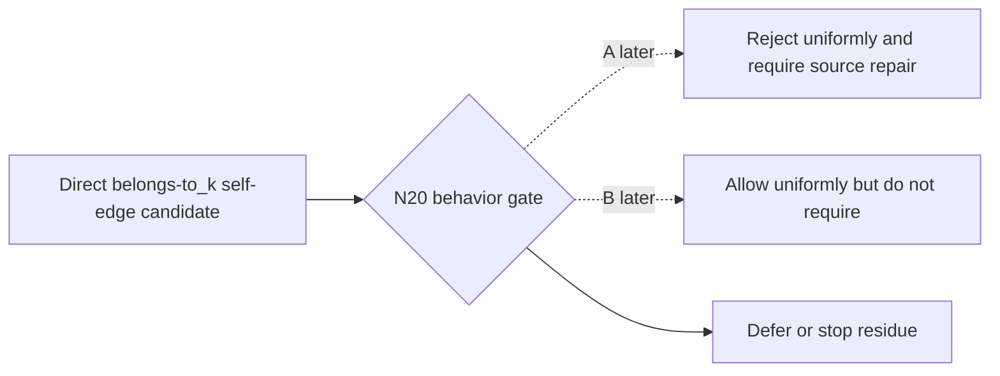
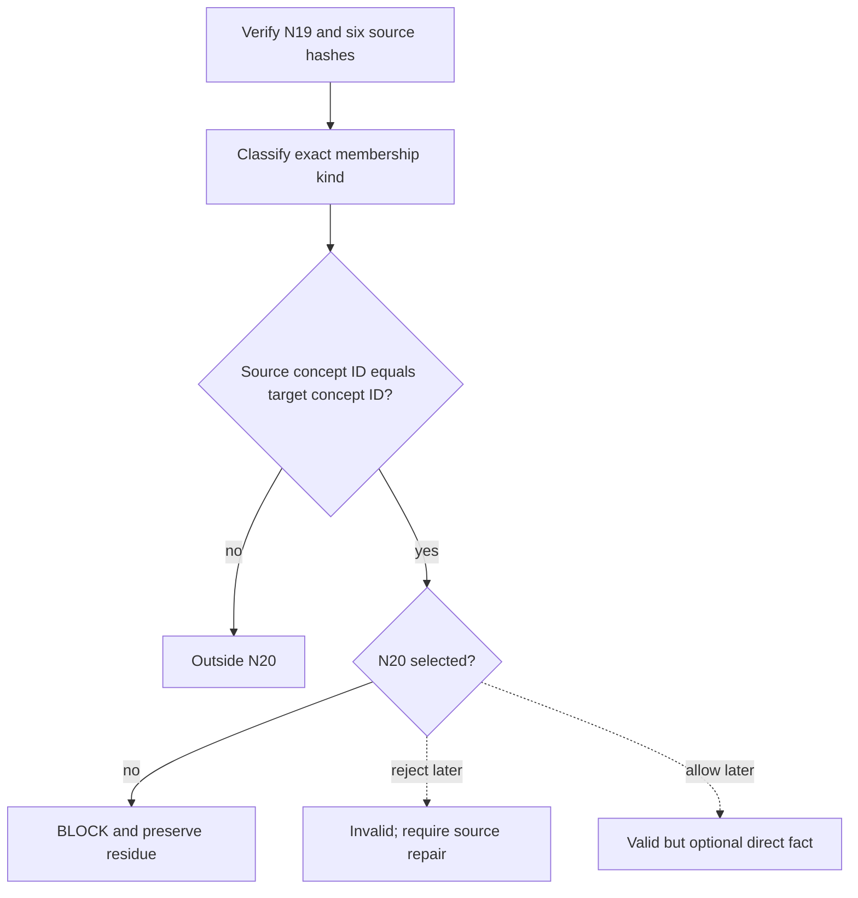

# Architecture Bundle: N20 Uniform Belongs-To Self-Edge Behavior

## Design Intent

Preserve N19 A as one uniform future behavior surface, then decide only whether every
direct canonical `belongs-to_k(e,e)` self-edge is rejected or allowed for all current
and later admitted D30 membership kinds. No behavior option is selected.

## 1. Context View



The boundary is one authored direct proposition with equal Entity concept IDs and one
exact admitted kind. It excludes longer paths, cycles over distinct Entities,
transitivity, closure, duplicates, existence, replacement parents, representation,
runtime behavior, numeric policy, feature-scope policy, and packet mutation.

## 2. High-Level Structure View

| Component | Responsibility | Input | Output | Owner boundary |
|---|---|---|---|---|
| ExactSourceBoundary | reject stale denominator bytes | six SHA-bound sources | current handles | Design evidence owner |
| N19BoundaryPreserver | preserve uniform governance without behavioral carryover | exact N19 A receipt | one N20 behavior surface | relationship decision owner |
| SelfEdgeClassifier | match one direct equal-endpoint fact in exact kind `k` | canonical `belongs-to` proposition plus registry | self-edge candidate | definitions owner |
| UniformBehavior | conditionally reject or allow the candidate across every admitted kind | future owner-selected N20 action | one uniform validity verdict | relationship decision owner |
| ResidueLedger | preserve every adjacent facet | unselected frontier | named later routes | lifecycle owner |

`UniformBehavior` has no active action branch until N20 is selected.

## 3. Low-Level Components View

N20 candidate identity:

```text
one canonical direct belongs-to fact
source Entity concept ID = target Entity concept ID = e
one exact admitted D30 membership kind k
uniform rule applies to every current and later admitted k
```

Option A rejects the proposition and requires the author to repair or remove it; it
does not require another parent. Option B permits the proposition but does not require
any Entity to author one. The canonical phrase “another entity” supports A as the
lower-surprise recommendation, while D30's explicit self-edge non-inference keeps B
structurally admissible and owner-gated.

Not part of N20: two-node or longer cycles, transitivity, closure, duplicate authorship,
mandatory membership, replacement-parent choice, kind representation/storage, inverse
authorship, cross-feature policy, numeric or runtime policy, other relationships,
packet acceptance, or implementation.

## 4. Workflow Process View



Only the block path is active. Conditional branches are Design projections, not
canonical policy or implementation.

## 5. Decision Flow View

Decision: `BMC-REL-NONNUMERIC-20-BELONGS-TO-UNIFORM-SELF-EDGE-BEHAVIOR`.

- **A:** reject every direct canonical `belongs-to_k(e,e)` self-edge for every current
  and later admitted D30 kind; require source repair without requiring a replacement
  parent. Recommended because the canonical semantics say “another entity” and
  rejection preserves the smallest direct-membership meaning.
- **B:** allow every such direct self-edge as valid but optional. This preserves a
  reflexive modeling possibility without changing D07 uniqueness, but weakens the
  ordinary other-Entity reading and requires downstream validators to accept it.
- **C:** defer and keep Design blocked.
- **D:** stop this route.

Kind-specific behavior, required self-edges, token-derived behavior, longer cycles,
and adjacent facets are inadmissible here. A/B remain authority choices behind
`relationship-decision-owner:owner-decision`. Selection: `null`.

## 6. Dependency Interface View

| Interface | Producer | Consumer | Contract | State |
|---|---|---|---|---|
| N19 owner selection | user | N20 Design | exact A; uniform governance only | satisfied |
| D07 topology | relationship decision owner | N20 classifier | one parent per exact kind; optional membership | satisfied |
| D30 registry | definitions owner | N20 classifier | exact active non-overlapping kinds and digest | satisfied |
| Canonical card | relationship authority | recommendation | Entity-to-Entity and “another entity” wording | satisfied but non-dispositive |
| N20 denominator | Design author | extractor | six exact sources, no unknowns | pending deterministic generation |
| Selection result | selector | architecture | unchanged pass-one/pass-two digest | pending deterministic generation |
| N20 prefilter | canonical prefilter | user gate | only A/B/C/D presented | pending deterministic generation |
| N20 owner selection | user | later Design continuation | one exact presented option | blocked |
| Planned witnesses | Design | later Plan | design-planned only | unexecuted |

## Significant Scenario

One hypothetical Entity has direct self-edge candidates under both current admitted
kinds. N19 says one behavior must govern both, but Design stops because only the owner
may decide whether both candidates are invalid or both are valid but optional. The
same rule would govern a later-added kind unless fresh authority changes it.

## Concern Trace And Planned Evidence

The validation concern binds N19 uniform governance, D07 optional per-kind uniqueness,
D30 explicit self-edge non-inference, the registry digest, the canonical card, and the
packet's unresolved self-relation facet. Planned witnesses cover uniform rejection,
uniform allowance, and adjacent-facet overreach. All remain `design-planned`.

## Output Boundary

All six views are authored to the owner gate. No Plan handoff, self-edge behavior,
packet acceptance, canonical mutation, implementation, promotion, publication, or
runtime-readiness claim is admitted. `authority_effect: none`.
