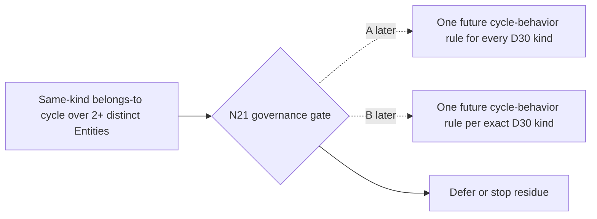

# Architecture Bundle: N21 Belongs-To Longer-Cycle Policy Governance

## Design Intent

Preserve N20 A, then decide only whether future same-kind `belongs-to` cycle
behavior over two or more distinct Entities is governed uniformly across all current
and later admitted D30 kinds or independently per kind. No reject/allow behavior and
no N21 option is selected.

## 1. Context View



The boundary excludes direct self-edges, actual cycle rejection or allowance,
mixed-kind paths, transitivity, derived closure, duplicates, partial-view evaluation,
existence, representation, runtime, numeric policy, and packet mutation.

## 2. High-Level Structure View

| Component | Responsibility | Input | Output | Owner boundary |
|---|---|---|---|---|
| ExactSourceBoundary | Reject stale evidence | Six SHA-bound sources | Closed denominator | Design author and independent extractor |
| N20SelectionBoundary | Preserve direct self-edge rejection only | Exact N20 A receipt | No longer-cycle consent | Relationship decision owner |
| CycleGovernanceClassifier | Distinguish uniform from per-kind governance | Same-kind cycle candidate | Governance route only | Architecture owner |
| DecisionGate | Present A/B/defer/stop | Caller-owned statuses | Unselected owner question | Relationship decision owner |
| ResidueLedger | Preserve adjacent unresolved facets | Explicit exclusions | Future bounded gates | Design owner |

## 3. Low-Level Components View

The cycle predicate considered by N21 is:

```text
canonical verb = belongs-to
path length >= 2
all path edges carry one exact admitted D30 kind k
the closed path contains >= 2 distinct Entity concept IDs
first endpoint = last endpoint
```

N21 changes only how the future reject-versus-allow decision is partitioned:

- A: one future behavior decision governs this predicate for every current and later
  admitted D30 kind unless fresh authority changes that governance.
- B: every exact kind needs its own future behavior decision and registry-digest
  review.

Neither action says whether any cycle is valid.

## 4. Workflow Process View

1. Reverify the N20 request, prefilter receipt, and exact A selection receipt.
2. Verify the six exact source digests and extract the closed denominator.
3. Run the Design selector twice and require an unchanged fixed point.
4. Classify A/B as reversible authority hazards and defer/stop as reversible states.
5. Canonically prefilter and present only the four admitted options.
6. Stop before behavior selection, Plan, implementation, or canonical mutation.

## 5. Decision Flow View

### Decision

For same-kind directed canonical `belongs-to` cycles over two or more distinct
Entities, should one future cycle behavior policy govern every current and later
admitted D30 membership kind, or should behavior be governed independently per kind?

| Option | Benefit | Cost / risk | Downstream impact |
|---|---|---|---|
| A — uniform governance | One stable rule surface; less drift across current and future kinds | A later behavior choice applies broadly and may require fresh authority to create an exception | One later reject/allow gate spans all admitted kinds |
| B — kind-specific governance | Preserves semantic independence of `classification`, `home-assignment`, and future kinds | More decisions, validator branches, and registry-digest review | One later behavior gate per exact kind |
| C — defer | Makes no unsupported semantic commitment | Blocks downstream cycle behavior | Keeps N21 unresolved |
| D — stop | Terminates this continuation cleanly | Leaves the frontier untouched | No further Design continuation |

Recommendation: **A**, because `belongs-to` is one canonical directed relationship and
one governance surface is the smallest rule set. N19/N20 uniformity is supporting
consistency evidence only, not consent; D30's non-overlapping meanings keep B fully
admissible and owner-gated.

Selected option: `null`. Decision effect: `none`.

## 6. Dependency Interface View

| Dependency | Exact contract | Consumed claim | Explicit non-effect |
|---|---|---|---|
| N20 owner receipt | Exact A and SHA | Direct self-edges are rejected uniformly | No longer-cycle governance or behavior |
| D07 record | One parent per exact admitted kind | Kind-partitioned direct uniqueness | No cycle rule |
| D30 definition and registry | Exact active IDs and non-overlap | Kind identity and withheld cycle policy | No topology consent |
| Canonical `belongs-to` card | Entity-to-Entity direction | One relationship identity | No endpoint-inequality or cycle rule |
| Candidate packet row | Ordinary facets remain unresolved | Cycle frontier is consequential | No packet acceptance or mutation |

## Evidence And Claim Ceiling

- Manifest input digest: `51fd764fce539856576670d5d338f094689f63b05a6d3715acf214340a587072`.
- Denominator receipt digest: `e499c81c88f22e84ae0fe7e2e0ba781ef644749a35d075362ecd39bf7429ceef`.
- Selection pass-one/pass-two digest:
  `c1b63a60864857ca33b1995417492f3b8a66c2fba34f3983143931ff8bd7f08f`.
- Prefilter requestDigest:
  `fb26d848eee88f9f1c28b0fd540a1e7dc795ba0faf53f0c9e6ef0b94e5b1fb05`.
- Design views: `6/6`.
- Planned witnesses remain unexecuted Plan evidence.
- Packet acceptance, canonical mutation, implementation, promotion, publication,
  release, deployment, and runtime readiness remain false.

Authority effect: `none`.
