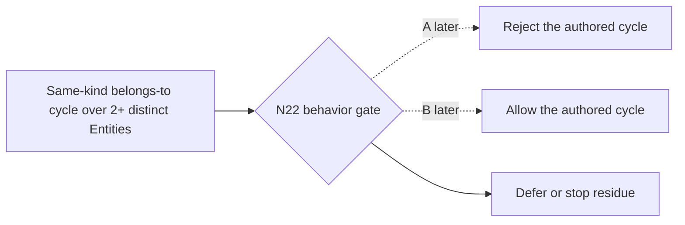

# Architecture Bundle: N22 Belongs-To Uniform Longer-Cycle Behavior

## Design Intent

Preserve N21 A, then decide only whether same-kind directed canonical `belongs-to`
cycles of length at least two over at least two distinct Entities are uniformly
rejected or allowed across all current and later admitted D30 kinds. No N22 option is
selected.

## 1. Context View



The boundary excludes direct self-edges, mixed-kind paths, transitivity, derived
reachability, closure/completeness evaluation, duplicates, exception vocabularies,
existence, representation, runtime, numeric policy, and packet mutation.

## 2. High-Level Structure View

| Component | Responsibility | Input | Output | Owner boundary |
|---|---|---|---|---|
| ExactSourceBoundary | Reject stale evidence | Six SHA-bound sources | Closed denominator | Design author and independent extractor |
| N21SelectionBoundary | Preserve uniform governance only | Exact N21 A receipt | No behavior consent | Relationship decision owner |
| SameKindCyclePredicate | Recognize exact candidate shape | Directed canonical facts carrying one kind | Cycle candidate only | Architecture owner |
| DecisionGate | Present A/B/defer/stop | Caller-owned statuses | Unselected owner question | Relationship decision owner |
| ResidueLedger | Preserve adjacent unresolved facets | Explicit exclusions | Future bounded gates | Design owner |

## 3. Low-Level Components View

The cycle predicate considered by N22 is:

```text
canonical verb = belongs-to
path length >= 2
all path edges carry one exact admitted D30 kind k
the closed path contains >= 2 distinct Entity concept IDs
first endpoint = last endpoint
```

- A rejects every authored fact set satisfying that predicate and requires source
  repair to break the cycle; it requires no replacement parent.
- B permits such authored cycles; it does not require a cycle or derive reachability.

Neither action changes N20 self-edge rejection or decides whether incomplete evidence
can establish cycle freedom.

## 4. Workflow Process View

1. Reverify the N21 request, prefilter receipt, and exact A selection receipt.
2. Verify six source digests and extract the closed denominator.
3. Run the Design selector twice and require an unchanged fixed point.
4. Classify A/B as reversible authority hazards and defer/stop as reversible states.
5. Canonically prefilter and present only the four admitted options.
6. Stop before selection, Plan, implementation, or canonical mutation.

## 5. Decision Flow View

### Decision

Under the N21 uniform policy, should every directed same-kind canonical `belongs-to`
cycle of length at least two over at least two distinct Entity concept IDs be rejected
or allowed for every current and later admitted D30 membership kind?

| Option | Benefit | Cost / risk | Downstream impact |
|---|---|---|---|
| A — reject uniformly | Keeps classification and home-assignment hierarchy-like and fail-closed | Forbids legitimate recursive membership models unless fresh authority changes policy | Future validation must detect and require repair of the cycle |
| B — allow uniformly | Preserves recursive or mutually referential models | Weakens hierarchy assumptions and may surprise traversal consumers | Future validation accepts the cycle but derives no reachability |
| C — defer | Makes no unsupported semantic commitment | Blocks downstream cycle behavior | Keeps N22 unresolved |
| D — stop | Terminates this continuation cleanly | Leaves the frontier untouched | No further Design continuation |

Recommendation: **A**, because direct classification/home semantics and “another
entity” language make acyclic hierarchy integrity the smallest fail-closed design.
D30 explicitly withholds cycle policy, so B remains fully admissible and owner-gated.

Selected option: `null`. Decision effect: `none`.

## 6. Dependency Interface View

| Dependency | Exact contract | Consumed claim | Explicit non-effect |
|---|---|---|---|
| N21 owner receipt | Exact A and SHA | One uniform governance surface | No reject or allow behavior |
| D07 record | One parent per exact admitted kind | Kind-partitioned direct uniqueness | No cycle rule |
| D30 definition and registry | Exact kinds and direct meanings | Kind identity and withheld cycle policy | No topology verdict |
| Canonical `belongs-to` card | Entity-to-Entity direction and another-entity prose | Recommendation evidence | No cycle prohibition authority |
| Candidate packet row | Ordinary facets remain unresolved | Behavior frontier is consequential | No packet acceptance or mutation |

## Evidence And Claim Ceiling

- Manifest input digest: `dd463f1e45b112d95389f757f0d4d16604e51f8a9cecac8325d33f94341d4b21`.
- Denominator receipt digest: `80b997d086c27fe9ca3af417f24af00ed40071192c33b251b2f2de3241cc422c`.
- Selection pass-one/pass-two digest:
  `c6d129ab0869d3182c88466617f74e81497e411856fea5b3b91297d1b13034c8`.
- Prefilter requestDigest:
  `5226daec977a02d093507aa1448e1e8b1fa0e3638233ab8b9c6812658dd80d21`.
- Design views: `6/6`. Planned witnesses remain unexecuted Plan evidence. Packet
acceptance, canonical mutation, implementation, promotion, publication, release,
deployment, and runtime readiness remain false.

Authority effect: `none`.
