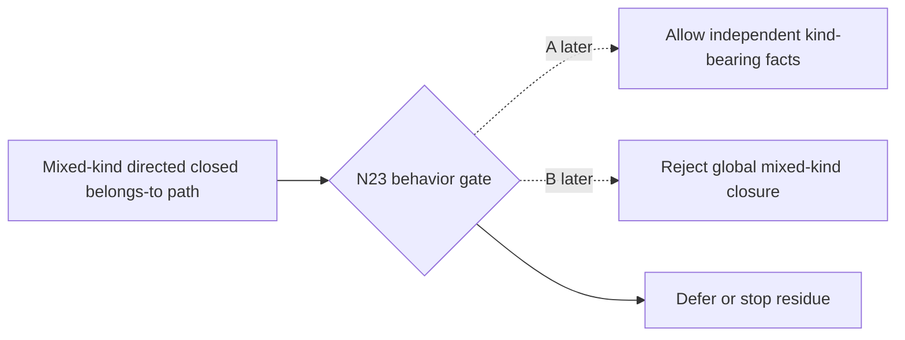

# Architecture Bundle: N23 Belongs-To Mixed-Kind Closed-Path Behavior

## Design Intent

Preserve N20 self-edge and N22 same-kind-cycle rejection, then isolate whether a
directed canonical `belongs-to` path is invalid solely because its combined path
closes while using at least two admitted D30 kinds. No N23 option is selected.

## 1. Context View



The boundary excludes direct self-edges, same-kind cycles, derived reachability,
kind collapse, closure/completeness evaluation, duplicates, exceptions, mandatory
membership, representation, runtime, numeric policy, and packet mutation.

## 2. High-Level Structure View

| Component | Responsibility | Input | Output | Owner boundary |
|---|---|---|---|---|
| ExactSourceBoundary | Reject stale evidence | Eight SHA-bound sources | Closed denominator | Design author and independent extractor |
| PriorSelectionBoundary | Preserve N20 and N22 predicates | Exact owner receipts | No mixed-kind consent | Relationship decision owner |
| MixedKindClosedPathDetector | Detect closure across 2+ exact kinds without prior violations | Direct kind-bearing facts | Stable candidate only | Architecture owner |
| DecisionGate | Present A/B/defer/stop | Caller-owned statuses | Unselected owner question | Relationship decision owner |
| ResidueLedger | Preserve downstream evaluation and adjacent facets | Explicit exclusions | Future bounded gates | Design owner |

## 3. Low-Level Components View

```text
MixedKindBelongsToClosedPath(vertices, edges) iff
  edges form a directed closed path
  and path length >= 2
  and at least two distinct Entity concept IDs participate
  and at least two distinct admitted D30 kinds label the edges
  and no edge is a direct self-edge
  and no same-kind directed cycle is embedded in the candidate
```

- A does not reject the direct facts solely because the combined mixed-kind path
  closes. Every fact retains its exact kind and remains subject to other policies.
- B rejects every candidate satisfying the combined predicate and requires source
  repair to break the path; it requires no replacement parent.

Neither action derives an endpoint relation or proves closure completeness.

## 4. Workflow Process View

1. Reverify N22 gate evidence and exact A owner receipt.
2. Verify eight source digests and extract the closed denominator.
3. Run the selector twice and require an unchanged fixed point.
4. Exclude N20 or N22 violations before mixed-kind classification.
5. Classify A/B as reversible authority hazards and defer/stop as reversible states.
6. Canonically prefilter and present only the four admitted options.
7. Stop before selection, partial-view Design, Plan, implementation, or mutation.

## 5. Decision Flow View

### Decision

For a directed canonical `belongs-to` closed path of length at least two containing
at least two distinct Entity IDs and using at least two admitted D30 kinds, should
the independent direct facts be allowed, or should the combined path be rejected as
one global `belongs-to` cycle?

| Option | Benefit | Cost / risk | Downstream impact |
|---|---|---|---|
| A — allow independent facts | Preserves D30 kind non-collapse and per-kind acyclicity | The combined untyped graph may appear circular | Later evaluation checks only already-prohibited predicates, not mixed closure |
| B — reject globally | Produces one globally acyclic combined graph | Couples distinct classification/home meanings and may reject individually valid facts | Future validation must detect and require repair of mixed closure |
| C — defer | Makes no unsupported commitment | Blocks downstream topology and evaluation | Keeps N23 unresolved |
| D — stop | Terminates cleanly | Leaves the frontier untouched | No further continuation |

Recommendation: **A**, because D30 makes current kinds pairwise non-overlapping and
permits different parents under distinct kinds. N07 is only structural analogy, not
authority; D30's withheld cycle policy keeps B fully admissible and owner-gated.

Selected option: `null`. Decision effect: `none`.

## 6. Dependency Interface View

| Dependency | Exact contract | Consumed claim | Explicit non-effect |
|---|---|---|---|
| N22 receipt | Exact A and SHA | Same-kind longer cycles rejected | No mixed-kind behavior |
| N20 receipt | Exact A and SHA | Direct self-edges rejected | No longer-path rule |
| N07 receipt | Owns-only mixed-axis analogy | Stable gate decomposition precedent | No belongs-to authority |
| D07/D30 | Per-kind uniqueness, non-overlap, different-parent permission | Kind identity and recommendation evidence | No mixed topology verdict |
| Canonical card and packet | Directed Entity-to-Entity facts; unresolved facets | Consequential frontier | No acceptance or mutation |

## Evidence And Claim Ceiling

Manifest SHA `1a0f916679aac4f656e6f2207b60963be06253a190ef4f2a0c518dd72426baae`,
denominator SHA `c5bdfc09bef6d07ea5d68b708934969f3c5b27f3153e2f516fec563c2f8ddef0`,
selection SHA `b86fd528b7b5c21d3f11381349c23bb8561fde61f09ee781824548cb433b8321`,
request SHA `96482b465cf0e8e696a89a71c8dc29600ad3fc3983f53e32a4020b9eba2d70cc`,
receipt SHA `f20edaa712a6dbb466aea7145c4fa2494210f2b71cd9aad2e0e8b3030db41cdb`,
and requestDigest `6bb6ba6efaccfe861c522e8d00d11473e462932cbfc7f63d5dabde0f0ca024b2`
bind the deterministic run.
Design views: `6/6`. Planned witnesses remain unexecuted. Packet acceptance,
canonical mutation, implementation, promotion, publication, release, deployment,
and runtime readiness remain false. Authority effect: `none`.
